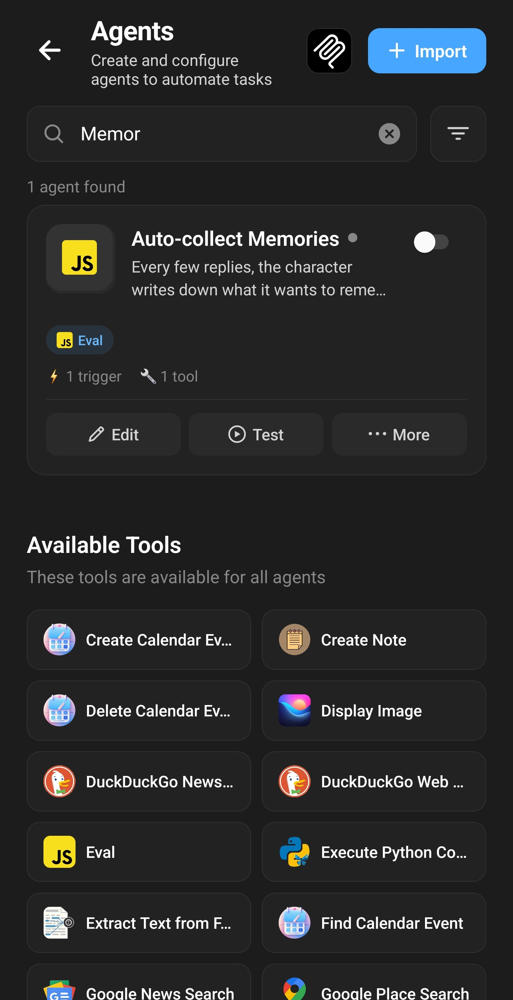
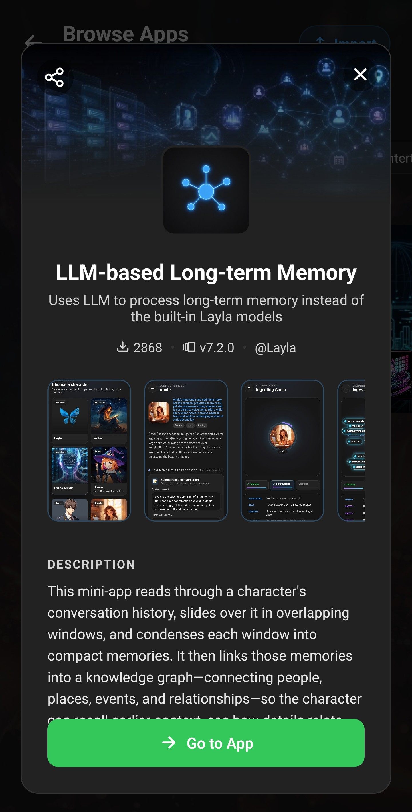

**Layla is an AI chatbot with long-term memory that runs on your phone, and it can turn your conversations into memories in three ways: a built-in summariser that runs after every reply, an Agent that asks your chat model to write memories every few replies, and a mini-app that processes your chat history with an LLM when you tell it to.** All three save into the same Long-Term Memory store, so your AI companion or roleplay character recalls the memories in the same way whichever method made them.

The methods trade speed for quality. This article explains why AI chatbots forget in the first place, how each method works, what it costs, and how to set it up, so you can choose one per character.

## Why AI chatbots forget, and what long-term memory changes

A language model does not remember anything between messages. Each time it replies, it reads the conversation again from its context window, which holds only a limited amount of text. Once a chat grows past that limit, the oldest messages no longer fit, and the AI forgets your name, the plans you made, or what happened earlier in a story.

Long-term memory works around that limit. Layla saves short memories of your conversations, searches them as you chat, and adds the relevant ones to the model's context before it replies. The character can then recall something from weeks ago without the whole chat history having to fit in the context window. Each character has its own memories, so an AI companion, a roleplay character, and an assistant each remember their own conversations with you.

Layla stores and searches these memories on your device. With a local LLM, your chats and memories stay on your own devices, so you get a private AI chatbot that remembers you without a company keeping your conversations on its servers.

## Three ways to give your AI long-term memory

|                            | Built-in auto-collect                | Auto-collect Memories Agent              | LLM-based Long-term Memory mini-app            |
| -------------------------- | ------------------------------------ | ---------------------------------------- | ---------------------------------------------- |
| **What writes the memory** | A small built-in summarisation model | Your chat model                          | Any inference engine you choose                |
| **When it runs**           | After every reply, automatically     | Every 3 replies, automatically           | Only when you tap **Start ingesting memories** |
| **Languages**              | English only                         | Any language your chat model handles     | Any language the chosen model handles          |
| **Quality**                | Basic summaries                      | Good: the character writes its own notes | Highest: you control the prompts               |
| **Speed**                  | Fast, no effect on the chat          | Adds a model call every 3 replies        | Slow, but runs outside your chats              |
| **Customisation**          | None                                 | Edit the prompt in the Agent's code      | System prompt and instruction per character    |

All three need the **Long Term Memory** mini-app, which stores the memories and downloads the models that search them. The mini-app is where you turn memory on or off for each character. [How to add features (mini-apps) in Layla](/how-to-add-features-mini-apps-in-layla/) shows where to find it.

## Method 1: Built-in auto-collect, fast and automatic

This is what Layla does by default once the Long Term Memory mini-app is installed, and it is the easiest way to get an AI that remembers conversations.

After each of the character's replies, Layla takes the last three messages of the chat and passes them to a small summarisation model built into the mini-app. The summary, the original messages, and a simple graph of the people and things mentioned are saved as one memory. This happens in the background on your device. It does not use your chat model, so it does not slow down the conversation or compete with it for memory.

The limits come from that small model:

- **It only understands English.** Chats in other languages produce poor or meaningless summaries. If you chat in another language, use one of the other two methods.
- **The summaries are short and literal.** The model condenses what was said; it does not decide what matters. Small talk is saved the same way as an important event.
- **There is nothing to configure** beyond turning it on or off for each character.

### How to turn it on or off

1. Open the **Long Term Memory** mini-app.
2. Select the character under **Characters**.
3. Under **Per character settings**, use **Auto-collect memories for this character**.

**Enable LTM for this character** is a separate switch. It controls whether the character uses Long-Term Memory at all, including recalling memories in chat. You can turn auto-collect off and keep LTM on, which is what the other two methods need.

## Method 2: The Auto-collect Memories Agent, memories in the character's own words

The **Auto-collect Memories** Agent asks your character to keep its own notes, the way an AI companion with memory should: it decides what is worth remembering about you. Every 3 of the character's replies, it pauses the roleplay and asks the chat model what the character would want to remember from those turns: facts about you, important events, promises or plans, and how the character feels. The model sees the whole conversation and the character's last few memories, so it can skip details it has already saved.

The Agent then:

- keeps at most 3 memories from each run,
- drops anything the model rated below 3 on a 1-to-5 importance scale,
- saves the rest to Long-Term Memory, written in the first person in the character's voice, and
- shows a **Saved to memory** card under the character's reply so you can see what was kept.

Because the model writes the memories, they are better than the built-in summaries. They follow the meaning of the conversation rather than its wording, they keep the character's voice, which matters in AI roleplay, and they work in any language your model handles. The cost is speed: every third reply is followed by an extra request to the model, and the memory card appears only when that request finishes. If you use a paid API through an [OpenAI-compatible connection](/how-to-connect-layla-to-any-openai-compatible-api/), that request also uses tokens.

### How to set it up

1. Install the **Agents** mini-app if you have not already. [How to enable Agents, Functions, and Tool-calling in Layla](/how-to-enable-agents-functions-and-tool-calling-in-layla/) explains how.
2. Open your character's settings and attach the **Auto-collect Memories** Agent in the agent selector on the **Advanced** tab. [How do I create custom characters?](/how-do-i-create-custom-characters/) shows where the selector is. An Agent attached to a character runs for that character even if it is switched off in the Agents mini-app.
3. In the **Long Term Memory** mini-app, turn off **Auto-collect memories for this character** for the same character. If both run, every conversation is collected twice.
4. Chat as usual. After 3 replies, the first **Saved to memory** card appears.

The default Layla characters do not use a list of attached Agents; they use every Agent that is switched on in the Agents mini-app. To use this method with them, switch the Auto-collect Memories Agent on in the Agents mini-app instead. Searching for "memor" in the Agents mini-app finds it quickly.

### Changing what the Agent remembers

Tap **Edit** on the Agent's card to open it. The dialog starts with its ID, name, and description, which repeats the setup advice above.

The prompt is the first thing in the code of the Agent's Eval tool, further down the dialog. You can rewrite it, for example to focus on facts and ignore feelings, as long as you keep the JSON format it asks for at the end. Below the prompt are settings for how often it runs (`COLLECT_EVERY_N_REPLIES`), how many memories it keeps from each run (`MAX_MEMORIES`), and the lowest importance it keeps (`MIN_IMPORTANCE`).

If saving a memory fails, for example because the Long Term Memory mini-app is not installed, the Agent stops trying for 24 hours. Each run writes a log to `auto-collect-memories/last-run.log` in the character's workspace, which is the first place to look if no cards appear.

## Method 3: The LLM-based Long-term Memory mini-app, the highest-quality memory

The **LLM-based Long-term Memory** mini-app processes your chat history in a separate step, when you choose to run it. It uses an LLM of your choice, local or online, to write each memory and build a knowledge graph of the people, places, and events in your chats. It gives the highest quality and the most control, at the cost of being slow and manual.

It is published on Layla Cloud Apps, the gallery of mini-apps built with the Layla SDK. To install it, open the [LLM-based Long-term Memory page on Layla Cloud Apps](https://apps.layla-cloud.com/app/llm-based-long-term-memory) on your phone and tap **Open in Layla**. You also need the Long Term Memory mini-app, because this one saves its results there.

When you start an ingest, the mini-app:

1. **Reads** the character's chats, starting after the newest memory the character already has, so it only processes new messages.
2. **Summarises** the messages in overlapping windows of three, sending each window to the model with your summary prompt.
3. **Graphs** each summary, asking the model to extract the people, places, events, traits, and objects in it and how they relate.
4. **Saves** each result as a memory with the original messages, the summary, and the graph.

### Writing your own prompts

Each character has its own settings, saved between runs:

- **Inference engine.** Choose any of your [saved inference engines](/how-saved-inference-engines-work-in-layla/), or the default engine. Because the ingest runs outside your chats, you can pick a larger or slower local LLM than the one you chat with, or an online model if you prefer.
- **Summarising conversations.** A **System prompt** and a **Custom instruction** that decide what a memory should contain. The default asks the model to keep durable facts, feelings, relationships, and turning points and to ignore small talk. You can change it to focus on anything: a story's plot and characters for a roleplay, or your projects and deadlines for an assistant.
- **Constructing the knowledge graph.** A second system prompt and instruction for extracting the graph. Keep the JSON format the default instruction asks for.

Both system prompts accept the templates `{{char}}`, `{{user}}`, `{{persona}}`, `{{description}}`, `{{personality}}`, and `{{character_card}}`, which are filled in from the character and its persona before each request.

### Running an ingest

Tap **Start ingesting memories**. The screen shows each stage as it runs, and you can cancel with the **X** button.

Every window of messages takes two requests to the model, so a long chat history can take a long time on a phone. Keep Layla in the foreground while it runs. Run it again whenever you want to process new conversations; there is no schedule.

### Turn off the automatic methods for the character

The mini-app starts reading after the character's newest memory. If built-in auto-collect or the Agent is also running for that character, the newest memory is always recent, so the mini-app finds little or nothing new to process. Turn both off for any character you ingest this way.

## Which method should you use?

- **Built-in auto-collect** if you chat in English and want memory to work without any setup or effect on speed. It suits an everyday assistant that only needs to recall the gist of past chats.
- **The Auto-collect Memories Agent** if you chat in another language, or want memories that capture what mattered rather than what was said, and can accept a slightly slower reply every third turn. It suits an AI companion or friend that should remember you, your plans, and how it feels about you.
- **The LLM-based Long-term Memory mini-app** if you want the best memories and full control over what they focus on, and do not mind running it yourself, for example once a day. It suits long AI roleplay campaigns, where a custom prompt can track the plot, the characters, and the world.

You can choose a different method for each character. Use only one method per character at a time.

## Frequently asked questions

### Why does my AI chatbot forget things?

Every model has a limited context window. When a conversation is longer than that window, the oldest messages are left out and the model can no longer see them. Long-term memory saves the important parts of those messages and brings them back when they are relevant.

### Is there an AI chatbot that remembers past conversations?

Yes. Layla remembers past conversations with each character through its Long-Term Memory mini-app, and it does this on your phone rather than on a server. The methods in this article control how those memories are written.

### Does Layla remember everything I say?

No. It saves memories of your conversations, then recalls only the ones that match what you are talking about now. The **Max Number of Memory Injections** and **Minimum Memory Score** settings in the Long Term Memory mini-app control how many memories are recalled and how closely they must match.

### Do memories from different methods work together?

Yes. All three save into the same Long-Term Memory store, and recall in chat works the same way for all of them. You can switch a character from one method to another without losing what it already remembers.

### Why are my character's memories in English when I chat in another language?

The built-in summariser only understands English. Use the Auto-collect Memories Agent or the LLM-based Long-term Memory mini-app, which use a language model that can write memories in the language of your chat.

### Does long-term memory work offline?

Yes, with a local model. All three methods run on your device, so you can have an offline AI chatbot with memory and no internet connection.

### Does any of this send my chats to the internet?

Not unless you choose an online model. If your chat model or ingest engine is an online API, the Agent and the mini-app send your messages to that service, as your chats already do.

### Can I edit or delete a memory?

Yes. Open the **Long Term Memory** mini-app, select the character, and open a memory to edit its summary and relationships or to delete it.

Whichever method you choose, the memories stay on your phone, and your characters can recall them in later chats without a cloud service or subscription. That is what long-term memory means in Layla: an offline AI that remembers you, on hardware you own.
