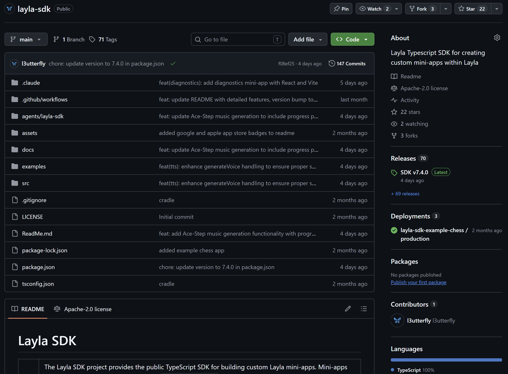

**Das Layla SDK ist eine TypeScript- und JavaScript-Bibliothek zum Erstellen von Mini-Apps, die die KI-Funktionen innerhalb von Layla nutzen.** Eine Mini-App kann Chats vom aktiven Modell streamen, mit Charakteren und Erinnerungen arbeiten, Bilder oder Musik erzeugen, Sprache verwenden und private App-Daten speichern — ohne API-Schlüssel und ohne eigenen KI-Server.

Dieser Leitfaden zeigt, wo Sie das SDK erhalten, wie Sie seinen Agent-Skill einem Coding-Agenten übergeben und wie Sie eine kleine HTML-Mini-App bauen, die eine Antwort aus Layla streamt.

## Vorhandene Mini-Apps ansehen

Wenn Sie vor dem eigenen Projekt sehen möchten, was andere gebaut haben, stöbern Sie in den [Layla Cloud Apps](https://apps.layla-cloud.com/). Bestehende Mini-Apps durchzusehen hilft zu verstehen, welche Oberflächen und Abläufe in Layla gut funktionieren — wählen Sie dann eine kleine Idee für Ihr erstes Projekt.

## Wie das Layla SDK funktioniert

Eine Layla-Mini-App ist eine Web-App, die in Laylas React-Native-WebView läuft. Wenn Ihr Code eine SDK-Methode aufruft, sendet das SDK eine Nachricht über die WebView-Brücke. Der Layla-Host führt die Arbeit auf dem Gerät aus und sendet das Ergebnis zurück.

```text
Mini-app -> Layla SDK -> WebView bridge -> Layla host -> on-device model
```

Das SDK ist daher kein gewöhnlicher Cloud-API-Client:

- Es gibt keinen API-Schlüssel, keine Basis-URL und keinen HTTP-Endpunkt zu konfigurieren.
- Der Layla-Host wählt das aktive Modell und die Inferenz-Engine.
- Echte SDK-Aufrufe funktionieren innerhalb von Layla, wo die Host-Brücke verfügbar ist.
- Bei der gewöhnlichen Browser-Entwicklung installieren Sie stattdessen den Mock-Host des SDK.

Die Generierung mit einem lokalen Modell kann auf einem Telefon dauern. Nutzen Sie für interaktive Funktionen Streaming, zeigen Sie einen deutlichen Arbeitszustand und geben Sie Nutzenden eine Möglichkeit, die Generierung abzubrechen.

Wenn Sie vor dem Programmieren mehr Hintergrund möchten, lesen Sie [Was sind Layla-Mini-Apps?](/post-what-are-layla-mini-apps-codekitty/).

## Woher Sie das SDK bekommen

Das SDK wird als [`@layla-network/sdk` auf npm](https://www.npmjs.com/package/@layla-network/sdk) veröffentlicht. Installieren Sie es in einem bestehenden JavaScript- oder TypeScript-Projekt mit:

```bash
npm install @layla-network/sdk
```

Das [Layla-SDK-Repository](https://github.com/l3utterfly/layla-sdk) enthält den Quellcode, die API-Referenz, Hinweise zum Packen und Beispiel-Mini-Apps.



Es gibt außerdem ein offizielles [Starter-Projekt mit React, TypeScript und Vite](https://github.com/l3utterfly/layla-miniapp-template) für Apps, die Komponenten, mehrere Quelldateien und mehr Anwendungszustand benötigen.

Für eine kleine App ist dieser Import der wichtige:

```js
import { LaylaSDK } from "@layla-network/sdk";

const layla = new LaylaSDK();
```

Erstellen Sie einen Client und verwenden Sie ihn in der gesamten App wieder.

## Den Agent-Skill des Layla SDK verwenden

Das SDK-Projekt veröffentlicht außerdem einen Agent-Skill. Das ist ein Dokumentationspaket für Coding-Agenten wie Codex, Claude Code und OpenCode. Es vermittelt dem Agenten die öffentlichen Methoden des SDK, die WebView-Laufzeit, den lokalen Mock, die Packregeln und häufige Fehler.

Skill und npm-Paket haben unterschiedliche Aufgaben: Der Skill hilft Ihrem Coding-Agenten beim Schreiben der App, während `@layla-network/sdk` die Bibliothek in der App selbst ist.

So verwenden Sie den Skill:

1. Öffnen Sie die [Releases des Layla-SDK-Agent-Skills](https://github.com/l3utterfly/layla-sdk/releases?q=agent+skill&expanded=true).
2. Laden Sie das Agent-Skill-ZIP aus dem neuesten passenden Release herunter.
3. Importieren oder installieren Sie dieses ZIP über den Skill-Workflow Ihres Coding-Agenten.
4. Öffnen Sie Ihr Mini-App-Projekt im Coding-Agenten.
5. Nennen Sie den Skill in Ihrem Prompt und beschreiben Sie das Verhalten der App.

Zum Beispiel:

```text
Use the layla-sdk skill to build a self-contained Layla mini-app.
Create a simple writing prompt generator that streams its response,
shows a working state, has a Stop button, uses the Layla mock during
local development, and builds to an index.html with app.json at the
root of the output.
```

Beschreiben Sie das Nutzungserlebnis konkret, statt den Agenten alle SDK-Methoden vorführen zu lassen. Eine fokussierte erste Version lässt sich leichter auf dem Telefon testen. Charaktere, Bilder, Sprache, Speicher oder kontextbezogenen Chat können Sie in späteren Durchgängen ergänzen.

## Eine kleine HTML-Mini-App bauen

Das folgende Beispiel erzeugt eine Seite mit einem Prompt-Feld, einer Schaltfläche **Ask Layla**, einer gestreamten Antwort und einer Schaltfläche **Stop**. Vite übernimmt den SDK-Import, während `vite-plugin-singlefile` das JavaScript und CSS der Produktionsversion in eine einzige `index.html` legt.

Sie benötigen Node.js und npm. Erstellen Sie das Projekt und installieren Sie die Abhängigkeiten:

```bash
mkdir hello-layla
cd hello-layla
npm init -y
npm install @layla-network/sdk
npm install --save-dev vite vite-plugin-singlefile
npm pkg set scripts.dev="vite" scripts.build="vite build" scripts.preview="vite preview"
```

Legen Sie diese Struktur an:

```text
hello-layla/
  public/
    app.json
  src/
    main.js
  index.html
  package.json
  vite.config.js
```

### Die Mini-App-Metadaten hinzufügen

Erstellen Sie `public/app.json`:

```json
{
  "title": "Hello Layla",
  "tagline": "Ask the on-device model for a short answer.",
  "description": "A small starter mini-app built with the Layla SDK."
}
```

Vite kopiert Dateien aus `public` in das Wurzelverzeichnis von `dist`, sodass das gebaute Paket sowohl `app.json` als auch `index.html` in seinem Wurzelverzeichnis enthält.

### Die Seite erstellen

Erstellen Sie `index.html`:

```html
<!doctype html>
<html lang="en">
  <head>
    <meta charset="UTF-8" />
    <meta name="viewport" content="width=device-width, initial-scale=1.0" />
    <title>Hello Layla</title>
    <style>
      :root {
        color: #f4f3f8;
        background: #111017;
        font-family: system-ui, sans-serif;
      }

      body {
        margin: 0;
        min-height: 100vh;
        display: grid;
        place-items: center;
      }

      main {
        width: min(42rem, calc(100% - 2rem));
      }

      textarea,
      pre {
        box-sizing: border-box;
        width: 100%;
        padding: 1rem;
        border: 1px solid #3a3744;
        border-radius: 0.75rem;
        color: inherit;
        background: #1b1922;
      }

      textarea {
        min-height: 7rem;
        resize: vertical;
      }

      pre {
        min-height: 9rem;
        white-space: pre-wrap;
      }

      .actions {
        display: flex;
        gap: 0.75rem;
        margin: 0.75rem 0;
      }

      button {
        padding: 0.7rem 1rem;
        border: 0;
        border-radius: 999px;
        font: inherit;
      }
    </style>
  </head>
  <body>
    <main>
      <h1>Hello Layla</h1>
      <p>Ask the model running through your selected Layla inference engine.</p>

      <label for="prompt">Prompt</label>
      <textarea id="prompt">Give me one practical writing tip.</textarea>

      <div class="actions">
        <button id="send">Ask Layla</button>
        <button id="stop" disabled>Stop</button>
      </div>

      <p id="status" aria-live="polite">Ready.</p>
      <pre id="answer" aria-live="polite">The response will appear here.</pre>
    </main>

    <script type="module" src="/src/main.js"></script>
  </body>
</html>
```

### Die Seite mit Layla verbinden

Erstellen Sie `src/main.js`:

```js
import {
  LaylaAbortError,
  LaylaBridgeUnavailableError,
  LaylaError,
  LaylaSDK,
  installLaylaMock,
} from "@layla-network/sdk";

if (import.meta.env.DEV) {
  installLaylaMock({
    respond: (messages) =>
      `Mock response to: ${messages.at(-1)?.content ?? ""}`,
  });
}

const layla = new LaylaSDK();
const promptInput = document.querySelector("#prompt");
const sendButton = document.querySelector("#send");
const stopButton = document.querySelector("#stop");
const status = document.querySelector("#status");
const answer = document.querySelector("#answer");

let activeStream = null;

sendButton.addEventListener("click", async () => {
  const prompt = promptInput.value.trim();
  if (!prompt || activeStream) return;

  answer.textContent = "";
  status.textContent = "Layla is thinking…";
  sendButton.disabled = true;
  stopButton.disabled = false;

  const stream = layla.chat.completions.stream({
    messages: [{ role: "user", content: prompt }],
  });

  activeStream = stream;

  stream.on("content", (_delta, snapshot) => {
    answer.textContent = snapshot;
  });

  try {
    await stream.finalContent();
    status.textContent = "Finished.";
  } catch (error) {
    if (error instanceof LaylaAbortError) {
      status.textContent = "Stopped.";
    } else if (error instanceof LaylaBridgeUnavailableError) {
      status.textContent = "Open this mini-app inside Layla.";
    } else if (error instanceof LaylaError) {
      status.textContent = error.message;
    } else {
      console.error(error);
      status.textContent = "Something went wrong.";
    }
  } finally {
    activeStream = null;
    sendButton.disabled = false;
    stopButton.disabled = true;
  }
});

stopButton.addEventListener("click", () => {
  activeStream?.abort();
});
```

Der Mock wird nur installiert, wenn Vite im Entwicklungsmodus läuft. Der Produktions-Build installiert ihn nicht, sodass Aufrufe innerhalb von Layla an die echte Host-Brücke gehen.

### Die App in eine einzige HTML-Datei bündeln

Erstellen Sie `vite.config.js`:

```js
import { defineConfig } from "vite";
import { viteSingleFile } from "vite-plugin-singlefile";

export default defineConfig({
  plugins: [viteSingleFile()],
  build: {
    assetsInlineLimit: Infinity,
  },
});
```

Diese Konfiguration bettet das gebündelte JavaScript und CSS direkt ein. Dateien aus `public`, darunter `app.json`, werden weiterhin neben die erzeugte `index.html` kopiert.

## Im Browser testen

Starten Sie den Entwicklungsserver:

```bash
npm run dev
```

Öffnen Sie die von Vite ausgegebene lokale Adresse und wählen Sie **Ask Layla**. Die Mock-Antwort sollte nach und nach erscheinen. Das prüft die Seite, die Event-Handler und die Streaming-Oberfläche; ein echtes Modell wird dabei nicht ausgeführt.

Wenn Sie den Entwicklungs-Mock entfernen und die Seite in einem normalen Browser öffnen, meldet das SDK `LaylaBridgeUnavailableError`. Das ist zu erwarten, weil die WebView-Brücke von Layla dort nicht vorhanden ist.

## Die Mini-App bauen und importieren

Erzeugen Sie die Produktionsdateien:

```bash
npm run build
```

Der Ordner `dist` sollte Folgendes enthalten:

```text
dist/
  app.json
  index.html
```

Packen Sie den **Inhalt** von `dist` in ein ZIP, nicht das Verzeichnis `dist` selbst. `app.json` und `index.html` müssen im Wurzelverzeichnis des ZIP liegen, ohne einen weiteren übergeordneten Ordner. Importieren Sie dieses ZIP über Laylas Mini-App-Import, öffnen Sie **Hello Layla** und senden Sie einen Prompt.

Die echte Antwort kann langsamer eintreffen als der Browser-Mock, weil Layla das ausgewählte Modell auf dem Gerät ausführt. Die Seite streamt jede Inhaltsaktualisierung und hält die Stop-Schaltfläche mit `stream.abort()` verbunden, sodass sie während der Generierung bedienbar bleibt.

## Häufige Probleme beim ersten Projekt

### Warum meldet das SDK, dass die Brücke nicht verfügbar ist?

Die App läuft in einem normalen Browser ohne `installLaylaMock(...)`, oder sie läuft nicht in Laylas WebView. Installieren Sie den Mock vor dem ersten SDK-Aufruf während der lokalen Entwicklung und halten Sie ihn hinter einer Bedingung, die nur im Entwicklungsmodus greift.

### Warum hat die importierte Mini-App keine Metadaten?

Prüfen Sie, ob `app.json` gültiges JSON enthält und im Wurzelverzeichnis des importierten ZIP liegt. Sie gehört neben `index.html`, nicht in `public`, `dist` oder einen anderen Ordner im ZIP.

### Muss ich im SDK ein Modell auswählen?

Nein. Der Layla-Host verwendet die aktive Inferenz-Engine. Spätere Artikel können behandeln, wie man Inferenz-Engines auflistet und wechselt, wenn eine Mini-App diese Wahl ausdrücklich anbieten soll.

### Sollte jede Mini-App eine einzige HTML-Datei sein?

Das Quellprojekt darf so viele Dateien enthalten wie nötig. Eine eigenständige `index.html` ist ein praktisches Verteilformat für Offline-Mini-Apps. Beginnen Sie bei einem größeren Projekt mit der offiziellen [Layla-Mini-App-Vorlage](https://github.com/l3utterfly/layla-miniapp-template) und lassen Sie den Build-Schritt die Einzeldatei erzeugen.

## Wie es weitergeht

Dieser Einstieg nutzt nur Streaming-Chat, aber derselbe Client bietet auch Charaktere, kontextbezogene Chat-Ereignisse, Erinnerungen, Personas, Sprachausgabe, Spracherkennung, Hintergrundaudio, Bild- und Musikgenerierung, eine private SQLite-Datenbank und Werkzeuge für private Dateien. Die [SDK-API-Referenz und die Beispiele](https://github.com/l3utterfly/layla-sdk) sind die maßgebliche Quelle, während der Rest dieser Kategorie jeden Bereich zu einem eigenen Tutorial ausbaut.
