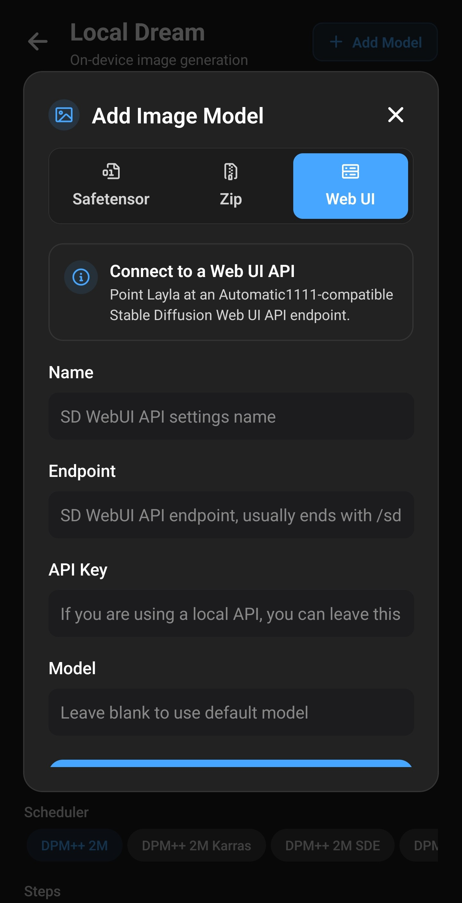
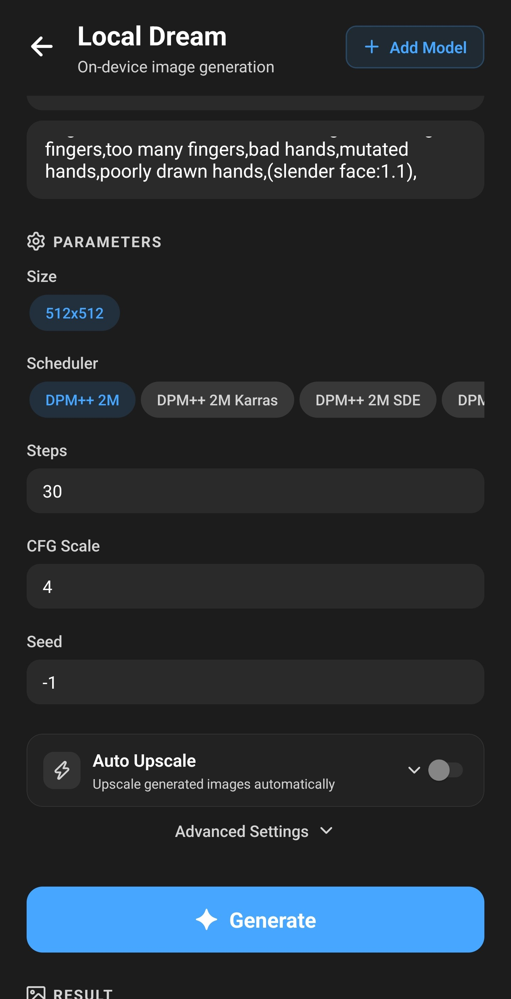

**Layla ist eine Android-App, die als Client für die AUTOMATIC1111 Stable Diffusion WebUI arbeitet: Ihr Smartphone sendet den Prompt über Ihr Netzwerk an die WebUI auf Ihrem eigenen PC, und der PC berechnet das Bild.** Sie aktivieren die API der WebUI, legen in der Mini-App Local Dream ein _Web UI_-Modell an, und Layla baut jede Anfrage aus einer JSON-Vorlage, die Sie bearbeiten können. Das Bild erscheint in Local Dream und in Ihren Chats, genau wie bei jedem anderen Layla-Bildmodell.

AUTOMATIC1111 ist eine Weboberfläche für Computer und bringt keine eigene Android-App mit. Über diese Verbindung nutzen Sie die Stable Diffusion WebUI auf Android: Checkpoints, LoRAs und Erweiterungen, die Sie in der WebUI bereits eingerichtet haben, bleiben erhalten, und Sie generieren vom Smartphone aus. Dieser Leitfaden behandelt den Start der WebUI mit aktivierter API, das Anlegen des Modells in Local Dream, die Anfragevorlage mit allen Platzhaltern, fertige Vorlagen für SD 1.5, SDXL, LoRAs und Hires fix sowie Lösungen für die häufigsten Verbindungsfehler.

Anders als Laylas Modelle auf dem Gerät setzt diese Methode voraus, dass der PC eingeschaltet und vom Smartphone erreichbar ist, solange Sie generieren. Prompt und Bild laufen über Ihr lokales Netzwerk zu Ihrem eigenen Computer und nicht zu einem Online-Dienst. Die Verbindung braucht daher keinen Internetzugang.

## Warum Stable Diffusion WebUI auf Android mit Layla nutzen?

Layla kann Stable Diffusion auch direkt auf dem Smartphone ausführen. Die WebUI-Verbindung ist also einer von zwei Wegen zu einem KI-Bildgenerator für Android in Layla. Sie eignet sich in diesen Fällen:

- **Sie haben bereits ein Stable-Diffusion-Setup.** Checkpoints, LoRAs, Embeddings und Erweiterungen wie ControlNet oder ADetailer bleiben auf dem PC und sind vom Smartphone aus verfügbar.
- **Ihr PC hat die schnellere Grafikkarte.** Der PC rechnet, daher begrenzt der Prozessor des Smartphones weder Bildgröße noch Schrittzahl oder Modell.
- **Sie wollen Modelle, die ein Smartphone nicht ausführen kann.** Große SDXL-Checkpoints und aufwendige Erweiterungen laufen ohne Konvertierung auf einer Desktop-GPU.
- **Es fallen keine Kosten pro Bild an.** Sie generieren mit Ihrer eigenen Hardware, ohne Guthaben und ohne Konto.
- **Es funktioniert im Chat.** Ein Web-UI-Modell kann das Bildmodell für Layla oder für einen einzelnen Charakter sein, sodass Ihre Charaktere Bilder senden, die Ihr eigener PC erzeugt hat.

|                         | Modell auf dem Gerät                                                 | Web-UI-Verbindung                          |
| ----------------------- | -------------------------------------------------------------------- | ------------------------------------------ |
| Wo die Bilder entstehen | Auf Ihrem Smartphone                                                 | Auf Ihrem PC                               |
| PC und Netzwerk nötig   | Nein                                                                 | Ja, der PC muss laufen und erreichbar sein |
| Modelle                 | Modelle, die Layla importieren und auf dem Smartphone ausführen kann | Alles, was Ihre WebUI laden kann           |
| Einstellungen           | Laylas Bedienelemente                                                | Laylas Bedienelemente plus JSON-Vorlage    |

Der Artikel [Eigene Bildgenerierungsmodelle in Layla importieren](/de/how-to-import-custom-image-generation-models-into-layla/) behandelt den Weg über das Gerät, einschließlich Civitai-Checkpoints und LoRAs.

## Wie Layla mit der Stable Diffusion WebUI kommuniziert

Die WebUI hat eine HTTP-API, die von ihrer Browserseite getrennt ist. Layla nutzt daraus einen einzigen Aufruf:

```text
Layla (phone)                         Stable Diffusion WebUI (PC)
  |  POST /sdapi/v1/txt2img               |
  |  JSON body built from your template -> |  renders the image
  |  <- JSON with "images": [base64]      |
  |  saves the first image, shows it      |
```

Wenn Sie auf **Generate** tippen, nimmt Layla Ihre Vorlage, ersetzt Platzhalter wie `{prompt}` und `{steps}` durch Ihre aktuellen Einstellungen und sendet das Ergebnis als Body einer `POST`-Anfrage an den eingetragenen Endpoint. Die WebUI antwortet mit dem Bild als Base64-Text in einer `images`-Liste. Layla dekodiert das erste Bild und speichert es als normale Bilddatei. Wenn Sie einen API-Schlüssel eingetragen haben, sendet Layla ihn in einem `Authorization: Bearer`-Header.

Mehr wird nicht gesendet. Layla wechselt nicht von sich aus das Modell, setzt keinen Sampler und wählt keine Größe. Alles, was die WebUI wissen muss, steht in der Vorlage.

## Was Sie brauchen

- Einen PC mit installierter [AUTOMATIC1111 Stable Diffusion WebUI](https://github.com/AUTOMATIC1111/stable-diffusion-webui), die auf ihrer eigenen Browserseite ein Bild erzeugen kann. Forks mit derselben API, etwa Forge, akzeptieren in der Regel dieselben Anfragen.
- Smartphone und PC im selben Netzwerk, zum Beispiel im selben WLAN.
- Layla mit installierter Mini-App **Local Dream**. [Bildgenerierung in Layla aktivieren](/de/how-to-enable-image-generation-in-layla/) zeigt die Installation, und [Mini-Apps aktivieren oder deaktivieren](/de/how-to-enable-disable-mini-apps-within-layla/) erklärt, wo Mini-Apps zu finden sind.

## Schritt 1: Die Stable-Diffusion-WebUI-API aktivieren (--api und --listen)

Die API ist standardmäßig ausgeschaltet. Fügen Sie das Argument `--api` hinzu, dazu `--listen`, damit die WebUI Verbindungen von anderen Geräten annimmt und nicht nur vom PC selbst. Beide gehören in die Zeile `COMMANDLINE_ARGS` der Startdatei der WebUI, also `webui-user.bat` unter Windows und `webui-user.sh` unter Linux:

```text
set COMMANDLINE_ARGS=--api --listen
```

Stehen in dieser Zeile bereits andere Argumente, ergänzen Sie die beiden, statt sie zu ersetzen. Starten Sie die WebUI mit dieser Datei. Standardmäßig lauscht sie auf Port `7860`.

Ob die API läuft, prüfen Sie, indem Sie auf dem PC `http://localhost:7860/docs` im Browser öffnen. Die Seite listet die verfügbaren API-Aufrufe auf, darunter `/sdapi/v1/txt2img`.

### Die Adresse des PCs finden und den Port freigeben

Das Smartphone kann `localhost` nicht verwenden, denn das wäre das Smartphone selbst. Es braucht die Adresse des PCs in Ihrem Netzwerk:

1. Öffnen Sie unter Windows ein Terminal und führen Sie `ipconfig` aus. Suchen Sie die **IPv4-Adresse** Ihres WLAN- oder Ethernet-Adapters. Sie sieht aus wie `192.168.1.50`.
2. Fragt die Windows-Defender-Firewall, ob Python in privaten Netzwerken zugelassen werden soll, erlauben Sie es. Kam keine Frage und das Smartphone kann sich später nicht verbinden, legen Sie eine eingehende Regel für TCP-Port `7860` an.
3. Öffnen Sie auf dem Smartphone im Browser `http://192.168.1.50:7860` mit Ihrer eigenen Adresse. Lädt die Seite der WebUI, erreicht das Smartphone den PC, und dieselbe Adresse funktioniert in Layla.

Ihr Endpoint ist diese Adresse, gefolgt vom txt2img-Pfad, zum Beispiel:

```text
http://192.168.1.50:7860/sdapi/v1/txt2img
```

Die Route heißt `txt2img`. Der Platzhaltertext im Endpoint-Feld älterer Layla-Versionen nennt `text2img`; diese Route gibt es in der WebUI nicht.

### Hinweis zu API-Schlüsseln und Sicherheit

`--listen` macht die WebUI für jedes Gerät in Ihrem Netzwerk erreichbar, und die API hat keine Anmeldung, wenn Sie keine einrichten. Nutzen Sie sie in einem Netzwerk, dem Sie vertrauen, und leiten Sie Port `7860` nicht ins Internet weiter.

Die Option `--api-auth` der WebUI legt Benutzernamen und Passwort fest, verwendet aber HTTP-Basic-Authentifizierung, während Layla seinen API-Schlüssel als Bearer-Token sendet. Beides passt nicht zusammen, lassen Sie das Feld **API Key** bei einer normalen WebUI daher leer. Das Feld ist für Aufbauten gedacht, bei denen eine vorgeschaltete Komponente wie ein Reverse-Proxy ein Bearer-Token prüft.

## Schritt 2: Die WebUI in Local Dream als Web-UI-Modell zu Layla hinzufügen

1. Öffnen Sie die Mini-App **Local Dream**.
2. Tippen Sie oben rechts auf **Add Model**. Der Bildschirm Add Image Model öffnet sich mit drei Tabs: Safetensor, Zip und Web UI.
3. Wählen Sie den Tab **Web UI**.



4. Füllen Sie die Felder aus:
   - **Name**: eine Bezeichnung, die Sie wiedererkennen, zum Beispiel `PC SDXL`. Sie erscheint in der Modellliste.
   - **Endpoint**: die vollständige Adresse aus Schritt 1, zum Beispiel `http://192.168.1.50:7860/sdapi/v1/txt2img`.
   - **API Key**: bei einer normalen WebUI leer lassen.
   - **Model**: siehe den Hinweis unten. Sie können das Feld leer lassen.
5. Tippen Sie auf **Save & Select**.

Name und Endpoint sind Pflichtfelder. Fehlt eines, bittet Layla Sie, mindestens einen Namen und einen API-Endpoint anzugeben.

Das Modell wird in Ihren Bildmodellen gespeichert und sofort ausgewählt. Es braucht keinen Download und ist einsatzbereit, sobald die WebUI läuft. Neue Web-UI-Modelle starten mit 20 Schritten, CFG-Skala 7 und leerem Negativ-Prompt; alle drei Werte können Sie in Local Dream ändern.

### Was das Feld Model bewirkt

Die WebUI rendert mit dem Checkpoint, den sie gerade geladen hat. In der aktuellen Layla-Version wird der Text im Feld **Model** zwar mit der Verbindung gespeichert, aber nicht in die Anfrage übernommen. Ein Checkpoint-Name dort schaltet das Modell der WebUI also nicht um. Um einen Checkpoint aus Layla zu wählen, tragen Sie ihn in die Anfragevorlage ein, wie in der SDXL-Vorlage weiter unten gezeigt.

### Eine Verbindung pro Setup anlegen

Jedes Web-UI-Modell hat eigene Einstellungen, auch eine eigene Anfragevorlage. Sie können denselben Endpoint mehrfach unter verschiedenen Namen anlegen, etwa eine Verbindung für einen SD-1.5-Anime-Checkpoint und eine für einen SDXL-Foto-Checkpoint, jeweils mit einer Vorlage, die den passenden Checkpoint und die passende Bildgröße wählt. Der Wechsel zwischen ihnen in Local Dream wechselt dann das ganze Setup. Name, Endpoint oder Schlüssel einer Verbindung ändern Sie später, indem Sie die Modellliste öffnen und auf das Stiftsymbol der Karte tippen.

## Schritt 3: Stable-Diffusion-Bilder vom Smartphone aus erzeugen

Ist das Web-UI-Modell ausgewählt, zeigt Local Dream dieselben Bedienelemente wie bei anderen Modellen:

1. Geben Sie einen Prompt und bei Bedarf einen Negativ-Prompt ein.
2. Stellen Sie **Steps**, **CFG Scale** und **Seed** ein. Der Seed `-1` wählt einen zufälligen Wert.
3. Tippen Sie auf **Generate**.



Das Smartphone wartet, während der PC rendert. Die Dauer hängt daher von Ihrer Grafikkarte und den Einstellungen ab, nicht vom Smartphone. Eine Fortschrittsvorschau gibt es für Web-UI-Modelle nicht, weil die Anfrage erst zurückkehrt, wenn das Bild fertig ist. Ist **Auto Upscale** aktiviert, führt Layla den Upscaler nach dem Eintreffen des Bildes auf dem Smartphone aus.

Einige Bedienelemente gelten für Web-UI-Modelle nicht:

- **Size** bietet nur eine Option, 512×512. Für eine andere Größe setzen Sie `width` und `height` in der Vorlage, wie unten beschrieben.
- **Scheduler** gilt für Laylas Modelle auf dem Gerät und wird nicht an die WebUI gesendet. Sampler und Scheduler legen Sie in der Vorlage fest.
- **Bild-zu-Bild** ist nicht verfügbar. Laylas Web-UI-Verbindung ruft nur txt2img auf.

## Die JSON-Anfragevorlage der Stable Diffusion WebUI API

Die Vorlage ist das JSON, das Layla an die WebUI sendet. Wählen Sie in Local Dream ein Web-UI-Modell, öffnen Sie **Advanced Settings** und scrollen Sie zu **WEBUI API BODY TEMPLATE**. Das Textfeld enthält den gesamten Anfrage-Body und lässt sich frei bearbeiten. Layla speichert Änderungen automatisch kurz nach der letzten Eingabe, und sie gelten nur für dieses Modell.

**Reset All Settings** am Ende von Advanced Settings setzt die Vorlage zusammen mit den übrigen Einstellungen dieses Modells auf Laylas Standard zurück.

### Die Standardvorlage

Mit dieser Vorlage startet jedes neue Web-UI-Modell. Sie führt fast alle Felder auf, die die txt2img-API akzeptiert:

```json
{
  "prompt": "{prompt}",
  "negative_prompt": "{negativePrompt}",
  "styles": [],
  "seed": {seed},
  "subseed": -1,
  "subseed_strength": 0,
  "seed_resize_from_h": -1,
  "seed_resize_from_w": -1,
  "sampler_name": "Euler A",
  "scheduler": "",
  "batch_size": 1,
  "n_iter": 1,
  "steps": {steps},
  "cfg_scale": {cfg},
  "width": {width},
  "height": {height},
  "restore_faces": true,
  "tiling": false,
  "do_not_save_samples": false,
  "do_not_save_grid": false,
  "eta": 0,
  "denoising_strength": 0,
  "s_min_uncond": 0,
  "s_churn": 0,
  "s_tmax": 0,
  "s_tmin": 0,
  "s_noise": 0,
  "override_settings": {},
  "override_settings_restore_afterwards": true,
  "refiner_checkpoint": "",
  "refiner_switch_at": 0,
  "disable_extra_networks": false,
  "firstpass_image": "",
  "comments": {},
  "enable_hr": false,
  "firstphase_width": 0,
  "firstphase_height": 0,
  "force_task_id": "",
  "sampler_index": "",
  "script_name": "",
  "script_args": [],
  "send_images": true,
  "save_images": false,
  "alwayson_scripts": {},
  "infotext": ""
}
```

Sie brauchen nicht alles davon. Jedes weggelassene Feld erhält den Standardwert der WebUI. Eine kurze Vorlage ist daher leichter zu lesen und zu pflegen. Die nächsten Abschnitte behandeln zuerst die Platzhalter und dann die Felder, die sich am ehesten zu ändern lohnen.

### Die Platzhalter

Sieben Platzhalter werden bei jeder Generierung durch Ihre Einstellungen ersetzt. Jeder andere Text der Vorlage wird unverändert gesendet.

| Platzhalter        | Wird ersetzt durch                                                            | Schreibweise                               |
| ------------------ | ----------------------------------------------------------------------------- | ------------------------------------------ |
| `{prompt}`         | Ihr Prompt, mit vorangestelltem Prompt Prefix                                 | In Anführungszeichen: `"{prompt}"`         |
| `{negativePrompt}` | Der Negativ-Prompt                                                            | In Anführungszeichen: `"{negativePrompt}"` |
| `{seed}`           | Das Feld Seed. Bei `-1` oder `0` wählt Layla eine Zufallszahl unter 1.000.000 | Ohne Anführungszeichen                     |
| `{steps}`          | Das Feld Steps                                                                | Ohne Anführungszeichen                     |
| `{cfg}`            | Das Feld CFG Scale                                                            | Ohne Anführungszeichen                     |
| `{width}`          | Die gewählte Breite, bei einem Web-UI-Modell 512                              | Ohne Anführungszeichen                     |
| `{height}`         | Die gewählte Höhe, bei einem Web-UI-Modell 512                                | Ohne Anführungszeichen                     |

Aus der Art, wie Layla sie einsetzt, ergeben sich einige Regeln:

- **Textplatzhalter in Anführungszeichen, Zahlen ohne.** Layla maskiert Anführungszeichen und Zeilenumbrüche in Ihrem Prompt, damit sie das JSON nicht zerstören, und erwartet `{prompt}` und `{negativePrompt}` innerhalb eines Strings. Die Zahlenplatzhalter werden zu bloßen Zahlen: `"steps": {steps}` ist richtig, `"steps": "{steps}"` sendet die Schritte als Text.
- **Das Ergebnis muss gültiges JSON sein.** Layla prüft es nicht. Ein fehlendes oder überzähliges Komma sorgt dafür, dass die WebUI einen Fehler statt eines Bildes zurückgibt.
- **Jedes Vorkommen wird ersetzt.** Steht `{prompt}` an zwei Stellen, werden beide gefüllt.
- **Es gibt keinen Platzhalter `{scheduler}` oder `{model}`.** Schreiben Sie Sampler, Scheduler oder Checkpoint direkt in die Vorlage.

### Was Layla zuerst mit dem Prompt macht

Bevor der Prompt in `{prompt}` landet, bereitet Layla ihn auf den kommagetrennten Stil von Stable Diffusion vor:

1. Das **Prompt Prefix** aus Advanced Settings wird, gefolgt von einem Komma, vorangestellt.
2. Der gesamte Prompt wird in Kleinbuchstaben umgewandelt.
3. Der Text wird an Kommas getrennt, und ein doppelt vorkommender Tag bleibt nur einmal erhalten.

Auch der Negativ-Prompt wird in Kleinbuchstaben umgewandelt. Gewichtungen wie `(detailed eyes:1.2)` bleiben unverändert.

Text, den Sie direkt in die Vorlage schreiben, wird nicht angetastet. Das ist für LoRAs wichtig, denn LoRA-Namen können auf dem PC zwischen Groß- und Kleinschreibung unterscheiden. Schreiben Sie einen Tag wie `<lora:MyStyle:0.8>` in die Vorlage und nicht in das Prompt-Feld von Layla, dann behält er seine Großbuchstaben. Die LoRA-Vorlage weiter unten macht genau das.

### Die Felder, die sich zu ändern lohnen

| Feld                   | Funktion                                                                                                                                                                                                                               |
| ---------------------- | -------------------------------------------------------------------------------------------------------------------------------------------------------------------------------------------------------------------------------------- |
| `sampler_name`         | Der Sampler. Die WebUI erwartet den Namen genau so, wie sie ihn listet, zum Beispiel `Euler a`. Laylas Standard ist `Euler A`. Meldet die WebUI einen unbekannten Sampler, kopieren Sie den Namen aus ihrer Liste **Sampling method**. |
| `scheduler`            | Der Rauschplan ab WebUI 1.9, zum Beispiel `Karras`. Ein leerer String belässt den Standard.                                                                                                                                            |
| `restore_faces`        | Führt ein Gesichtsrestaurierungsmodell auf dem Ergebnis aus. In Laylas Standard ist es `true`. Bei stilisierten oder Anime-Checkpoints setzen Sie es auf `false`, weil es dort das Aussehen von Gesichtern verändern kann.             |
| `width`, `height`      | Die Ausgabegröße. Setzen Sie hier Zahlen, um über 512×512 zu rendern. Nutzen Sie Größen, für die Ihr Checkpoint trainiert wurde, etwa 1024 für SDXL.                                                                                   |
| `batch_size`, `n_iter` | Wie viele Bilder die WebUI pro Anfrage erzeugt. Layla verwendet nur das erste, lassen Sie beide auf `1`.                                                                                                                               |
| `override_settings`    | Einstellungen, die nur für diese Anfrage gelten. So wählen Sie den Checkpoint.                                                                                                                                                         |
| `enable_hr`            | Aktiviert Hires fix: erst klein rendern, dann in einem zweiten Durchgang hochskalieren.                                                                                                                                                |
| `send_images`          | Muss `true` bleiben. Layla liest das Bild aus der Antwort.                                                                                                                                                                             |
| `save_images`          | Ob die WebUI zusätzlich eine Kopie auf dem PC behält. Standardmäßig `false`.                                                                                                                                                           |
| `alwayson_scripts`     | Argumente für Erweiterungen wie ControlNet oder ADetailer, falls installiert.                                                                                                                                                          |

Die [API-Dokumentation der WebUI](https://github.com/AUTOMATIC1111/stable-diffusion-webui/wiki/API) beschreibt die Anfrage, und die Seite `/docs` Ihrer eigenen WebUI listet jedes Feld, das Ihre installierte Version akzeptiert.

## Fertige Vorlagen

Kopieren Sie eine in das Vorlagenfeld und passen Sie sie an. Jede ist vollständiges, gültiges JSON.

### Vorlage: minimales SD 1.5

Die kleinste brauchbare Vorlage. Die WebUI ergänzt alles, was nicht aufgeführt ist.

```json
{
  "prompt": "{prompt}",
  "negative_prompt": "{negativePrompt}",
  "seed": {seed},
  "steps": {steps},
  "cfg_scale": {cfg},
  "width": {width},
  "height": {height},
  "sampler_name": "Euler a",
  "restore_faces": false,
  "send_images": true,
  "save_images": false
}
```

### Vorlage: SDXL mit gewähltem Checkpoint

SDXL rendert mit etwa 1024×1024, daher legt die Vorlage die Größe selbst fest. Der Block `override_settings` lädt für diese Anfrage den genannten Checkpoint, und `override_settings_restore_afterwards` stellt danach den vorherigen Checkpoint der WebUI wieder her.

```json
{
  "prompt": "{prompt}",
  "negative_prompt": "{negativePrompt}",
  "seed": {seed},
  "steps": {steps},
  "cfg_scale": {cfg},
  "width": 1024,
  "height": 1024,
  "sampler_name": "DPM++ 2M",
  "scheduler": "Karras",
  "restore_faces": false,
  "override_settings": {
    "sd_model_checkpoint": "your-sdxl-checkpoint.safetensors"
  },
  "override_settings_restore_afterwards": true,
  "send_images": true,
  "save_images": false
}
```

Ersetzen Sie `your-sdxl-checkpoint.safetensors` durch den Namen des Checkpoints, wie ihn die WebUI anzeigt. Die WebUI akzeptiert den Dateinamen auch ohne Endung. Nutzen Sie immer denselben Checkpoint, ist es schneller, ihn einmal in der WebUI zu laden und `override_settings` zu entfernen. Nennt eine Anfrage nämlich einen anderen als den geladenen Checkpoint, muss die WebUI ihn zuerst laden, was jedes Bild verlängert.

### Vorlage: LoRA und feste Qualitäts-Tags

Text in der Vorlage wird exakt so gesendet, wie Sie ihn schreiben. Nutzen Sie das für einen LoRA-Tag und für Qualitäts-Tags, die Sie immer wollen, und lassen Sie das Feld in Layla für das, was sich von Bild zu Bild ändert:

```json
{
  "prompt": "masterpiece, best quality, <lora:MyStyle:0.8>, {prompt}",
  "negative_prompt": "{negativePrompt}",
  "seed": {seed},
  "steps": {steps},
  "cfg_scale": {cfg},
  "width": {width},
  "height": {height},
  "sampler_name": "Euler a",
  "restore_faces": false,
  "send_images": true,
  "save_images": false
}
```

Hier ist `MyStyle` der Name der LoRA in der WebUI. Der Tag behält seine Großbuchstaben, und nur der Teil `{prompt}` wird in Kleinbuchstaben umgewandelt.

### Vorlage: Hires fix

Hires fix rendert in der Basisgröße und skaliert das Ergebnis dann hoch und verfeinert es. Das ergibt ein schärferes Bild ohne die wiederholten Motive, die ein großer erster Durchgang verursachen kann. Es dauert spürbar länger.

```json
{
  "prompt": "{prompt}",
  "negative_prompt": "{negativePrompt}",
  "seed": {seed},
  "steps": {steps},
  "cfg_scale": {cfg},
  "width": {width},
  "height": {height},
  "sampler_name": "Euler a",
  "restore_faces": false,
  "enable_hr": true,
  "hr_scale": 2,
  "hr_upscaler": "Latent",
  "hr_second_pass_steps": 10,
  "denoising_strength": 0.5,
  "send_images": true,
  "save_images": false
}
```

Laylas Standardvorlage setzt `denoising_strength` auf `0`, was bei ausgeschaltetem Hires fix in Ordnung ist. Wenn Sie es einschalten, setzen Sie einen Wert wie `0.5`, sonst verändert der zweite Durchgang nichts. Eine Basis von 512×512 mit `hr_scale` `2` ergibt ein Bild mit 1024×1024.

## Tipps für ein zuverlässiges Setup

- **Zuerst in der WebUI testen.** Funktioniert eine Kombination aus Checkpoint, Sampler und Größe auf der Browserseite der WebUI, funktionieren dieselben Werte in der Vorlage. Der Tab **PNG Info** der WebUI zeigt die Einstellungen eines von ihr erzeugten Bildes.
- **Den PC wach halten.** Geht der PC in den Ruhezustand, meldet das Smartphone einen Verbindungsfehler. Schalten Sie den Ruhezustand aus, solange Sie generieren.
- **Dem PC eine feste Adresse geben.** Ändert Ihr Router die Adresse des PCs, funktioniert der gespeicherte Endpoint nicht mehr. Reservieren Sie in den Router-Einstellungen eine Adresse für den PC, oder bearbeiten Sie den Endpoint in der Modellliste, wenn sie sich ändert.
- **Das Prompt Prefix für Wörter nutzen, die Sie immer wollen.** Es wird jedem Prompt vorangestellt und wie der Rest des Prompts in Kleinbuchstaben umgewandelt. Für alles, was zwischen Groß- und Kleinschreibung unterscheidet, gehört es in die Vorlage.
- **Die Verbindung auch im Chat nutzen.** Sobald ein Web-UI-Modell existiert, können Sie es als Bildmodell von Layla oder eines einzelnen Charakters festlegen. [Bildgenerierung in Layla aktivieren](/de/how-to-enable-image-generation-in-layla/) zeigt, wo Sie es auswählen.

## Häufig gestellte Fragen

### Wie kann ich die Stable Diffusion WebUI auf meinem Android-Smartphone nutzen?

Starten Sie die WebUI auf einem PC mit `--api --listen` und fügen Sie sie in Laylas Mini-App Local Dream als **Web UI**-Modell hinzu, mit der Adresse des PCs gefolgt von `/sdapi/v1/txt2img`. Das Smartphone sendet den Prompt, der PC rendert das Bild, und Layla zeigt es an. Die Seite der WebUI im Browser des Smartphones zu öffnen funktioniert ebenfalls, dann nutzen Sie aber die eigene Seite der WebUI und nicht Laylas Chat und Bildwerkzeuge.

### Gibt es eine AUTOMATIC1111-App für Android?

AUTOMATIC1111 ist eine Weboberfläche, die auf einem Computer läuft, und bringt keine Android-App mit. Layla arbeitet als Android-Client dafür: Das Web-UI-Modell sendet txt2img-Anfragen an Ihre WebUI und zeigt die zurückgegebenen Bilder an, und Ihre Charaktere können die WebUI auch im Chat nutzen.

### Kann ich Stable Diffusion auf Android ohne PC ausführen?

Ja, aber nicht mit einer Web-UI-Verbindung, die eine auf einem Computer laufende WebUI voraussetzt. Layla kann Stable Diffusion mit seinen Modellen auf dem Gerät direkt auf dem Smartphone ausführen, ohne PC und ohne Internetverbindung. [Bildgenerierung in Layla aktivieren](/de/how-to-enable-image-generation-in-layla/) behandelt sie.

### Wie aktiviere ich die Stable Diffusion WebUI API?

Starten Sie die WebUI mit dem Argument `--api`, normalerweise indem Sie es in `COMMANDLINE_ARGS` in `webui-user.bat` oder `webui-user.sh` eintragen. Fügen Sie auch `--listen` hinzu, damit andere Geräte in Ihrem Netzwerk, etwa Ihr Smartphone, sie erreichen. Ob es funktioniert, sehen Sie, indem Sie `/docs` an der Adresse der WebUI öffnen.

### Wie lautet der Endpoint der Stable Diffusion WebUI API für Layla?

Die Adresse der WebUI gefolgt von `/sdapi/v1/txt2img`, zum Beispiel `http://192.168.1.50:7860/sdapi/v1/txt2img`. Verwenden Sie die Adresse des PCs in Ihrem Netzwerk und nicht `localhost`, denn auf dem Smartphone bezeichnet `localhost` das Smartphone selbst.

### Kann ich von unterwegs auf die Stable Diffusion WebUI zugreifen?

Nur wenn das Smartphone den PC erreichen kann. Zu Hause genügt dasselbe WLAN, und mobile Daten erreichen den PC nicht von allein. Unterwegs brauchen Sie eine private Verbindung zu Ihrem Heimnetz, etwa ein VPN. Setzen Sie die WebUI nicht direkt dem Internet aus, denn ihre API hat standardmäßig keine Anmeldung. Für Bilder unterwegs ohne jede Einrichtung funktionieren Laylas Modelle auf dem Gerät mit mobilen Daten oder ganz ohne Verbindung.

### Funktioniert Layla mit Forge, reForge oder SD.Next?

Layla sendet nur eine txt2img-Anfrage im AUTOMATIC1111-Format, daher kann jeder Server funktionieren, der dieselbe Anfrage unter `/sdapi/v1/txt2img` akzeptiert. Forks unterscheiden sich darin, welche Felder und Samplernamen sie akzeptieren. Prüfen Sie daher die Seite `/docs` Ihrer WebUI und passen Sie die Vorlage an.

### Wie nutze ich SDXL, einen anderen Checkpoint, eine LoRA oder einen anderen Sampler mit der WebUI-API?

Bearbeiten Sie die Vorlage. Tragen Sie den Checkpoint unter `override_settings` als `"sd_model_checkpoint"` ein, schreiben Sie den LoRA-Tag in die Zeile `prompt` und setzen Sie `sampler_name` und `scheduler` auf Namen, die die WebUI listet. Für einen SDXL-Checkpoint setzen Sie außerdem `width` und `height` auf etwa 1024. Die Vorlagen oben zeigen jeweils ein Beispiel.

### Wie erzeuge ich größere Bilder?

Setzen Sie `width` und `height` in der Vorlage auf feste Zahlen. Ein Web-UI-Modell bietet in Layla nur die Größenschaltfläche 512×512, und genau dieser Wert wird für `{width}` und `{height}` verwendet. Über 512 hinaus führen daher feste Zahlen in der Vorlage zum Ziel. Für SDXL-Checkpoints nehmen Sie etwa 1024×1024. Für mehr Details bei einem SD-1.5-Checkpoint schalten Sie Hires fix ein.

### Warum schlägt die Bildgenerierung mit „Failed to generate image“ fehl?

Layla zeigt nach diesem Text den Statuscode und die Meldung der WebUI an, die verrät, was schiefging. Ein `404` bedeutet meist, dass die API nicht aktiviert oder der Endpoint-Pfad falsch geschrieben ist, prüfen Sie also `--api` und `txt2img`. Ein `422` bedeutet, dass die WebUI den Anfrage-Body abgelehnt hat: Ein Feld hat den falschen Typ, ein Name ist falsch geschrieben oder das JSON ist ungültig. Ein `500` bedeutet, dass beim Rendern in der WebUI ein Fehler auftrat. Das Konsolenfenster auf dem PC zeigt den Grund, etwa einen unbekannten Sampler oder zu wenig Speicher.

### Warum kann sich mein Smartphone nicht mit der Stable Diffusion WebUI verbinden? (network request failed)

Das Smartphone konnte den PC nicht erreichen. Prüfen Sie, ob die WebUI läuft, ob sie mit `--listen` gestartet wurde, ob Smartphone und PC im selben Netzwerk sind, ob die IP-Adresse im Endpoint aktuell ist und ob die Firewall Port `7860` zulässt. Am schnellsten testen Sie es, indem Sie die Adresse der WebUI im Browser des Smartphones öffnen.

### Warum meldet Layla „No images returned“?

Die WebUI hat erfolgreich geantwortet, aber die Antwort enthielt keine Bildliste. Prüfen Sie, ob `send_images` in der Vorlage `true` ist und ob nichts in `alwayson_scripts` die Rückgabe des Bildes verhindert.

### Warum wird meine LoRA ignoriert?

Layla wandelt den Prompt in Kleinbuchstaben um, daher kann ein im Prompt-Feld getippter LoRA-Tag einen Namen mit Großbuchstaben verfehlen. Setzen Sie den Tag stattdessen in die Zeile `prompt` der Vorlage, wo er unverändert gesendet wird, und achten Sie darauf, dass der Name mit dem in der WebUI übereinstimmt.

### Ist die Bildgenerierung über die WebUI privat?

Prompt und Bild gehen von Ihrem Smartphone über Ihr Netzwerk zu Ihrem eigenen PC, und Layla sendet sie nicht an einen Online-Dienst. Nichts verlässt Ihr Netzwerk, sofern Sie keinen Fernzugriff einrichten. Für Generierung ganz ohne PC nutzen Sie Laylas Modelle auf dem Gerät, beschrieben in [Bildgenerierung in Layla aktivieren](/de/how-to-enable-image-generation-in-layla/).

### Kann ich das im Chat nutzen, damit mein Charakter Bilder sendet?

Ja. Ein Web-UI-Modell ist ein Bildmodell wie jedes andere. Wählen Sie es in den Inference Settings als Standard-Bildgenerierungsmodell aus oder für einen einzelnen Charakter im Tab **Advanced** des Charaktereditors. Der PC muss eingeschaltet und die WebUI gestartet sein, wenn der Charakter ein Bild erzeugt.

## Fazit

Mit einem Web-UI-Modell nutzen Sie die Stable Diffusion WebUI auf Android: Die AUTOMATIC1111-Installation auf Ihrem PC wird zum Bildgenerator für Layla. Die WebUI braucht `--api` und `--listen`, Local Dream braucht die Adresse ihres `txt2img`-Endpoints, und die Anfragevorlage entscheidet alles Übrige: Checkpoint, Sampler, Größe, LoRAs und Hires fix. Mit einer kurzen Vorlage pro Setup, gespeichert als getrennte Verbindungen, wechseln Sie in der Modellliste zwischen ihnen.

Layla ist als Offline-KI-Assistent für Android gebaut, und seine Modelle auf dem Gerät bleiben der Weg, Stable Diffusion auf dem Smartphone ohne PC und ohne Netzwerk auszuführen. Die WebUI-Verbindung ist für den Fall gedacht, dass Sie bereits ein Stable-Diffusion-Setup auf einem eigenen Computer haben und es in Ihren Chats und in Local Dream verfügbar machen möchten.
