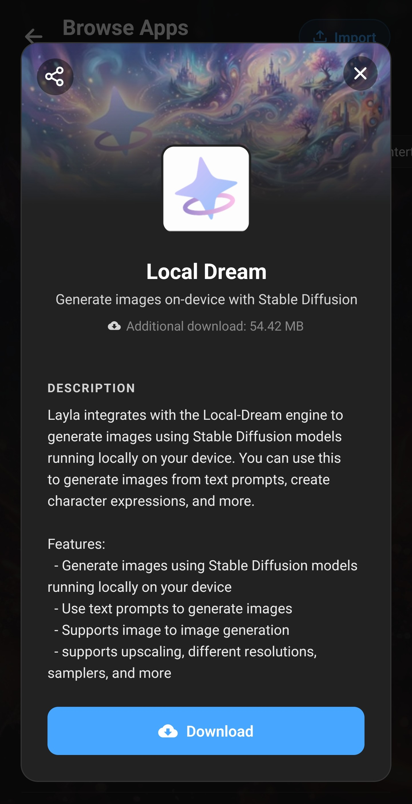
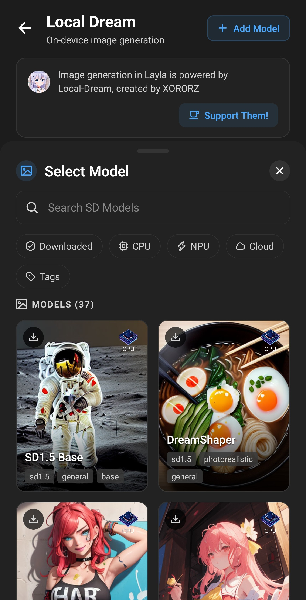
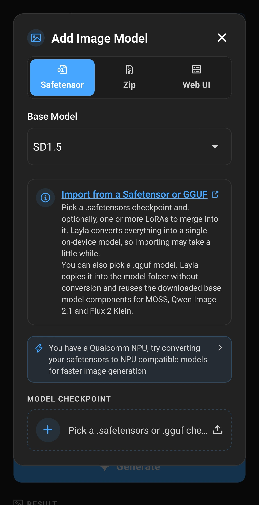
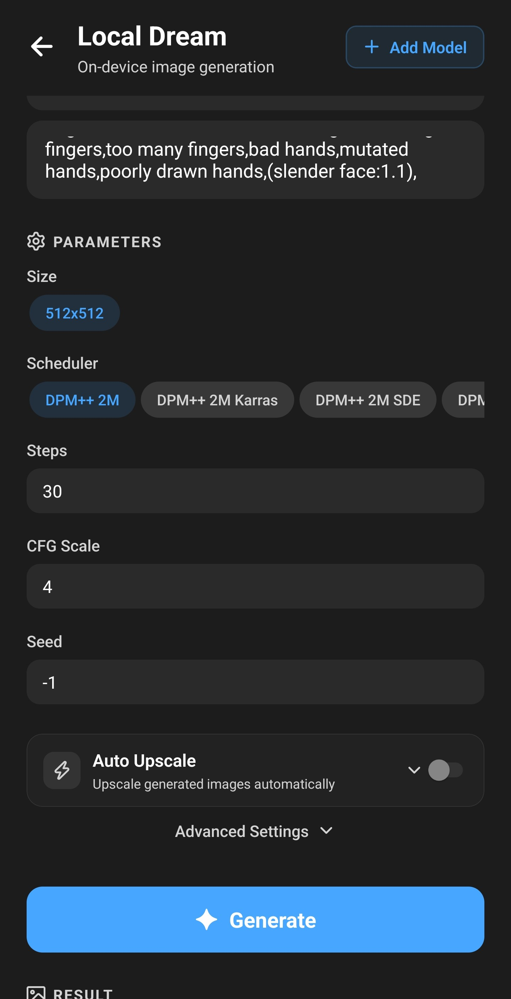
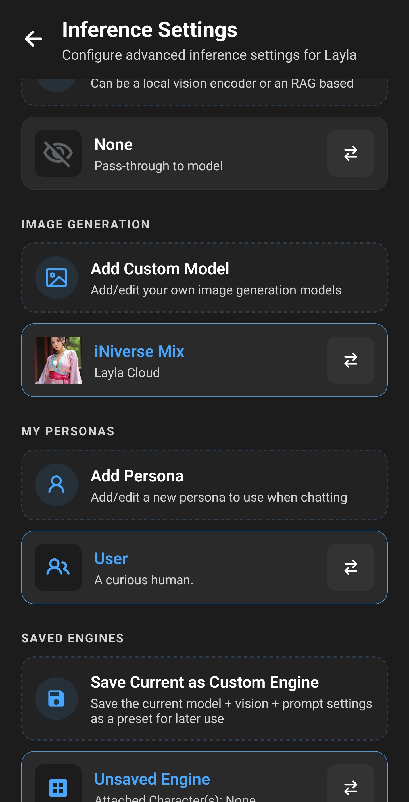
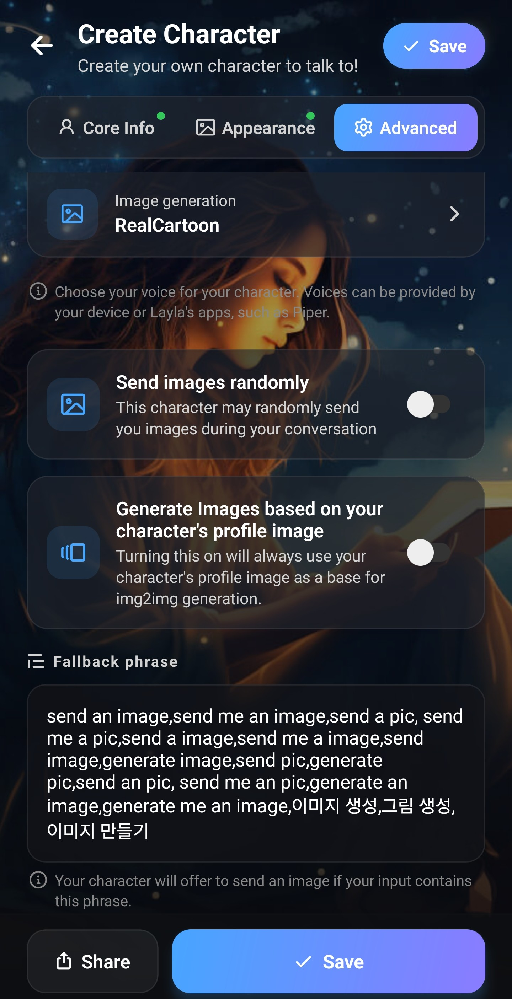

**Layla erzeugt KI-Bilder offline auf Android und iPhone. Mit der Mini-App Local Dream laufen Stable Diffusion, SDXL, FLUX, Z-Image und weitere Text-zu-Bild-Modelle direkt auf dem Smartphone, ohne Internet oder Konto.** Prompts und Bilder bleiben auf dem Gerät; kein Onlinedienst prüft die Ergebnisse.

Dieser Überblick erklärt die Bildgenerierung in Layla: Local Dream installieren, Modelle auswählen oder importieren, Modelltypen verstehen, Einstellungen anpassen und Modelle für Layla und einzelne Chat-Charaktere festlegen. Wo verfügbar, verlinken die Abschnitte ausführliche Anleitungen.

## Warum KI-Bilder mit Layla auf dem Smartphone erzeugen?

- **Offline.** Nach dem Modelldownload läuft Stable Diffusion lokal, auch im Flugmodus.
- **Privat.** Prompts und Bilder gehen an keinen Server. Kein Konto, Upload oder Online-Prüfschritt.
- **Ohne Credits und Bildgebühren.** Lokale Generierung hat weder Tageslimit noch Preis pro Bild. Grenzen setzen Speicher und Geschwindigkeit des Geräts.
- **Freie Modellwahl.** Nutzen Sie integrierte Modelle von SD 1.5 bis FLUX.2 Klein und Z-Image Turbo oder eigene Checkpoints und LoRAs von [Civitai](https://civitai.com/).
- **KI-Hardware.** Auf unterstützten Snapdragon-Geräten ist die NPU meist deutlich schneller als die CPU.
- **Im Chat integriert.** Charaktere können mit dem von Ihnen gewählten Modell Bilder im Gespräch senden.

## Drei Wege zur KI-Bildgenerierung in Layla

| Methode                 | Berechnung                        | Verbindung nötig             | Kosten                                   |
| ----------------------- | --------------------------------- | ---------------------------- | ---------------------------------------- |
| Auf dem Gerät           | CPU, GPU oder NPU des Smartphones | Nur zum Modelldownload       | Keine Bildgebühren                       |
| Layla Cloud             | Laylas Server                     | Internet und Cloud-Anmeldung | Monatliches Kontingent je nach Tarif     |
| Stable Diffusion Web UI | PC in Ihrem Netzwerk              | Lokales Netzwerk             | Keine Bildgebühren; Sie betreiben den PC |

Dieser Artikel behandelt vor allem die erste Methode: Prompts und Bilder bleiben vollständig auf Ihrem Smartphone. [Zwischen lokalem LLM und Layla Cloud wechseln](/de/how-to-switch-between-local-llm-and-layla-cloud/) erklärt den Wechsel zwischen Cloud und lokalen Modellen.

## Local Dream für die Offline-Bildgenerierung installieren

Local Dream ist die Mini-App für die Berechnung auf dem Gerät. Sie ist optional und nicht vorinstalliert.

1. Öffnen Sie Laylas Mini-App-Übersicht (**Browse Apps**) und suchen Sie **Local Dream**. [Mini-Apps aktivieren oder deaktivieren](/de/how-to-enable-disable-mini-apps-within-layla/) erklärt den Zugang.
2. Öffnen Sie den Eintrag und lesen Sie die Beschreibung. Der Zusatzdownload beträgt etwa 54 MB, wenig im Vergleich zu einem Modell.
3. Tippen Sie auf **Download**.
4. Öffnen Sie die Mini-App. Die Überschrift lautet _On-device image generation_.

Bringt ein Layla-Update eine neue Engine, meldet die Mini-App ein nötiges Update. Aktualisieren Sie sie in der Mini-App-Übersicht vor dem Generieren oder Importieren.

Eine Deinstallation von Local Dream löscht alle darin gespeicherten Bildmodelle, auch importierte. Layla fragt vorher nach einer Bestätigung.

## Ein KI-Bildmodell auswählen und herunterladen

Tippen Sie oben in Local Dream auf die Modellkarte oder deren Pfeil, um **Select Model** zu öffnen.

- **Search** sucht nach Modellnamen.
- **Filter** begrenzen die Liste auf **Downloaded**, **CPU**, **NPU** oder **Cloud**. **Tags** filtern nach Stil, etwa _realistic_, _anime_ oder _sdxl_.
- Jede Karte zeigt zuerst ein Downloadsymbol, danach ein Häkchen. Ein kleines Abzeichen kennzeichnet CPU, NPU oder Cloud.

Wählen Sie ein Modell und **Download Model**. Die Downloads reichen von ungefähr 1 GB für SD 1.5 bis weit über 10 GB für die größten NPU-Modelle. Nutzen Sie WLAN und prüfen Sie den freien Speicher. **Delete Model** entfernt das gespeicherte Modell jederzeit wieder.

Layla liest die Chipinformationen. Meldet Ihr Gerät die erforderliche Hardware nicht, erscheint über **Generate** eine Warnung. Sie dient als Hinweis; Sie können das Modell trotzdem ausprobieren.

## Eigene Stable-Diffusion-Modelle von Civitai importieren

Fehlt der gewünschte Stil, importieren Sie eigene Modelle. Zwei Wege führen zu **Add Image Model**:

- Tippen Sie oben in Local Dream auf **Add Model**.
- Öffnen Sie **Settings** → **Inference Settings**, scrollen Sie zu **Image Generation** und wählen Sie **Add Custom Model**.

Der Bildschirm bietet bis zu drei Tabs:

- **Safetensor**: Wählen Sie einen `.safetensors`-Checkpoint, etwa von [Civitai](https://civitai.com/) oder [Hugging Face](https://huggingface.co/). Layla konvertiert ihn auf dem Smartphone. Android akzeptiert auch `.gguf`-Diffusionsmodelle. Wählen Sie die passende Modellfamilie und fügen Sie bei Bedarf LoRAs hinzu.
- **Zip**: Importieren Sie bereits für Layla konvertierte und verpackte Modelle.
- **Web UI**: Verbinden Sie eine AUTOMATIC1111 Stable Diffusion Web UI auf Ihrem PC über deren API-Adresse.

Auf dem iPhone akzeptiert Safetensor nur SD-1.5-Checkpoints. Auf Geräten mit unterstützter Qualcomm-NPU erscheint zusätzlich ein Hinweis zur Konvertierung für schnellere Generierung.

Die [Importübersicht](/de/how-to-import-custom-image-generation-models-into-layla/) erklärt alle Methoden; die [SD-1.5-Anleitung für Civitai](/de/how-to-import-sd1-5-safetensor-models-from-civit-ai-into-layla/) zeigt ein Beispiel mit Screenshots. Bei unterstützten Snapdragon-Chips konvertiert [NPU Forge](/de/how-to-convert-safetensors-to-qnn-with-npu-forge-in-layla/) SD 1.5 und SDXL für die NPU statt der CPU.

## Unterstützte Bildmodelle: Stable Diffusion, SDXL, FLUX, Z-Image und mehr

Layla gruppiert Modelle nach ihrer Rechenhardware. Das Abzeichen auf der Modellkarte zeigt die Gruppe.

| Typ                                        | Integrierte Beispiele                                                                            | Berechnung        | Plattformen                   |
| ------------------------------------------ | ------------------------------------------------------------------------------------------------ | ----------------- | ----------------------------- |
| SD 1.5 (CPU)                               | SD1.5 Base, DreamShaper, RealCartoon, Pastel-Mix                                                 | CPU, optional GPU | Android und iOS               |
| SD 1.5 (NPU)                               | CyberRealistic, Realistic Vision Hyper, Reliberate, ToonYou                                      | Snapdragon-NPU    | Android                       |
| SDXL (CPU)                                 | SDXL Turbo, AnimeMix XL, IntoRealism                                                             | CPU               | Android; IntoRealism auch iOS |
| SDXL (NPU)                                 | Pony Realism V23, Illustrious V17, Nova Anime XL V10                                             | Snapdragon-NPU    | Android                       |
| Neuere Diffusionstransformer (NPU)         | Z-Image Turbo, FLUX.2 Klein 4B und 9B, Qwen Image 2.1, Krea 2 Turbo, MOSS-Image, IntoRealism ZIT | Snapdragon-NPU    | Android                       |
| Kompakte FLUX- und Z-Image-Modelle (lokal) | Bonsai Image 4B, FLUX.2 klein 4B, Z-Image Turbo 6B                                               | CPU oder GPU      | Android und iOS               |
| Core ML                                    | Realistic Vision Hyper, Deliberate v2                                                            | Apple-Hardware    | iOS                           |
| Layla Cloud                                | FLUX.1[dev], BrainDance, CyberRealisticXL, iNiverse Mix                                          | Laylas Server     | Android und iOS               |
| Web UI                                     | Alle Modelle Ihrer Web UI                                                                        | Ihr PC            | Android und iOS               |

Was die Gruppen bedeuten:

- **SD 1.5** ([Stable Diffusion](https://en.wikipedia.org/wiki/Stable_Diffusion) 1.5) ist die älteste und leichteste Familie und auf Civitai besonders verbreitet. Sie erzeugt 512 x 512 Pixel auf den meisten neueren Smartphones.
- **SDXL** erzeugt größere, detailliertere Bilder mit 1024 x 1024 Pixeln und braucht mehr Speicher. NPU-Modelle benötigen Snapdragon 8 Elite oder neuer.
- **Neuere Diffusionstransformer** (Z-Image, FLUX.2 Klein, Qwen Image, Krea, MOSS-Image) bieten die höchste Qualität der Liste. Die großen Downloads laufen auf der NPU eines Snapdragon 8 Elite oder neuer, unterstützen bis 2048 x 2048 und teilweise Bildbearbeitung.
- **Kompakte FLUX- und Z-Image-Modelle** verwenden auf beiden Plattformen eine andere lokale Engine. Sie haben feste kleine Auflösungen; die größten benötigen mehrere Gigabyte und sind langsam.
- **Layla Cloud** benötigt keinen Download. Melden Sie sich an; jeder Tarif enthält ein monatliches Bildkontingent.

Die NPU (Neural Processing Unit) ist Qualcomms KI-Beschleuniger in Snapdragon-Chips. Für dasselbe Modell ist sie meist deutlich schneller als die CPU. Deshalb bietet Layla NPU-Varianten und Konvertierungswerkzeuge wie NPU Forge.

## Generierung einstellen: Prompt, Schritte, CFG und Seed

Die Bedienelemente unter der Modellkarte in Local Dream steuern die Bilderzeugung. Welche erscheinen, hängt vom Modell ab.

| Einstellung                       | Funktion                                               | Hinweise                                                                                                                                   |
| --------------------------------- | ------------------------------------------------------ | ------------------------------------------------------------------------------------------------------------------------------------------ |
| **Prompt**                        | Beschreibt das gewünschte Bild.                        | Der Stern erstellt aus Stichwörtern mit Ihrem Chatmodell einen Prompt. Die zweite Taste kürzt lange Prompts und benötigt Long-term Memory. |
| **Negative prompt**               | Beschreibt unerwünschte Inhalte.                       | Bei Modellen ohne Unterstützung ausgeblendet. Bei neueren Transformern erst über CFG 1 wirksam.                                            |
| **Size**                          | Breite und Höhe.                                       | SD 1.5 CPU bietet mehrere quadratische Größen, neuere NPU-Modelle bis 2048 x 2048. Manche Größen sind fest.                                |
| **Steps**                         | Anzahl der Entrauschungsschritte.                      | Mehr Schritte dauern länger. Turbo- und destillierte Modelle sind für 4 bis 9 Schritte ausgelegt.                                          |
| **CFG Scale**                     | Stärke der Promptbindung.                              | Integrierte Modelle haben passende Standardwerte. Viele neuere Modelle sind für 1 optimiert.                                               |
| **Seed**                          | Zufälliger Ausgangspunkt.                              | -1 wählt jedes Mal einen neuen Seed. Im Ergebnis steht der verwendete Wert zum Wiederholen.                                                |
| **Scheduler**                     | Sampler wie DPM++ 2M Karras, Euler A oder LCM.         | Bei SD 1.5 und SDXL sichtbar; neuere Modelle nutzen eigene Sampler.                                                                        |
| **Source image**                  | Startet von einem Bild statt Rauschen (Bild-zu-Bild).  | SD 1.5 CPU/NPU, SDXL NPU und neuere NPU-Modelle. Danach können Sie eine Maske für Teilbereiche malen und **Denoise Strength** einstellen.  |
| **Reference images**              | Bis zu drei Bilder zur Orientierung bei Bearbeitungen. | FLUX.2 Klein und Qwen Image.                                                                                                               |
| **Show Preview While Generating** | Grobe Vorschau bei jedem Schritt.                      | Nicht bei allen Modellen.                                                                                                                  |
| **Auto Upscale**                  | Vergrößert fertige Bilder.                             | Wählen Sie Upscaler, OpenCL-Nutzung der GPU und Kachelgröße. Kleinere Kacheln sparen Speicher.                                             |

Unter **Advanced Settings**:

- **Prompt prefix** setzt Text vor jeden Prompt, etwa einen wiederkehrenden Stil oder Qualitätsbegriff.
- **Use GPU** verwendet bei unterstützten Modellen die GPU. Unter 12 GB RAM warnt Layla vor möglichem Speichermangel.
- **Reset All Settings** stellt die Standardwerte des gewählten Modells wieder her.

Starten Sie mit **Generate**. Währenddessen erscheint **Stop generating** zum Abbrechen. Fertige Bilder finden Sie in der Galerie.

## Das Bildmodell in Inference Settings festlegen

In Local Dream generieren Sie manuell. Für Layla und Charaktere im Chat wählen Sie ein Modell in **Inference Settings**.

1. Öffnen Sie **Settings** → **Inference Settings** → **Image Generation**.
2. Die Karte unter **Add Custom Model** zeigt das aktuelle Modell. Die Wechselpfeile öffnen **Select Model**.
3. Wählen Sie ein Modell oder **No Image Generation** zum Deaktivieren.

Dies ist das Standardmodell für Charaktere ohne eigene Auswahl. Lokale Modelle müssen zuerst in Local Dream heruntergeladen werden. Cloud- und Web-UI-Modelle sind nach Anmeldung oder Verbindung bereit. Bearbeiten Sie eine Web-UI-Verbindung später über das Stiftsymbol ihrer Modellkarte.

## Bildgenerierung für einzelne Charaktere einstellen

Inference Settings legt nur den Standard fest. Jeder eigene Charakter kann ein eigenes Modell und Regeln für Bilder haben: So sendet ein KI-Begleiter Bilder im Chat, während verschiedene Charaktere etwa Anime oder Fotorealismus nutzen.

1. Erstellen oder bearbeiten Sie einen Charakter. [Eigene Charaktere erstellen](/de/how-do-i-create-custom-characters/) erklärt den Editor.
2. Öffnen Sie **Advanced** und unter **OUTPUT** den Eintrag **Image generation**. Er zeigt das Modell oder _No image generation_.
3. Tippen Sie darauf und wählen Sie in **Select Model** ein Modell. **No Image Generation** deaktiviert Bilder für diesen Charakter.
4. Passen Sie die folgenden Optionen an und tippen Sie auf **Save**.

Mit gewähltem Bildmodell erscheinen drei weitere Optionen:

- **Send images randomly**: Der Charakter darf ungefragt Bilder senden. Standardmäßig aus.
- **Generate Images based on your character's profile image**: Nutzt das Profilbild immer als Ausgangsbild, damit das Aussehen ähnlich bleibt. Benötigt Bild-zu-Bild-Unterstützung; siehe Parametertabelle.
- **Fallback phrase**: Durch Kommas getrennte Ausdrücke wie _schick mir ein Bild_ oder _erzeuge ein Bild_. Enthält Ihre Nachricht einen davon, bietet der Charakter ein Bild an. Layla versteht auch normale Bitten um Bilder, Fotos und Selfies. Die Liste ergänzt Ihre persönlichen Formulierungen, auch in anderen Sprachen.

Ein angebotenes Bild können Sie ablehnen. Bei einem versehentlichen Treffer müssen Sie nur das Angebot schließen.

Beachten Sie:

- Laden Sie das Modell zuerst in Local Dream herunter. Ohne lokale Modelldateien kann der Charakter nicht generieren.
- Für Layla-Cloud-Modelle müssen Sie angemeldet sein. Jedes Bild zählt zum monatlichen Kontingent.
- Ohne eigenes Bildmodell verwendet der Charakter den Standard aus Inference Settings.

## Weitere Wege zur Bildgenerierung

Auch Agenten können Bilder generieren, etwa wenn Ihr Smartphone zu langsam ist. Diese Methoden benötigen Internet und senden den Prompt an externe Dienste:

- [Einen Bildgenerierungsagenten erstellen](/de/creating-an-image-generation-agent/) erzeugt nach jeder Nachricht ein Bild der Szene oder Figur.
- [Bilder mit dem Perchance-Agenten erzeugen](/de/how-to-use-the-perchance-image-generation-agent/) nutzt die kostenlose Perchance-Website.
- [Nano Banana API in Layla](/de/how-to-use-the-google-nano-banana-image-generation-agent/) verbindet Googles Modell mit einem API-Schlüssel aus Google AI Studio.

## Häufige Fragen

### Wie erzeuge ich KI-Bilder offline auf Android?

Installieren Sie Local Dream und laden Sie ein Modell herunter. Danach erzeugt Layla Bilder aus Text oder Bildern ohne Internet auf dem Smartphone. Nur Installation und Modelldownload benötigen eine Verbindung.

### Funktioniert die Bildgenerierung auf dem iPhone?

Ja. SD 1.5 läuft auf CPU oder GPU, Core-ML-Modelle sind verfügbar und kompakte FLUX- und Z-Image-Modelle laufen ebenfalls auf iOS. Snapdragon-NPU-Modelle sind nur für Android.

### Kann Stable Diffusion auf meinem Smartphone laufen?

Ja. Layla führt Stable Diffusion 1.5 und SDXL auf Android und iPhone aus. SD 1.5 nutzt die CPU der meisten neueren Geräte oder die NPU unterstützter Snapdragon-Chips für mehr Tempo. Eigene Checkpoints und LoRAs lassen sich ebenfalls importieren.

### Kann FLUX auf meinem Smartphone laufen?

Mit passender Hardware ja. FLUX.2 Klein läuft auf der NPU eines Snapdragon 8 Elite oder neuer. Kompakte FLUX.2 klein 4B und Bonsai Image 4B nutzen CPU oder GPU auf Android und iOS. FLUX.1[dev] gibt es über Layla Cloud.

### Brauche ich ein Snapdragon-Smartphone?

Nein. SD-1.5-CPU-Modelle laufen auf den meisten neueren Geräten. Nur NPU-Modelle benötigen Snapdragon; die neuesten setzen 8 Elite oder neuer voraus.

### Mit welchem Modell soll ich anfangen?

Beginnen Sie im Zweifel mit SD 1.5, etwa DreamShaper. Der Download ist klein und das Modell läuft auf fast jedem neueren Gerät. Mit Snapdragon 8 Elite oder neuer bietet ein NPU-Modell wie Z-Image Turbo höhere Qualität.

### Kann ich Civitai-Modelle nutzen?

Ja, für unterstützte Modellfamilien. Laden Sie einen safetensors-Checkpoint herunter und importieren Sie ihn über **Safetensor**. Die oben verlinkte Importanleitung nennt die unterstützten Familien.

### Kann ich ein vorhandenes Bild bearbeiten?

Ja, mit Bild-zu-Bild-Modellen. Fügen Sie in Local Dream ein Ausgangsbild hinzu. FLUX.2 Klein und Qwen Image akzeptieren auch bis zu drei Referenzbilder.

### Kostet Bildgenerierung mit Layla Cloud Geld?

Jeder Tarif, auch der kostenlose, enthält ein monatliches Bildkontingent. Höhere Tarife bieten mehr. Lokale Generierung hat kein Nutzungslimit und keine Bildgebühren.

### Wie sende ich mit meinem KI-Charakter Bilder?

Wählen Sie im Charaktereditor unter **Advanced** → **OUTPUT** ein Bildmodell. Aktivieren Sie **Send images randomly** oder tragen Sie Auslöser in **Fallback phrase** ein.

### Können Charaktere unterschiedliche Modelle verwenden?

Ja. Jeder eigene Charakter kann in **Advanced** ein Bildmodell erhalten. Ohne eigene Auswahl gilt der Standard aus Inference Settings.

### Prüft oder zensiert Layla meine Bilder?

Bei lokaler Generierung verlassen Prompt und Bild das Gerät nicht; kein Onlinedienst prüft sie. Layla Cloud läuft auf Laylas Servern, Web UI auf Ihrem PC. Für beide gelten ihre jeweiligen Einstellungen.

### Worauf sollte ich bei einem Offline-KI-Bildgenerator für Android achten?

Prüfen Sie Offline-Betrieb, Modellunterstützung, NPU-Nutzung, Import eigener Stable-Diffusion-Checkpoints und LoRAs sowie lokale Speicherung der Bilder. Layla deckt alle fünf Punkte ab und kann Bilder auch im Charakterchat senden.

### Wie verbinde ich Layla mit Stable Diffusion auf meinem PC?

Aktivieren Sie die API der AUTOMATIC1111 Web UI und fügen Sie ihre Adresse unter **Web UI** in Add Image Model hinzu. Der PC berechnet die Bilder und muss vom Smartphone im Netzwerk erreichbar sein.

## Mitwirkende

Die Bildgenerierung verwendet [Local Dream](https://github.com/xororz/local-dream) von XORORZ. NPU Forge wurde von AbrahamPaulJ entwickelt.
