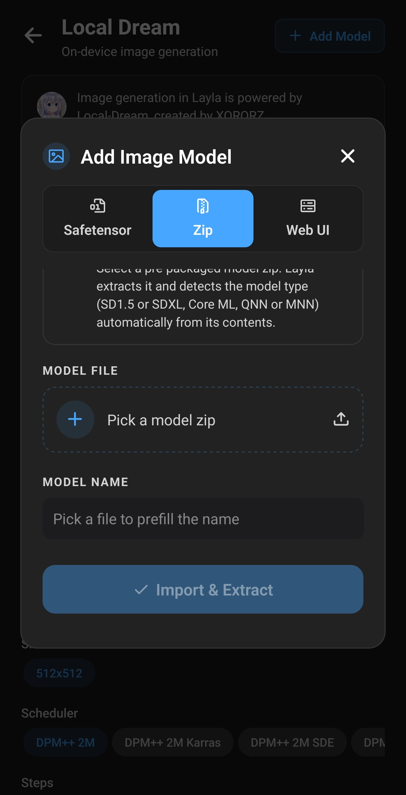
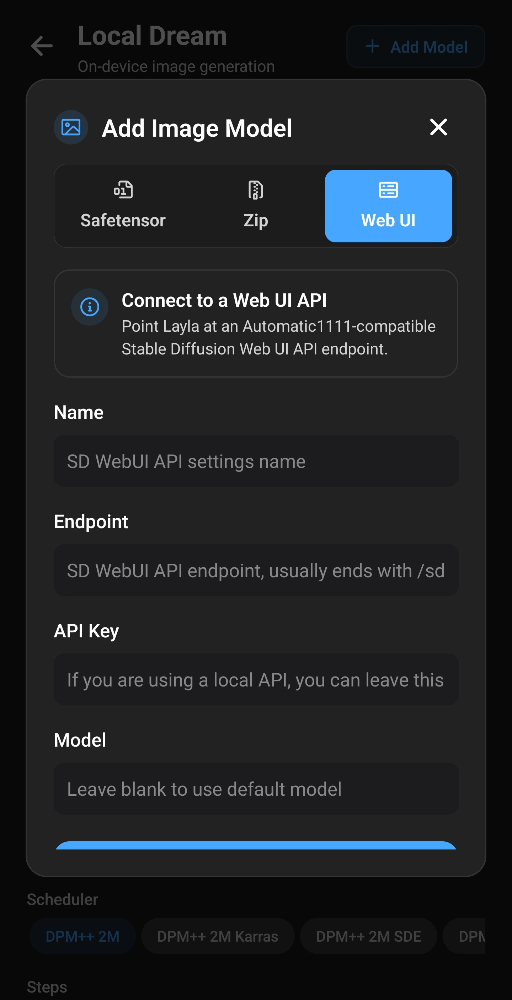

**Layla importiert eigene Bildmodelle, darunter Stable-Diffusion-Checkpoints von Civitai, auf drei Wegen: safetensors- oder GGUF-Dateien mit Konvertierung auf dem Gerät, vorbereitete Zip-Pakete oder eine Verbindung zu Stable Diffusion Web UI auf Ihrem PC.** Dateibasierte Modelle erzeugen Bilder offline auf Android oder iPhone. Die passende Methode hängt von Modellfamilie und Chip ab.

Dieser Überblick erklärt Importbildschirm, Methoden, unterstützte Modelle und die optionale Mini-App NPU Forge. Checkpoints werden vollständig auf Ihrem Gerät importiert; die ausgewählten Dateien werden nirgendwo hochgeladen.

Für die bereits angebotenen Modelle lesen Sie [Bildgenerierung in Layla aktivieren](/de/how-to-enable-image-generation-in-layla/).

## Warum ein eigenes Bildmodell importieren?

Die integrierte Auswahl ist nur ein Teil des Angebots. [Civitai](https://civitai.com/) und [Hugging Face](https://huggingface.co/) bieten Community-Checkpoints für Fotorealismus, Anime und Illustrationen sowie LoRAs für bestimmte Figuren, Kleidung oder Looks. Durch Import können Sie diese statt nur der integrierten Liste nutzen.

Importierte Modelle laufen in Local Dream auf Ihrem Gerät. Der gesamte Vorgang bleibt lokal:

- **Offline.** Nach dem Import ohne Internet, Konto oder Abo generieren.
- **Privat.** Prompts und Bilder bleiben auf dem Smartphone, ohne Online-Prüfung.
- **Flexibel.** Text-zu-Bild und bei den meisten Typen Bild-zu-Bild. Auch Ihre Charaktere können das Modell im Chat verwenden.

## Ein eigenes Modell in Layla importieren

Zwei Wege öffnen denselben Bildschirm **Add Image Model**:

- **Settings** → **Inference Settings** → **Image Generation** → **Add Custom Model**.
- In **Local Dream** oben **Add Model** antippen.

Local Dream übernimmt die lokale Berechnung und ist für alle Methoden außer Web UI erforderlich. Installieren Sie die Mini-App zuerst; siehe [Mini-Apps aktivieren oder deaktivieren](/de/how-to-enable-disable-mini-apps-within-layla/). Eine veraltete Version muss vor dem Import aktualisiert werden; Layla weist darauf hin.

Es gibt bis zu drei Tabs: **Safetensor**, **Zip**, **Web UI**. Nach dem Import wird das Modell gespeichert und automatisch gewählt. Lassen Sie Layla geöffnet; große Imports können mehrere Minuten dauern.

## Die drei Importmethoden

|                 | Safetensor                                         | Zip                                | Web UI                     |
| --------------- | -------------------------------------------------- | ---------------------------------- | -------------------------- |
| Eingabe         | `.safetensors`-Checkpoint oder `.gguf` auf Android | Für Layla vorbereitetes Modell-Zip | Web-UI-API-Adresse         |
| Laylas Aufgabe  | In lokales Modell konvertieren                     | Entpacken und Typ erkennen         | Verbindungsdaten speichern |
| Berechnung      | Ihr Gerät                                          | Ihr Gerät                          | Computer mit Web UI        |
| Plattformen     | Android und iOS (iOS nur SD 1.5)                   | Android und iOS                    | Android und iOS            |
| Typische Quelle | [Civitai](https://civitai.com/) und Hugging Face   | Vorkonvertierte Pakete             | Ihr PC                     |

## Welche Bildmodelle unterstützt Layla?

Unter Android legt **Base Model** im Safetensor-Tab fest, wie konvertiert wird. Wählen Sie die Familie, auf der Ihr Checkpoint trainiert wurde.

| Basismodell    | Ergebnis                                             | Hardware       | Plattformen     |
| -------------- | ---------------------------------------------------- | -------------- | --------------- |
| SD 1.5         | Einzelnes lokales Modell mit zusammengeführten LoRAs | CPU            | Android und iOS |
| SDXL           | Q4_0-GGUF-Modell; LoRAs während der Generierung      | Snapdragon-NPU | Android         |
| MOSS           | Q4_0-GGUF-Diffusionsmodell                           | Snapdragon-NPU | Android         |
| Qwen Image 2.1 | Q4_0-GGUF-Diffusionsmodell                           | Snapdragon-NPU | Android         |
| Flux 2 Klein   | Q4_0-GGUF-Diffusionsmodell                           | Snapdragon-NPU | Android         |

Hinweise zur Tabelle:

- **SD 1.5** ist auf Civitai besonders verbreitet und die einzige auf iOS importierbare Familie. Sie läuft auf der CPU fast aller neueren Smartphones.
- **SDXL, MOSS, Qwen Image 2.1 und Flux 2 Klein** verwenden dieselbe NPU-Engine wie die integrierten Modelle. Sie benötigt Snapdragon 8 Elite (SM8750) oder neuer. Beim Import erfolgt keine Chipwarnung; prüfen Sie die Hardware vorher.
- **MOSS, Qwen Image 2.1 und Flux 2 Klein** verwenden Tokenizer, Textencoder und VAE des passenden integrierten Modells. Laden Sie es zuerst herunter; siehe [Basismodellpakete](#models-that-need-a-base-model-first).
- **Z-Image Turbo, Krea 2 Turbo und andere integrierte NPU-Modelle** fehlen in Base Model. Sie können sie herunterladen, aber keine eigenen Checkpoints dieser Familien importieren.

Civitai nennt das Basismodell auf der Modellseite. Prüfen Sie es vor dem Download. Layla kontrolliert die gewählte Familie nicht anhand der Datei; eine falsche Wahl kann Import oder Generierung scheitern lassen.

## safetensors- oder GGUF-Checkpoint importieren

1. Laden Sie den Checkpoint auf das Smartphone. Civitai-Filter: **Model Type: Checkpoint**, **File format: SafeTensor** und gewünschtes **Base Model**. Siehe [SD-1.5-Beispiel mit Screenshots](/de/how-to-import-sd1-5-safetensor-models-from-civit-ai-into-layla/).
2. Öffnen Sie **Add Image Model** → **Safetensor**.
3. Wählen Sie auf Android **Base Model**. Auf iOS fehlt die Liste, da nur SD 1.5 verfügbar ist.
4. Wählen Sie die Datei unter **MODEL CHECKPOINT**. Zulässig sind `.safetensors` und auf Android auch `.gguf`.
5. Prüfen Sie **MODEL NAME**. Layla übernimmt den Dateinamen; Sie können ihn ändern.
6. Fügen Sie optional LoRAs hinzu, wie unten beschrieben.
7. Tippen Sie auf **Import & Convert**.

Ohne nötige Konvertierung heißt die Taste **Import**, etwa bei GGUF oder reinen LoRA-Imports. Layla zeigt den Fortschritt beim Kopieren und Konvertieren und entfernt temporäre Kopien. Die Originaldatei bleibt unverändert.

### GGUF-Dateien

Auf Android können Sie ein `.gguf`-Diffusionsmodell statt safetensors wählen. Layla kopiert es ohne Konvertierung und ist dadurch schneller. Das passende Basismodell bestimmt die benötigten Zusatzdateien.

### LoRAs

Ein LoRA ist eine kleine Ergänzung für einen Stil, Charakter oder Begriff. Tippen Sie unter **LORA FILES (OPTIONAL)** auf **Add LoRA**, wählen Sie `.safetensors` und die Stärke, standardmäßig 1.0. Mehrere LoRAs sind möglich.

Die Anwendung hängt von der Familie ab:

- **SD 1.5**: LoRAs werden in das konvertierte Modell integriert und lassen sich danach nicht ändern oder entfernen.
- **SDXL, MOSS, Qwen Image 2.1, Flux 2 Klein**: LoRAs werden in den Modellordner kopiert und bei der Generierung angewendet.

### Modelle, die zuerst ein Basismodell benötigen

MOSS, Qwen Image 2.1 und Flux 2 Klein benötigen Zusatzdateien eines bereits in Local Dream geladenen Modells. Fehlen sie, warnt Safetensor und deaktiviert den Import. Laden Sie zuerst eines dieser Modelle:

| Base Model     | Download in Local Dream                  |
| -------------- | ---------------------------------------- |
| MOSS           | MOSS-Image Turbo oder MOSS-Image Base    |
| Qwen Image 2.1 | Qwen Image 2.1 oder Qwen Image 2.1 Turbo |
| Flux 2 Klein   | FLUX.2 Klein 4B                          |

Bei diesen drei Familien erstellt **LoRA only** ein neues Modell aus dem geladenen Basismodell und Ihren LoRAs, ohne Checkpoint. Das spart Zeit und Speicher für die Checkpoint-Konvertierung.

## Zip importieren

**Zip** ist für bereits konvertierte, für Layla vorbereitete Modelle. Wählen Sie das Zip, prüfen Sie den Namen und tippen Sie auf **Import & Extract**.

Layla entpackt das Archiv und erkennt den Typ am Inhalt:

- Core-ML-Paket: SD 1.5 Core ML für iOS;
- SDXL mit MNN-Dateien: SDXL CPU;
- SDXL mit QNN-Dateien: SDXL NPU;
- ANIMA-Paket: ANIMA NPU;
- Paket mit QNN-Dateien: SD 1.5 NPU;
- sonst: SD 1.5 CPU.

Die letzte Erkennung ist ein Fallback. Ein ungeeignetes Zip kann deshalb ohne Fehler importieren, später aber nicht generieren. Nutzen Sie vertrauenswürdige Quellen mit ausdrücklich für Local Dream vorgesehenen Paketen. QNN-Pakete sind chipspezifisch; prüfen Sie die unterstützten Snapdragon-Chips vorab.

## Web UI verbinden

Mit [AUTOMATIC1111 Stable Diffusion Web UI](https://github.com/AUTOMATIC1111/stable-diffusion-webui) auf Ihrem PC verbindet der Tab **Web UI** Layla mit dessen API. Der Computer erzeugt die Bilder. Eine Netzwerkverbindung zum PC ist nötig; diese Methode läuft nicht offline.

Tragen Sie ein:

- **Name**: frei erkennbarer Name.
- **Endpoint**: API-Adresse, meist mit `/sdapi/v1/text2img` am Ende.
- **API Key**: für eine lokale API leer lassen.
- **Model**: leer lassen, um das Standardmodell der Web UI zu nutzen.

Tippen Sie auf **Save & Select**. [Bildgenerierung aktivieren](/de/how-to-enable-image-generation-in-layla/) behandelt die Einrichtung der Web UI.

## Schnellere Generierung auf der Snapdragon-NPU mit NPU Forge

Ein SD-1.5-safetensors-Import läuft auf der CPU. Bei unterstützten Qualcomm-Snapdragon-Chips kann **NPU Forge** denselben Checkpoint in QNN konvertieren, um auf Qualcomms schnellerem KI-Beschleuniger, der NPU, zu generieren.

NPU Forge ist eine eigene Android-Mini-App für SD 1.5 und SDXL. Sie kann LoRAs zusammenführen und fertige Modelle direkt in Local Dream ablegen. Bei unterstützten Chips verlinkt Safetensor darauf. Die [NPU-Forge-Anleitung](/de/how-to-convert-safetensors-to-qnn-with-npu-forge-in-layla/) enthält Schritte und Speicherbedarf.

## Nach dem Import

In Local Dream ist das neue Modell bereits ausgewählt. Über die Liste oben wechseln Sie es. Standardwerte sind 20 Schritte und CFG 5, bei Flux 2 Klein 4 Schritte und CFG 1. Beide Werte sind änderbar; für wenige Schritte trainierte Modelle benötigen meist niedrigere Werte.

Für ein ausgewähltes Modell stehen zwei Aktionen bereit:

- **Model setup** für Imports mit neuer Engine: SDXL, MOSS, Qwen Image 2.1, Flux 2 Klein. Dort bearbeiten Sie Dateien, Sampler und LoRAs.
- **Delete Model** löscht das Modell und gibt Speicher frei.

Importierte Modelle erscheinen auch bei den Bildmodellen Ihrer Charaktere. [Bildgenerierung aktivieren](/de/how-to-enable-image-generation-in-layla/) erklärt die Zuweisung pro Charakter.

## Häufige Fragen

### Kann Stable Diffusion offline auf Android laufen?

Ja, über Local Dream auf der CPU der meisten Smartphones oder der NPU unterstützter Snapdragon-Chips. Nach dem Modelldownload ist kein Internet erforderlich.

### Kann SDXL auf meinem Smartphone laufen?

Ja, unter Android mit Snapdragon 8 Elite (SM8750) oder neuer. Wählen Sie **SDXL** im Safetensor-Tab für ein NPU-Modell. Alternativen sind vorkonvertierte **Zip**-Pakete und NPU Forge auf unterstützten Chips.

### Läuft Stable Diffusion auf dem iPhone?

Ja, SD 1.5: safetensors über **Safetensor**, Core-ML-Pakete über **Zip**. Andere Familien sind nur auf Android verfügbar.

### Kann ich Civitai-Modelle auf dem Smartphone nutzen?

Ja, wenn der safetensors-Checkpoint zu einer unterstützten Familie gehört. Filtern Sie nach **Checkpoint**, **SafeTensor**, **SD 1.5** oder **SDXL** und importieren Sie den Download über **Safetensor**.

### Was ist eine safetensors-Datei?

Ein Format für Modellgewichte, das die meisten Stable-Diffusion-Checkpoints und LoRAs auf Civitai verwenden. Es ersetzt `.ckpt` und kann anders als dieses keinen ausführbaren Code enthalten, ein Grund für seine Verbreitung.

### Was unterscheidet Checkpoint und LoRA?

Ein Checkpoint ist ein vollständiges Bildmodell. Ein LoRA ergänzt einen Stil oder ein Motiv und funktioniert nur mit derselben Basisfamilie. Wählen Sie zuerst den Checkpoint, dann die LoRAs.

### Unterstützt Layla LoRAs für Stable Diffusion?

Ja. Unter **Safetensor** fügen Sie mehrere mit eigener Stärke hinzu. Bei SD 1.5 werden sie integriert, bei SDXL, MOSS, Qwen Image 2.1 und Flux 2 Klein während der Generierung angewendet.

### Brauche ich Snapdragon für eigene Bildmodelle?

Nein. SD 1.5 läuft auf der CPU der meisten neueren Android-Geräte und iPhones. Snapdragon ist nur für NPU-Modelle nötig, einschließlich NPU-Forge-Konvertierungen und Android-Imports von SDXL, MOSS, Qwen Image 2.1 und Flux 2 Klein.

### Kann ich jedes Stable-Diffusion-Modell importieren?

Nein. Unterstützt werden SD 1.5 und SDXL sowie auf Android MOSS, Qwen Image 2.1 und Flux 2 Klein. Andere Familien wie SD 2.x stehen nicht in Base Model.

### Benötigt der Import Internet?

Nur für Mini-App-Installation und nötige Basismodelldownloads. Die Konvertierung ist lokal. Ausnahme: Web UI benötigt während der Generierung Zugriff auf den PC.

### Warum fehlt Base Model auf meinem iPhone?

iOS importiert nur SD-1.5-safetensors; eine Auswahl ist unnötig. Zip akzeptiert zusätzlich Core-ML-Pakete.

### Läuft mein importiertes Modell auf der NPU?

SD-1.5-safetensors-Imports verwenden die CPU. NPU Forge konvertiert SD 1.5 oder SDXL für die NPU. Android-Imports von SDXL, MOSS, Qwen Image 2.1 und Flux 2 Klein zielen bereits auf die NPU und benötigen Snapdragon 8 Elite oder neuer.

### Kann ich ein LoRA nach dem SD-1.5-Import ändern?

Nein, es ist fest integriert. Importieren Sie den Originalcheckpoint mit anderen LoRAs oder Stärken erneut unter einem neuen Namen.

### Warum muss ich Local Dream aktualisieren?

Der Import benötigt Konvertierungsdateien aus der Mini-App. Aktualisieren Sie sie über die Mini-App-Übersicht und versuchen Sie es erneut.

### Wie entferne ich ein importiertes Modell?

Öffnen Sie Local Dream, wählen Sie das Modell und **Delete Model**.

### Wo finde ich Modelle zum Importieren?

Die meisten Checkpoints liegen auf [Civitai](https://civitai.com/) und [Hugging Face](https://huggingface.co/). Prüfen Sie vorab das Basismodell: Es bestimmt die Importmethode.

## Mitwirkende

Die Bildgenerierung verwendet [Local Dream](https://github.com/xororz/local-dream) von XORORZ. NPU Forge wurde von AbrahamPaulJ entwickelt.
