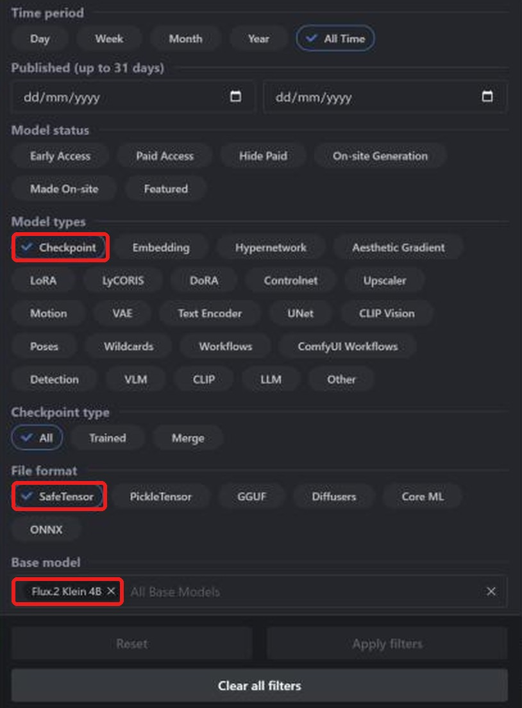
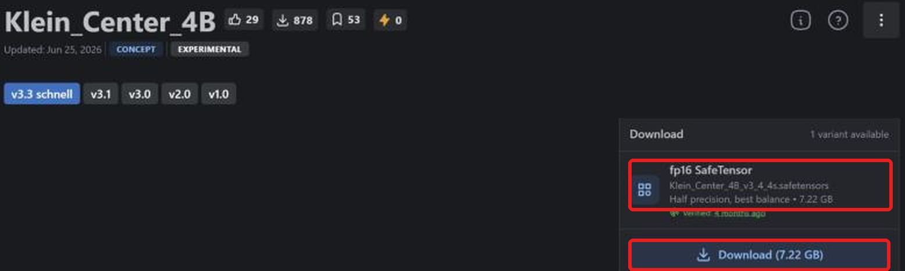
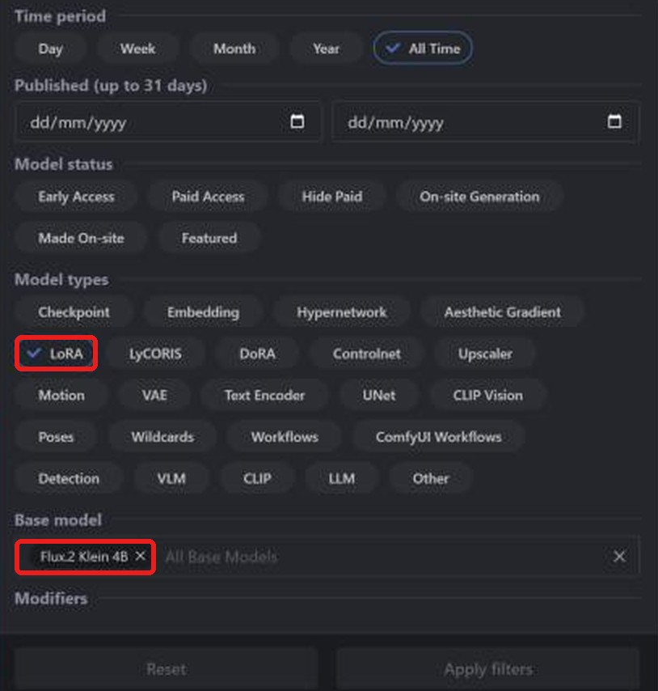
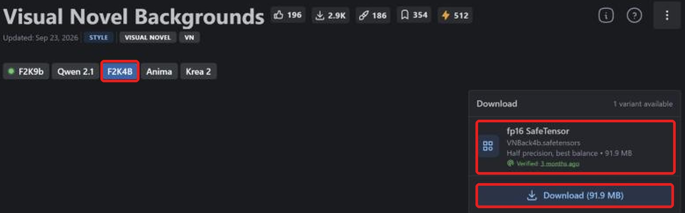

**Layla importiert FLUX.2-Klein-4B-safetensors-Checkpoints und LoRAs von Civitai für Offline-Bilder auf Android.** Für das kompakte Text-zu-Bild-Modell gibt es Community-Finetunes und LoRAs auf [Civitai](https://civitai.com/). Layla konvertiert lokal; danach ist keine Internetverbindung zum Generieren nötig.

Diese Anleitung erklärt Suche, richtigen Download, Import und LoRAs. Andere Familien: [SD 1.5](/de/how-to-import-sd1-5-safetensor-models-from-civit-ai-into-layla/), [SDXL](/de/how-to-import-sdxl-safetensor-models-from-civitai-into-layla/), [MOSS Image](/de/how-to-import-moss-image-safetensor-models-from-civitai-into-layla/), [Qwen Image 2.1](/de/how-to-import-qwen-image-2-1-safetensor-models-from-civitai-into-layla/). GGUF, Zip und Web UI behandelt [Eigene Bildgenerierungsmodelle in Layla importieren](/de/how-to-import-custom-image-generation-models-into-layla/).

## Was ist FLUX.2 Klein?

FLUX.2 [klein] ist eine Modellfamilie von Black Forest Labs, dem Entwickler von FLUX. Das 4B-Modell hat ungefähr 4 Milliarden Parameter und wurde für etwa 4 Generierungsschritte destilliert. Es gibt auch ein größeres 9B-Modell.

Civitai unterscheidet **Flux.2 Klein 4B** und **Flux.2 Klein 9B**. Laylas **Flux 2 Klein** basiert auf 4B: Filtern Sie nach **Flux.2 Klein 4B**. Klein-4B-LoRAs benötigen Klein-4B-Checkpoints.

## Voraussetzungen

- Android mit Snapdragon 8 Elite (SM8750) oder neuer. FLUX.2 Klein-Imports laufen auf der Snapdragon-NPU und sind nicht für iPhone verfügbar. Layla prüft den Chip beim Import nicht; kontrollieren Sie ihn vor einer großen Konvertierung.

- Die Mini-App **Local Dream**. Zur Installation siehe [Mini-Apps in Layla aktivieren oder deaktivieren](/de/how-to-enable-disable-mini-apps-within-layla/).

- Ein in Local Dream heruntergeladenes integriertes Modell: **FLUX.2 Klein 4B**. Layla verwendet dessen Tokenizer, Textencoder und VAE. Fehlen sie, warnt Safetensor und deaktiviert den Import.

- Freier Speicher für den Checkpoint: Klein 4B in fp16 benötigt etwa 7 GB.

## Welche safetensors-Datei herunterladen?

**Layla unterstützt f16-safetensors (halbe Genauigkeit)**, auf Civitai **fp16 SafeTensor** genannt. Für FLUX.2 Klein werden auch bf16-Dateien akzeptiert. Quantisierte Varianten wie **fp8**, **int8**, **int4** und **nvfp4** werden nicht unterstützt.

Auch bf16 funktioniert, einschließlich des offiziellen FLUX.2-Klein-4B-Checkpoints. Viele Klein-Modelle werden als kleineres, nicht unterstütztes fp8 angeboten. Prüfen Sie die Downloadangaben.

## Einen FLUX.2 Klein-Checkpoint von Civitai importieren

### Schritt 1: Civitai und Models öffnen

Öffnen Sie [civitai.com](https://civitai.com/) und wählen Sie oben **Models**. Die Screenshots stammen vom Desktop-Browser; auf dem Smartphone kann das Layout abweichen.

### Schritt 2: Checkpoint, SafeTensor und Flux.2 Klein 4B filtern

Öffnen Sie oben rechts **Filters**:

1. **Model types**: **Checkpoint**.
2. **File format**: **SafeTensor**.
3. **Base model**: **Flux.2 Klein 4B** suchen und auswählen.

Jetzt sehen Sie FLUX.2 Klein-Checkpoints im passenden Format. [Gefilterte Liste öffnen](https://civitai.com/models?types=Checkpoint&fileFormats=SafeTensor&baseModels=Flux.2%20Klein%204B&sort=Most%20Downloaded).

### Schritt 3: Die fp16-safetensors-Datei herunterladen

Öffnen Sie das Modell und prüfen Sie rechts **Download**. Wählen Sie **fp16 SafeTensor**, hier 7.22 GB, und **Download**. Bei mehreren Varianten nehmen Sie fp16. Unterstützte bf16-Ausnahmen sind oben erklärt.

Sie benötigen nur den Checkpoint. Civitais **Required Components** wie Textencoder und VAE sind für andere Programme bestimmt. Layla verwendet die Zusatzdateien des bereits in Local Dream geladenen Basismodells.

### Schritt 4: In Layla importieren

Öffnen Sie **Settings** → **Inference Settings** → **Image Generation** → **Add Custom Model** oder **Local Dream** → **Add Model**.

Wählen Sie unter **Safetensor** das **Base Model** **Flux 2 Klein**.

Wählen Sie unter **MODEL CHECKPOINT** die Datei, prüfen Sie **MODEL NAME** und tippen Sie auf **Import & Convert**. Layla konvertiert in ein Q4_0-GGUF-Diffusionsmodell. Das dauert eventuell mehrere Minuten; lassen Sie die App geöffnet. Das fertige Modell wird gespeichert und automatisch gewählt.

Layla prüft die Modellfamilie nicht anhand der Datei. **Flux 2 Klein** für eine andere Familie auszuwählen kann Import oder Generierung scheitern lassen.

### Schritt 5: Ein Bild erzeugen

Öffnen Sie **Local Dream**, prüfen Sie das Modell und geben Sie einen Prompt ein. Klein ist für wenige Schritte ausgelegt; Layla startet mit 4 Schritten und CFG 1. Beides ist änderbar.

## Ein FLUX.2 Klein-LoRA von Civitai hinzufügen

Ein LoRA ist eine kleine Datei, die Stil verändert oder einen Charakter, ein Objekt oder Konzept ergänzt. Die Suche ähnelt der nach Checkpoints, mit anderem Modelltyp.

### Schritt 1: LoRA und Flux.2 Klein 4B filtern

Öffnen Sie **Models** → **Filters**, unter **Model types** wählen Sie **LoRA**, unter **Base model** **Flux.2 Klein 4B**. [Gefilterte Liste öffnen](https://civitai.com/models?types=LORA&fileFormats=SafeTensor&baseModels=Flux.2%20Klein%204B&sort=Most%20Downloaded). Das Filterpanel ist dasselbe wie für Checkpoints.

### Schritt 2: Die LoRA-safetensors-Datei herunterladen

Die Seite kann zuerst **F2K9b** für 9B anzeigen. Wechseln Sie zu **F2K4B** für 4B. Prüfen Sie **fp16 SafeTensor**, hier 91,9 MB, und wählen Sie **Download**.

### Schritt 3: LoRA beim Import hinzufügen

Wählen Sie unter **Safetensor** das **Base Model** **Flux 2 Klein** und Ihren Checkpoint. Unter **LORA FILES (OPTIONAL)** → **Add LoRA** wählen Sie die Datei und Stärke (Standard 1.0). Mehrere sind möglich. Starten Sie anschließend **Import & Convert**.

Bei FLUX.2 Klein werden LoRAs in den Modellordner kopiert und während der Generierung angewendet. Wählen Sie danach das Modell in Local Dream und **Model setup**, um Dateien, Sampler und LoRAs anzusehen oder zu ändern.

### LoRA ohne vollständigen Checkpoint verwenden

Aktivieren Sie bei FLUX.2 Klein unter **Safetensor** **LoRA only**. Das neue Modell nutzt die bereits geladene Basis in Local Dream und Ihre LoRAs ohne Checkpoint. Das spart Zeit und Speicher der Konvertierung.

## Häufige Fragen

### Kann ich FLUX.2 Klein auf meinem Smartphone nutzen?

Ja, mit den oben genannten Voraussetzungen. Wählen Sie **Flux 2 Klein** als **Base Model** und importieren Sie den Civitai-Checkpoint. Familien mit wiederverwendeter Basis benötigen vorher den entsprechenden Download in Local Dream.

### Welche FLUX.2 Klein-Datei von Civitai soll ich laden?

**fp16 SafeTensor** oder bf16. Kein fp8, int8, int4 oder nvfp4.

### Kann ich FLUX.2 Klein 9B importieren?

Laylas Flux-2-Klein-Option basiert auf 4B. Verwenden Sie für Checkpoints und LoRAs **Flux.2 Klein 4B**.

### Kann ich FLUX.1 importieren?

Nein. FLUX.1 ist eine andere Familie und steht nicht in Base Model.

### Kann ich FLUX.2 Klein auf iPhone importieren?

Nein. iOS importiert nur SD-1.5-safetensors. Siehe die oben verlinkte SD-1.5-Anleitung.

### Braucht ein Civitai-Import Internet?

Nur zum Dateidownload. Konvertierung und Bildgenerierung erfolgen auf Ihrem Gerät.

### Wie lösche ich ein importiertes Modell?

Öffnen Sie **Local Dream**, wählen Sie das Modell und **Delete Model**, um Speicher freizugeben.

## FLUX.2 Klein offline auf dem Smartphone

Nach dem Import läuft FLUX.2 Klein ohne Internet, Konto oder Abo auf Ihrem Smartphone. Prompts, Modell und Bilder bleiben auf dem Gerät.
