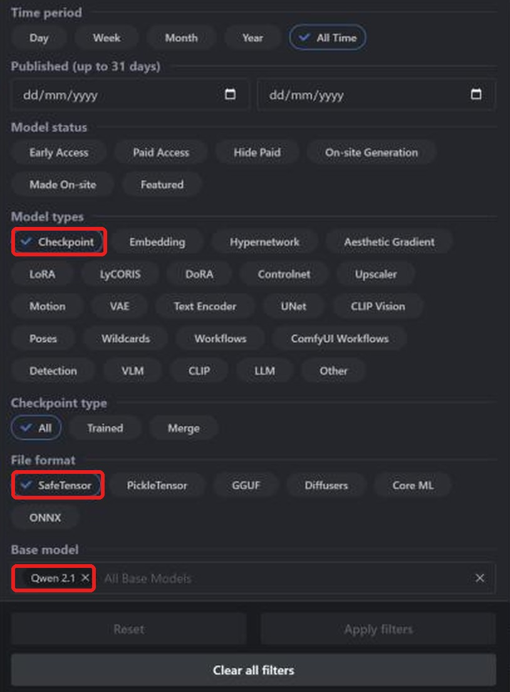
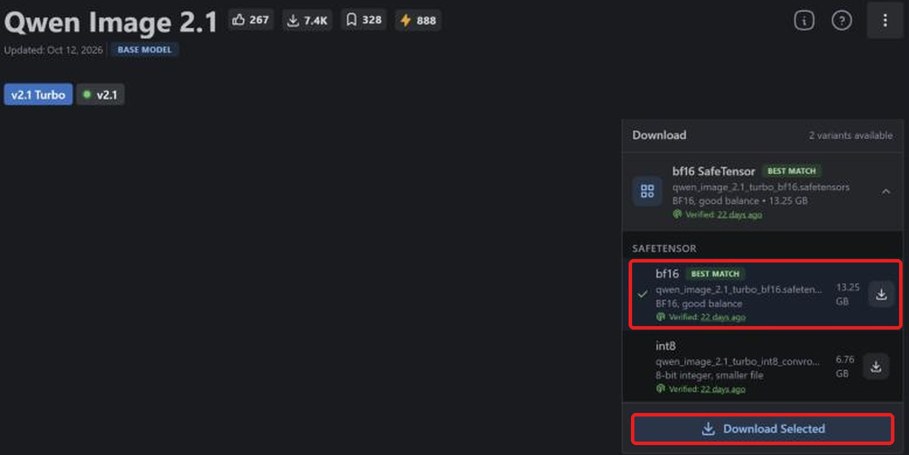
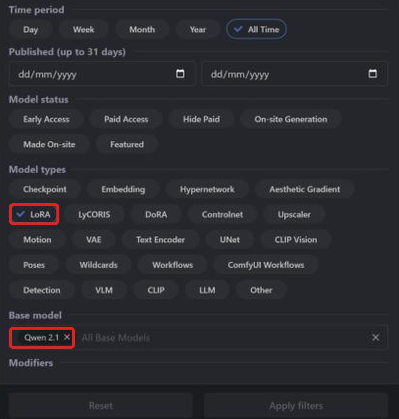
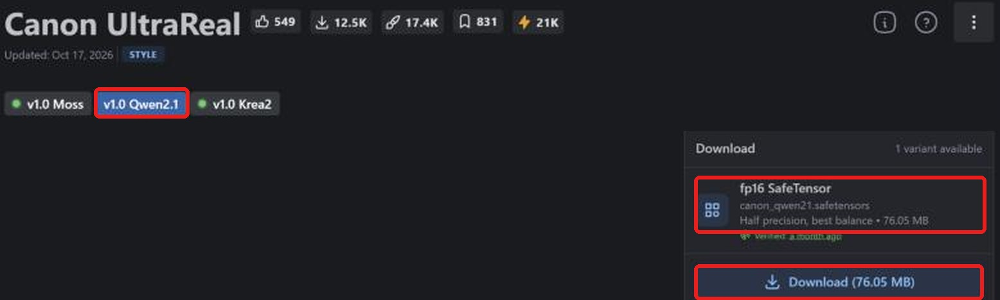

**Layla importiert Qwen-Image-2.1-safetensors-Checkpoints und LoRAs von Civitai für Offline-Bilder auf Android.** Die Community bietet Finetunes und LoRAs dieses neueren Text-zu-Bild-Modells auf [Civitai](https://civitai.com/). Nach Download und lokaler Konvertierung ist kein Internet nötig.

Diese Anleitung erklärt Suche, richtigen Download, Import und LoRAs. Andere Familien: [SD 1.5](/de/how-to-import-sd1-5-safetensor-models-from-civit-ai-into-layla/), [SDXL](/de/how-to-import-sdxl-safetensor-models-from-civitai-into-layla/), [MOSS Image](/de/how-to-import-moss-image-safetensor-models-from-civitai-into-layla/), [FLUX.2 Klein](/de/how-to-import-flux-2-klein-safetensor-models-from-civitai-into-layla/). GGUF, Zip und Web UI behandelt [Eigene Bildgenerierungsmodelle in Layla importieren](/de/how-to-import-custom-image-generation-models-into-layla/).

## Was ist Qwen Image 2.1?

Qwen-Image-2.1 stammt von Alibabas Qwen-Team und wurde im September 2026 mit offenen Gewichten veröffentlicht. Der Bildgenerator hat etwa 7 Milliarden Parameter und unterstützt Text-zu-Bild sowie Bildbearbeitung. Prüfen Sie vor kommerzieller Nutzung die Lizenz: Sie unterscheidet sich von früheren Qwen-Image-Versionen.

Wählen Sie auf Civitai **Qwen 2.1**, in Layla **Qwen Image 2.1**. LoRAs brauchen dieselbe Basis. Civitais separate Filter **Qwen**, **Qwen 2** und **Qwen 3** bezeichnen andere Familien.

## Voraussetzungen

- Android mit Snapdragon 8 Elite (SM8750) oder neuer. Qwen Image 2.1-Imports laufen auf der Snapdragon-NPU und sind nicht für iPhone verfügbar. Layla prüft den Chip beim Import nicht; kontrollieren Sie ihn vor einer großen Konvertierung.

- Die Mini-App **Local Dream**. Zur Installation siehe [Mini-Apps in Layla aktivieren oder deaktivieren](/de/how-to-enable-disable-mini-apps-within-layla/).

- Ein in Local Dream heruntergeladenes integriertes Modell: **Qwen Image 2.1** / **Qwen Image 2.1 Turbo**. Layla verwendet dessen Tokenizer, Textencoder und VAE. Fehlen sie, warnt Safetensor und deaktiviert den Import.

- Viel freier Speicher: Ein bf16-Qwen-Image-2.1-Checkpoint benötigt über 13 GB.

## Welche safetensors-Datei herunterladen?

**Layla unterstützt f16-safetensors (halbe Genauigkeit)**, auf Civitai **fp16 SafeTensor** genannt. Für Qwen Image 2.1 werden auch bf16-Dateien akzeptiert. Quantisierte Varianten wie **fp8**, **int8**, **int4** und **nvfp4** werden nicht unterstützt.

Zum Zeitpunkt der Erstellung fanden wir keinen fp16-Qwen-2.1-Checkpoint auf Civitai, nur bf16 oder quantisierte Dateien. Wählen Sie **bf16 SafeTensor**. Auf der offiziellen Seite zeigt **Best match** auf bf16, auf anderen Seiten eventuell auf quantisierte Varianten. Prüfen Sie jede Seite.

## Einen Qwen Image 2.1-Checkpoint von Civitai importieren

### Schritt 1: Civitai und Models öffnen

Öffnen Sie [civitai.com](https://civitai.com/) und wählen Sie oben **Models**. Die Screenshots stammen vom Desktop-Browser; auf dem Smartphone kann das Layout abweichen.

### Schritt 2: Checkpoint, SafeTensor und Qwen 2.1 filtern

Öffnen Sie oben rechts **Filters**:

1. **Model types**: **Checkpoint**.
2. **File format**: **SafeTensor**.
3. **Base model**: **Qwen 2.1** suchen und auswählen.

Jetzt sehen Sie Qwen Image 2.1-Checkpoints im passenden Format. [Gefilterte Liste öffnen](https://civitai.com/models?types=Checkpoint&fileFormats=SafeTensor&baseModels=Qwen%202.1&sort=Most%20Downloaded).

### Schritt 3: Die bf16-safetensors-Datei herunterladen

Öffnen Sie unter **Download** die Variantenliste, wählen Sie **bf16 SafeTensor**, hier 13,25 GB, und **Download Selected**. Die kleinere **int8**-Datei wird nicht unterstützt. Falls **fp16 SafeTensor** verfügbar ist, bevorzugen Sie diese. Für diese Familie sind f16 und bf16 zulässig.

Sie benötigen nur den Checkpoint. Civitais **Required Components** wie Textencoder und VAE sind für andere Programme bestimmt. Layla verwendet die Zusatzdateien des bereits in Local Dream geladenen Basismodells.

### Schritt 4: In Layla importieren

Öffnen Sie **Settings** → **Inference Settings** → **Image Generation** → **Add Custom Model** oder **Local Dream** → **Add Model**.

Wählen Sie unter **Safetensor** das **Base Model** **Qwen Image 2.1**.

Wählen Sie unter **MODEL CHECKPOINT** die Datei, prüfen Sie **MODEL NAME** und tippen Sie auf **Import & Convert**. Layla konvertiert in ein Q4_0-GGUF-Diffusionsmodell. Das dauert eventuell mehrere Minuten; lassen Sie die App geöffnet. Das fertige Modell wird gespeichert und automatisch gewählt.

Layla prüft die Modellfamilie nicht anhand der Datei. **Qwen Image 2.1** für eine andere Familie auszuwählen kann Import oder Generierung scheitern lassen.

### Schritt 5: Ein Bild erzeugen

Öffnen Sie **Local Dream**, prüfen Sie das Modell und geben Sie einen Prompt ein. Anfangswerte sind 20 Schritte und CFG 5, beide änderbar. Turbo-Checkpoints sind für weniger Schritte und meist niedrigere Werte ausgelegt.

## Ein Qwen Image 2.1-LoRA von Civitai hinzufügen

Ein LoRA ist eine kleine Datei, die Stil verändert oder einen Charakter, ein Objekt oder Konzept ergänzt. Die Suche ähnelt der nach Checkpoints, mit anderem Modelltyp.

### Schritt 1: LoRA und Qwen 2.1 filtern

Öffnen Sie **Models** → **Filters**, unter **Model types** wählen Sie **LoRA**, unter **Base model** **Qwen 2.1**. [Gefilterte Liste öffnen](https://civitai.com/models?types=LORA&fileFormats=SafeTensor&baseModels=Qwen%202.1&sort=Most%20Downloaded). Das Filterpanel ist dasselbe wie für Checkpoints.

### Schritt 2: Die LoRA-safetensors-Datei herunterladen

Wählen Sie die Qwen-Image-2.1-Version, hier **v1.0 Qwen2.1**. Prüfen Sie **fp16 SafeTensor**, hier 76,05 MB, und wählen Sie **Download**.

### Schritt 3: LoRA beim Import hinzufügen

Wählen Sie unter **Safetensor** das **Base Model** **Qwen Image 2.1** und Ihren Checkpoint. Unter **LORA FILES (OPTIONAL)** → **Add LoRA** wählen Sie die Datei und Stärke (Standard 1.0). Mehrere sind möglich. Starten Sie anschließend **Import & Convert**.

Bei Qwen Image 2.1 werden LoRAs in den Modellordner kopiert und während der Generierung angewendet. Wählen Sie danach das Modell in Local Dream und **Model setup**, um Dateien, Sampler und LoRAs anzusehen oder zu ändern.

### LoRA ohne vollständigen Checkpoint verwenden

Aktivieren Sie bei Qwen Image 2.1 unter **Safetensor** **LoRA only**. Das neue Modell nutzt die bereits geladene Basis in Local Dream und Ihre LoRAs ohne Checkpoint. Das spart Zeit und Speicher der Konvertierung.

## Häufige Fragen

### Kann ich Qwen Image 2.1 auf meinem Smartphone nutzen?

Ja, mit den oben genannten Voraussetzungen. Wählen Sie **Qwen Image 2.1** als **Base Model** und importieren Sie den Civitai-Checkpoint. Familien mit wiederverwendeter Basis benötigen vorher den entsprechenden Download in Local Dream.

### Welche Qwen Image 2.1-Datei von Civitai soll ich laden?

**fp16 SafeTensor**, falls vorhanden, sonst **bf16 SafeTensor**. Kein fp8, int8, int4 oder nvfp4.

### Gibt es Qwen Image 2.1 in fp16 auf Civitai?

Zum Erstellungszeitpunkt fanden wir keine solche Qwen-2.1-Datei, nur bf16 oder quantisierte Varianten. Layla importiert für diese Familie bf16.

### Was unterscheidet die Turbo-Version?

Turbo erzeugt Bilder in weniger Schritten. Beide Varianten eignen sich als Importbasis, wenn eine davon zuvor in Local Dream heruntergeladen wurde.

### Kann ich Qwen Image 2.1 auf iPhone importieren?

Nein. iOS importiert nur SD-1.5-safetensors. Siehe die oben verlinkte SD-1.5-Anleitung.

### Braucht ein Civitai-Import Internet?

Nur zum Dateidownload. Konvertierung und Bildgenerierung erfolgen auf Ihrem Gerät.

### Wie lösche ich ein importiertes Modell?

Öffnen Sie **Local Dream**, wählen Sie das Modell und **Delete Model**, um Speicher freizugeben.

## Qwen Image 2.1 offline auf dem Smartphone

Nach dem Import läuft Qwen Image 2.1 ohne Internet, Konto oder Abo auf Ihrem Smartphone. Prompts, Modell und Bilder bleiben auf dem Gerät.
