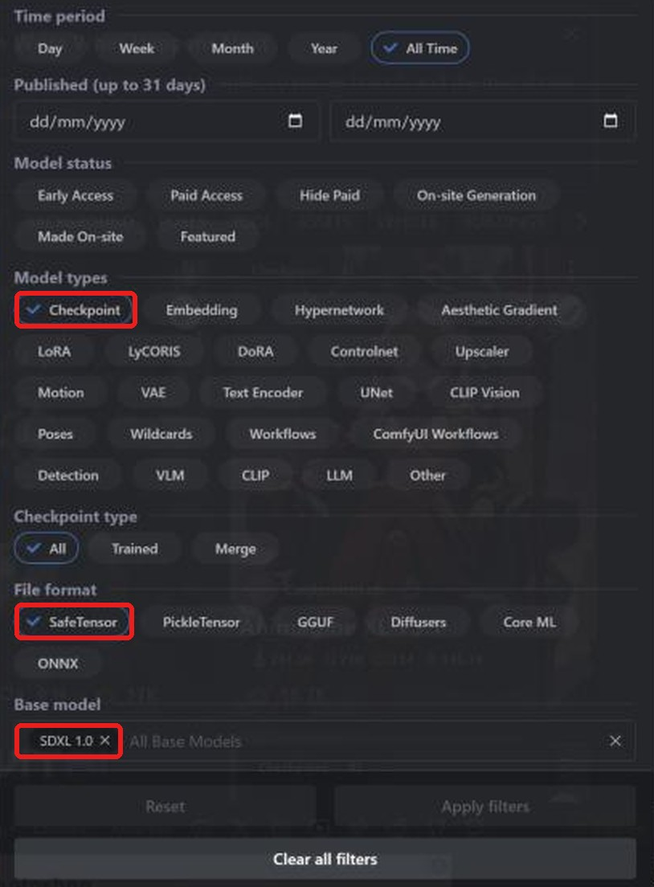
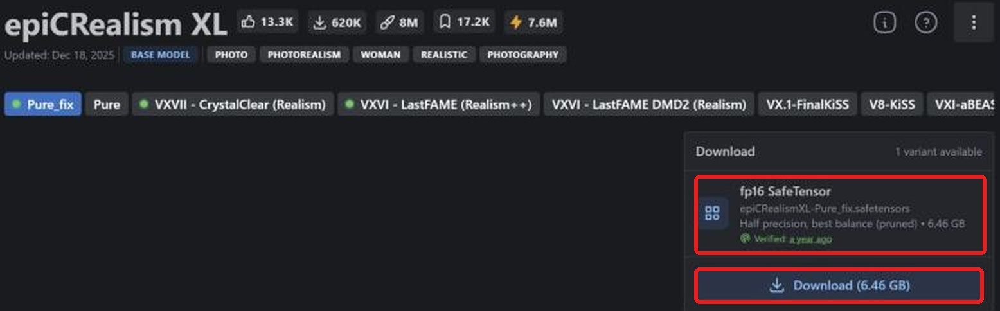
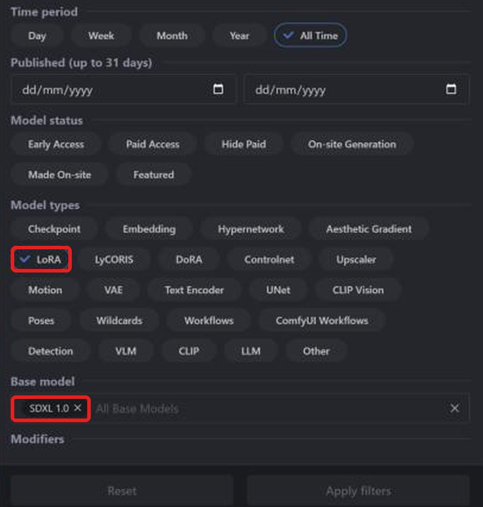
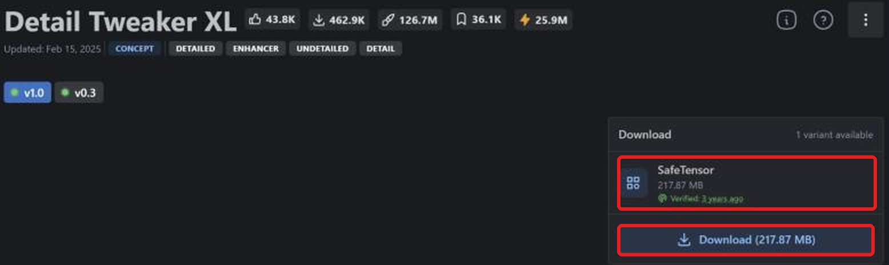

**Layla importiert Stable Diffusion XL (SDXL) als safetensors-Checkpoints und LoRAs von Civitai für die Snapdragon-NPU Ihres Android-Smartphones.** Die meisten SDXL-Modelle auf [Civitai](https://civitai.com/) liegen in diesem Format vor. Nach lokaler Konvertierung ist kein Internet zur Bildgenerierung nötig.

Diese Anleitung erklärt Suche, richtigen Download, Import und LoRAs. Andere Familien: [SD 1.5](/de/how-to-import-sd1-5-safetensor-models-from-civit-ai-into-layla/), [MOSS Image](/de/how-to-import-moss-image-safetensor-models-from-civitai-into-layla/), [Qwen Image 2.1](/de/how-to-import-qwen-image-2-1-safetensor-models-from-civitai-into-layla/), [FLUX.2 Klein](/de/how-to-import-flux-2-klein-safetensor-models-from-civitai-into-layla/). GGUF, Zip und Web UI behandelt [Eigene Bildgenerierungsmodelle in Layla importieren](/de/how-to-import-custom-image-generation-models-into-layla/).

## Was ist SDXL?

SDXL ist Stable Diffusion XL 1.0, der größere Nachfolger von SD 1.5, 2023 von Stability AI veröffentlicht. Es erzeugt 1024 x 1024 statt 512 x 512 Pixel. Der Civitai-Filter heißt **SDXL 1.0**; viele fotorealistische und Anime-Checkpoints bauen darauf auf.

Ein SDXL-LoRA benötigt einen SDXL-Checkpoint. In Laylas **Base Model** heißt die Familie **SDXL**.

## Voraussetzungen

- Android mit Snapdragon 8 Elite (SM8750) oder neuer. SDXL-Imports laufen auf der Snapdragon-NPU und sind nicht für iPhone verfügbar. Layla prüft den Chip beim Import nicht; kontrollieren Sie ihn vor einer großen Konvertierung.

- Die Mini-App **Local Dream**. Zur Installation siehe [Mini-Apps in Layla aktivieren oder deaktivieren](/de/how-to-enable-disable-mini-apps-within-layla/).

- Genug Speicher für den mehrere Gigabyte großen Checkpoint und das konvertierte Modell.

## Welche safetensors-Datei herunterladen?

**Layla unterstützt nur f16-safetensors (halbe Genauigkeit).** Suchen Sie bei Civitai nach **fp16 SafeTensor**. Prüfen Sie die Genauigkeit vor dem Download.

SDXL in fp16 ist ungefähr 6,5 GB groß. Die Modellseite kann auch Vollpräzisions- oder andere Varianten anbieten; prüfen Sie das Label.

## Einen SDXL-Checkpoint von Civitai importieren

### Schritt 1: Civitai und Models öffnen

Öffnen Sie [civitai.com](https://civitai.com/) und wählen Sie oben **Models**. Die Screenshots stammen vom Desktop-Browser; auf dem Smartphone kann das Layout abweichen.

### Schritt 2: Checkpoint, SafeTensor und SDXL 1.0 filtern

Öffnen Sie oben rechts **Filters**:

1. **Model types**: **Checkpoint**.
2. **File format**: **SafeTensor**.
3. **Base model**: **SDXL 1.0** suchen und auswählen.

Jetzt sehen Sie SDXL-Checkpoints im passenden Format. [Gefilterte Liste öffnen](https://civitai.com/models?types=Checkpoint&fileFormats=SafeTensor&baseModels=SDXL%201.0&sort=Most%20Downloaded).

### Schritt 3: Die fp16-safetensors-Datei herunterladen

Öffnen Sie das Modell und prüfen Sie rechts **Download**. Wählen Sie **fp16 SafeTensor**, hier 6.46 GB, und **Download**. Bei mehreren Varianten nehmen Sie fp16. Unterstützte bf16-Ausnahmen sind oben erklärt.

### Schritt 4: In Layla importieren

Öffnen Sie **Settings** → **Inference Settings** → **Image Generation** → **Add Custom Model** oder **Local Dream** → **Add Model**.

Wählen Sie unter **Safetensor** das **Base Model** **SDXL**.

Wählen Sie unter **MODEL CHECKPOINT** die Datei, prüfen Sie **MODEL NAME** und tippen Sie auf **Import & Convert**. Layla konvertiert in ein Q4_0-GGUF-Diffusionsmodell. Das dauert eventuell mehrere Minuten; lassen Sie die App geöffnet. Das fertige Modell wird gespeichert und automatisch gewählt.

Layla prüft die Modellfamilie nicht anhand der Datei. **SDXL** für eine andere Familie auszuwählen kann Import oder Generierung scheitern lassen.

### Schritt 5: Ein Bild erzeugen

Öffnen Sie **Local Dream**, prüfen Sie das Modell und geben Sie einen Prompt ein. Anfangswerte sind 20 Schritte und CFG 5, beide änderbar. SDXL ist für 1024 x 1024 ausgelegt.

## Ein SDXL-LoRA von Civitai hinzufügen

Ein LoRA ist eine kleine Datei, die Stil verändert oder einen Charakter, ein Objekt oder Konzept ergänzt. Die Suche ähnelt der nach Checkpoints, mit anderem Modelltyp.

### Schritt 1: LoRA und SDXL 1.0 filtern

Öffnen Sie **Models** → **Filters**, unter **Model types** wählen Sie **LoRA**, unter **Base model** **SDXL 1.0**. [Gefilterte Liste öffnen](https://civitai.com/models?types=LORA&fileFormats=SafeTensor&baseModels=SDXL%201.0&sort=Most%20Downloaded). Das Filterpanel ist dasselbe wie für Checkpoints.

### Schritt 2: Die LoRA-safetensors-Datei herunterladen

Wählen Sie **Download** für SafeTensor, hier 217,87 MB. Das Label nennt oft nur **SafeTensor**. Bei mehreren Genauigkeiten wählen Sie wie beim Checkpoint **fp16**.

### Schritt 3: LoRA beim Import hinzufügen

Wählen Sie unter **Safetensor** das **Base Model** **SDXL** und Ihren Checkpoint. Unter **LORA FILES (OPTIONAL)** → **Add LoRA** wählen Sie die Datei und Stärke (Standard 1.0). Mehrere sind möglich. Starten Sie anschließend **Import & Convert**.

Bei SDXL werden LoRAs in den Modellordner kopiert und während der Generierung angewendet. Wählen Sie danach das Modell in Local Dream und **Model setup**, um Dateien, Sampler und LoRAs anzusehen oder zu ändern.

## Häufige Fragen

### Kann ich SDXL auf meinem Smartphone nutzen?

Ja, mit den oben genannten Voraussetzungen. Wählen Sie **SDXL** als **Base Model** und importieren Sie den Civitai-Checkpoint. Familien mit wiederverwendeter Basis benötigen vorher den entsprechenden Download in Local Dream.

### Welche SDXL-Datei von Civitai soll ich laden?

**fp16 SafeTensor**. SDXL akzeptiert nur f16. **Best match** kann eine andere Variante markieren; prüfen Sie die Liste.

### Kann ich Pony, Illustrious oder NoobAI importieren?

Sie basieren auf SDXL, werden bei Civitai aber separat von **SDXL 1.0** geführt. Diese Anleitung behandelt den letztgenannten Filter. Layla prüft die Dateifamilie nicht; andere Familien funktionieren nicht garantiert.

### Kann ich SDXL auf iPhone importieren?

Nein. iOS importiert nur SD-1.5-safetensors. Siehe die oben verlinkte SD-1.5-Anleitung.

### Brauche ich Snapdragon für SDXL?

Ja für Laylas SDXL-Import auf die NPU. Auf Snapdragon 8 Gen 3 oder neuer kann auch [NPU Forge](/de/how-to-convert-safetensors-to-qnn-with-npu-forge-in-layla/) SDXL zu QNN konvertieren.

### Braucht ein Civitai-Import Internet?

Nur zum Dateidownload. Konvertierung und Bildgenerierung erfolgen auf Ihrem Gerät.

### Warum meldet Layla eine ungültige Safetensor-Datei?

Die Datei konnte nicht gelesen werden. Prüfen Sie `.safetensors`, fp16 und die Familie SDXL, und wiederholen Sie den Import.

### Wie lösche ich ein importiertes Modell?

Öffnen Sie **Local Dream**, wählen Sie das Modell und **Delete Model**, um Speicher freizugeben.

## SDXL offline auf dem Smartphone

Nach dem Import läuft SDXL ohne Internet, Konto oder Abo auf Ihrem Smartphone. Prompts, Modell und Bilder bleiben auf dem Gerät.
