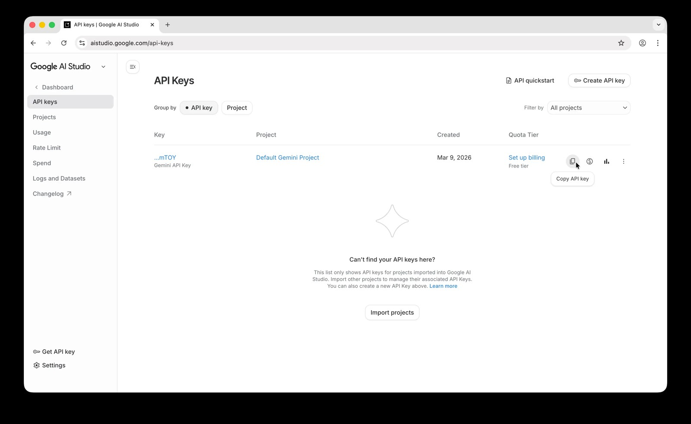

**Ein eigener Agent für die Bilderzeugung macht Layla zu einem KI-Chatbot, der Bilder mit jedem Dienst erzeugt, der eine API anbietet, statt auf die in die App integrierten Modelle beschränkt zu sein.** Wenn dein KI-Charakter in seiner Antwort ein Bild beschreibt, sendet der Agent diese Beschreibung an den Dienst, erhält das fertige Bild und zeigt es in deinem Chat an.

Layla erzeugt bereits Bilder mit Stable-Diffusion-Modellen, entweder auf deinem Gerät oder über Layla Cloud. Ein Agent bietet eine weitere Möglichkeit: Du wählst den Dienst, das Modell und die Einstellungen und verwendest deinen eigenen API-Schlüssel, ein Ansatz, der oft „Bring your own key“ genannt wird. Diese Anleitung baut einen solchen Agenten rund um die Nano-Banana-API. Nano Banana ist Googles Name für seine Gemini-Modelle zur Bilderzeugung, und der Agent in dieser Anleitung verwendet Nano Banana Pro, dessen API-Name `gemini-3-pro-image` lautet.

Die Anleitung verfolgt drei Ziele. Sie zeigt, wie du einen Nano-Banana-API-Schlüssel bekommst und den Agenten einrichtest. Danach erklärt sie jeden Schritt im Code des Agenten, und schließlich beschreibt sie, wie du dasselbe Muster für Agenten mit anderen Bilddiensten wiederverwendest.

Anders als Laylas lokale Modelle braucht dieser Agent eine Internetverbindung. Deine Bildbeschreibung wird an Google gesendet, und Google berechnet jedes Bild. Wenn du mit einem lokalen Modell chattest, bleibt der Rest deiner Unterhaltung auf deinem Gerät.

So sieht der Agent in Aktion aus. Der Charakter antwortet, und auf die Bildbeschreibung, die er geschrieben hat, folgt das fertige Bild:


Wenn du es gleich ausprobieren möchtest, lade hier die Agent-Datei herunter: [google-nano-banana-generate-image.json](/assets/articles/how-to-use-the-google-nano-banana-image-generation-agent/google-nano-banana-generate-image.json). Ohne Google-API-Schlüssel funktioniert sie nicht; wie du ihn bekommst, erklärt die Anleitung weiter unten.

## Warum Nano Banana in Layla nutzen?

Laylas eigene Stable-Diffusion-Modelle sind die richtige Wahl, wenn Bilder vollständig auf deinem Gerät entstehen sollen. Die Nano-Banana-API passt zu anderen Anforderungen:

- **Bildqualität, die nicht von deinem Smartphone abhängt.** Das Bild wird auf Googles Servern erzeugt. Die Geschwindigkeit der CPU oder NPU deines Geräts begrenzt also weder das Ergebnis noch die Wartezeit.
- **Bilder, die dem Gespräch folgen.** Dein Charakter schreibt die Bildbeschreibung aus dem Chat heraus, sodass das Bild zur Szene, zum Outfit oder zum Ort passt, über den ihr sprecht. Das funktioniert für KI-Rollenspiele und Chats mit KI-Begleitern gleichermaßen.
- **Ein lokales Chatmodell mit Bildern aus der Cloud.** Der Agent reagiert nur auf die Antwort des Charakters und funktioniert daher mit jedem Modell, mit dem du chattest. Du kannst ein lokales LLM für die Unterhaltung behalten, und nur die Bildbeschreibung geht an Google.
- **Bezahlung pro Bild, ohne Abonnement.** Google berechnet die Bilder, die du erzeugst, und du siehst Nutzung und Kosten in Google AI Studio.
- **Dein eigener Schlüssel.** Du kannst den API-Schlüssel jederzeit widerrufen, und der Agent funktioniert mit jedem anderen Schlüssel, den du erstellst.

Auch Googles Gemini-App bietet Nano Banana auf Android. Der Unterschied: Hier entstehen die Bilder direkt in deinen eigenen Layla-Chats, mit deinen eigenen Charakteren und deinem eigenen API-Schlüssel.

## So funktioniert der Agent im Überblick

Jeder Agent für die Bilderzeugung, der aus dem Chat heraus arbeitet, folgt demselben Ablauf in vier Schritten:

```text
Du bittest um ein Bild
  -> der Charakter antwortet mit einer Bildbeschreibung im Tag
  -> der Trigger des Agenten erkennt den Tag
  -> das Eval-Tool ruft Googles API auf und speichert das Bild
  -> das Tool Display Image zeigt es im Chat an
```

1. **Der System-Prompt bittet das Modell um einen Tag.** Der Agent fügt eine Anweisung hinzu, die das Sprachmodell deines Charakters anweist, immer dann eine ausführliche Bildbeschreibung in `<stable_diffusion_prompt></stable_diffusion_prompt>`-Tags zu schreiben, wenn du um ein Bild bittest.
2. **Ein Trigger erkennt den Tag.** Der Agent hat einen Regex-Trigger, der die Antworten des Modells überwacht. Sobald er den Tag sieht, erfasst er den Text darin und startet den Agenten.
3. **Ein Skript ruft die API auf.** Das erste Tool des Agenten führt ein kurzes JavaScript-Programm aus. Es sendet die Beschreibung an Google, erhält das Bild und speichert es als Datei.
4. **Das Bild erscheint im Chat.** Das zweite Tool, _Display Image_, nimmt die gespeicherte Datei und zeigt sie in der Unterhaltung an.

Das Sprachmodell spricht nie direkt mit Google. Es schreibt nur Text. Alles Weitere übernimmt der Agent, und deshalb funktioniert dasselbe Muster mit jedem Dienst, der eine API hat.

Der Tag heißt `<stable_diffusion_prompt>`, weil auch Laylas eigene Bilderzeugung auf diesen Tag reagiert. Das ist für die Einrichtung wichtig und wird im Abschnitt zur Einrichtung weiter unten behandelt.

## Was du brauchst

- Die installierte Mini-App _Agenten_. Falls du noch nicht mit Agenten gearbeitet hast, lies zuerst [So aktivierst du Agenten, Funktionen und Tool-Aufrufe in Layla](/how-to-enable-agents-functions-and-tool-calling-in-layla/).
- Ein Google-Konto.
- Einen Gemini-API-Schlüssel, also den Nano-Banana-API-Schlüssel, mit aktivierter Abrechnung. Der nächste Abschnitt zeigt, wie das geht.
- Eine Internetverbindung.
- Die Agent-Datei, die am Ende dieser Anleitung verlinkt ist.

Dieser Agent nutzt das in Layla integrierte Tool _Eval_. Die Mini-App Python-Interpreter brauchst du nicht.

## So bekommst du einen Nano-Banana-API-Schlüssel aus Google AI Studio

Es gibt keinen eigenen Nano-Banana-Schlüssel. Du brauchst einen Gemini-API-Schlüssel, den Google über Google AI Studio ausstellt und der mit den Bildmodellen funktioniert, sobald die Abrechnung aktiviert ist. Ein API-Schlüssel ist eine lange Zeichenfolge, die dein Google-Konto identifiziert, wenn der Agent eine Anfrage sendet. Der Vorgang dauert wenige Minuten.

### Schritt 1: Google AI Studio öffnen

Rufe [aistudio.google.com](https://aistudio.google.com) auf und melde dich mit deinem Google-Konto an. Wenn du zum ersten Mal dort bist, akzeptiere die Nutzungsbedingungen. Google legt dann ein Standardprojekt und einen API-Schlüssel für dich an.

Wähle unten in der linken Seitenleiste **Get API key**.


### Schritt 2: Einen Schlüssel erstellen

Die Seite _API Keys_ listet die Schlüssel deiner Projekte auf. Wähle **Create API key**.


### Schritt 3: Den Schlüssel benennen und ein Projekt wählen

Gib einen Namen ein, den du wiedererkennst, zum Beispiel „Layla“, und wähle ein Projekt. Neue Konten haben ein Projekt namens _Default Gemini Project_. Wähle **Create key**.


Jeder API-Schlüssel gehört zu einem Google-Cloud-Projekt, und das Projekt steuert Abrechnung und Nutzungslimits. Wenn du Google Cloud bereits verwendest, zeigt AI Studio deine vorhandenen Projekte nicht automatisch an. Mit der Schaltfläche _Import projects_ fügst du das gewünschte Projekt hinzu. Google erklärt das in [Using Gemini API keys](https://ai.google.dev/gemini-api/docs/api-key).

### Schritt 4: Den Schlüssel kopieren

Dein neuer Schlüssel erscheint in der Liste. Wähle in seiner Zeile das Kopiersymbol, um den Schlüssel in die Zwischenablage zu kopieren. Du kannst später auf diese Seite zurückkehren und ihn erneut kopieren.



Behandle den Schlüssel wie ein Passwort. Jeder, der ihn hat, kann Anfragen stellen, die Google deinem Konto in Rechnung stellt. Wenn du vermutest, dass ein Schlüssel offengelegt wurde, lösche ihn auf dieser Seite und erstelle einen neuen.

### Schritt 5: Die Abrechnung einrichten

Die Spalte Quota Tier im vorherigen Screenshot zeigt _Free tier_ mit einem Link **Set up billing** daneben. Dieser Schritt ist erforderlich, denn Google bietet für die Nano-Banana-Bildmodelle in der API keine kostenlose Stufe an. Das Projekt, dem dein Schlüssel gehört, braucht ein Rechnungskonto.

Wähle **Set up billing** und folge den Anweisungen von Google: Wähle dein Land, akzeptiere die Bedingungen und füge eine Zahlungsmethode hinzu. Je nach Konto verlangt Google möglicherweise ein Vorauszahlungsguthaben in Höhe eines Mindestbetrags, derzeit 5 $. Googles [Abrechnungsleitfaden](https://ai.google.dev/gemini-api/docs/billing) listet die aktuellen Schritte und Tarife auf.

Google berechnet jedes Bild. Zum Zeitpunkt der Erstellung kostet ein 1K- oder 2K-Bild von Nano Banana Pro 0,134 $, ein 4K-Bild 0,24 $. Der Agent in dieser Anleitung fordert 1K-Bilder an. Preise ändern sich, prüfe also vor dem Start Googles [Preisseite](https://ai.google.dev/gemini-api/docs/pricing). Deine Nutzung siehst du in AI Studio unter _Dashboard_ und dann _Usage_.

Laut Googles Preisseite werden Inhalte, die in der kostenpflichtigen Stufe gesendet werden, nicht zur Verbesserung der Produkte von Google verwendet.

## Welches Nano-Banana-Modell solltest du verwenden?

Google bietet mehrere Nano-Banana-Modelle über dieselbe API an. Der Agent nutzt Nano Banana Pro, und mit einer einzigen Zeile im Skript kannst du ein anderes Modell wählen. Das sind die Modelle, die Google zum Zeitpunkt der Erstellung auflistet, mit dem von Google genannten Preis für ein 1K-Bild:

| Modell             | API-Name                      | Preis pro 1K-Bild | Hinweise                                                                                                   |
| ------------------ | ----------------------------- | ----------------- | ---------------------------------------------------------------------------------------------------------- |
| Nano Banana 2.1    | `gemini-nano-banana-2.1`      | 0,0336 $          | Googles empfohlenes Modell für neue Projekte. Unterstützt Bilder in 1K, 2K und 4K.                         |
| Nano Banana 2 Lite | `gemini-3.1-flash-lite-image` | 0,0336 $          | Das schnellste und günstigste Modell. Unterstützt nur 1K-Bilder.                                           |
| Nano Banana 2      | `gemini-3.1-flash-image`      | 0,067 $           | Das Modell der vorherigen Generation in derselben Familie.                                                 |
| Nano Banana Pro    | `gemini-3-pro-image`          | 0,134 $           | Googles Premium-Modell für die komplexesten visuellen Aufgaben. Das Modell, das dieser Agent nutzt.        |
| Nano Banana        | `gemini-2.5-flash-image`      | 0,039 $           | Das ursprüngliche Modell. Google bezeichnet es als veraltet und nennt als Abschaltdatum den 15. März 2027. |

Im Vergleich Nano Banana Pro vs. Nano Banana 2 kostet Pro pro 1K-Bild etwa doppelt so viel und ist auf komplexe Szenen ausgelegt, während Nano Banana 2 und 2.1 die schnelleren, günstigeren Modelle sind. Größere Bilder kosten bei jedem Modell mehr. Nano Banana Pro berechnet für ein 4K-Bild 0,24 $, Nano Banana 2 berechnet 0,151 $ und Nano Banana 2.1 berechnet 0,113 $.

Um das Modell zu wechseln, ändere `MODEL_ID` im Skript und nutze die Schaltfläche **Test**. In Googles [Dokumentation zur Bilderzeugung](https://ai.google.dev/gemini-api/docs/image-generation) steht, was jedes Modell unterstützt. Wenn ein Modell einen Fehler zurückgibt, akzeptiert es möglicherweise eine der Einstellungen in der Anfrage des Agenten nicht, zum Beispiel die Größe 2K, oder es erwartet Googles neueres API-Format. Preise und Modellnamen ändern sich häufig. Prüfe daher vor deiner Wahl Googles [Preisseite](https://ai.google.dev/gemini-api/docs/pricing) und die [Seite zu eingestellten Modellen](https://ai.google.dev/gemini-api/docs/deprecations).

## Den Agenten in Layla einrichten

### Schritt 1: Laylas Standard-Bilderzeugung ausschalten

Öffne deine _Inferenz-Einstellungen_, scrolle zum Abschnitt _Bilderzeugung_ und wähle das Bilderzeugungsmodell aus. Wähle in der Liste _Select Model_ den Eintrag **No Image Generation** (keine Bilderzeugung).


Laylas integrierte Bilderzeugung liest denselben Tag `<stable_diffusion_prompt>` aus der Antwort eines Charakters. Ist noch ein Modell ausgewählt, erzeugt Layla aus dem Tag ein eigenes Bild, und du erhältst zwei Bilder. Ist _No Image Generation_ ausgewählt, bleibt der Tag für den Agenten übrig. [So aktivierst du die Bilderzeugung in Layla](/how-to-enable-image-generation-in-layla/) zeigt, wo sich diese Einstellung befindet.

### Schritt 2: Den Agenten importieren

Lade die Agent-Datei am Ende dieser Anleitung herunter. Öffne die Mini-App _Agenten_ und importiere die Datei mit der Schaltfläche **Import** oben rechts. Der Agent heißt _Google Nano Banana: generate image_, und auf seiner Karte stehen die beiden Tools, die er nutzt: _Eval_ und _Display Image_.


Achte darauf, dass der Schalter oben rechts auf der Karte des Agenten eingeschaltet ist. Im Screenshot ist er noch ausgeschaltet.

### Schritt 3: Deinen API-Schlüssel eintragen

Öffne den Agenten mit der Schaltfläche **Edit** und suche das Tool _Eval_. Oben in seinem Code steht diese Zeile:

```js
const API_KEY = "PUT YOUR API KEY HERE";
```

Ersetze `PUT YOUR API KEY HERE` durch deinen Schlüssel und behalte die Anführungszeichen bei. Speichere den Agenten.

Dein Schlüssel ist jetzt im Agenten gespeichert. Bevor du die Agent-Datei irgendwo teilst oder hochlädst, setze wieder den Platzhalter ein.

### Schritt 4: Um ein Bild bitten

Starte einen Chat und bitte um ein Bild, zum Beispiel „Zeig mir einen Leuchtturm auf einer Klippe in der Abenddämmerung“. Der Charakter antwortet mit einer Bildbeschreibung, der Agent läuft, und nach einigen Sekunden erscheint das Bild im Chat, wie im Screenshot am Anfang dieser Anleitung.

Wenn etwas schiefgeht, nutze die Schaltfläche **Test** in der Mini-App Agenten. Sie zeigt Eingabe und Ausgabe jedes Schritts, wie in [Layla Agents im Detail](/deep-dive-into-layla-agents/) beschrieben.

## So funktioniert der Agent, Schritt für Schritt

Ein Agent besteht aus drei Teilen: einem System-Prompt, einem Trigger und einer Liste von Tools, die nacheinander laufen. Die Ausgabe jedes Tools ist die Eingabe des nächsten. [Layla Agents im Detail](/deep-dive-into-layla-agents/) behandelt diese Bausteine allgemein. Dieser Abschnitt begleitet den Nano-Banana-Agenten durch jeden von ihnen.

### 1. Der System-Prompt

Der System-Prompt ist eine Anweisung, die Layla der Unterhaltung hinzufügt, solange der Agent aktiviert ist. Der Prompt des Agenten ist auf Englisch verfasst, und die Datei enthält ihn genau so:

```text
When the user asks you to generate, draw or create an image, write a detailed
description of the image (subject, setting, style, lighting, composition) inside
<stable_diffusion_prompt></stable_diffusion_prompt> tags, e.g.
<stable_diffusion_prompt>a lighthouse on a cliff at dusk, oil painting, warm
light</stable_diffusion_prompt>. The image is generated from the text inside the
tags and shown in the chat. Use the tags only when an image is requested, and
never put backticks inside them.
```

Jeder Teil der Anweisung hat einen Zweck:

- **„When the user asks you to generate, draw or create an image“** (wenn der Nutzer dich bittet, ein Bild zu erzeugen, zu zeichnen oder zu erstellen) beschränkt das Verhalten auf Bildanfragen, sodass normale Unterhaltungen unberührt bleiben.
- **„A detailed description (subject, setting, style, lighting, composition)“** (eine ausführliche Beschreibung mit Motiv, Umgebung, Stil, Beleuchtung und Bildaufbau) gibt dem Modell eine Checkliste. Nano Banana ist ein Sprachmodell, das Beschreibungen liest. Ein ganzer Satz mit diesen Angaben liefert daher meist ein besseres Bild als eine Liste von Stichwörtern.
- **Das Beispiel** zeigt das genaue Tag-Format. Sprachmodelle folgen einem Beispiel zuverlässiger als der Beschreibung eines Formats.
- **„Use the tags only when an image is requested“** (Tags nur verwenden, wenn ein Bild gewünscht wird) verhindert, dass das Modell jeder Antwort Tags hinzufügt, was jedes Mal den Agenten starten und dir Kosten verursachen würde.
- **„Never put backticks inside them“** (niemals Backticks in die Tags setzen) schützt das Skript. Der Grund wird in der Code-Erklärung weiter unten erläutert.

Wenn du eigene Agenten schreibst, erfüllt der System-Prompt dieselbe Aufgabe: Er bringt dem Modell ein neues Verhalten bei, zeigt das Ausgabeformat und legt fest, wann es nicht angewendet werden soll.

### 2. Der Trigger

Der Agent hat einen Trigger, einen _Regex-Auslöser_, der auf die **Ausgabe** des Modells statt auf deine Eingabe reagiert. Sein Muster lautet:

```text
/<stable_diffusion_prompt>(.*?)<\/stable_diffusion_prompt>/s
```

- Die öffnenden und schließenden Tags entsprechen den Tags im Wortlaut.
- `(.*?)` ist eine Erfassungsgruppe. Sie sammelt alles zwischen den Tags, und das `?` sorgt dafür, dass sie am ersten schließenden Tag aufhört.
- Das Flag `s` erlaubt, dass sich die Beschreibung über mehrere Zeilen erstreckt.

Der von der Gruppe erfasste Text steht dem Agenten als `{{match$1}}` zur Verfügung. Das ist die Verbindung zwischen Sprachmodell und Code: Was das Modell zwischen die Tags schreibt, wird an das erste Tool übergeben.

### 3. Das Eval-Tool: die API aufrufen

Das erste Tool ist _Eval_. Es führt JavaScript in einer abgeschotteten Laufzeitumgebung innerhalb von Layla aus. Die Umgebung bietet `fetch` für Webanfragen und ein globales Objekt namens `layla`, über das Skripte auf Funktionen von Layla zugreifen, etwa zum Speichern von Dateien. Eine Browserseite oder Node.js-Module gibt es dort nicht.

Eval gibt den Wert des letzten Ausdrucks im Skript zurück und wartet darauf, falls es ein Promise ist. Das erklärt die letzte Zeile des Skripts, die die Arbeit startet: `generateImage(PROMPT);`.

Das Skript besteht aus acht Teilen.

#### Einstellungen am Anfang

```js
const API_KEY = "PUT YOUR API KEY HERE";
const PROMPT = String.raw`{{match$1}}`.trim();

const MODEL_ID = "gemini-3-pro-image";
const API_METHOD = "streamGenerateContent";
const API_URL = `https://generativelanguage.googleapis.com/v1beta/models/${MODEL_ID}:${API_METHOD}`;
const TIMEOUT_MS = 60000;
```

Alles, was du eventuell ändern möchtest, steht an einer Stelle:

- `API_KEY` ist dein Schlüssel.
- `PROMPT` ist die Beschreibung, die das Modell geschrieben hat. Bevor das Skript läuft, ersetzt Layla `{{match$1}}` durch den erfassten Text, sodass die Beschreibung Teil des Programms wird. Sie steht in einem Template-Literal mit `String.raw`, damit Backslashes so erhalten bleiben, wie sie geschrieben wurden, und `.trim()` entfernt überflüssige Leerzeichen und Zeilenumbrüche. Ein Backtick oder die Zeichen `${` in der Beschreibung würden das Literal vorzeitig beenden und das Skript beschädigen. Deshalb verbietet der System-Prompt Backticks.
- `MODEL_ID` ist das zu verwendende Modell. Google benennt Modelle von Zeit zu Zeit um oder stellt sie ein. Das ist also die Zeile, die du später am wahrscheinlichsten bearbeitest.
- `API_URL` wird aus dem Modell und der Methode zusammengesetzt. `streamGenerateContent` liefert die Antwort als Liste von Teilstücken (Chunks).
- `TIMEOUT_MS` ist die Wartezeit, bevor aufgegeben wird: 60 Sekunden.

Der Rest des Skripts steckt in einer Funktion namens `generateImage`. Sie erhält die Beschreibung als Parameter `prompt`, und die letzte Zeile des Skripts ruft sie mit `PROMPT` auf.

#### Die Eingaben prüfen

```js
if (!prompt) throw new Error("The stable diffusion prompt was empty.");
if (!API_KEY || API_KEY === "PUT YOUR API KEY HERE")
  throw new Error("Set API_KEY in this agent first.");
```

Das Skript bricht früh mit einer verständlichen Meldung ab, wenn es nichts zu senden gibt oder der Schlüssel nicht gesetzt wurde. Wirft ein Skript einen Fehler, hält der Agent an, und es erscheint kein Bild. Die Schaltfläche **Test** zeigt die Meldung an.

#### Die Anfrage aufbauen

```js
const imageConfig = { imageSize: "1K" };

const payload = {
  contents: [{ role: "user", parts: [{ text: prompt }] }],
  generationConfig: {
    responseModalities: ["IMAGE", "TEXT"],
    imageConfig,
  },
  tools: [{ googleSearch: {} }],
};
```

Die Nutzlast (Payload) sind die Daten, die an Google gesendet werden:

- `contents` ist die Unterhaltung, die an das Modell geht. Hier ist es eine einzelne Nachricht des Nutzers mit einem Textstück: der Beschreibung.
- `responseModalities` listet die Arten von Ausgabe auf, die das Modell zurückgeben darf. Mit `IMAGE` zeichnet das Modell ein Bild, und `TEXT` erlaubt ihm, einen Kommentar hinzuzufügen.
- `imageConfig` enthält die Bildeinstellungen. `imageSize` kann `'1K'`, `'2K'` oder `'4K'` sein, mit großem K, und größere Formate kosten mehr. Du kannst außerdem ein `aspectRatio` wie `'16:9'` oder `'9:16'` hinzufügen. Das Skript sendet nur Einstellungen mit einem Wert, weil Google bei einem leeren Wert mit einem Fehler antwortet.
- `tools: [{ googleSearch: {} }]` erlaubt dem Modell, während der Arbeit Dinge in der Google-Suche nachzuschlagen, was bei realen Orten und Objekten hilft. Entferne diese Zeile, wenn du das nicht möchtest. Google enthält ein monatliches Kontingent an Suchanfragen für Gemini-3-Modelle und berechnet darüber hinausgehende Anfragen, wie auf der Preisseite aufgeführt.

#### Die Anfrage mit Zeitlimit senden

```js
const controller = new AbortController();
const timer = setTimeout(() => controller.abort(), TIMEOUT_MS);
let response;
let body;
try {
  response = await fetch(API_URL, {
    method: "POST",
    headers: { "Content-Type": "application/json", "x-goog-api-key": API_KEY },
    body: JSON.stringify(payload),
    signal: controller.signal,
  });
  body = await response.text();
} catch (error) {
  if (controller.signal.aborted)
    throw new Error(`Image generation timed out after ${TIMEOUT_MS / 1000} s.`);
  throw new Error(`Image generation request failed: ${error.message}`);
} finally {
  clearTimeout(timer);
}
```

Dieser Teil spricht mit Google:

- `fetch` sendet eine `POST`-Anfrage mit der in JSON-Text umgewandelten Nutzlast.
- Der API-Schlüssel wird im Header `x-goog-api-key` übertragen und ist daher nicht Teil der Webadresse.
- Der `AbortController` und der Timer brechen die Anfrage nach 60 Sekunden ab. Ohne sie würde eine hängende Verbindung den Agenten warten lassen.
- Der `catch`-Block unterscheidet ein Zeitlimit von anderen Netzwerkfehlern, sodass die Fehlermeldung sagt, was passiert ist. Der `finally`-Block stoppt den Timer in beiden Fällen.

#### Den Antwortstatus prüfen

```js
if (!response.ok) {
  throw new Error(
    `HTTP error ${response.status} ${response.statusText}. Response body: ${body.slice(0, 500)}`,
  );
}
```

Wenn Google eine Anfrage ablehnt, erklärt es den Grund im Antworttext. Das Skript übernimmt die ersten 500 Zeichen dieser Erklärung in den Fehler, sodass ein falscher Schlüssel, eine fehlende Abrechnung oder ein überschrittenes Limit als klare Meldung erscheint, wenn du die Schaltfläche **Test** verwendest.

#### Das Bild in der Antwort finden

```js
const data = JSON.parse(body);
const chunks = Array.isArray(data) ? data : [data];

for (const chunk of chunks) {
  for (const candidate of chunk.candidates || []) {
    for (const part of (candidate.content && candidate.content.parts) || []) {
      const inline = part.inlineData;
      if (
        !inline ||
        !inline.data ||
        !String(inline.mimeType || "").startsWith("image/")
      )
        continue;
      // ...save the image
    }
  }
}
```

Die Streaming-Methode antwortet mit einer JSON-Liste von Teilstücken. Jedes Teilstück hat `candidates` (die Antworten des Modells), jeder Kandidat hat `content`, und der Inhalt ist eine Liste von `parts`. Ein Teil ist entweder Text oder Inline-Daten. Inline-Daten enthalten einen `mimeType`, etwa `image/png`, und das Bild selbst als Base64-Text, eine Möglichkeit, Binärdaten als normale Zeichen zu schreiben.

Die Schleife geht jedes Teilstück, jeden Kandidaten und jeden Teil durch, überspringt Text und hält beim ersten Teil an, der ein Bild ist. Die Absicherungen mit `|| []` verhindern, dass das Skript abstürzt, wenn ein Teilstück keine Kandidaten hat.

#### Das Bild speichern

```js
const extension =
  inline.mimeType
    .split("/")
    .pop()
    .replace(/[^a-z0-9]/gi, "") || "png";
const id = Math.random().toString(16).slice(2, 10).padEnd(8, "0");
const path = `generated-images/output_image_${id}.${extension}`;

await layla.utils.saveFile(path, inline.data);
return path;
```

- Die Dateiendung stammt aus dem Bildtyp, den Google meldet, mit `png` als Ersatzwert.
- Eine zufällige achtstellige ID gibt jedem Bild einen eigenen Dateinamen, sodass ein neues Bild nie ein früheres in deinem Chatverlauf überschreibt.
- `layla.utils.saveFile` schreibt die Datei in den privaten Arbeitsordner des Charakters. Der Pfad ist relativ zu diesem Ordner, und fehlende Ordner werden automatisch angelegt. Die Funktion erwartet Base64-Text, wie ihn Google sendet, daher werden die Daten ohne Umwandlung gespeichert.
- Die Funktion gibt den Pfad zurück. Dieser Pfad ist die Ausgabe des Tools.

#### Einen Fehler klar melden

```js
const keys =
  chunks.length && typeof chunks[0] === "object"
    ? Object.keys(chunks[0]).join(", ")
    : "Unknown error";
throw new Error(
  `No image was found in the response. Full API Response Keys: ${keys}`,
);
```

Findet die Schleife kein Bild, zum Beispiel weil das Modell die Anfrage abgelehnt und nur mit Text geantwortet hat, meldet das Skript, was die Antwort enthielt. So lassen sich ungewöhnliche Fehler viel leichter diagnostizieren.

### 4. Das Tool Display Image

Das zweite Tool ist _Display Image_, und seine einzige Einstellung lautet:

```text
{{input}}
```

`{{input}}` wird durch die Ausgabe des vorherigen Tools ersetzt, also durch den Dateipfad, den das Skript zurückgegeben hat. _Display Image_ öffnet diese Datei aus dem Arbeitsordner des Charakters und hängt sie an die Antwort an, und das Bild erscheint im Chat.

## Die Bilder deines KI-Charakters einheitlich halten

Ein Sprachmodell schreibt jede Bildbeschreibung von Grund auf neu. Ohne Anleitung kann ein Charakter daher von Bild zu Bild anders aussehen. Mit diesen Ansätzen bleiben KI-Charakterbilder einheitlich, und du bestimmst, wie oft Bilder erscheinen:

- **Den Charakter einmal beschreiben.** Füge im _Szenario_ des Charakters eine Anweisung wie diese hinzu: „Wenn du einen `<stable_diffusion_prompt>` schreibst, beginne mit dieser Beschreibung von dir selbst: eine Frau Ende zwanzig mit kurzen roten Haaren, grünen Augen und Sommersprossen. Beschreibe danach die Szene.“ Das Modell wiederholt das Aussehen in jedem Prompt, was dem Bildmodell hilft, jedes Mal denselben Charakter zu zeichnen.
- **Den Stil festlegen.** Ergänze in derselben Anweisung einen Stil, zum Beispiel „35-mm-Filmfoto, natürliches Licht“ oder „Aquarellillustration“. [So erzeugst du KI-Bilder in Layla mit dem Perchance-Agenten](/how-to-use-the-perchance-image-generation-agent/) beschreibt denselben Ansatz, und er funktioniert mit jedem Agenten, der diesen Tag verwendet.
- **Nach jeder Nachricht ein Bild erzeugen.** Füge dem _Szenario_ eine Anweisung hinzu, jede Antwort mit dem Tag abzuschließen, wie in [Einen Agenten zur Bilderzeugung erstellen](/creating-an-image-generation-agent/). Dann kommt zu jeder Antwort ein Bild, was sich für KI-Rollenspiele und Geschichten eignet. Jedes Bild wird berechnet, das ist also teurer als Bilder nur auf Anfrage.
- **Referenzbilder verwenden.** Nano-Banana-Modelle können auch ein Bild als Eingabe annehmen, was einem Charakter hilft, dasselbe Gesicht zu behalten. Dieser Agent sendet nur Text. Der Anfrage ein Referenzbild hinzuzufügen, ist daher ein gutes nächstes Projekt.

## Dasselbe Muster für andere Agenten nutzen

Der Nano-Banana-Agent ist eine Vorlage. System-Prompt, Regex-Trigger und der Schritt Display Image bleiben für jeden Bilddienst gleich. Nur das Skript ändert sich. Diese Ideen bauen darauf auf.

- **Das Modell oder die Einstellungen ändern.** Bearbeite im Skript `MODEL_ID` oder `imageSize`, oder füge `aspectRatio` hinzu. Google bietet mehrere Nano-Banana-Modelle zu unterschiedlichen Preisen an, die auf der [Preisseite](https://ai.google.dev/gemini-api/docs/pricing) aufgeführt sind.
- **Einen anderen Bilddienst verwenden.** Ersetze die Anfrage und die Verarbeitung der Antwort. Liefert der Dienst Base64-Text, bleibt der Speicherschritt gleich. Liefert er eine Webadresse, rufe diese Adresse ab und wandle die Bytes mit `toBase64()` um, bevor du `layla.utils.saveFile` aufrufst.
- **Das Modell um mehr als eine Beschreibung bitten.** Der System-Prompt kann statt Freitext einige Felder anfordern, zum Beispiel ein kurzes JSON-Objekt mit `prompt` und `aspect_ratio`. Das Skript liest die Felder dann aus dem erfassten Text. Behalte den Platzhalter in einem String-Literal, wie der Agent es mit `PROMPT` tut, und werte den Text in deinem eigenen Code aus.
- **Etwas anderes als Bilder tun.** Wähle einen anderen Tag, etwa `<weather_request>`, lass _Eval_ eine andere API aufrufen und beende den Ablauf mit dem Tool _Provide Context_, damit der Charakter über das Ergebnis sprechen kann. Der [Brave-Suchagent](/how-to-create-a-brave-search-agent/) ist ein Beispiel für diesen Ablauf.

Wenn du einen eigenen Agenten schreibst, lohnt es sich, ein paar Gewohnheiten aus diesem zu übernehmen:

- **Alle Einstellungen in einem Block am Anfang sammeln.** Schlüssel, Modell, Größe und Zeitlimit sind leicht zu finden und zu ändern.
- **Eingaben prüfen, bevor Geld ausgegeben wird.** Eine Prüfung, die eine leere Anfrage stoppt, kostet nichts.
- **Immer ein Zeitlimit setzen.** Eine Anfrage, die nie endet, ist schlimmer als eine, die mit einer Meldung fehlschlägt.
- **Bei Fehlern etwas Lesbares zurückgeben.** Der Fehlertext ist das, was die Schaltfläche **Test** anzeigt, also sollte er sagen, was schiefgelaufen ist.
- **Einen Pfad weitergeben, keine Nutzdaten.** Das Skript speichert das Bild und gibt einen kurzen Pfad an das nächste Tool weiter, sodass große Datenmengen nicht durch die Kette wandern.
- **Pro Tag einen Agenten verwenden.** Wenn du einen weiteren Agenten baust, der auf `<stable_diffusion_prompt>` reagiert, deaktiviere diesen. Alternativ gibst du dem neuen Agenten einen eigenen Tag, sowohl in seinem System-Prompt als auch in seinem Trigger.
- **`{{match$1}}` wie Code behandeln.** Der erfasste Text wird vor der Ausführung in das Skript eingefügt. Setze ihn daher in ein String-Literal und sage dem Modell, welche Zeichen es vermeiden soll.

## Häufig gestellte Fragen

### Wie bekomme ich einen Nano-Banana-API-Schlüssel?

Es gibt keinen eigenen Nano-Banana-Schlüssel. Melde dich bei [Google AI Studio](https://aistudio.google.com) an, öffne die Seite _API Keys_ und wähle **Create API key**. Aktiviere dann die Abrechnung für das Projekt des Schlüssels, denn die Nano-Banana-Modelle haben in der API keine kostenlose Stufe.

### Ist die Nano-Banana-API kostenlos?

Einen Schlüssel zu erstellen ist kostenlos, aber Google bietet für die Nano-Banana-Bildmodelle in der API keine kostenlose Stufe an, daher wird jedes Bild berechnet. Aktuelle Preise findest du auf Googles [Preisseite](https://ai.google.dev/gemini-api/docs/pricing).

### Was kostet die Nano-Banana-API pro Bild?

Zum Zeitpunkt der Erstellung kostet Nano Banana Pro 0,134 $ für ein 1K- oder 2K-Bild und 0,24 $ für ein 4K-Bild. Nano Banana 2.1 kostet 0,0336 $ für ein 1K-Bild. Die Tabelle im Abschnitt zu den Modellen oben listet jedes Modell auf.

### Was ist der Unterschied zwischen Nano Banana Pro und Nano Banana 2?

Nano Banana Pro ist Googles Premium-Bildmodell für komplexe Szenen und kostet pro Bild mehr. Nano Banana 2 ist ein schnelleres, günstigeres Modell aus derselben Familie, und Google empfiehlt für neue Projekte inzwischen Nano Banana 2.1. Namen und Preise findest du in der Modelltabelle oben.

### Kann ich Nano Banana auf Android verwenden?

Ja. Googles Gemini-App enthält Nano Banana. Dieser Agent ist für den Fall gedacht, dass die Bilder in deinen eigenen Layla-Chats entstehen sollen, mit deinen eigenen Charakteren und deinem eigenen API-Schlüssel.

### Kann mein KI-Charakter während eines Chats oder Rollenspiels Bilder senden?

Ja. Bitte im Chat um ein Bild, oder füge dem _Szenario_ des Charakters eine Anweisung hinzu, sodass jede Antwort mit einer Bildbeschreibung endet. Der Abschnitt zu einheitlichen Bildern erklärt beide Möglichkeiten.

### Filtert Nano Banana Bilder?

Ja. Google wendet auf die Gemini-API eigene Sicherheitsrichtlinien an, und eine Anfrage, die es ablehnt, kann ohne Bild zurückkommen. Der Agent meldet dann, dass in der Antwort kein Bild gefunden wurde. Für eine Bilderzeugung, die vollständig auf deinem Gerät stattfindet, nutze die lokalen Stable-Diffusion-Modelle aus [So aktivierst du die Bilderzeugung in Layla](/how-to-enable-image-generation-in-layla/).

### Warum habe ich zwei Bilder bekommen?

Laylas integrierte Bilderzeugung ist wahrscheinlich noch aktiviert. Wähle in den Inferenz-Einstellungen _No Image Generation_, damit nur der Agent den Tag verarbeitet.

### Der Agent meldet „Set API_KEY in this agent first.“

Der Platzhalter für den Schlüssel steht noch im Skript. Öffne den Agenten, bearbeite das Tool _Eval_ und ersetze `PUT YOUR API KEY HERE` durch deinen Schlüssel.

### Der Agent zeigt einen HTTP-Fehler. Was bedeutet das?

Die Meldung enthält Googles eigene Erklärung. Häufige Ursachen sind ein falsch eingegebener Schlüssel, eine nicht eingerichtete Abrechnung für das Projekt, dem der Schlüssel gehört, oder ein erreichtes Nutzungslimit. Auch ein Modellname, den Google eingestellt hat, kann einen Fehler verursachen.

### Ältere Anleitungen verwenden `gemini-3-pro-image-preview`. Funktioniert das noch?

Google hat diesen Vorschau-Namen am 25. Juni 2026 eingestellt und empfiehlt stattdessen `gemini-3-pro-image`, das auch dieser Agent verwendet. Googles [Seite zu eingestellten Modellen](https://ai.google.dev/gemini-api/docs/deprecations) listet aktuelle Modellnamen und Abschaltdaten auf.

### Nutzt dieser Agent Googles neueste API?

Der Agent nutzt Googles `generateContent`-API, die aus einer einzigen Webanfrage besteht und sich in einem Skript leicht nachvollziehen lässt. Google bezeichnet sie in seiner Dokumentation inzwischen als veraltet („legacy“) und empfiehlt für neue Projekte die neuere Interactions-API, erklärt aber, dass `generateContent` weiterhin unterstützt wird. Sollte Google sie ändern, müssen nur die Teile des Skripts für Anfrage und Antwort neu geschrieben werden. Der Rest des Agenten bleibt gleich.

### Ist mein Prompt privat?

Die Bildbeschreibung wird an Google gesendet, damit das Bild erzeugt wird. Wenn du mit einem lokalen Modell chattest, bleibt der Rest deiner Unterhaltung auf deinem Gerät. Laut Googles Preisseite werden Inhalte in der kostenpflichtigen Stufe nicht zur Verbesserung der Produkte von Google verwendet.

### Tragen die Bilder ein Wasserzeichen?

Google erklärt, dass alle mit seinen Nano-Banana-Modellen erzeugten Bilder ein SynthID-Wasserzeichen enthalten.

### Kann ich diesen Agenten ohne Internetverbindung nutzen?

Nein. Der Agent ruft Googles Server auf. Für die Bilderzeugung offline nutze eines der lokalen Modelle aus [So aktivierst du die Bilderzeugung in Layla](/how-to-enable-image-generation-in-layla/).

## Fazit

Der Nano-Banana-Agent zeigt, wie klein ein Agent für KI-Chat mit Bilderzeugung sein kann. Ein System-Prompt bringt das Modell dazu, eine Beschreibung in einem Tag zu schreiben, ein Regex-Trigger fängt sie ab, ein kurzes Skript tauscht die Beschreibung gegen ein Bild, und _Display Image_ zeigt das Ergebnis in deinem Chat an. Wenn du diese vier Bausteine verstehst, kannst du den Dienst, das Modell oder die Einstellungen austauschen und Agenten für Bilddienste bauen, die Layla nicht von Haus aus unterstützt.

Laylas lokale Modelle bleiben die Wahl für vollständig offline erzeugte Bilder. Agenten wie dieser sind eine Option, wenn du ein bestimmtes Online-Modell bevorzugst und die Verbindung und die Kosten in Kauf nimmst.

## Den Agenten herunterladen

[google-nano-banana-generate-image.json herunterladen](/assets/articles/how-to-use-the-google-nano-banana-image-generation-agent/google-nano-banana-generate-image.json)

Importiere die Datei mit der Schaltfläche _Import_ in der Mini-App Agenten und trage dann deinen API-Schlüssel ein.
