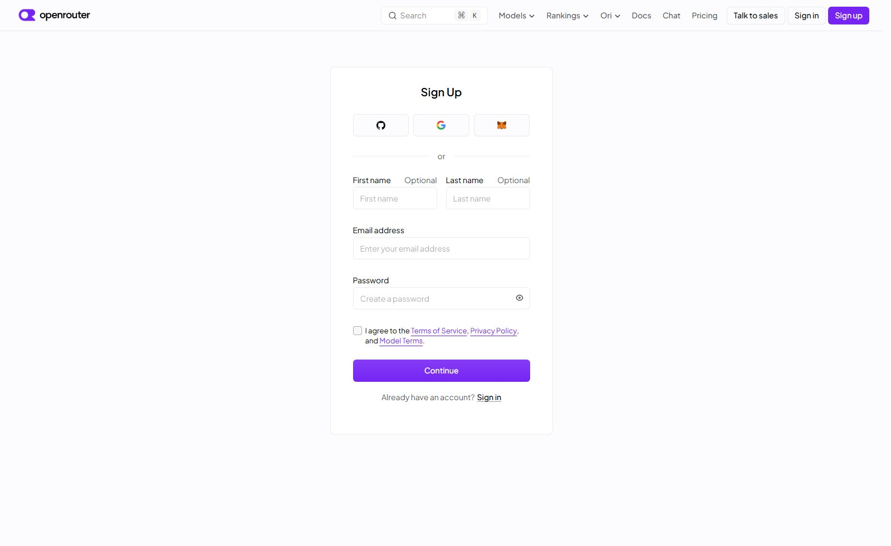
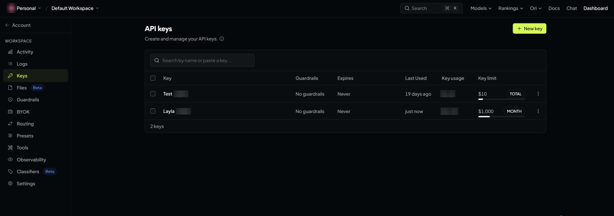
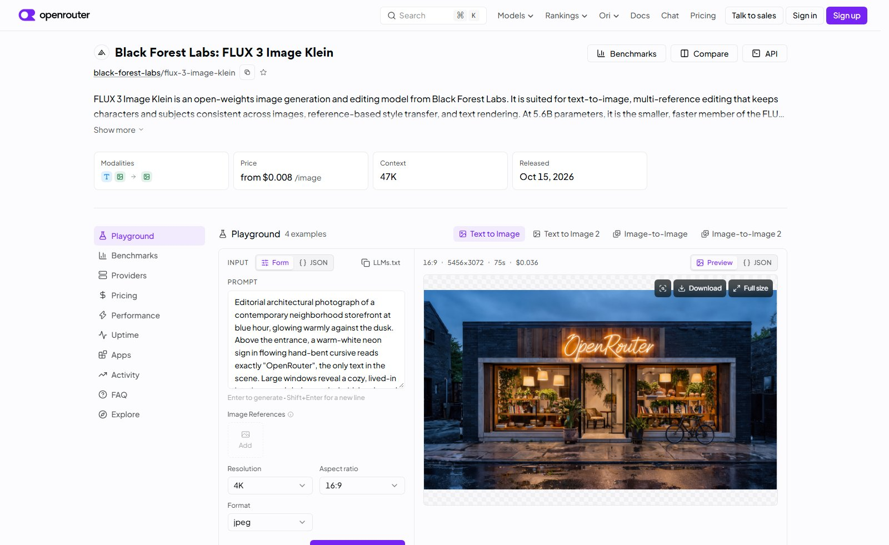

**Mit OpenRouter-Bilderzeugung bekommst du einen einzigen API-Schlüssel für Bildmodelle vieler Unternehmen, darunter FLUX von Black Forest Labs, Seedream von ByteDance, Nano Banana von Google und GPT Image von OpenAI.** Diese Anleitung verbindet die OpenRouter-API für Bilderzeugung mit Layla, einer KI-Chat-App für Android, damit deine KI-Charaktere Bilder im Chat senden können. Wenn ein Charakter in seiner Antwort ein Bild beschreibt, sendet ein Layla-Agent diese Beschreibung an OpenRouter, erhält das fertige Bild und zeigt es in der Unterhaltung an.

Layla erzeugt bereits Bilder mit Stable-Diffusion-Modellen, entweder auf deinem Gerät oder über Layla Cloud. Ein Agent bietet eine weitere Möglichkeit: Du wählst den Dienst, das Modell und die Einstellungen und verwendest deinen eigenen API-Schlüssel. [Nano Banana API in Layla](/de/how-to-use-the-google-nano-banana-image-generation-agent/) macht das mit einem Modell von Google. Der OpenRouter-Agent folgt derselben Methode, aber um zu einem Modell eines anderen Unternehmens zu wechseln, änderst du nur eine Zeile.

Die Anleitung zeigt, wie du einen OpenRouter-API-Schlüssel bekommst und den Agenten einrichtest, vergleicht die Bildmodelle und Preise bei OpenRouter und erklärt jeden Schritt im Code des Agenten.

Anders als Laylas lokale Modelle braucht dieser Agent eine Internetverbindung. Deine Bildbeschreibung wird an OpenRouter und an das Unternehmen gesendet, das das Modell betreibt, und jedes Bild wird von deinem OpenRouter-Guthaben bezahlt. Wenn du mit einem lokalen Modell chattest, bleibt der Rest deiner Unterhaltung auf deinem Gerät.

<div class="file-download">
  <div class="file-download-info">
    <span class="file-download-label">Agent-Datei</span>
    <span class="file-download-name">openrouter-generate-image.json</span>
    <span class="file-download-hint">Ohne OpenRouter-API-Schlüssel funktioniert sie nicht; wie du ihn bekommst, erklärt die Anleitung weiter unten.</span>
  </div>
  <a class="file-download-button" href="/assets/articles/how-to-use-the-openrouter-image-generation-agent/openrouter-generate-image.json" download="openrouter-generate-image.json"><svg viewBox="0 0 24 24" fill="none" stroke="currentColor" stroke-width="2" stroke-linecap="round" stroke-linejoin="round" aria-hidden="true"><path d="M12 4v11"/><path d="m7 10 5 5 5-5"/><path d="M5 20h14"/></svg>Herunterladen</a>
</div>

## Warum OpenRouter-Bilderzeugung in Layla nutzen?

Laylas eigene Stable-Diffusion-Modelle sind die richtige Wahl, wenn Bilder vollständig auf deinem Gerät entstehen sollen. OpenRouter passt zu anderen Anforderungen:

- **Viele Bildmodelle hinter einem Schlüssel.** FLUX, Seedream, GPT Image, Nano Banana, Qwen Image, Grok Imagine und weitere nutzen alle dieselbe Anfrage. Du kannst ein neues Modell ausprobieren, ohne ein weiteres Konto anzulegen oder den Agenten umzuschreiben.
- **Niedrige Preise pro Bild.** Zum Zeitpunkt der Erstellung kostet das Modell, das dieser Agent standardmäßig nutzt, FLUX 3 Image Klein, 0,009 $ für ein 1K-Bild. OpenRouter gibt den Preis des Unternehmens weiter, das das Modell betreibt, und schlägt nichts darauf auf.
- **Ein Ausgabelimit für den Schlüssel.** Bei OpenRouter kannst du jedem API-Schlüssel ein eigenes Guthabenlimit geben, sodass der in deinem Agenten gespeicherte Schlüssel nie mehr ausgeben kann, als du erlaubst.
- **Bildqualität, die nicht von deinem Smartphone abhängt.** Das Bild wird auf einem Server erzeugt. Die Geschwindigkeit der CPU oder NPU deines Geräts begrenzt also weder das Ergebnis noch die Wartezeit.
- **Ein OpenRouter-Konto für Chat und Bilder.** Layla kann die Sprachmodelle von OpenRouter auch für die Unterhaltung selbst nutzen, über seine [Verbindung zu OpenAI-kompatiblen APIs](/de/how-to-connect-layla-to-any-openai-compatible-api/). Mit diesem Agenten liefert dasselbe Konto sowohl die Antworten deines Charakters als auch seine Bilder, und Layla dient so für beides als OpenRouter-App für Android.
- **Oder ein lokales Chatmodell mit Bildern aus der Cloud.** Der Agent reagiert nur auf die Antwort des Charakters und funktioniert daher mit jedem Modell, mit dem du chattest. Du kannst ein privates Offline-LLM für die Unterhaltung behalten, und nur die Bildbeschreibung verlässt dein Smartphone.

## So funktioniert der Agent im Überblick

Der Agent folgt demselben Ablauf in vier Schritten wie jeder Agent für die Bilderzeugung, der aus dem Chat heraus arbeitet:

```text
Du bittest um ein Bild
  -> der Charakter antwortet mit einer Bildbeschreibung im Tag
  -> der Trigger des Agenten erkennt den Tag
  -> das Eval-Tool ruft die API von OpenRouter auf und speichert das Bild
  -> das Tool Display Image zeigt es im Chat an
```

1. **Der System-Prompt bittet das Modell um einen Tag.** Der Agent weist das Sprachmodell deines Charakters an, immer dann eine ausführliche Bildbeschreibung in `<stable_diffusion_prompt></stable_diffusion_prompt>`-Tags zu schreiben, wenn du um ein Bild bittest.
2. **Ein Trigger erkennt den Tag.** Ein Regex-Trigger überwacht die Antworten des Modells. Sobald er den Tag sieht, erfasst er den Text darin und startet den Agenten.
3. **Ein Skript ruft die API auf.** Das erste Tool des Agenten führt ein kurzes JavaScript-Programm aus. Es sendet die Beschreibung an OpenRouter, erhält das Bild und speichert es als Datei.
4. **Das Bild erscheint im Chat.** Das zweite Tool, _Display Image_, nimmt die gespeicherte Datei und zeigt sie in der Unterhaltung an.

Das Sprachmodell spricht nie direkt mit OpenRouter. Es schreibt nur Text, und alles Weitere übernimmt der Agent.

Der Tag heißt `<stable_diffusion_prompt>`, weil auch Laylas eigene Bilderzeugung auf diesen Tag reagiert. Das ist für die Einrichtung wichtig, wie weiter unten erklärt wird.

## Was du brauchst

- Die installierte Mini-App _Agenten_. Falls du noch nicht mit Agenten gearbeitet hast, lies zuerst [So aktivierst du Agenten, Funktionen und Tool-Aufrufe in Layla](/de/how-to-enable-agents-functions-and-tool-calling-in-layla/).
- Ein OpenRouter-Konto mit Guthaben und einen OpenRouter-API-Schlüssel. Der nächste Abschnitt zeigt, wie das geht.
- Eine Internetverbindung.
- Die Agent-Datei, die am Ende dieser Anleitung verlinkt ist.

Dieser Agent nutzt das in Layla integrierte Tool _Eval_. Die Mini-App Python-Interpreter brauchst du nicht.

## So bekommst du einen OpenRouter-API-Schlüssel

Ein API-Schlüssel ist eine lange Zeichenfolge, die dein OpenRouter-Konto identifiziert, wenn der Agent eine Anfrage sendet. Schlüssel von OpenRouter beginnen mit `sk-or-v1-`. Einen zu bekommen dauert wenige Minuten.

### Schritt 1: Ein OpenRouter-Konto erstellen

Rufe [openrouter.ai](https://openrouter.ai) auf und wähle oben rechts **Sign up**. Du kannst dich mit einem GitHub- oder Google-Konto registrieren oder mit einer E-Mail-Adresse und einem Passwort.



### Schritt 2: Guthaben aufladen

OpenRouter funktioniert mit Vorauszahlung. Bildmodelle berechnen jedes Bild, daher braucht dein Konto ein Guthaben, bevor der Agent etwas erzeugen kann.

Öffne die [Seite Credits](https://openrouter.ai/settings/credits) und kaufe Guthaben. OpenRouter akzeptiert gängige Kreditkarten, AliPay und USDC. Bei jedem Kauf per Karte fällt eine Gebühr von 5,5 % an, mindestens 0,80 $, sodass eine kleine Aufladung verhältnismäßig teurer ist als eine größere. Die [FAQ](https://openrouter.ai/docs/faq) von OpenRouter listen die aktuellen Gebühren auf und weisen darauf hin, dass ungenutztes Guthaben ein Jahr nach dem Kauf verfallen kann.

Bei den unten aufgeführten Preisen reichen ein paar Dollar Guthaben für Hunderte von Bildern mit dem Standardmodell.

### Schritt 3: Die Seite mit den API-Schlüsseln öffnen

Öffne die [Seite mit den API-Schlüsseln](https://openrouter.ai/settings/keys). In der Seitenleiste der Einstellungen von OpenRouter heißt sie _Keys_. Die Seite listet deine vorhandenen Schlüssel auf, jeweils mit dem Zeitpunkt der letzten Nutzung, den bisherigen Ausgaben und dem Limit. Wähle oben rechts **New key**.



### Schritt 4: Den Schlüssel benennen und ein Limit setzen

Der Dialog _Create API key_ fragt drei Dinge ab:

- **Name**: ein Name, den du wiedererkennst, zum Beispiel „Layla“.
- **Expiration**: wann der Schlüssel aufhört zu funktionieren. Ein Schlüssel mit Ablaufdatum ist sicherer, aber der Agent funktioniert ab diesem Datum nicht mehr, bis du einen neuen Schlüssel erstellst und einträgst.
- **Credit limit**: der Höchstbetrag, den dieser Schlüssel ausgeben darf. Unter _Reset limit every_ kannst du das Limit täglich, wöchentlich oder monatlich zurücksetzen lassen oder es als Gesamtbetrag belassen.


OpenRouter empfiehlt, für jeden Schlüssel ein Guthabenlimit zu setzen, und hier ist das sinnvoll. Der Schlüssel wird in deinem Agenten gespeichert, und mit einem Limit kann ein offengelegter Schlüssel oder ein außer Kontrolle geratener Agent nur diesen Betrag ausgeben. Erreicht ein Schlüssel sein Limit, lehnt OpenRouter seine Anfragen ab, bis du das Limit erhöhst oder es bei einem täglichen, wöchentlichen oder monatlichen Limit zurückgesetzt wird. Ein monatliches Limit von ein paar Dollar reicht für gelegentliche Bilder mit dem Standardmodell völlig aus.

Wähle **Create**.

### Schritt 5: Den Schlüssel kopieren

OpenRouter zeigt den neuen Schlüssel nur einmal an. Wähle die Kopierschaltfläche daneben und bewahre den Schlüssel an einem sicheren Ort auf, zum Beispiel in einem Passwortmanager. Wie der Dialog sagt, kannst du ihn später nicht mehr sehen. Wenn du ihn verlierst, lösche ihn auf der Seite mit den API-Schlüsseln und erstelle einen neuen.


Behandle den Schlüssel wie ein Passwort. Jeder, der ihn hat, kann Bilder erzeugen, die von deinem Guthaben bezahlt werden. Die [Anleitung zur Authentifizierung](https://openrouter.ai/docs/api_reference/authentication) von OpenRouter erklärt das Schlüsselformat und was zu tun ist, wenn ein Schlüssel offengelegt wurde.

## Bildmodelle und Preise bei OpenRouter

OpenRouter listet jedes Bildmodell auf seiner [Modellseite, gefiltert nach Bildausgabe](https://openrouter.ai/models?output_modalities=image). Jeder Eintrag zeigt den Preis des Modells und das Datum, an dem es hinzugefügt wurde.


Wähle ein Modell, um seine Seite zu öffnen. Die Modell-ID, also der Name, den der Agent braucht, steht unter dem Titel, mit einer Kopierschaltfläche daneben. Die Seite zeigt außerdem den Preis und bietet einen Playground, in dem du Prompts ausprobieren kannst, bevor du das Modell in Layla nutzt.



Der Agent nutzt FLUX 3 Image Klein, ein Modell mit offenen Gewichten von Black Forest Labs, das schnell und günstig ist. Das sind einige der Bildmodelle, die OpenRouter zum Zeitpunkt der Erstellung auflistet, mit dem Preis für ein 1K-Bild:

| Modell               | Modell-ID                              | Preis pro 1K-Bild | Hinweise                                                                                     |
| -------------------- | -------------------------------------- | ----------------- | -------------------------------------------------------------------------------------------- |
| FLUX 3 Image Klein   | `black-forest-labs/flux-3-image-klein` | 0,009 $           | Das Modell, das dieser Agent nutzt. Unterstützt 768 bis 4K.                                  |
| Seedream 5.0 Flash   | `bytedance-seed/seedream-5-0-flash`    | 0,018 $           | Das schnelle Modell von ByteDance. Unterstützt 1K und 2K.                                    |
| Qwen Image 2.1 Turbo | `qwen/qwen-image-2.1-turbo`            | 0,0184 $          | Die schnelle Version von Qwen Image 2.1. Unterstützt 1K und 2K.                              |
| Seedream 5.5         | `bytedance-seed/seedream-5-5`          | 0,02 $            | Das neueste Modell von ByteDance. Höhere Auflösungen kosten 0,035 $.                         |
| Nano Banana 2.1      | `google/gemini-nano-banana-2.1`        | etwa 0,034 $      | Das Modell von Google, nach Tokens abgerechnet. Unterstützt 1K, 2K und 4K.                   |
| FLUX 3 Image         | `black-forest-labs/flux-3-image`       | 0,048 $           | Das größere FLUX-3-Modell. Höhere Auflösungen kosten mehr, bis zu 0,607 $ bei 4K.            |
| Nano Banana Pro      | `google/gemini-3-pro-image`            | etwa 0,134 $      | Das Premium-Modell von Google, nach Tokens abgerechnet.                                      |
| GPT Image 2          | `openai/gpt-image-2`                   | unterschiedlich   | Das Modell von OpenAI, nach Tokens abgerechnet. Die Kosten hängen von Größe und Qualität ab. |

Mit 0,009 $ pro Bild ist FLUX 3 Image Klein die günstigste Option in dieser Tabelle und damit ein sinnvoller Standard für einen KI-Chat, der häufig Bilder sendet. Nano Banana Pro und FLUX 3 Image kosten mehr und lohnen sich, wenn du mehr Details möchtest.

Größere Bilder kosten bei den meisten Modellen mehr. Manche Modelle, etwa die Modelle von GPT Image und Recraft, akzeptieren die Einstellung `resolution` nicht, die der Agent sendet. Andere, etwa die Vektormodelle von Recraft, liefern statt Bildern SVG-Zeichnungen, die _Display Image_ möglicherweise nicht anzeigt. Wenn du eines dieser Modelle wählst, lies den nächsten Absatz.

Um das Modell zu wechseln, kopiere die Modell-ID von seiner Seite, füge sie im Skript bei `MODEL_ID` ein und nutze die Schaltfläche **Test**. Gibt das Modell einen Fehler zurück, prüfe, welche Einstellungen es unterstützt. Die Code-Erklärung weiter unten zeigt, wie du sie änderst oder entfernst. Preise und Modelle ändern sich häufig. Prüfe daher vor deiner Wahl die Seite des Modells bei OpenRouter.

## OpenRouter-Bilderzeugung in Layla einrichten

### Schritt 1: Laylas Standard-Bilderzeugung ausschalten

Öffne deine _Inferenz-Einstellungen_, scrolle zum Abschnitt _Bilderzeugung_ und wähle das Bilderzeugungsmodell aus. Wähle in der Liste _Select Model_ den Eintrag **No Image Generation** (keine Bilderzeugung).


Laylas integrierte Bilderzeugung liest denselben Tag `<stable_diffusion_prompt>` aus der Antwort eines Charakters. Ist noch ein Modell ausgewählt, erzeugt Layla aus dem Tag ein eigenes Bild, und du erhältst zwei Bilder. Ist _No Image Generation_ ausgewählt, bleibt der Tag für den Agenten übrig. [So aktivierst du die Bilderzeugung in Layla](/de/how-to-enable-image-generation-in-layla/) zeigt, wo sich diese Einstellung befindet.

### Schritt 2: Den Agenten importieren

Lade die Agent-Datei am Ende dieser Anleitung herunter. Öffne die Mini-App _Agenten_ und importiere die Datei mit der Schaltfläche **Import** oben rechts. Der Agent heißt _OpenRouter: generate image_, und auf seiner Karte stehen die beiden Tools, die er nutzt: _Eval_ und _Display Image_.

Achte darauf, dass der Schalter oben rechts auf der Karte des Agenten eingeschaltet ist.

Wenn du bereits den [Nano-Banana-Agenten](/de/how-to-use-the-google-nano-banana-image-generation-agent/) oder einen anderen Agenten nutzt, der auf `<stable_diffusion_prompt>` reagiert, schalte ihn aus. Sonst laufen bei jeder Bildanfrage beide Agenten, und du bezahlst für zwei Bilder.

### Schritt 3: Deinen API-Schlüssel eintragen

Öffne den Agenten mit der Schaltfläche **Edit** und suche das Tool _Eval_. Oben in seinem Code steht diese Zeile:

```js
const API_KEY = "PUT YOUR API KEY HERE";
```

Ersetze `PUT YOUR API KEY HERE` durch deinen Schlüssel und behalte die Anführungszeichen bei. Speichere den Agenten.

Dein Schlüssel ist jetzt im Agenten gespeichert. Bevor du die Agent-Datei irgendwo teilst oder hochlädst, setze wieder den Platzhalter ein.

### Schritt 4: Um ein Bild bitten

Starte einen Chat und bitte um ein Bild, zum Beispiel „Zeig mir einen Leuchtturm auf einer Klippe in der Abenddämmerung“. Der Charakter antwortet mit einer Bildbeschreibung, der Agent läuft, und nach einigen Sekunden erscheint das Bild im Chat.

Wenn etwas schiefgeht, nutze die Schaltfläche **Test** in der Mini-App Agenten. Sie zeigt Eingabe und Ausgabe jedes Schritts, wie in [Layla Agents im Detail](/de/deep-dive-into-layla-agents/) beschrieben. Außerdem siehst du jede Anfrage mit ihrem Modell und ihren Kosten auf der [Seite Activity](https://openrouter.ai/activity) von OpenRouter.

## So funktioniert der Agent, Schritt für Schritt

Ein Agent besteht aus drei Teilen: einem System-Prompt, einem Trigger und einer Liste von Tools, die nacheinander laufen. Die Ausgabe jedes Tools ist die Eingabe des nächsten. [Layla Agents im Detail](/de/deep-dive-into-layla-agents/) behandelt diese Bausteine allgemein. Dieser Abschnitt begleitet den OpenRouter-Agenten durch jeden von ihnen.

### 1. Der System-Prompt

Der System-Prompt ist eine Anweisung, die Layla der Unterhaltung hinzufügt, solange der Agent aktiviert ist. Der Prompt des Agenten ist auf Englisch verfasst, und die Datei enthält ihn genau so:

```text
When the user asks you to generate, draw or create an image, write a detailed
description of the image (subject, setting, style, lighting, composition) inside
<stable_diffusion_prompt></stable_diffusion_prompt> tags, e.g.
<stable_diffusion_prompt>a lighthouse on a cliff at dusk, oil painting, warm
light</stable_diffusion_prompt>. The image is generated from the text inside the
tags and shown in the chat. Use the tags only when an image is requested, and
never put backticks inside them.
```

Es ist dieselbe Anweisung, die auch der Nano-Banana-Agent verwendet, denn sie hängt nicht vom Bilddienst ab:

- **„When the user asks you to generate, draw or create an image“** (wenn der Nutzer dich bittet, ein Bild zu erzeugen, zu zeichnen oder zu erstellen) beschränkt das Verhalten auf Bildanfragen, sodass normale Unterhaltungen unberührt bleiben.
- **„A detailed description (subject, setting, style, lighting, composition)“** (eine ausführliche Beschreibung mit Motiv, Umgebung, Stil, Beleuchtung und Bildaufbau) gibt dem Modell eine Checkliste. Aktuelle Bildmodelle wie FLUX 3 und Seedream verstehen ganze Sätze, daher liefert eine ausführliche Beschreibung meist ein besseres Bild als eine Liste von Stichwörtern.
- **Das Beispiel** zeigt das genaue Tag-Format. Sprachmodelle folgen einem Beispiel zuverlässiger als der Beschreibung eines Formats.
- **„Use the tags only when an image is requested“** (Tags nur verwenden, wenn ein Bild gewünscht wird) verhindert, dass das Modell jeder Antwort Tags hinzufügt, was jedes Mal den Agenten starten und Guthaben verbrauchen würde.
- **„Never put backticks inside them“** (niemals Backticks in die Tags setzen) schützt das Skript. Der Grund wird in der Code-Erklärung weiter unten erläutert.

### 2. Der Trigger

Der Agent hat einen Trigger, einen _Regex-Auslöser_, der auf die **Ausgabe** des Modells statt auf deine Eingabe reagiert. Sein Muster lautet:

```text
/<stable_diffusion_prompt>(.*?)<\/stable_diffusion_prompt>/s
```

- Die öffnenden und schließenden Tags entsprechen den Tags im Wortlaut.
- `(.*?)` ist eine Erfassungsgruppe. Sie sammelt alles zwischen den Tags, und das `?` sorgt dafür, dass sie am ersten schließenden Tag aufhört.
- Das Flag `s` erlaubt, dass sich die Beschreibung über mehrere Zeilen erstreckt.

Der von der Gruppe erfasste Text steht dem Agenten als `{{match$1}}` zur Verfügung. Was das Modell zwischen die Tags schreibt, wird an das erste Tool übergeben.

### 3. Das Eval-Tool: die API aufrufen

Das erste Tool ist _Eval_. Es führt JavaScript in einer abgeschotteten Laufzeitumgebung innerhalb von Layla aus. Die Umgebung bietet `fetch` für Webanfragen und ein globales Objekt namens `layla`, über das Skripte auf Funktionen von Layla zugreifen, etwa zum Speichern von Dateien. Eine Browserseite oder Node.js-Module gibt es dort nicht.

Eval gibt den Wert des letzten Ausdrucks im Skript zurück und wartet darauf, falls es ein Promise ist. Die letzte Zeile des Skripts, `generateImage(PROMPT);`, startet die Arbeit.

#### Einstellungen am Anfang

```js
const API_KEY = "PUT YOUR API KEY HERE";
const PROMPT = String.raw`{{match$1}}`.trim();

const MODEL_ID = "black-forest-labs/flux-3-image-klein";
const RESOLUTION = "1K";
const ASPECT_RATIO = "";
const API_URL = "https://openrouter.ai/api/v1/images";
const TIMEOUT_MS = 90000;
```

Alles, was du eventuell ändern möchtest, steht an einer Stelle:

- `API_KEY` ist dein Schlüssel.
- `PROMPT` ist die Beschreibung, die das Modell geschrieben hat. Bevor das Skript läuft, ersetzt Layla `{{match$1}}` durch den erfassten Text, sodass die Beschreibung Teil des Programms wird. Sie steht in einem Template-Literal mit `String.raw`, damit Backslashes so erhalten bleiben, wie sie geschrieben wurden, und `.trim()` entfernt überflüssige Leerzeichen und Zeilenumbrüche. Ein Backtick oder die Zeichen `${` in der Beschreibung würden das Literal vorzeitig beenden und das Skript beschädigen. Deshalb verbietet der System-Prompt Backticks.
- `MODEL_ID` ist das zu verwendende Modell, kopiert von seiner Seite bei OpenRouter.
- `RESOLUTION` ist die Größe des Bildes. OpenRouter akzeptiert `'512'`, `'768'`, `'1K'`, `'1.5K'`, `'2K'` und `'4K'`, und jedes Modell unterstützt einen Teil davon. Setze den Wert auf `''` für Modelle, die keine Auflösung akzeptieren, etwa GPT Image.
- `ASPECT_RATIO` ist das Seitenverhältnis des Bildes, zum Beispiel `'9:16'` für ein hohes Bild, das einen Smartphone-Bildschirm ausfüllt, oder `'16:9'` für ein breites. Ist der Wert `''`, nutzt das Modell seine Standardeinstellung.
- `API_URL` ist der Endpunkt von OpenRouter für die Bilderzeugung. Er ist für jedes Modell gleich.
- `TIMEOUT_MS` ist die Wartezeit, bevor aufgegeben wird: 90 Sekunden. Manche Modelle brauchen länger als andere, besonders bei großen Formaten.

Der Rest des Skripts steckt in einer Funktion namens `generateImage`. Sie erhält die Beschreibung als Parameter `prompt`, und die letzte Zeile des Skripts ruft sie mit `PROMPT` auf.

#### Die Eingaben prüfen

```js
if (!prompt) throw new Error("The stable diffusion prompt was empty.");
if (!API_KEY || API_KEY === "PUT YOUR API KEY HERE")
  throw new Error("Set API_KEY in this agent first.");
```

Das Skript bricht früh mit einer verständlichen Meldung ab, wenn es nichts zu senden gibt oder der Schlüssel nicht gesetzt wurde. Wirft ein Skript einen Fehler, hält der Agent an, und es erscheint kein Bild. Die Schaltfläche **Test** zeigt die Meldung an.

#### Die Anfrage aufbauen

```js
const payload = { model: MODEL_ID, prompt };
if (RESOLUTION) payload.resolution = RESOLUTION;
if (ASPECT_RATIO) payload.aspect_ratio = ASPECT_RATIO;
```

Die Nutzlast (Payload) sind die Daten, die an OpenRouter gesendet werden. Nur `model` und `prompt` sind erforderlich. Das Skript fügt `resolution` und `aspect_ratio` nur hinzu, wenn sie einen Wert haben, weil nicht jedes Modell jede Einstellung akzeptiert.

Die [Anleitung zur Bilderzeugung](https://openrouter.ai/docs/guides/overview/multimodal/image-generation) von OpenRouter listet die weiteren Einstellungen auf, die du der Nutzlast hinzufügen kannst, etwa `seed`, um ein Ergebnis zu wiederholen, `quality` für die GPT-Image-Modelle und `output_format`, um zwischen PNG, JPEG und WebP zu wählen. Auf der Seite jedes Modells steht, welche davon es unterstützt.

#### Die Anfrage mit Zeitlimit senden

```js
const controller = new AbortController();
const timer = setTimeout(() => controller.abort(), TIMEOUT_MS);
let response;
let body;
try {
  response = await fetch(API_URL, {
    method: "POST",
    headers: {
      "Content-Type": "application/json",
      Authorization: `Bearer ${API_KEY}`,
    },
    body: JSON.stringify(payload),
    signal: controller.signal,
  });
  body = await response.text();
} catch (error) {
  if (controller.signal.aborted)
    throw new Error(`Image generation timed out after ${TIMEOUT_MS / 1000} s.`);
  throw new Error(`Image generation request failed: ${error.message}`);
} finally {
  clearTimeout(timer);
}
```

Dieser Teil spricht mit OpenRouter:

- `fetch` sendet eine `POST`-Anfrage mit der in JSON-Text umgewandelten Nutzlast.
- Der API-Schlüssel wird im Header `Authorization` als Bearer-Token übertragen, dem Format, das OpenRouter erwartet. Er ist nicht Teil der Webadresse.
- Der `AbortController` und der Timer brechen die Anfrage nach 90 Sekunden ab. Ohne sie würde eine hängende Verbindung den Agenten warten lassen.
- Der `catch`-Block unterscheidet ein Zeitlimit von anderen Netzwerkfehlern, sodass die Fehlermeldung sagt, was passiert ist. Der `finally`-Block stoppt den Timer in beiden Fällen.

OpenRouter berechnet nur Bilder, die fertiggestellt wurden. Eine Erzeugung, die fehlschlägt oder das Zeitlimit überschreitet, wird nicht abgerechnet.

#### Den Antwortstatus prüfen

```js
if (!response.ok) {
  throw new Error(
    `HTTP error ${response.status} ${response.statusText}. Response body: ${body.slice(0, 500)}`,
  );
}
```

Wenn OpenRouter eine Anfrage ablehnt, erklärt es den Grund im Antworttext. Das Skript übernimmt die ersten 500 Zeichen dieser Erklärung in den Fehler, sodass ein falscher Schlüssel, ein leeres Guthaben, ein erreichtes Guthabenlimit oder eine Einstellung, die das Modell nicht unterstützt, als klare Meldung erscheint, wenn du die Schaltfläche **Test** verwendest.

#### Das Bild in der Antwort finden

```js
let data;
try {
  data = JSON.parse(body);
} catch (error) {
  throw new Error(`The response was not JSON: ${body.slice(0, 200)}`);
}

for (const image of data.data || []) {
  if (!image || !image.b64_json) continue;
  // ...save the image
}
```

OpenRouter beantwortet jede Bildanfrage im selben Format, egal welches Modell das Bild erzeugt hat:

```json
{
  "created": 1748372400,
  "data": [{ "b64_json": "<base64-encoded-image>", "media_type": "image/png" }],
  "usage": { "cost": 0.009 }
}
```

Das Skript wandelt zuerst den Antworttext in ein Objekt um und bricht mit einer Meldung ab, wenn der Text kein gültiges JSON ist. In diesem Objekt ist `data` eine Liste von Bildern. Jedes enthält das Bild als Base64-Text, eine Möglichkeit, Binärdaten als normale Zeichen zu schreiben, und einen `media_type` wie `image/png` oder `image/jpeg`. Das Skript nimmt das erste Bild der Liste. Die Absicherung mit `|| []` verhindert einen Absturz, wenn die Liste fehlt. Das Feld `usage` meldet, was die Anfrage gekostet hat.

Dieses gemeinsame Format ist der größte Vorteil von OpenRouter für einen Agenten. Das Skript liest dieselben Felder für FLUX, Seedream, Nano Banana oder GPT Image, daher genügt es, `MODEL_ID` zu ändern, um zwischen ihnen zu wechseln.

#### Das Bild speichern

```js
const mediaType = String(image.media_type || "image/png");
const extension =
  mediaType
    .split("/")
    .pop()
    .split("+")[0]
    .replace(/[^a-z0-9]/gi, "") || "png";
const id = Math.random().toString(16).slice(2, 10).padEnd(8, "0");
const path = `generated-images/output_image_${id}.${extension}`;

await layla.utils.saveFile(path, image.b64_json);
return path;
```

- Die Dateiendung stammt aus dem Bildtyp, den OpenRouter meldet, mit `png` als Ersatzwert.
- Eine zufällige achtstellige ID gibt jedem Bild einen eigenen Dateinamen, sodass ein neues Bild nie ein früheres in deinem Chatverlauf überschreibt.
- `layla.utils.saveFile` schreibt die Datei in den privaten Arbeitsordner des Charakters. Der Pfad ist relativ zu diesem Ordner, und fehlende Ordner werden automatisch angelegt. Die Funktion erwartet Base64-Text, wie ihn OpenRouter sendet, daher werden die Daten ohne Umwandlung gespeichert.
- Die Funktion gibt den Pfad zurück. Dieser Pfad ist die Ausgabe des Tools.

#### Einen Fehler klar melden

```js
const detail =
  data.error && data.error.message
    ? data.error.message
    : `Response keys: ${Object.keys(data).join(", ")}`;
throw new Error(`No image was found in the response. ${detail}`);
```

Findet die Schleife kein Bild, zum Beispiel weil der Sicherheitsfilter des Modells die Anfrage abgelehnt hat, meldet das Skript die Fehlermeldung von OpenRouter oder die Felder, die die Antwort enthielt. So lassen sich ungewöhnliche Fehler viel leichter diagnostizieren.

### 4. Das Tool Display Image

Das zweite Tool ist _Display Image_, und seine einzige Einstellung lautet:

```text
{{input}}
```

`{{input}}` wird durch die Ausgabe des vorherigen Tools ersetzt, also durch den Dateipfad, den das Skript zurückgegeben hat. _Display Image_ öffnet diese Datei aus dem Arbeitsordner des Charakters und hängt sie an die Antwort an, und das Bild erscheint im Chat.

## KI-Rollenspiel mit Bilderzeugung: deinen Charakter einheitlich halten

Ein Sprachmodell schreibt jede Bildbeschreibung von Grund auf neu. Ohne Anleitung kann ein Charakter daher von Bild zu Bild anders aussehen. Mit diesen Ansätzen bleiben KI-Charakterbilder in Rollenspielen und Chats mit KI-Begleitern einheitlich, und du bestimmst, wie oft Bilder erscheinen:

- **Den Charakter einmal beschreiben.** Füge im _Szenario_ des Charakters eine Anweisung wie diese hinzu: „Wenn du einen `<stable_diffusion_prompt>` schreibst, beginne mit dieser Beschreibung von dir selbst: eine Frau Ende zwanzig mit kurzen roten Haaren, grünen Augen und Sommersprossen. Beschreibe danach die Szene.“ Das Modell wiederholt das Aussehen in jedem Prompt, was dem Bildmodell hilft, jedes Mal denselben Charakter zu zeichnen.
- **Den Stil festlegen.** Ergänze in derselben Anweisung einen Stil, zum Beispiel „35-mm-Filmfoto, natürliches Licht“ oder „Aquarellillustration“.
- **Nach jeder Nachricht ein Bild erzeugen.** Füge dem _Szenario_ eine Anweisung hinzu, jede Antwort mit dem Tag abzuschließen, wie in [Einen Agenten zur Bilderzeugung erstellen](/de/creating-an-image-generation-agent/). Dann kommt zu jeder Antwort ein Bild, was sich für KI-Rollenspiele und Geschichten eignet. Jedes Bild wird bezahlt, das ist also teurer als Bilder nur auf Anfrage. Ein günstiges Modell wie FLUX 3 Image Klein hält die Kosten niedrig.
- **Referenzbilder verwenden.** Die meisten Bildmodelle bei OpenRouter akzeptieren über die Einstellung `input_references` auch Referenzbilder, was einem Charakter hilft, dasselbe Gesicht zu behalten. OpenRouter nennt in der Beschreibung von FLUX 3 Image Klein eine Bearbeitung mit mehreren Referenzen, die Charaktere über mehrere Bilder hinweg einheitlich hält. Dieser Agent sendet nur Text. Der Anfrage ein Referenzbild hinzuzufügen, ist daher ein gutes nächstes Projekt.

## Dasselbe Muster für andere Agenten nutzen

System-Prompt, Regex-Trigger und der Schritt _Display Image_ bleiben für jeden Bilddienst gleich. Nur das Skript ändert sich. Deshalb unterscheiden sich dieser Agent und der [Nano-Banana-Agent](/de/how-to-use-the-google-nano-banana-image-generation-agent/) nur in der Verarbeitung von Anfrage und Antwort. Diese Ideen bauen darauf auf:

- **Zwei Versionen behalten.** Dupliziere den Agenten, gib jeder Kopie eine andere `MODEL_ID` und schalte die gewünschte ein. Es sollte immer nur eine aktiviert sein, weil beide auf denselben Tag reagieren.
- **Das Modell um mehr als eine Beschreibung bitten.** Der System-Prompt kann statt Freitext einige Felder anfordern, zum Beispiel ein kurzes JSON-Objekt mit `prompt` und `aspect_ratio`. Das Skript liest die Felder dann aus dem erfassten Text. Behalte den Platzhalter in einem String-Literal, wie der Agent es mit `PROMPT` tut, und werte den Text in deinem eigenen Code aus.
- **Bestimmen, wohin dein Prompt geht.** OpenRouter kann eine Anfrage auf Anbieter beschränken, die nicht mit deinen Daten trainieren. Füge dem Skript `payload.provider = { data_collection: 'deny' };` hinzu, oder lege dieselbe Präferenz für dein ganzes Konto auf der [Seite mit den Datenschutzeinstellungen](https://openrouter.ai/settings/privacy) von OpenRouter fest. Erfüllt kein Anbieter des Modells diese Bedingung, schlägt die Anfrage mit einem Fehler fehl.
- **Etwas anderes als Bilder tun.** Wähle einen anderen Tag, lass _Eval_ eine andere API aufrufen und beende den Ablauf mit dem Tool _Provide Context_, damit der Charakter über das Ergebnis sprechen kann. Der [Brave-Suchagent](/de/how-to-create-a-brave-search-agent/) ist ein Beispiel für diesen Ablauf.

## Häufig gestellte Fragen

### Wie bekomme ich einen OpenRouter-API-Schlüssel?

Erstelle ein Konto auf [openrouter.ai](https://openrouter.ai), lade auf der Seite Credits Guthaben auf, öffne dann die Seite mit den API-Schlüsseln und wähle **New key**. Gib dem Schlüssel einen Namen, ein Ablaufdatum und ein Guthabenlimit, und kopiere ihn, sobald er angezeigt wird, denn OpenRouter zeigt ihn nur einmal an.

### Ist die Bilderzeugung bei OpenRouter kostenlos?

Ein Konto und einen Schlüssel zu erstellen ist kostenlos, aber Bildmodelle berechnen jedes Bild, daher brauchst du Guthaben. Zum Zeitpunkt der Erstellung kostet FLUX 3 Image Klein 0,009 $ für ein 1K-Bild. Gelegentlich listet OpenRouter für begrenzte Zeit ein kostenloses Bildmodell, das auf der Modellseite mit „(free)“ gekennzeichnet ist.

### Was kostet die Bilderzeugung bei OpenRouter?

Jedes Modell hat einen eigenen Preis, der auf seiner Seite steht. Zum Zeitpunkt der Erstellung reichen die Preise für ein 1K-Bild von unter einem Cent für FLUX 3 Image Klein bis zu etwa 0,134 $ für Nano Banana Pro. OpenRouter schlägt nichts auf die Modellpreise auf, berechnet aber eine Gebühr, wenn du Guthaben kaufst.

### Wie lautet der API-Endpunkt von OpenRouter für die Bilderzeugung?

Anfragen gehen als `POST` an `https://openrouter.ai/api/v1/images`, mit deinem Schlüssel im Header `Authorization`. Derselbe Endpunkt bedient jedes Bildmodell, und das Feld `model` in der Anfrage legt fest, welches läuft. Die [Anleitung zur Bilderzeugung](https://openrouter.ai/docs/guides/overview/multimodal/image-generation) von OpenRouter dokumentiert jede Einstellung.

### Kann ich Nano Banana Pro über OpenRouter nutzen?

Ja. Setze `MODEL_ID` auf `google/gemini-3-pro-image` für Nano Banana Pro oder auf `google/gemini-nano-banana-2.1` für Nano Banana 2.1. Beide akzeptieren über die Einstellung `RESOLUTION` 1K, 2K und 4K. Wenn du lieber direkt bei Google bezahlst, nutze stattdessen den [Nano-Banana-Agenten](/de/how-to-use-the-google-nano-banana-image-generation-agent/).

### Gibt es eine OpenRouter-App für Android?

OpenRouter selbst ist eine Website und eine API. Layla ist eine Android-App, die damit zusammenarbeitet: Sie kann über ihre [Verbindung zu OpenAI-kompatiblen APIs](/de/how-to-connect-layla-to-any-openai-compatible-api/) mit den Sprachmodellen von OpenRouter chatten und über diesen Agenten Bilder mit den Bildmodellen von OpenRouter erzeugen.

### Kann ein KI-Chatbot auf Android Bilder senden?

Ja. Mit diesem Agenten sendet ein Layla-Charakter ein Bild, wann immer du darum bittest, oder nach jeder Nachricht, wenn du es so einrichtest. Layla kann Bilder auch ganz ohne Cloud-Dienst senden, mit Stable-Diffusion-Modellen, die auf deinem Smartphone laufen, wie in [So aktivierst du die Bilderzeugung in Layla](/de/how-to-enable-image-generation-in-layla/) beschrieben.

### Kann ich meine SillyTavern-Charaktere mit OpenRouter-Bilderzeugung nutzen?

Ja. Layla importiert [TavernPNG-Charakterkarten](/de/how-to-import-tavernpng-characters-in-layla/), das Format, das SillyTavern verwendet, und [SillyTavern-Presets](/de/how-to-use-sillytavern-presets-in-layla/), und dieser Agent funktioniert mit jedem Charakter. Wenn du OpenRouter-Bilderzeugung mit SillyTavern auf einem Computer genutzt hast, bekommst du damit dieselbe Einrichtung in einer Chat-App auf deinem Smartphone.

### Warum habe ich zwei Bilder bekommen?

Entweder ist Laylas integrierte Bilderzeugung noch aktiviert, oder ein anderer Agent, der auf `<stable_diffusion_prompt>` reagiert, ist eingeschaltet. Wähle in den Inferenz-Einstellungen _No Image Generation_ und schalte andere Bild-Agenten aus.

### Der Agent meldet „Set API_KEY in this agent first.“

Der Platzhalter für den Schlüssel steht noch im Skript. Öffne den Agenten, bearbeite das Tool _Eval_ und ersetze `PUT YOUR API KEY HERE` durch deinen Schlüssel.

### Warum funktioniert mein OpenRouter-API-Schlüssel nicht?

Wenn eine Anfrage fehlschlägt, zeigt der Agent einen HTTP-Fehler mit der Erklärung von OpenRouter an. Ein Fehler 401 bedeutet, dass der Schlüssel falsch, gelöscht oder abgelaufen ist. Ein Fehler 402 bedeutet, dass dein Guthaben oder das Guthabenlimit des Schlüssels aufgebraucht ist. Ein Fehler 400 bedeutet meist, dass das Modell eine der Einstellungen nicht akzeptiert, etwa die Auflösung. Prüfe die Seite des Modells und ändere `RESOLUTION` oder `ASPECT_RATIO`.

### Filtert OpenRouter Bilder?

Ja. Jedes Unternehmen wendet auf seine Modelle eigene Inhaltsrichtlinien an, und eine Anfrage, die ein Modell ablehnt, liefert kein Bild. Der Agent meldet dann den Fehler, den er erhalten hat. Die Richtlinien unterscheiden sich zwischen den Modellen, daher kann ein Prompt, den ein Modell ablehnt, mit einem anderen funktionieren. Für eine Bilderzeugung, die vollständig auf deinem Gerät stattfindet und bei der kein Prompt an einen Anbieter geht, nutze die lokalen Stable-Diffusion-Modelle aus [So aktivierst du die Bilderzeugung in Layla](/de/how-to-enable-image-generation-in-layla/).

### Ist mein Prompt privat?

Die Bildbeschreibung wird an OpenRouter und an das Unternehmen gesendet, das das gewählte Modell betreibt. Laut OpenRouter werden Prompts standardmäßig nicht protokolliert, und für das, was der Anbieter erhält, gelten dessen eigene Datenrichtlinien. Wenn du mit einem lokalen Modell chattest, bleibt der Rest deiner Unterhaltung auf deinem Gerät.

### Kann ich diesen Agenten ohne Internetverbindung nutzen?

Nein. Der Agent ruft die Server von OpenRouter auf. Für die Bilderzeugung offline nutze eines der lokalen Modelle aus [So aktivierst du die Bilderzeugung in Layla](/de/how-to-enable-image-generation-in-layla/).

## Fazit

Der OpenRouter-Agent nutzt dieselben vier Bausteine wie jeder Agent für die Bilderzeugung in Layla: einen System-Prompt, der um eine Beschreibung im Tag bittet, einen Regex-Trigger, der sie abfängt, ein kurzes Skript, das die Beschreibung gegen ein Bild tauscht, und _Display Image_, das das Ergebnis in deinem Chat anzeigt. Weil OpenRouter für jedes Modell im selben Format antwortet, gibt ein einziges Skript deinen KI-Charakteren Zugang zu Dutzenden von Bildmodellen, und der Wechsel zwischen ihnen ist eine Änderung in einer Zeile.

Layla ist als Offline-KI-Assistent für Android gebaut, und seine lokalen Modelle bleiben die Wahl für vollständig private Chats und Bilderzeugung offline. OpenRouter-Bilderzeugung ist eine Option, wenn du ein bestimmtes Online-Modell in deinen Chats möchtest und die Verbindung und die Kosten pro Bild in Kauf nimmst.

## Den Agenten herunterladen

<div class="file-download">
  <div class="file-download-info">
    <span class="file-download-label">Agent-Datei</span>
    <span class="file-download-name">openrouter-generate-image.json</span>
    <span class="file-download-hint">Importiere die Datei mit der Schaltfläche <em>Import</em> in der Mini-App Agenten und trage dann deinen API-Schlüssel ein.</span>
  </div>
  <a class="file-download-button" href="/assets/articles/how-to-use-the-openrouter-image-generation-agent/openrouter-generate-image.json" download="openrouter-generate-image.json"><svg viewBox="0 0 24 24" fill="none" stroke="currentColor" stroke-width="2" stroke-linecap="round" stroke-linejoin="round" aria-hidden="true"><path d="M12 4v11"/><path d="m7 10 5 5 5-5"/><path d="M5 20h14"/></svg>Herunterladen</a>
</div>
