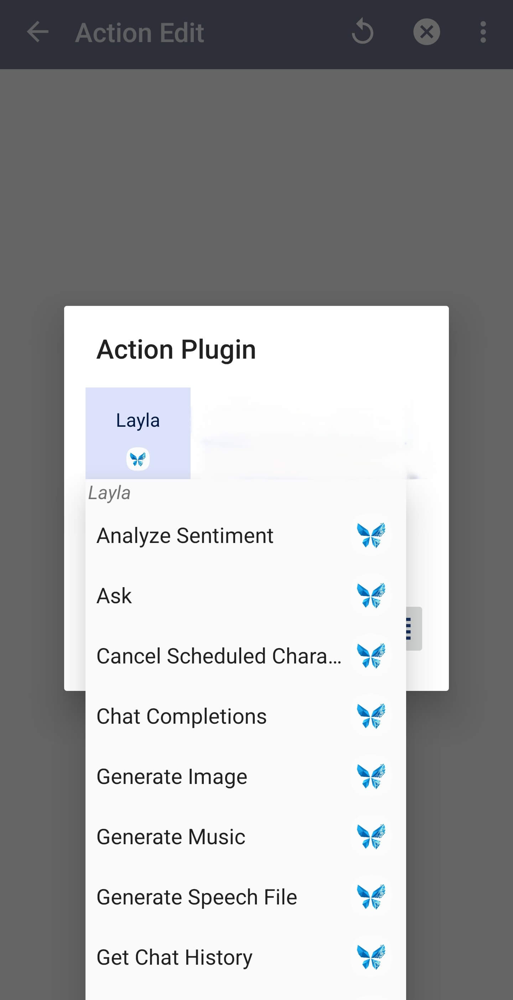

Layla enthält ein Tasker-Plugin, das deinen Android-Automatisierungen eine KI auf dem Gerät hinzufügt. Eine Tasker-Aufgabe kann einen Prompt an ein lokales LLM senden, Bilder, Sprache und Musik erzeugen, Chatverläufe lesen und schreiben, Erinnerungen speichern und Nachrichten deiner Charaktere planen. Wenn du Modelle auf deinem Gerät verwendest, wird nichts davon an einen Online-Dienst gesendet.

## Was ist Tasker?

Tasker ist eine beliebte Android-App zur Automatisierung. Mit ihr erstellst du Aufgaben, die ausgeführt werden, sobald eine Bedingung auf deinem Gerät erfüllt ist. Du kannst zum Beispiel Layla bitten, eine neue E-Mail zusammenzufassen, sobald sie eintrifft, oder einen Charakter dir in einer Stunde eine Erinnerung schicken lassen.

Da Layla Modelle lokal ausführt, funktionieren diese Automatisierungen ohne Internetverbindung und ohne Kosten pro Anfrage. Layla verwendet die Inferenz-Engine, die du als Standard festgelegt hast, sodass Aufgaben dieselbe Einrichtung nutzen wie deine Chats.

*Hinweis: Tasker ist eine separate App und kostet etwas ([Google Play](https://play.google.com/store/apps/details?id=net.dinglisch.android.taskerm&hl=de)). Layla steht in keiner Verbindung zu Tasker.*

Die Tasker-Integration ist nur für Android verfügbar.

## Was kannst du mit Layla und Tasker automatisieren?

Jeder Tasker-Auslöser kann eine Layla-Aktion starten, und das Ergebnis lässt sich in der nächsten Aktion der Aufgabe weiterverwenden. Einige Beispiele:

- **Benachrichtigungen oder E-Mails zusammenfassen.** Übergib den Text einer neuen Benachrichtigung an **Ask Layla** und lass ein lokales LLM eine Zusammenfassung in einem Satz schreiben.
- **Nachrichten vorlesen.** Sende eingehenden Text an **Speak Text**, damit Layla ihn mit der gewählten Stimme vorliest.
- **Den Ton einer Nachricht prüfen.** Lass einen Text von **Analyze Sentiment** analysieren und verzweige deine Aufgabe anhand der stärksten Emotion.
- **Bilder oder Musik per Auslöser erzeugen.** Verwende **Generate Image** oder **Generate Music** mit einer Beschreibung, die aus Tasker-Variablen aufgebaut ist, etwa der Tageszeit oder einem Kalendereintrag.
- **Erinnerungen von einem Charakter planen.** Mit **Schedule Character Message** lässt du einen deiner Charaktere dir zu einer bestimmten Zeit eine Nachricht senden.
- **Notizen als Erinnerungen speichern.** Mit **Remember Text** speicherst du Text im Langzeitgedächtnis eines Charakters.

## Schritt für Schritt: deine erste Layla-Aufgabe erstellen

In dieser Anleitung erstellst du eine Tasker-Aufgabe, die eine Nachricht an Layla sendet und die Antwort auf dem Bildschirm anzeigt. Wenn du das einmal gemacht hast, funktioniert jede weitere Layla-Aktion auf dieselbe Weise.

### Schritt 1: Eine Aufgabe erstellen und eine Aktion hinzufügen

Öffne Tasker, erstelle eine neue Aufgabe und tippe auf **+**, um eine Aktion hinzuzufügen. Tasker fordert dich auf, eine Aktionskategorie auszuwählen. Wähle **Plugin**.


### Schritt 2: Layla auswählen

Tasker listet die Apps auf, die Plugin-Aktionen bereitstellen. Tippe auf **Layla**.


Wenn Layla nicht aufgeführt ist, stelle sicher, dass Layla auf demselben Gerät installiert und auf dem neuesten Stand ist.

### Schritt 3: Eine Aktion auswählen

Layla zeigt alle seine Tasker-Aktionen an. Wähle für diese Anleitung **Chat Completions**. Was die einzelnen Aktionen tun, steht weiter unten unter [Verfügbare Aktionen](#verfügbare-aktionen).



Tasker kann „Layla“ in dieser Liste aus dem Namen einer Aktion weglassen, sodass **Ask Layla** als **Ask** erscheinen kann.

### Schritt 4: Die Konfiguration öffnen

Tippe auf der Seite der Aktion auf das Stiftsymbol neben **Configuration**. Damit öffnet sich Laylas eigener Bildschirm zur Einrichtung der Aktion.


### Schritt 5: Anfrage eingeben und speichern

Gib die Nachricht ein, die du an Layla senden möchtest. Zum Beispiel:

```
{"messages":[{"role":"user","content":"Hello, how are you?"}]}
```

Statt des Textes kannst du auch eine Tasker-Variable verwenden, zum Beispiel `%prompt`. Lass **JSON-escape variable values** aktiviert, damit Anführungszeichen und Zeilenumbrüche in deinen Variablen keine Probleme verursachen. Tippe dann auf **Save**, um zu Tasker zurückzukehren.


Das Timeout ist standardmäßig auf **None** gesetzt. So kann Layla sich so viel Zeit für die Antwort nehmen, wie nötig ist.

### Schritt 6: Das Ergebnis anzeigen

Layla gibt ihre Antwort in der Variable `%layla_text` zurück. Um sie anzuzeigen, füge nach Chat Completions eine weitere Aktion hinzu: Wähle die Kategorie **Alert**, dann **Popup** und gib `%layla_text` als **Text** ein.


### Schritt 7: Die Aufgabe ausführen

Tippe unten auf dem Aufgabenbildschirm auf die Wiedergabe-Schaltfläche. Layla erzeugt eine Antwort, und Tasker zeigt sie im Popup an.


Der erste Durchlauf kann länger dauern, weil Layla ihr Modell erst laden muss.

## Variablen und Ausgaben verwenden

Jedes Textfeld einer Layla-Aktion akzeptiert Tasker-Variablen, sodass du die Ausgabe einer Aktion an die nächste weitergeben kannst. Du kannst zum Beispiel eine Variable auf den Text einer Benachrichtigung setzen und sie dann als Prompt für **Ask Layla** verwenden.

Jede Aktion gibt ihre Ergebnisse als Tasker-Variablen zurück, die du in jeder nachfolgenden Aktion verwenden kannst, so wie das Popup in der Anleitung oben. Layla-Aktionen starten Layla im Hintergrund, falls die App noch nicht läuft, du musst sie also nicht zuerst öffnen.

## Verfügbare Aktionen

### Chat und Text

| Aktion | Was sie tut |
| --- | --- |
| **Ask Layla** | Sendet einen Prompt, optional mit Systemanweisungen, an Layla und gibt die Antwort zurück. Jede Anfrage steht für sich und liest oder verändert keinen Chatverlauf. |
| **Analyze Sentiment** | Analysiert die Emotionen in einem Text. |
| **Chat Completions** | Eine erweiterte Aktion, die eine vollständige Chat-Anfrage mit mehreren Nachrichten akzeptiert, wenn du die gesamte Unterhaltung selbst vorgeben möchtest. |

Ask Layla und Chat Completions sind die Aktionen, mit denen du einen LLM-Prompt aus Tasker ausführst. Sie verwenden die Inferenz-Engine, die du in Layla als Standard festgelegt hast, sodass ein lokales Modell auf deinem Gerät ohne zusätzliche Einrichtung in Tasker funktioniert.

**Ask Layla** gibt zurück:

- `%layla_text`: die Antwort von Layla.

**Analyze Sentiment** gibt zurück:

- `%layla_emotion`: die stärkste im Text gefundene Emotion.
- `%layla_emotion_score`: der Wert dieser Emotion, von 0 bis 1.
- Einen Wert für jede einzelne Emotion, zum Beispiel `%layla_sentiment_joy` oder `%layla_sentiment_sadness`.

### Sprache, Bilder und Musik

Diese Aktionen bringen KI-Text-to-Speech, Bilderzeugung und Musikerzeugung in Tasker. Wie du die Modelle für diese Aktionen einrichtest, steht in [So aktivierst du die Bilderzeugung in Layla](/de/how-to-enable-image-generation-in-layla/), [So hören Sie Ihre Charaktere in Layla sprechen](/de/how-to-hear-your-characters-speak-in-layla/) und [So erzeugst du mit ACE-Step Musik offline in Layla](/de/how-to-generate-music-offline-in-layla-with-ace-step/).

| Aktion | Was sie tut |
| --- | --- |
| **Speak Text** | Liest Text mit Laylas Stimme vor und wartet, bis das Sprechen beendet ist. Lass die Stimme leer, um deine Standardstimme zu verwenden. |
| **Generate Speech File** | Wandelt Text in eine Audiodatei um, ohne sie abzuspielen. Die Stimme ist optional. |
| **Generate Image** | Erzeugt ein Bild aus einem Prompt. Das Bildmodell ist optional; lass es leer, um dein Standardmodell zu verwenden. |
| **Generate Music** | Erzeugt einen Song aus einer Stilbeschreibung. Songtext, Dauer in Sekunden und Musikmodell sind optional. |

Erzeugte Bilder und Audiodaten werden als Dateien zurückgegeben, die Tasker lesen kann:

- Bilder: `%layla_image_uri`, `%layla_image_mime` und `%layla_image_name`.
- Sprache und Musik: `%layla_audio_uri`, `%layla_audio_mime` und `%layla_audio_name`.

Diese Dateien liegen in Laylas Cache. Sie bleiben dort, bis du Laylas Caches leerst oder Android sie entfernt. Verwende daher Taskers Aktion **Copy File**, um sie dauerhaft zu speichern. Es wird nichts automatisch abgespielt.

Zum Erzeugen von Sprachdateien ist eine Text-to-Speech-Stimme nötig, die Audiodateien erstellen kann. Zum Erzeugen von Musik muss das Musikerzeugungsmodell in Layla eingerichtet sein.

### Charaktere, Chats und Erinnerungen

| Aktion | Was sie tut |
| --- | --- |
| **List Characters** | Gibt die Namen und IDs deiner Charaktere zurück. |
| **List Chat Sessions** | Gibt die Chats eines Charakters zurück, jeweils mit der letzten Nachricht. |
| **Get Chat History** | Gibt die Nachrichten eines Chats zurück. Du kannst festlegen, wie viele zurückgegeben und wie viele übersprungen werden. |
| **Save Chat Message** | Fügt einem Chat eine Nachricht hinzu, entweder von dir oder von einem Charakter. Dabei wird keine Antwort erzeugt. |
| **Remember Text** | Fügt einem Charakter eine neue Erinnerung hinzu. Dafür muss das Langzeitgedächtnis-Modell heruntergeladen sein. |
| **Get Memories** | Gibt die neuesten Erinnerungen eines Charakters oder seine wichtigsten Erinnerungen zurück. |
| **List Voices** | Gibt die Namen und IDs der verfügbaren Stimmen zurück. |

Die Listenaktionen geben ihre Ergebnisse als zusammengehörige Arrays zurück. Der Eintrag an Position 1 der Namen gehört zum Eintrag an Position 1 der IDs und so weiter:

- List Characters: `%layla_character_ids()` und `%layla_character_names()`.
- List Chat Sessions: `%layla_session_ids()` und `%layla_last_messages()`.
- List Voices: `%layla_voice_ids()` und `%layla_voice_names()`.

Verwende die von diesen Aktionen zurückgegebenen IDs in den anderen Aktionen. Führe zum Beispiel **List Characters** aus, um die ID eines Charakters zu finden, und übergib sie dann an **Remember Text** oder **Get Memories**.

Weitere Ausgaben:

- Get Chat History: `%layla_text` ist ein lesbares Transkript vom ältesten zum neuesten Eintrag.
- Get Memories: `%layla_memory_ids()` und `%layla_memory_texts()`.
- Remember Text: `%layla_memory_id` und `%layla_session_id`.
- Save Chat Message: `%layla_message_id` und `%layla_session_id`.

Das solltest du wissen:

- **Save Chat Message** benötigt einen bestehenden Chat, um eine Nachricht von dir hinzuzufügen. Um einen neuen Chat zu beginnen, gib eine neue Session-ID an und speichere zuerst eine Nachricht eines Charakters.
- **Get Memories** gibt neueste oder am höchsten bewertete Erinnerungen zurück. Eine Textsuche in den Erinnerungen findet nicht statt.
- **Remember Text** kann die Zusammenfassung der Erinnerung für dich schreiben, wenn du das Feld für die Zusammenfassung leer lässt.
- Zeitstempel in **Get Memories** verwenden Unix-Millisekunden. Die Tasker-Variable `%TIMEMS` liefert die aktuelle Zeit in diesem Format.

### Geplante Charakternachrichten

| Aktion | Was sie tut |
| --- | --- |
| **Schedule Character Message** | Plant, dass eine Nachricht eines Charakters zu einem zukünftigen Zeitpunkt zugestellt wird. |
| **List Scheduled Character Messages** | Listet alle geplanten und ungelesenen Charakternachrichten auf, auch solche, die nicht über Tasker erstellt wurden. |
| **Cancel Scheduled Character Message** | Bricht eine geplante Nachricht anhand ihrer ID ab. |

Die Planung stellt genau den Text zu, den du angibst, zu dem Zeitpunkt, den du wählst. Layla schreibt zum Zustellzeitpunkt keine neue Antwort. Layla benötigt die Benachrichtigungsberechtigung, um geplante Nachrichten zuzustellen.

Der Zustellzeitpunkt ist ein Unix-Zeitstempel in Millisekunden. In Tasker kannst du ihn mit **Variable Set** und **Do Maths** berechnen. Zum Beispiel ist `%TIMEMS + 60000` in einer Minute. Übergib diese Variable als Zustellzeitpunkt.

**Schedule Character Message** gibt `%layla_scheduled_id` zurück, mit der du die Nachricht später abbrechen kannst. Das Abbrechen entfernt eine Nachricht, die noch nicht zugestellt wurde. Eine bereits erschienene Benachrichtigung wird dadurch nicht geschlossen.

### Erweitert

| Aktion | Was sie tut |
| --- | --- |
| **Get Execution Context** | Gibt in `%layla_app_version` die auf deinem Gerät installierte Version von Layla zurück. Nützlich, um zu prüfen, ob Tasker Layla erreichen kann. |
| **Raw Layla API Request** | Sendet eine Anfrage direkt an Layla, für Entwickler. Was verfügbar ist, steht im [Layla SDK](https://github.com/l3utterfly/layla-sdk). |

## Fehler und Timeouts behandeln

Wenn eine Aktion fehlschlägt, setzt Tasker `%err` und `%errmsg`. Aktiviere für die Aktion **Continue Task After Error**, wenn deine Aufgabe weiterlaufen und die Meldung lesen soll.

Layla-Aktionen warten so lange, wie die Arbeit dauert, was bei der Bild- und Musikerzeugung eine Weile sein kann. Neue Aktionen verwenden standardmäßig ein Tasker-Timeout von **None**, also ohne Zeitlimit. Wenn du stattdessen ein Zeitlimit festlegst, hält Layla es ein.

## Beispiel: auf eine Benachrichtigung reagieren

1. Verwende ein Tasker-Plugin wie AutoNotification, um den Text einer eingehenden Benachrichtigung in einer Variable zu erfassen, zum Beispiel `%ntext`.
2. Füge **Ask Layla** mit dem Prompt `Summarise this notification in one sentence: %ntext` hinzu.
3. Füge Taskers Aktion **Flash** mit `%layla_text` hinzu, um die Zusammenfassung auf dem Bildschirm anzuzeigen, oder **Speak Text**, damit Layla sie vorliest.

## Tipps

- Die Hintergrundbeschränkungen von Android gelten weiterhin. Wenn Aktionen bei ruhendem Telefon fehlschlagen, prüfe, ob die Akkuoptimierung Layla einschränkt.
- Stelle sicher, dass die Modelle, die eine Aktion benötigt, zuvor in Layla heruntergeladen wurden, etwa ein Bildmodell, ein Musikmodell oder das Langzeitgedächtnis-Modell.
- Variablen können Anführungszeichen, Zeilenumbrüche und andere Sonderzeichen enthalten. Layla verarbeitet sie in den Standardfeldern für dich.

## Häufig gestellte Fragen

### Kann ich in Tasker ein LLM ohne Internetverbindung verwenden?

Ja. Wenn deine Standard-Inferenz-Engine in Layla ein auf dein Gerät heruntergeladenes Modell ist, laufen Tasker-Aktionen wie **Ask Layla** vollständig auf dem Telefon. Wenn du eine Cloud- oder Remote-Engine als Standard festgelegt hast, laufen die Anfragen stattdessen über diese Engine.

### Brauche ich einen API-Schlüssel, um Layla mit Tasker zu nutzen?

Nein. Laylas Tasker-Aktionen verlangen keinen API-Schlüssel. Sie verwenden die Inferenz-Engine, die in Layla bereits eingerichtet ist.

### Muss Layla geöffnet sein, damit eine Tasker-Aktion läuft?

Nein. Layla startet im Hintergrund, wenn eine Aktion ausgeführt wird. Die Hintergrundbeschränkungen von Android gelten weiterhin. Wenn Aktionen bei ruhendem Telefon fehlschlagen, prüfe daher die Akkueinstellungen für Layla.

### Kann Tasker mit Layla Bilder erzeugen?

Ja. Verwende die Aktion **Generate Image** mit einem Prompt und optional einem Bildmodell. Tasker erhält das Bild als Datei, die du kopieren, teilen oder in späteren Aktionen verwenden kannst. Richte zuerst ein Modell ein, siehe [So aktivierst du die Bilderzeugung in Layla](/de/how-to-enable-image-generation-in-layla/).

### Kann Tasker Layla sprechen lassen oder Musik erzeugen?

Ja. **Speak Text** gibt Sprache mit Laylas Stimme wieder, **Generate Speech File** speichert Sprache als Audiodatei, und **Generate Music** erstellt einen Song aus einer Beschreibung und optionalem Songtext.

### Wo landen die erzeugten Bilder und Audiodateien?

Sie werden in Laylas Cache gespeichert und bleiben dort, bis du den Cache leerst oder Android sie entfernt. Verwende Taskers Aktion **Copy File**, um sie dauerhaft zu behalten.
