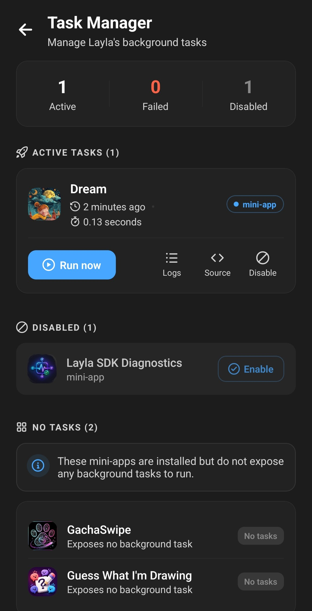

**Eine Datei `task.js` gibt einer Layla-Mini-App eine einmalig laufende JavaScript-Aufgabe, die Layla regelmäßig im Hintergrund ausführen kann, ohne die WebView der Mini-App zu öffnen.** Die Aufgabe läuft in einer isolierten Laufzeit, erhält einen einsatzbereiten Layla-SDK-Client und kann ein Ergebnis zurückgeben, das Nutzende im Aufgabenmanager von Layla einsehen können.

Dieser Leitfaden erklärt das Ausführungsmodell, zeigt eine kleine eigenständige Aufgabe und baut anschließend eine generierte `task.js`, damit eine größere Mini-App denselben Ablauf in ihrer Oberfläche und in der Hintergrundaufgabe wiederverwenden kann.

Der Aufgabenmanager trennt aktive und deaktivierte Aufgaben von installierten Mini-Apps, die keine Hintergrundarbeit bereitstellen. Für jede aktive Aufgabe bietet er manuelle Ausführung, Protokolle und den generierten Quellcode an einem Ort.



Wenn Sie neu in der Mini-App-Entwicklung sind, beginnen Sie mit [Erste Schritte mit dem Layla SDK](/getting-started-with-the-layla-sdk/).

## Was ist `task.js`?

`task.js` ist eine optionale Datei im Wurzelverzeichnis einer gepackten Layla-Mini-App, neben `app.json` und `index.html`:

```text
my-mini-app/
  app.json
  index.html
  task.js
  icon.png
```

Findet Layla die Datei, erscheint die Mini-App im Aufgabenmanager. Nutzende können die Aufgabe manuell ausführen, ihre Hintergrundausführung ein- oder ausschalten und Ergebnis und Protokolle des letzten Laufs ansehen.

Eine Aufgabe ist kein dauerhaft laufender Dienst. Layla startet sie, wartet, bis ihr Endwert oder ihre Promise erledigt ist, hält das Ergebnis fest und verwirft ihre Laufzeit. Der Host bestimmt, wann periodische Hintergrundarbeit versucht wird — `task.js` sollte also einen nützlichen Durchlauf erledigen und dann enden. Bauen Sie darin keinen eigenen Scheduler und keine Polling-Schleife ein.

Damit eignet sich `task.js` für Arbeiten wie:

- Aktuelle Chats oder Erinnerungen lesen und eine Zusammenfassung speichern.
- Zwischengespeicherte Daten für das nächste Öffnen der Mini-App aktualisieren.
- Strukturierte Datensätze in der Datenbank der Mini-App anlegen oder aktualisieren.
- Eine Nachricht erzeugen und für später einplanen.
- Prüfen, welche Charaktere Arbeit benötigen, und jeden einmal verarbeiten.

## Wie Layla eine Hintergrundaufgabe ausführt

Die WebView- und die Aufgaben-Umgebung verwenden dasselbe SDK-Protokoll, sind aber getrennte Laufzeiten.

Wenn Layla eine Aufgabe ausführt:

1. Erstellt sie eine frische QuickJS-Laufzeit, die auf diese Mini-App beschränkt ist.
2. Lädt sie das Layla SDK vor und verbindet es mit dem Host.
3. Wertet sie die `task.js` der Mini-App als klassisches JavaScript-Skript aus.
4. Wartet sie, falls der Abschlusswert des Skripts eine Promise ist.
5. Hält sie fest, ob der Lauf erfolgreich war, wie lange er dauerte, seine Ausgabe und seine gepufferten Konsolenprotokolle.
6. Zerstört sie die Laufzeit.

Die Hintergrundwarteschlange führt geeignete Mini-App-Aufgaben aus, während Layla nicht im Vordergrund ist. Deaktivierte Aufgaben werden übersprungen. Ein manueller Lauf verwendet dasselbe isolierte Ausführungsmodell.

Da jeder Lauf sauber startet, existieren in einer Ausführung deklarierte Variablen im nächsten Lauf nicht mehr. Speichern Sie dauerhaften Zustand über das SDK. `layla.db.executeSql(...)` ist eine gute Standardwahl für strukturierte Daten. Aufgabe und WebView-App nutzen denselben privaten Mini-App-Speicher, sodass die Oberfläche lesen kann, was die Hintergrundaufgabe gespeichert hat.

## Das Layla SDK ist bereits verfügbar

Importieren Sie `@layla-network/sdk` nicht in der fertigen `task.js`. Layla injiziert das SDK, bevor Ihr Code läuft, und stellt diese globalen Objekte bereit:

- `layla`: ein einsatzbereiter SDK-Client.
- `Layla`: die Klasse des SDK-Clients.
- `LaylaError`, `LaylaAbortError` und `LaylaBridgeUnavailableError`: die Fehlerklassen des SDK.

Verwenden Sie in den meisten Aufgaben direkt die vorhandene `layla`-Instanz:

```js
const characters = await layla.characters.list(0, 10);
```

Diese Zeile gehört allerdings in eine asynchrone Funktion. `task.js` wird als klassisches Skript und nicht als ES-Modul ausgewertet, daher stehen `await` auf oberster Ebene sowie `import`, `export` und `require(...)` nicht zur Verfügung. Kapseln Sie asynchrone Arbeit in einen sofort ausgeführten asynchronen Funktionsausdruck (async IIFE) und machen Sie diese Promise zum letzten Ausdruck der Datei.

Die Laufzeit ist auch kein Browser. Es gibt kein DOM, kein `document`, kein `fetch`, kein `XMLHttpRequest`, kein `localStorage`, kein `setTimeout` und kein `setInterval`. Promises, `async`/`await`, `queueMicrotask`, `JSON` und SDK-Aufrufe funktionieren normal.

Bevorzugen Sie SDK-Methoden, die auch ohne sichtbare Oberfläche sinnvoll sind: nicht gestreamte Chat-Completions, Charaktere, Erinnerungen, geplante Nachrichten, Sentiment-Klassifizierung, private Dateien und die private SQLite-Datenbank. Vermeiden Sie Oberflächen- oder Geräteinteraktionen wie Mikrofoneingabe, Sprachausgabe und Hintergrundaudio. Auch langlebige Event-Listener passen schlecht, weil die Laufzeit mit dem Ende der Aufgabe verschwindet.

## Ein einfaches `task.js`-Beispiel

Diese Aufgabe zählt die erste Seite an Charakteren und hält jeden Lauf in der privaten Datenbank der Mini-App fest:

```js
// task.js — the host has already created the global `layla` client.
console.info("Character snapshot task starting.");

(async () => {
  const ranAt = Date.now();
  const characters = await layla.characters.list(0, 10);

  await layla.db.executeSql(
    "CREATE TABLE IF NOT EXISTS character_snapshots (" +
      "id INTEGER PRIMARY KEY, ran_at INTEGER, character_count INTEGER)",
  );

  await layla.db.executeSql(
    "INSERT INTO character_snapshots (ran_at, character_count) VALUES (?, ?)",
    [ranAt, characters.length],
  );

  console.info(`Recorded ${characters.length} characters.`);

  return {
    status: "ok",
    ranAt,
    characterCount: characters.length,
  };
})();
```

Die async IIFE ist bewusst der letzte Ausdruck. Layla wartet auf ihre Promise und hält dann das zurückgegebene Objekt als Ausgabe des Laufs fest. Halten Sie den Rückgabewert JSON-serialisierbar. Eine abgelehnte Promise oder ein geworfener Fehler markiert den Lauf als fehlgeschlagen, während alles, was mit `console.log`, `console.info`, `console.debug`, `console.warn` oder `console.error` geschrieben wird, im Ausführungsprotokoll gepuffert wird.

Protokolle werden nach dem Lauf angezeigt, nicht live gestreamt. Nutzen Sie sie für knappe Meilensteine und diagnostischen Kontext, und den Rückgabewert für die abschließende maschinenlesbare Zusammenfassung.

## `task.js` generieren, wenn der Ablauf komplexer wird

Eine `task.js` von Hand zu schreiben, funktioniert für einen kleinen Job. Umständlich wird es, wenn die Hintergrundaufgabe dieselbe Auswahl-, Prompt-, Validierungs- oder Persistenzlogik nutzen soll wie die sichtbare Mini-App.

Dream, eine funktionierende Layla-Mini-App, verwendet einen eigenen Task-Einstiegspunkt und eine eigene Build-Konfiguration. Ihr Task-Einstieg importiert gemeinsame Workflow- und Prompt-Module aus dem Quellcode der Hauptanwendung. Vite folgt diesen Importen und erzeugt eine eigenständige `dist/task.js` mit dem gemeinsamen Code darin. Das erzeugte Artefakt enthält keine Importe, während der Quellcode in normale, wartbare Module aufgeteilt bleibt.

Die zentrale Entwurfsentscheidung ist Dependency Injection: Gemeinsamer Code bekommt einen Layla-Client übergeben, statt selbst einen zu erzeugen. Die WebView übergibt ihren importierten SDK-Client; die Aufgabe übergibt den vom Host bereitgestellten globalen `layla`-Client.

Beginnen Sie mit einem gemeinsamen Workflow:

```ts
// src/lib/recordCharacterSnapshot.ts
import type LaylaSDK from "@layla-network/sdk";

export async function recordCharacterSnapshot({
  layla,
  ranAt = Date.now(),
}: {
  layla: LaylaSDK;
  ranAt?: number;
}) {
  const characters = await layla.characters.list(0, 10);

  await layla.db.executeSql(
    "CREATE TABLE IF NOT EXISTS character_snapshots (" +
      "id INTEGER PRIMARY KEY, ran_at INTEGER, character_count INTEGER)",
  );
  await layla.db.executeSql(
    "INSERT INTO character_snapshots (ran_at, character_count) VALUES (?, ?)",
    [ranAt, characters.length],
  );

  return { status: "ok", ranAt, characterCount: characters.length };
}
```

Der reine Typ-Import hilft TypeScript, die gemeinsame Funktion zu prüfen, und verschwindet aus dem kompilierten JavaScript. Die sichtbare Mini-App kann dieselbe Funktion mit ihrer regulären SDK-Instanz aufrufen:

```ts
// src/main.ts
import LaylaSDK from "@layla-network/sdk";
import { recordCharacterSnapshot } from "./lib/recordCharacterSnapshot";

const layla = new LaylaSDK();

document.querySelector("#refresh")?.addEventListener("click", async () => {
  const result = await recordCharacterSnapshot({ layla });
  console.log(result);
});
```

Erstellen Sie dann einen kleinen Task-Einstiegspunkt. Während der Entwicklung importiert er den gemeinsamen Quellcode, im Build verschwindet diese Modulgrenze:

```js
// src/task-entry.js
import { recordCharacterSnapshot } from "./lib/recordCharacterSnapshot";

console.info("Character snapshot background task starting.");

(async () => {
  return recordCharacterSnapshot({ layla });
})();
```

Geben Sie diesem Einstiegspunkt einen eigenen Vite-Build:

```ts
// vite.task.config.ts
import { defineConfig } from "vite";

export default defineConfig({
  publicDir: false,
  build: {
    target: "es2020",
    outDir: "dist",
    emptyOutDir: false,
    copyPublicDir: false,
    minify: false,
    lib: {
      entry: "src/task-entry.js",
      formats: ["es"],
      fileName: () => "task.js",
    },
  },
});
```

Führen Sie zuerst den normalen WebView-Build aus, dann den Task-Build:

```json
{
  "scripts": {
    "build": "vite build && vite build --config vite.task.config.ts",
    "build:task": "vite build --config vite.task.config.ts"
  }
}
```

`emptyOutDir: false` bewahrt `index.html`, `app.json` und die Assets aus dem ersten Build. Der zweite Build legt `dist/task.js` daneben.

Halten Sie Laufzeit-Importe von `@layla-network/sdk` aus dem Abhängigkeitsgraphen der Aufgabe heraus. Reine Typ-Importe sind in Ordnung, aber die generierte Aufgabe sollte den injizierten Client verwenden statt einen weiteren SDK-Client mitzubündeln. Halten Sie in einer größeren App WebView-spezifischen Code — DOM-Updates, React-State, Browser-Speicher und Streaming-Oberfläche — aus dem gemeinsamen Workflow heraus.

Dream wendet diese Trennung in größerem Maßstab an: Die Quell-Aufgabe übernimmt kopfloses Laden von Daten und die Orchestrierung, während gemeinsame Module den Workflow enthalten, der eine Charakternachricht auswählt und einplant. Die produktive `task.js` wird aus diesen Quellen erzeugt, sodass Korrekturen am gemeinsamen Workflow für die sichtbare Aktion und die Hintergrundaufgabe gleichermaßen gelten.

## Das erzeugte Artefakt prüfen

Testen Sie die Datei, die Layla tatsächlich ausführt, nicht nur `src/task-entry.js`.

Prüfen Sie nach dem Build, dass `dist/task.js`:

- Im Wurzelverzeichnis des Pakets neben `app.json` und `index.html` liegt.
- Keine `import`-, `export`- oder `require(...)`-Anweisungen enthält.
- `@layla-network/sdk` zur Laufzeit weder bündelt noch referenziert.
- Mit der Promise erzeugenden async IIFE als Abschlussausdruck endet.
- Keine Browser-APIs, Timer oder `fetch` aufruft.
- Auf jedem erfolgreichen Pfad einen JSON-serialisierbaren Wert zurückgibt.

Fügen Sie für eine komplexe Aufgabe ein kleines Testgerüst hinzu, das `dist/task.js` mit einem gefälschten globalen `layla`-Objekt auswertet. Die Mini-App Dream nutzt diesen Ansatz, um das erzeugte Artefakt zu prüfen, SDK-Anfragen aufzuzeichnen und sowohl den Leerlauf- als auch den erfolgreichen Planungspfad zu verifizieren. Das Testen des Bundles findet Probleme, die ein Unit-Test auf Quellcode-Ebene übersieht — darunter übrig gebliebene Importe und ein Task-Einstieg, dessen Endwert nicht die Workflow-Promise ist.

## Häufig gestellte Fragen

### Läuft `task.js` in der WebView der Mini-App?

Nein. Es läuft in einer frischen, isolierten QuickJS-Laufzeit. Es kann weder auf die Seite noch auf React-State oder das DOM zugreifen, wohl aber das vorgeladene Layla SDK nutzen.

### Sollte ich `LaylaSDK` in `task.js` importieren?

Nein. Verwenden Sie die injizierte globale `layla`-Instanz. In gemeinsamen TypeScript-Modulen ist ein reiner Typ-Import des SDK in Ordnung, weil er beim Kompilieren entfernt wird.

### Wie teile ich Daten zwischen Aufgabe und Oberfläche?

Nutzen Sie den privaten SDK-Speicher der Mini-App. `layla.db.executeSql(...)` eignet sich gut für strukturierten Zustand, während die Werkzeuge des SDK für private Dateien zu dokumentartigen Einstellungen oder erzeugten Dateien passen. Beide Ausführungen sind derselben Mini-App zugeordnet.

### Kann eine Aufgabe mit `setTimeout` auf später warten?

Nein. Timer sind nicht verfügbar, und eine Hintergrundaufgabe sollte einen Durchlauf abschließen. Kehren Sie zurück, sobald die aktuelle Arbeit erledigt ist. Für eine künftige Charakternachricht verwenden Sie `layla.chat.scheduleChatMessage(...)`, statt die Aufgabe am Leben zu halten.

### Was sollte eine Hintergrundaufgabe zurückgeben?

Geben Sie eine kleine, JSON-serialisierbare Zusammenfassung zurück, etwa `{ status: "ok", processed: 4 }`. Nutzen Sie Konsolenmeldungen für diagnostische Details. Werfen Sie einen Fehler, wenn der Lauf wirklich fehlgeschlagen ist, damit der Aufgabenmanager ihn als Fehler meldet.

## Für eine kurzlebige, kopflose Laufzeit bauen

Das brauchbare gedankliche Modell ist nicht „eine versteckte Kopie meiner Mini-App“, sondern „ein Durchlauf im Hintergrund mit bereits verbundenem Layla SDK“. Halten Sie den Einstieg klein, verlagern Sie wiederverwendbare Arbeit in Funktionen, die ihre Abhängigkeiten entgegennehmen, speichern Sie alles, was die Oberfläche braucht, und lassen Sie die erzeugte `task.js` mit einem klaren Ergebnis enden.

Diese Struktur hält das Hintergrund-Artefakt kompatibel mit Laylas isolierter Laufzeit und erlaubt einer größeren Mini-App zugleich, ihren Kern-Workflow nur einmal zu implementieren.
