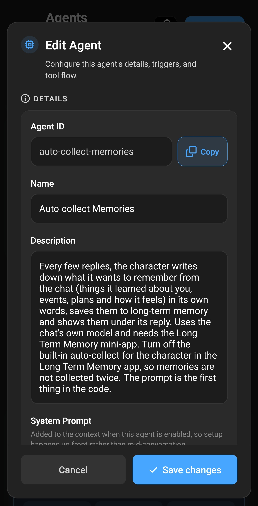

**Layla est un chatbot IA avec mémoire à long terme qui fonctionne sur votre téléphone, et il peut transformer vos conversations en souvenirs de trois façons : un résumeur intégré qui s'exécute après chaque réponse, un Agent qui demande à votre modèle de chat d'écrire des souvenirs toutes les quelques réponses, et une mini-application qui traite votre historique de chat avec un LLM lorsque vous le lui demandez.** Les trois enregistrent dans le même espace Long-Term Memory, si bien que votre compagnon IA ou votre personnage de jeu de rôle se rappelle les souvenirs de la même manière, quelle que soit la méthode qui les a créés.

Ces méthodes échangent de la vitesse contre de la qualité. Cet article explique pourquoi les chatbots IA oublient, comment fonctionne chaque méthode, ce qu'elle coûte et comment la configurer, afin que vous puissiez en choisir une par personnage.

## Pourquoi les chatbots IA oublient, et ce que change la mémoire à long terme

Un modèle de langage ne retient rien d'un message à l'autre. À chaque réponse, il relit la conversation depuis sa fenêtre de contexte, qui ne contient qu'une quantité de texte limitée. Dès qu'un chat dépasse cette limite, les messages les plus anciens n'y tiennent plus, et l'IA oublie votre prénom, les projets que vous avez faits ou ce qui s'est passé plus tôt dans une histoire.

La mémoire à long terme contourne cette limite. Layla enregistre de courts souvenirs de vos conversations, les recherche pendant que vous discutez et ajoute les plus pertinents au contexte du modèle avant qu'il ne réponde. Le personnage peut alors se rappeler un événement vieux de plusieurs semaines sans que tout l'historique du chat ait à tenir dans la fenêtre de contexte. Chaque personnage a ses propres souvenirs : un compagnon IA, un personnage de jeu de rôle et un assistant se souviennent chacun de leurs propres conversations avec vous.

Layla stocke et recherche ces souvenirs sur votre appareil. Avec un LLM local, vos chats et vos souvenirs restent sur vos propres appareils : vous obtenez un chatbot IA privé qui se souvient de vous, sans qu'une entreprise conserve vos conversations sur ses serveurs.

## Trois façons de donner une mémoire à long terme à votre IA

|                              | Collecte automatique intégrée         | Agent Auto-collect Memories                     | Mini-application LLM-based Long-term Memory                  |
| ---------------------------- | ------------------------------------- | ----------------------------------------------- | ------------------------------------------------------------ |
| **Ce qui écrit le souvenir** | Un petit modèle de résumé intégré     | Votre modèle de chat                            | Le moteur d'inférence de votre choix                         |
| **Quand elle s'exécute**     | Après chaque réponse, automatiquement | Toutes les 3 réponses, automatiquement          | Uniquement lorsque vous touchez **Start ingesting memories** |
| **Langues**                  | Anglais uniquement                    | Toute langue gérée par votre modèle de chat     | Toute langue gérée par le modèle choisi                      |
| **Qualité**                  | Résumés basiques                      | Bonne : le personnage écrit ses propres notes   | Maximale : vous contrôlez les invites                        |
| **Vitesse**                  | Rapide, sans effet sur le chat        | Ajoute un appel au modèle toutes les 3 réponses | Lente, mais hors de vos chats                                |
| **Personnalisation**         | Aucune                                | Modifier l'invite dans le code de l'Agent       | Invite système et instruction par personnage                 |

Les trois nécessitent la mini-application **Long Term Memory**, qui stocke les souvenirs et télécharge les modèles qui les recherchent. C'est dans cette mini-application que vous activez ou désactivez la mémoire pour chaque personnage. [Comment ajouter des fonctionnalités (mini-applications) dans Layla](/fr/how-to-add-features-mini-apps-in-layla/) indique où la trouver.

## Méthode 1 : la collecte automatique intégrée, rapide et automatique

C'est ce que fait Layla par défaut dès que la mini-application Long Term Memory est installée, et c'est le moyen le plus simple d'obtenir une IA qui se souvient des conversations.

Après chaque réponse du personnage, Layla prend les trois derniers messages du chat et les transmet à un petit modèle de résumé intégré à la mini-application. Le résumé, les messages d'origine et un graphe simple des personnes et des choses mentionnées sont enregistrés comme un seul souvenir. Tout cela se passe en arrière-plan, sur votre appareil. Votre modèle de chat n'est pas utilisé : la conversation n'est donc pas ralentie et n'entre pas en concurrence avec lui pour la mémoire.

Les limites viennent de ce petit modèle :

- **Il ne comprend que l'anglais.** Les chats dans d'autres langues produisent des résumés médiocres ou dénués de sens. Si vous discutez dans une autre langue, utilisez l'une des deux autres méthodes.
- **Les résumés sont courts et littéraux.** Le modèle condense ce qui a été dit ; il ne décide pas de ce qui compte. Une conversation anodine est enregistrée de la même façon qu'un événement important.
- **Il n'y a rien à configurer**, hormis l'activer ou le désactiver pour chaque personnage.

### Comment l'activer ou le désactiver

1. Ouvrez la mini-application **Long Term Memory**.
2. Sélectionnez le personnage sous **Characters**.
3. Sous **Per character settings**, utilisez **Auto-collect memories for this character**.

**Enable LTM for this character** est un interrupteur distinct. Il détermine si le personnage utilise la Long-Term Memory, y compris pour se rappeler des souvenirs pendant le chat. Vous pouvez désactiver la collecte automatique tout en laissant la LTM activée, ce dont les deux autres méthodes ont besoin.

## Méthode 2 : l'Agent Auto-collect Memories, des souvenirs dans les mots du personnage

L'Agent **Auto-collect Memories** demande à votre personnage de tenir ses propres notes, comme devrait le faire un compagnon IA doté de mémoire : c'est lui qui décide ce qui mérite d'être retenu à votre sujet. Toutes les 3 réponses du personnage, il met le jeu de rôle en pause et demande au modèle de chat ce que le personnage voudrait retenir de ces échanges : des faits vous concernant, des événements importants, des promesses ou des projets, et ce que ressent le personnage. Le modèle voit toute la conversation ainsi que les derniers souvenirs du personnage, et peut donc ignorer les détails déjà enregistrés.

L'Agent :

- conserve au plus 3 souvenirs par exécution,
- écarte tout ce que le modèle a noté en dessous de 3 sur une échelle d'importance de 1 à 5,
- enregistre le reste dans la Long-Term Memory, rédigé à la première personne avec la voix du personnage, et
- affiche une carte **Saved to memory** sous la réponse du personnage pour que vous voyiez ce qui a été conservé.

Comme c'est le modèle qui écrit les souvenirs, ils sont meilleurs que les résumés intégrés. Ils suivent le sens de la conversation plutôt que sa formulation, ils conservent la voix du personnage, ce qui compte dans le jeu de rôle IA, et ils fonctionnent dans toute langue gérée par votre modèle. Le prix à payer est la vitesse : une requête supplémentaire est envoyée au modèle après chaque troisième réponse, et la carte de souvenir n'apparaît qu'une fois cette requête terminée. Si vous utilisez une API payante via une [connexion compatible OpenAI](/fr/how-to-connect-layla-to-any-openai-compatible-api/), cette requête consomme aussi des jetons.

### Comment la configurer

1. Installez la mini-application **Agents** si ce n'est pas déjà fait. [Comment activer les Agents, les fonctions et l'appel d'outils dans Layla](/fr/how-to-enable-agents-functions-and-tool-calling-in-layla/) l'explique.
2. Ouvrez les paramètres de votre personnage et associez l'Agent **Auto-collect Memories** dans le sélecteur d'Agents de l'onglet **Advanced**. [Comment créer un personnage IA personnalisé dans Layla](/fr/how-do-i-create-custom-characters/) montre où se trouve le sélecteur. Un Agent associé à un personnage s'exécute pour ce personnage même s'il est désactivé dans la mini-application Agents.
3. Dans la mini-application **Long Term Memory**, désactivez **Auto-collect memories for this character** pour le même personnage. Si les deux fonctionnent, chaque conversation est collectée deux fois.
4. Discutez comme d'habitude. Après 3 réponses, la première carte **Saved to memory** apparaît.

Les personnages Layla par défaut n'utilisent pas de liste d'Agents associés ; ils utilisent tous les Agents activés dans la mini-application Agents. Pour employer cette méthode avec eux, activez plutôt l'Agent Auto-collect Memories dans la mini-application Agents. Une recherche de « memor » dans cette mini-application le trouve rapidement.

### Modifier ce dont l'Agent se souvient

Touchez **Edit** sur la carte de l'Agent pour l'ouvrir. La boîte de dialogue commence par son ID, son nom et sa description, qui reprend les conseils de configuration ci-dessus.

L'invite se trouve au début du code de l'outil Eval de l'Agent, plus bas dans la boîte de dialogue. Vous pouvez la réécrire, par exemple pour vous concentrer sur les faits et ignorer les sentiments, à condition de conserver à la fin le format JSON qu'elle demande. Sous l'invite figurent des paramètres pour la fréquence d'exécution (`COLLECT_EVERY_N_REPLIES`), le nombre de souvenirs conservés à chaque exécution (`MAX_MEMORIES`) et l'importance minimale retenue (`MIN_IMPORTANCE`).

Si l'enregistrement d'un souvenir échoue, par exemple parce que la mini-application Long Term Memory n'est pas installée, l'Agent cesse d'essayer pendant 24 heures. Chaque exécution écrit un journal dans `auto-collect-memories/last-run.log` dans l'espace de travail du personnage, ce qui est le premier endroit à consulter si aucune carte n'apparaît.

## Méthode 3 : la mini-application LLM-based Long-term Memory, la mémoire de la plus haute qualité

La mini-application **LLM-based Long-term Memory** traite votre historique de chat dans une étape séparée, lorsque vous choisissez de l'exécuter. Elle utilise un LLM de votre choix, local ou en ligne, pour écrire chaque souvenir et construire un graphe de connaissances des personnes, des lieux et des événements de vos chats. Elle offre la meilleure qualité et le plus de contrôle, au prix d'être lente et manuelle.

Elle est publiée sur Layla Cloud Apps, la galerie de mini-applications créées avec le SDK Layla. Pour l'installer, ouvrez la [page LLM-based Long-term Memory sur Layla Cloud Apps](https://apps.layla-cloud.com/app/llm-based-long-term-memory) sur votre téléphone et touchez **Open in Layla**. Vous avez aussi besoin de la mini-application Long Term Memory, car celle-ci y enregistre ses résultats.

Lorsque vous lancez une ingestion, la mini-application :

1. **Lit** les chats du personnage, en commençant après le souvenir le plus récent déjà présent, de sorte qu'elle ne traite que les nouveaux messages.
2. **Résume** les messages par fenêtres chevauchantes de trois, en envoyant chaque fenêtre au modèle avec votre invite de résumé.
3. **Construit le graphe** de chaque résumé, en demandant au modèle d'en extraire les personnes, les lieux, les événements, les traits et les objets, ainsi que leurs relations.
4. **Enregistre** chaque résultat comme un souvenir avec les messages d'origine, le résumé et le graphe.

### Rédiger vos propres invites

Chaque personnage a ses propres paramètres, conservés d'une exécution à l'autre :

- **Inference engine.** Choisissez l'un de vos [moteurs d'inférence enregistrés](/fr/how-saved-inference-engines-work-in-layla/) ou le moteur par défaut. Comme l'ingestion s'exécute en dehors de vos chats, vous pouvez choisir un LLM local plus grand ou plus lent que celui avec lequel vous discutez, ou un modèle en ligne si vous préférez.
- **Summarising conversations.** Une **System prompt** et une **Custom instruction** qui déterminent ce qu'un souvenir doit contenir. Par défaut, elles demandent au modèle de conserver les faits durables, les sentiments, les relations et les tournants, et d'ignorer les conversations anodines. Vous pouvez les modifier pour vous concentrer sur ce que vous voulez : l'intrigue et les personnages d'une histoire pour un jeu de rôle, ou vos projets et vos échéances pour un assistant.
- **Constructing the knowledge graph.** Une seconde invite système et une seconde instruction pour extraire le graphe. Conservez le format JSON demandé par l'instruction par défaut.

Les deux invites système acceptent les modèles `{{char}}`, `{{user}}`, `{{persona}}`, `{{description}}`, `{{personality}}` et `{{character_card}}`, qui sont remplis à partir du personnage et de son persona avant chaque requête.

### Lancer une ingestion

Touchez **Start ingesting memories**. L'écran affiche chaque étape au fur et à mesure, et vous pouvez annuler avec le bouton **X**.

Chaque fenêtre de messages demande deux requêtes au modèle : un long historique de chat peut donc prendre beaucoup de temps sur un téléphone. Gardez Layla au premier plan pendant l'exécution. Relancez-la chaque fois que vous voulez traiter de nouvelles conversations ; il n'y a pas de planification.

### Désactiver les méthodes automatiques pour le personnage

La mini-application commence sa lecture après le souvenir le plus récent du personnage. Si la collecte automatique intégrée ou l'Agent fonctionne aussi pour ce personnage, le souvenir le plus récent est toujours très récent, et la mini-application ne trouve donc rien ou presque à traiter. Désactivez les deux pour tout personnage que vous ingérez de cette façon.

## Quelle méthode choisir ?

- **La collecte automatique intégrée** si vous discutez en anglais et voulez que la mémoire fonctionne sans configuration ni effet sur la vitesse. Elle convient à un assistant du quotidien qui n'a besoin de se rappeler que l'essentiel des chats passés.
- **L'Agent Auto-collect Memories** si vous discutez dans une autre langue, ou voulez des souvenirs qui retiennent ce qui comptait plutôt que ce qui a été dit, et pouvez accepter une réponse un peu plus lente tous les trois tours. Il convient à un compagnon ou un ami IA qui doit se souvenir de vous, de vos projets et de ce qu'il ressent pour vous.
- **La mini-application LLM-based Long-term Memory** si vous voulez les meilleurs souvenirs et un contrôle total sur ce sur quoi ils se concentrent, et que cela ne vous dérange pas de la lancer vous-même, par exemple une fois par jour. Elle convient aux longues campagnes de jeu de rôle IA, où une invite personnalisée peut suivre l'intrigue, les personnages et le monde.

Vous pouvez choisir une méthode différente pour chaque personnage. N'utilisez qu'une seule méthode à la fois par personnage.

## Foire aux questions

### Pourquoi mon chatbot IA oublie-t-il des choses ?

Chaque modèle a une fenêtre de contexte limitée. Quand une conversation dépasse cette fenêtre, les messages les plus anciens sont laissés de côté et le modèle ne peut plus les voir. La mémoire à long terme enregistre les parties importantes de ces messages et les ramène quand elles sont pertinentes.

### Existe-t-il un chatbot IA qui se souvient des conversations passées ?

Oui. Layla se souvient des conversations passées avec chaque personnage grâce à sa mini-application Long-Term Memory, et elle le fait sur votre téléphone plutôt que sur un serveur. Les méthodes décrites dans cet article déterminent comment ces souvenirs sont écrits.

### Layla se souvient-elle de tout ce que je dis ?

Non. Elle enregistre des souvenirs de vos conversations, puis ne rappelle que ceux qui correspondent à ce dont vous parlez à ce moment-là. Les paramètres **Max Number of Memory Injections** et **Minimum Memory Score** de la mini-application Long Term Memory contrôlent combien de souvenirs sont rappelés et à quel point ils doivent correspondre.

### Les souvenirs issus de différentes méthodes fonctionnent-ils ensemble ?

Oui. Les trois enregistrent dans le même espace Long-Term Memory, et le rappel dans le chat fonctionne de la même façon pour tous. Vous pouvez faire passer un personnage d'une méthode à une autre sans perdre ce dont il se souvient déjà.

### Pourquoi les souvenirs de mon personnage sont-ils en anglais alors que je discute dans une autre langue ?

Le résumeur intégré ne comprend que l'anglais. Utilisez l'Agent Auto-collect Memories ou la mini-application LLM-based Long-term Memory, qui s'appuient sur un modèle de langage capable d'écrire les souvenirs dans la langue de votre chat.

### La mémoire à long terme fonctionne-t-elle hors ligne ?

Oui, avec un modèle local. Les trois méthodes s'exécutent sur votre appareil : vous pouvez donc avoir un chatbot IA hors ligne avec mémoire, sans connexion internet.

### Est-ce que cela envoie mes chats sur internet ?

Pas à moins que vous ne choisissiez un modèle en ligne. Si votre modèle de chat ou votre moteur d'ingestion est une API en ligne, l'Agent et la mini-application envoient vos messages à ce service, comme le font déjà vos chats.

### Puis-je modifier ou supprimer un souvenir ?

Oui. Ouvrez la mini-application **Long Term Memory**, sélectionnez le personnage et ouvrez un souvenir pour modifier son résumé et ses relations ou pour le supprimer.

Quelle que soit la méthode choisie, les souvenirs restent sur votre téléphone, et vos personnages peuvent s'en rappeler lors de chats ultérieurs sans service cloud ni abonnement. C'est cela, la mémoire à long terme dans Layla : une IA hors ligne qui se souvient de vous, sur un matériel qui vous appartient.
