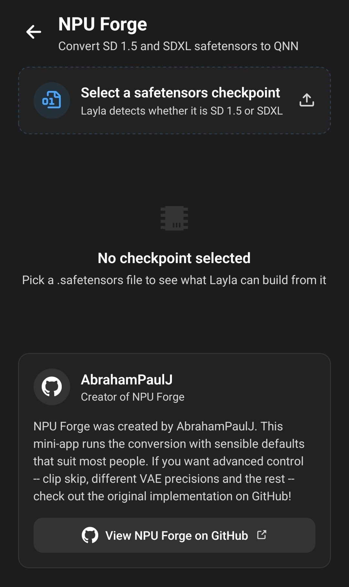

**NPU Forge est une mini-application de Layla qui convertit un checkpoint safetensors Stable Diffusion en modèle QNN, le format exécuté par le NPU Qualcomm des téléphones Snapdragon.** Vous choisissez un fichier `.safetensors`, Layla vérifie qu'il peut être converti, puis la conversion s'exécute sur votre téléphone. Une fois terminée, le modèle apparaît dans Local Dream, prêt à générer des images.

Layla sait déjà importer directement un checkpoint safetensors, comme l'explique [Comment importer des modèles Safetensor SD1.5 depuis Civit.ai dans Layla](/how-to-import-sd1-5-safetensor-models-from-civit-ai-into-layla/). Cette méthode crée un modèle qui s'exécute sur le processeur (CPU) de votre appareil. NPU Forge ajoute une seconde voie pour les téléphones équipés d'une puce Snapdragon compatible : le même checkpoint, converti pour que l'image soit générée sur le NPU, ce qui est plus rapide.

Cet article explique ce dont vous avez besoin, comment convertir un checkpoint étape par étape, combien de temps cela prend et comment générer des images avec le résultat. La conversion et la génération d'images se font toutes deux sur votre appareil : rien n'est envoyé en ligne.

## Ce que NPU Forge convertit

NPU Forge fonctionne avec deux types de checkpoints :

- **Stable Diffusion 1.5 (SD 1.5)**, la famille de checkpoints la plus répandue sur Civitai.
- **Stable Diffusion XL (SDXL)**, la famille plus grande qui produit des images de 1024 x 1024.

Vous n'avez pas besoin d'indiquer à Layla quelle famille vous avez choisie. Elle lit le fichier et détecte la famille elle-même. Les modèles sont convertis pour la résolution standard de chaque famille : 512 x 512 pour SD 1.5 et 1024 x 1024 pour SDXL.

Certains checkpoints ne peuvent pas être convertis. Les modèles SD 2.x, les modèles d'inpainting et les modèles SDXL refiner ne sont pas pris en charge. Layla vous le signale avant de commencer, pour que vous ne perdiez pas de temps avec un fichier inutilisable.

## Ce dont vous avez besoin

- Un téléphone Android équipé d'une puce Qualcomm Snapdragon dotée d'un NPU. NPU Forge affiche un message en haut de l'écran si Layla ne reconnaît pas votre puce.
- Un Snapdragon 8 Gen 3 ou plus récent si vous voulez convertir des checkpoints SDXL. SD 1.5 fonctionne sur un plus grand nombre de puces Snapdragon.
- Android 13 ou plus récent.
- La mini-application _NPU Forge_, qui télécharge environ 216 Mo d'outils de conversion. Consultez [Comment activer ou désactiver les mini-applications dans Layla](/how-to-enable-disable-mini-apps-within-layla/) si vous n'avez encore jamais installé de mini-application.
- La mini-application _Local Dream_, qui sert à générer des images. Elle télécharge aussi l'environnement d'exécution NPU dont les modèles convertis ont besoin. NPU Forge peut convertir un modèle sans elle, mais le modèle ne fonctionnera pas tant que Local Dream n'aura pas récupéré ces fichiers.
- Un checkpoint `.safetensors` enregistré sur votre téléphone.
- De l'espace de stockage et de la mémoire disponibles. La section suivante donne les chiffres.

NPU Forge n'existe que sur Android. La mini-application n'est pas disponible sur iOS, car le NPU qu'elle cible est une fonctionnalité Qualcomm.

## Stockage, mémoire et durée

La conversion est exigeante. Layla évalue votre téléphone avant de commencer et vous avertit s'il semble insuffisant. Voici les quantités approximatives qu'elle recommande, qui comprennent une marge pour Android et vos autres applications :

|                                 | SD 1.5        | SDXL           |
| ------------------------------- | ------------- | -------------- |
| Mémoire (RAM)                   | environ 5 Go  | environ 8 Go   |
| Stockage libre                  | environ 3 Go  | environ 23 Go  |
| Durée sur un Snapdragon 8 Elite | environ 2 min | environ 22 min |

Le chiffre de stockage est mesuré une fois que Layla a copié votre checkpoint dans son propre espace : il vous faut donc cet espace libre en plus du checkpoint lui-même. Une puce plus lente prend plus de temps que les durées ci-dessus.

L'avertissement est un conseil, pas un blocage. Si votre téléphone est juste, vous pouvez quand même lancer la conversion, mais elle risque de manquer de mémoire ou de stockage en cours de route et d'échouer.

## Comment convertir un checkpoint safetensors

### Étape 1 : obtenir un checkpoint

Téléchargez un checkpoint SD 1.5 ou SDXL sur votre téléphone. Sur [Civitai](https://civitai.com/), filtrez par **Model Type : Checkpoint**, **File format : SafeTensor** et le **Base Model** souhaité.

Conservez le fichier après l'avoir téléchargé. NPU Forge convertit le fichier `.safetensors` d'origine, et non un modèle que vous avez déjà importé dans Layla. Si vous l'avez importé auparavant avec **Ajouter un modèle personnalisé**, il vous faut quand même le fichier d'origine.

### Étape 2 : ouvrir NPU Forge

Ouvrez la mini-application NPU Forge depuis **Mes applications**. Il existe aussi un raccourci : sur un téléphone doté d'un NPU Qualcomm compatible, l'écran **Ajouter un modèle personnalisé** des Paramètres d'inférence affiche un message qui suggère de convertir vos safetensors pour générer des images plus vite. Si vous le touchez, NPU Forge s'ouvre dans Parcourir les apps, où vous pouvez l'installer.

Si l'écran affiche un message tel que _Ressources NPU Forge manquantes_, les outils de conversion n'ont pas encore été téléchargés. Téléchargez-les d'abord depuis la page de la mini-application.

### Étape 3 : sélectionner votre checkpoint

Touchez **Select a safetensors checkpoint** (« Sélectionner un checkpoint safetensors ») et choisissez votre fichier. Layla le copie dans son propre espace de stockage et l'inspecte. La copie des gros fichiers prend un moment.

Si vous choisissez un fichier dont le nom ne se termine pas par `.safetensors`, Layla le refuse.

### Étape 4 : lire le modèle détecté

Lorsque l'inspection est terminée, une carte **Modèle détecté** présente ce que Layla a trouvé :

- la famille du modèle, SD 1.5 ou SDXL ;
- le nombre de poids et la taille du fichier ;
- si les trois parties principales du modèle ont été trouvées : l'UNet, l'encodeur de texte CLIP et le VAE ;
- une étiquette **Convertible** ou **Not convertible** (« non convertible »).

Si l'étiquette indique _Not convertible_, la carte en explique la raison, par exemple l'absence de parties requises du modèle. Dans ce cas, choisissez un autre checkpoint.

Si vous avez choisi un checkpoint SDXL et que votre téléphone a une puce plus ancienne, Layla indique que SDXL nécessite un Snapdragon 8 Gen 3 ou plus récent, et le bouton **Start conversion** reste désactivé.

### Étape 5 : ajouter des LoRA (facultatif)

Un LoRA est un petit fichier complémentaire qui modifie le style d'un modèle ou lui apprend un personnage ou un concept. NPU Forge peut fusionner des LoRA dans votre modèle pendant la conversion.

1. Touchez **Add a LoRA** (« Ajouter un LoRA ») et choisissez un fichier LoRA `.safetensors`.
2. Réglez sa force. La valeur par défaut est 1,0. Les valeurs plus faibles appliquent le LoRA plus faiblement.
3. Répétez l'opération pour d'autres LoRA. Ils sont appliqués dans l'ordre de la liste.
4. Touchez l'icône de corbeille à côté d'un LoRA pour le retirer.

Les LoRA sont intégrés au modèle. Vous ne pouvez ni les désactiver ni modifier leur force par la suite. Pour utiliser une autre combinaison, convertissez à nouveau le checkpoint avec les LoRA souhaités. Seule la partie d'un LoRA qui agit sur le modèle d'image lui-même est fusionnée, et certains formats de LoRA peuvent ne pas être pris en charge.

### Étape 6 : nommer le modèle

Layla propose le nom du fichier du checkpoint. Vous pouvez le modifier. Le nom ne doit pas correspondre à un dossier de modèle existant, et les caractères que les systèmes de fichiers n'autorisent pas, comme `/` et `:`, sont remplacés par des espaces.

### Étape 7 : lancer la conversion

Touchez **Start conversion** (« Lancer la conversion »). Une fenêtre de progression plein écran s'affiche et indique l'étape en cours, par exemple _Extraction des poids_ ou _Compilation pour le NPU_, ainsi que la partie du modèle traitée.

Gardez ces points à l'esprit pendant l'exécution :

- **Elle ne peut pas être annulée ni passer en arrière-plan.** Gardez Layla ouverte au premier plan.
- **Branchez votre téléphone.** L'étape la plus longue peut durer de nombreuses minutes, surtout pour SDXL.
- Une notification s'affiche pendant la conversion pour qu'Android n'arrête pas le processus.
- L'écran peut s'assombrir. Ce n'est pas un problème.

La conversion transforme l'encodeur de texte, puis quantifie et compile l'UNet pour le NPU. Pour SD 1.5, elle fait de même avec le VAE. Pour SDXL, Layla utilise un VAE partagé fourni avec NPU Forge au lieu de convertir le VAE contenu dans votre checkpoint : le VAE propre à un checkpoint SDXL n'influence donc pas le résultat.

### Étape 8 : terminer

Lorsque la conversion est terminée, Layla affiche **Conversion terminée**. Le modèle est enregistré dans vos modèles de génération d'images et sélectionné automatiquement, et la copie temporaire de votre checkpoint est supprimée. Votre fichier d'origine n'est pas modifié.

Si la conversion échoue, Layla affiche une erreur et supprime tout résultat partiel : le nom reste disponible pour une nouvelle tentative.

## Générer des images avec le modèle converti

Ouvrez la mini-application **Local Dream**. Votre modèle converti est déjà sélectionné. Pour passer à un autre modèle, choisissez-le dans la liste des modèles.

Saisissez un prompt et touchez **Générer**.

Layla renseigne des réglages de départ pour chaque famille : 30 étapes et une échelle CFG de 7 pour SD 1.5, 20 étapes et une échelle CFG de 4 pour SDXL. Vous pouvez modifier les deux dans Local Dream, et le modèle converti conserve le style de son checkpoint d'origine, y compris les LoRA que vous avez fusionnés.

Si la puce de votre téléphone ne correspond pas à ce dont le modèle a besoin, Local Dream affiche un avertissement au-dessus de **Générer**. Vous pouvez quand même essayer de générer, mais cela peut échouer.

Les modèles convertis fonctionnent aussi lorsque vos personnages génèrent des images dans le chat, car ce sont des entrées normales de votre liste de modèles de génération d'images. Consultez [Comment activer la génération d'images dans Layla](/how-to-enable-image-generation-in-layla/) pour savoir comment choisir un modèle par personnage.

## Foire aux questions

### Dois-je convertir un checkpoint pour l'utiliser dans Layla ?

Non. Layla peut importer directement un fichier safetensors et l'exécuter sur le CPU. La conversion avec NPU Forge est l'option à choisir lorsque vous disposez d'un NPU Snapdragon compatible et que vous voulez une génération plus rapide.

### Puis-je convertir un modèle que j'ai déjà importé dans Layla ?

Pas directement. NPU Forge lit le fichier `.safetensors` d'origine. Si vous l'avez encore, sélectionnez-le dans NPU Forge. Si vous l'avez supprimé, téléchargez-le à nouveau.

### Puis-je convertir un modèle SD 2.x, d'inpainting ou SDXL refiner ?

Non. Seuls les checkpoints SD 1.5 et de type SDXL base sont pris en charge.

### Pourquoi NPU Forge indique-t-il que mon téléphone n'a pas de NPU Qualcomm ?

Layla en juge d'après le chipset que signale votre téléphone. Les téléphones équipés d'autres puces, comme MediaTek ou Samsung Exynos, ne peuvent pas exécuter de modèles QNN : NPU Forge ne peut donc pas être utilisé sur ces appareils.

### La conversion nécessite-t-elle une connexion Internet ?

Uniquement pour télécharger au départ les mini-applications et leurs fichiers. La conversion elle-même s'exécute sur votre téléphone et votre checkpoint y reste.

### Puis-je arrêter une conversion en cours de route ?

Non. NPU Forge ne peut pas annuler une conversion ni la passer en arrière-plan : lancez-la lorsque vous pouvez laisser le téléphone tranquille, idéalement sur son chargeur.

### Puis-je modifier la force d'un LoRA après la conversion ?

Non. Les forces sont figées au moment de la conversion. Convertissez à nouveau le checkpoint d'origine avec les nouvelles valeurs et un nouveau nom de modèle.

### Comment supprimer un modèle converti ?

Ouvrez Local Dream, sélectionnez le modèle et utilisez son option de suppression. Cela libère l'espace de stockage qu'il occupe.

### Où trouver plus de contrôle sur la conversion ?

NPU Forge dans Layla utilise des réglages par défaut judicieux qui conviennent à la plupart des checkpoints. Si vous voulez des options comme le clip skip et d'autres précisions de VAE, consultez le projet d'origine sur [GitHub](https://github.com/AbrahamPaulJ/npuforge).

## Crédits

NPU Forge a été créé par AbrahamPaulJ, et la mini-application renvoie vers le [projet d'origine sur GitHub](https://github.com/AbrahamPaulJ/npuforge). La génération d'images dans Layla repose sur [Local Dream](https://github.com/xororz/local-dream), créé par XORORZ.
