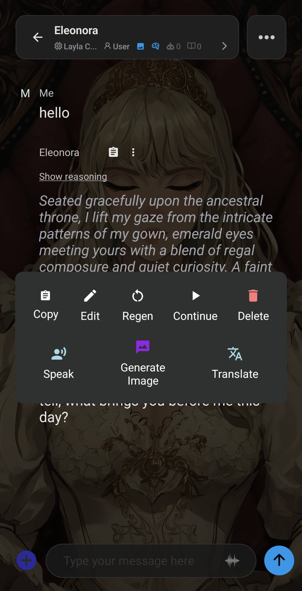

Layla peut lire à voix haute les réponses de votre personnage. Il existe trois façons de le faire, et chacune convient à une situation différente : une conversation vocale mains libres, la lecture automatique de chaque réponse pendant que vous continuez à écrire, ou la lecture d'un message précis à la demande.

Avant que l'une de ces méthodes ne produise du son, votre personnage doit disposer d'une voix. Si vous n'en avez pas encore configuré, consultez [Comment utiliser PocketTTS dans Layla](/how-to-use-pockettts-in-layla/) ou [Comment ajouter une synthèse vocale multilingue à vos personnages dans Layla](/how-to-add-multilingual-text-to-speech-for-your-characters-in-layla/).

## Démarrer un chat vocal

Le chat vocal est une conversation parlée mains libres, dans les deux sens. Layla vous écoute, convertit votre voix en texte, génère une réponse et lit cette réponse à voix haute. Avec un personnage animé, les lèvres du personnage bougent en synchronisation avec la voix.

Pour le démarrer, ouvrez un chat et appuyez sur l'**icône de forme d'onde** dans la barre de message, à côté de la zone de saisie. Layla passe en mode chat vocal et affiche _Initialisation du chat vocal..._ pendant le démarrage.

Une fois que le bouton du microphone devient vert, commencez à parler. Lorsque vous vous arrêtez, laissez à Layla un instant pour traiter ce que vous avez dit ; elle répondra ensuite à voix haute. En mode chat vocal, vous disposez de quelques commandes :

- **Mettre en pause et reprendre** — interrompez la conversation, puis reprenez lorsque vous êtes prêt à continuer.
- **Maintenir pour continuer à parler** — appuyez longuement si vous avez besoin de plus de temps pour terminer votre idée avant que Layla ne réponde.
- **Arrêter le chat vocal** — le bouton rouge met fin au mode chat vocal et vous ramène à l'affichage texte habituel.

Pour une meilleure reconnaissance, parlez clairement et placez-vous dans une pièce calme. Le bruit ambiant peut perturber l'étape de reconnaissance vocale.

## Lire les réponses automatiquement

Si vous préférez continuer à écrire tout en entendant chaque réponse lue à voix haute dès son arrivée, activez la lecture automatique des réponses. C'est distinct du chat vocal : vous saisissez toujours vos messages et Layla se contente de lire chaque réponse.

1. Dans un chat, appuyez sur le **bouton plus** à gauche de la barre de message pour ouvrir le menu **Actions de chat**.
2. Appuyez sur **Lire les réponses**.

Lorsque l'option est activée, elle apparaît en surbrillance. À partir de ce moment, chaque nouvelle réponse de votre personnage est lue automatiquement. Pour la désactiver, ouvrez de nouveau Actions de chat et appuyez une seconde fois sur **Lire les réponses** ; la surbrillance disparaît et Layla cesse de lire les nouvelles réponses.

## Lire un seul message

Il arrive que vous vouliez entendre un message en particulier plutôt que d'activer la lecture pour tout. Vous pouvez le faire sur n'importe quel message de la conversation, ancien ou récent.

1. Appuyez longuement sur le message que vous voulez entendre. Sur la réponse la plus récente, vous pouvez aussi appuyer sur le bouton **plus (...)** du message.
2. Dans le menu qui s'affiche, appuyez sur **Lire**.

Layla lit ce message à voix haute. Rien d'autre ne change : la lecture automatique des réponses reste désactivée, et vous pouvez utiliser cette commande sur autant de messages que vous le souhaitez.

## Laquelle choisir ?

- Utilisez le **chat vocal** pour une conversation entièrement parlée, sans rien saisir.
- Utilisez **Lire les réponses** lorsque vous voulez écrire mais entendre chaque réponse.
- Utilisez **Lire** sur un message lorsque vous voulez entendre une seule réponse précise.

Les trois méthodes reposent sur la même voix de synthèse configurée pour le personnage ; commencer par mettre en place une bonne voix améliore donc le rendu de chacune d'elles.
