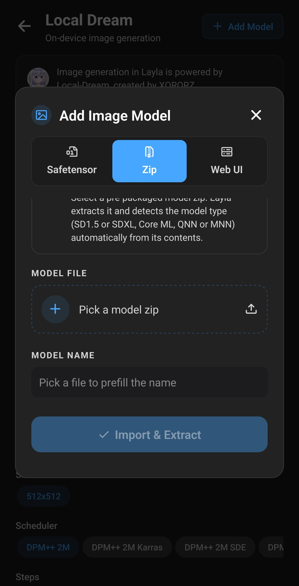
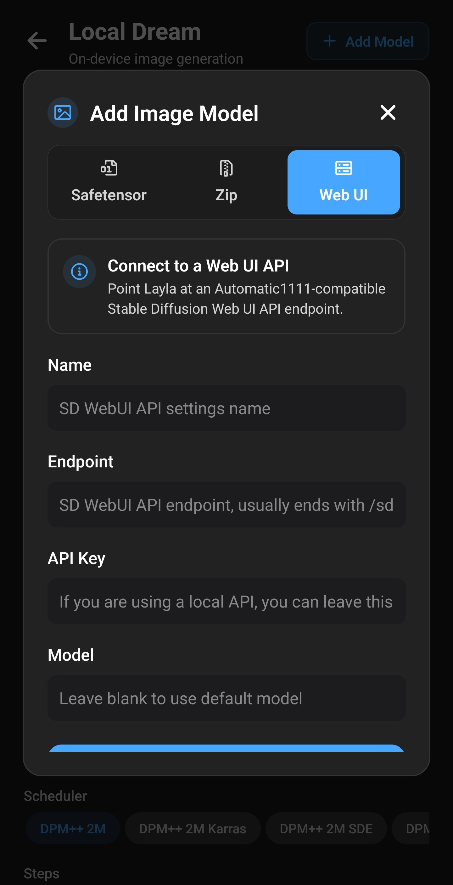

**Layla importe vos modèles d'images personnalisés, notamment les checkpoints Stable Diffusion de Civitai, de trois façons : fichier safetensors ou GGUF converti sur l'appareil, archive zip déjà préparée, ou connexion à Stable Diffusion Web UI sur votre PC.** Les modèles importés depuis un fichier génèrent hors ligne sur Android ou iPhone. La méthode dépend de la famille du modèle et de la puce du téléphone.

Ce guide présente l'écran d'importation, les méthodes, les modèles compatibles et le rôle de la mini-application facultative NPU Forge. L'importation s'effectue entièrement sur l'appareil : les fichiers choisis ne sont téléversés nulle part.

Pour les modèles déjà proposés par Layla, consultez [Activer la génération d'images](/fr/how-to-enable-image-generation-in-layla/).

## Pourquoi importer un modèle personnalisé

Layla propose des modèles prêts à télécharger, mais [Civitai](https://civitai.com/) et [Hugging Face](https://huggingface.co/) offrent bien plus de choix : checkpoints communautaires photoréalistes, anime ou illustration, et LoRA ajoutant un personnage, une tenue ou un rendu précis. L'importation permet de les utiliser au-delà de la liste intégrée.

Un modèle importé utilise Local Dream, le générateur local de Layla. Tout reste donc sur l'appareil :

- **Hors ligne.** Après l'importation, aucun Internet, compte ou abonnement nécessaire.
- **Confidentiel.** Les invites et images restent sur le téléphone, sans examen par un service en ligne.
- **Souple.** Génération texte-image et, pour la plupart des types, image-image. Les personnages peuvent aussi utiliser le modèle dans le chat.

## Importer un modèle personnalisé dans Layla

Deux chemins ouvrent le même écran **Add Image Model** :

- Ouvrez **Settings** → **Inference Settings**, descendez à **Image Generation**, puis **Add Custom Model**.
- Ouvrez **Local Dream**, puis **Add Model** en haut de l'écran.

Local Dream exécute les modèles sur l'appareil et est nécessaire à toutes les méthodes sauf Web UI. Installez-la d'abord : [Activer ou désactiver les mini-applications](/fr/how-to-enable-disable-mini-apps-within-layla/). Si elle est ancienne, Layla indique qu'une _mise à jour est nécessaire_ avant l'importation.

Jusqu'à trois onglets sont disponibles : **Safetensor**, **Zip** et **Web UI**. À la fin de l'importation, le modèle est enregistré et sélectionné automatiquement. Gardez Layla ouverte : une importation volumineuse peut prendre plusieurs minutes.

## Les trois méthodes d'importation

|                               | Onglet Safetensor                                | Onglet Zip                 | Onglet Web UI               |
| ----------------------------- | ------------------------------------------------ | -------------------------- | --------------------------- |
| Fichier ou information fourni | Checkpoint `.safetensors` ou `.gguf` sur Android | Zip préparé pour Layla     | Adresse de l'API Web UI     |
| Action de Layla               | Convertit pour l'appareil                        | Extrait et détecte le type | Enregistre la connexion     |
| Lieu de génération            | Votre appareil                                   | Votre appareil             | Ordinateur exécutant Web UI |
| Plateformes                   | Android et iOS (SD 1.5 seulement sur iOS)        | Android et iOS             | Android et iOS              |
| Source habituelle             | [Civitai](https://civitai.com/) et Hugging Face  | Paquets préconvertis       | Votre PC                    |

## Quels modèles d'images sont compatibles ?

Sur Android, **Base Model** dans Safetensor indique comment convertir le fichier. Choisissez la famille sur laquelle votre checkpoint a été entraîné.

| Modèle de base | Résultat                                  | Exécution      | Plateformes    |
| -------------- | ----------------------------------------- | -------------- | -------------- |
| SD 1.5         | Modèle local unique avec LoRA fusionnés   | CPU            | Android et iOS |
| SDXL           | GGUF Q4_0, LoRA appliqués à la génération | NPU Snapdragon | Android        |
| MOSS           | Modèle de diffusion GGUF Q4_0             | NPU Snapdragon | Android        |
| Qwen Image 2.1 | Modèle de diffusion GGUF Q4_0             | NPU Snapdragon | Android        |
| Flux 2 Klein   | Modèle de diffusion GGUF Q4_0             | NPU Snapdragon | Android        |

Quelques précisions :

- **SD 1.5**, très répandu sur Civitai, est la seule famille importable sur iOS. Son exécution CPU convient à presque tous les téléphones récents.
- **SDXL, MOSS, Qwen Image 2.1 et Flux 2 Klein** utilisent le même moteur NPU que leurs variantes intégrées. Il nécessite un Snapdragon 8 Elite (SM8750) ou ultérieur. Aucun avertissement sur la puce n'est affiché à l'importation : vérifiez-la avant de convertir.
- **MOSS, Qwen Image 2.1 et Flux 2 Klein** réutilisent le tokenizer, l'encodeur de texte et le VAE du modèle intégré correspondant. Téléchargez-le d'abord ; consultez la [section des modèles de base](#models-that-need-a-base-model-first).
- **Z-Image Turbo, Krea 2 Turbo et les autres modèles NPU intégrés** ne figurent pas dans Base Model. Vous pouvez les télécharger dans Local Dream, mais pas importer vos propres checkpoints de ces familles.

Vérifiez le modèle de base sur la page Civitai avant de télécharger. Layla n'inspecte pas le fichier pour confirmer la famille choisie ; un mauvais choix peut faire échouer l'importation ou la génération.

## Importer un checkpoint safetensors ou GGUF

1. Téléchargez le checkpoint sur le téléphone. Sur Civitai, filtrez par **Model Type: Checkpoint**, **File format: SafeTensor** et le **Base Model** souhaité. Voir l'[exemple SD 1.5 illustré](/fr/how-to-import-sd1-5-safetensor-models-from-civit-ai-into-layla/).
2. Ouvrez **Add Image Model**, onglet **Safetensor**.
3. Sur Android, choisissez **Base Model**. Sur iOS, cette liste est masquée car seul SD 1.5 est disponible.
4. Dans **MODEL CHECKPOINT**, choisissez le fichier. Layla refuse les extensions autres que `.safetensors` (ou `.gguf` sur Android).
5. Vérifiez **MODEL NAME**, prérempli à partir du nom du fichier et modifiable.
6. Ajoutez éventuellement des LoRA, comme décrit ci-dessous.
7. Appuyez sur **Import & Convert**.

Le bouton indique **Import** lorsqu'aucune conversion n'est nécessaire : fichiers GGUF ou importation de LoRA seuls. Layla affiche la progression de la copie et conversion, puis supprime les copies temporaires. Votre téléchargement original reste intact.

### Fichiers GGUF

Sur Android, choisissez un modèle de diffusion `.gguf` à la place d'un safetensors pour une importation plus rapide : Layla le copie sans conversion. Choisissez la famille correspondante pour utiliser les bons fichiers auxiliaires.

### LoRA

Un LoRA est un petit complément qui modifie le style ou apprend un personnage ou concept au modèle. Dans **LORA FILES (OPTIONAL)**, appuyez sur **Add LoRA**, choisissez un `.safetensors` et réglez sa force (1.0 par défaut). Vous pouvez en ajouter plusieurs.

Leur application dépend de la famille :

- **SD 1.5** : fusionnés au modèle converti, ils ne peuvent plus être modifiés ou retirés.
- **SDXL, MOSS, Qwen Image 2.1 et Flux 2 Klein** : copiés dans le dossier du modèle et appliqués pendant la génération.

### Modèles nécessitant d'abord un modèle de base

MOSS, Qwen Image 2.1 et Flux 2 Klein réutilisent les fichiers auxiliaires d'un modèle déjà téléchargé dans Local Dream. S'ils manquent, Safetensor affiche un avertissement et désactive l'importation. Téléchargez d'abord :

| Base Model     | Téléchargement dans Local Dream        |
| -------------- | -------------------------------------- |
| MOSS           | MOSS-Image Turbo ou MOSS-Image Base    |
| Qwen Image 2.1 | Qwen Image 2.1 ou Qwen Image 2.1 Turbo |
| Flux 2 Klein   | FLUX.2 Klein 4B                        |

Pour ces trois familles, **LoRA only** permet de créer un modèle à partir du modèle de base téléchargé et de vos LoRA, sans checkpoint. Vous économisez le temps et le stockage de sa conversion.

## Importer un zip

L'onglet **Zip** accepte un modèle déjà converti et préparé pour Layla. Choisissez le zip, vérifiez son nom et appuyez sur **Import & Extract**.

Layla extrait le zip et détecte son type selon son contenu :

- paquet Core ML : SD 1.5 Core ML sur iOS ;
- paquet SDXL avec fichiers MNN : SDXL CPU ;
- paquet SDXL avec fichiers QNN : SDXL NPU ;
- paquet ANIMA : ANIMA NPU ;
- paquet avec fichiers QNN : SD 1.5 NPU ;
- sinon : SD 1.5 CPU.

Ce dernier cas étant un repli, un zip non préparé pour Layla peut être accepté puis échouer à la génération. Utilisez une source fiable précisant sa compatibilité avec Local Dream. Les paquets QNN ciblent des puces Snapdragon précises : vérifiez-les avant téléchargement.

## Connecter une Web UI

Si votre PC exécute [AUTOMATIC1111 Stable Diffusion Web UI](https://github.com/AUTOMATIC1111/stable-diffusion-webui), connectez Layla via **Web UI**. Le PC génère les images ; une connexion réseau avec lui est nécessaire et cette méthode n'est pas hors ligne.

Renseignez :

- **Name** : un nom reconnaissable.
- **Endpoint** : l'adresse d'API, généralement terminée par `/sdapi/v1/text2img`.
- **API Key** : laissez vide pour une API locale.
- **Model** : laissez vide pour le modèle par défaut de Web UI.

Appuyez sur **Save & Select**. Le guide [Activer la génération d'images](/fr/how-to-enable-image-generation-in-layla/) explique la configuration de Web UI.

## Accélérer Stable Diffusion sur le NPU Snapdragon avec NPU Forge

L'importation safetensors SD 1.5 utilise le CPU. Avec une puce Qualcomm Snapdragon compatible, **NPU Forge** peut convertir le même checkpoint en QNN pour utiliser le NPU, l'accélérateur d'IA de Qualcomm, plus rapide.

NPU Forge est une mini-application Android distincte. Elle convertit SD 1.5 et SDXL, peut fusionner des LoRA et ajoute directement le résultat à Local Dream. Sur une puce compatible, Safetensor affiche un lien vers elle. Le [guide NPU Forge](/fr/how-to-convert-safetensors-to-qnn-with-npu-forge-in-layla/) détaille les étapes et les besoins en stockage et mémoire.

## Après l'importation

Ouvrez Local Dream : le nouveau modèle est sélectionné. La liste en haut permet d'en changer. Les imports commencent à 20 étapes et CFG 5, sauf Flux 2 Klein : 4 étapes et CFG 1. Ces valeurs sont modifiables ; les modèles conçus pour peu d'étapes demandent souvent des valeurs plus faibles.

Deux actions sont proposées pour le modèle sélectionné :

- **Model setup** est disponible pour les imports SDXL, MOSS, Qwen Image 2.1 et Flux 2 Klein utilisant le nouveau moteur. Consultez et modifiez leurs fichiers, leur échantillonneur et leurs LoRA.
- **Delete Model** supprime le modèle et libère son stockage.

Les modèles importés apparaissent aussi dans la liste des personnages pour envoyer des images dans le chat. Consultez [Activer la génération d'images](/fr/how-to-enable-image-generation-in-layla/) pour attribuer un modèle par personnage.

## Questions fréquentes

### Puis-je exécuter Stable Diffusion hors ligne sur Android ?

Oui, via Local Dream sur le CPU de la plupart des téléphones ou le NPU des Snapdragon compatibles. Une fois le modèle téléchargé, aucune connexion n'est nécessaire.

### Puis-je exécuter SDXL sur mon téléphone ?

Oui, sur Android avec un Snapdragon 8 Elite (SM8750) ou ultérieur. Choisissez **SDXL** dans Safetensor pour convertir vers le NPU. Vous pouvez aussi importer un paquet préconverti via **Zip** ou utiliser NPU Forge sur les puces compatibles.

### Puis-je exécuter Stable Diffusion sur iPhone ?

Oui, avec SD 1.5 : safetensors via **Safetensor**, paquets Core ML via **Zip**. Les autres familles sont réservées à Android.

### Puis-je utiliser les modèles Civitai sur mon téléphone ?

Oui, pour un checkpoint safetensors d'une famille compatible. Filtrez Civitai par **Checkpoint**, **SafeTensor** et **SD 1.5** ou **SDXL**, téléchargez puis importez via **Safetensor**.

### Qu'est-ce qu'un fichier safetensors ?

C'est un format stockant les poids d'un modèle d'apprentissage automatique, utilisé par la plupart des checkpoints et LoRA Stable Diffusion de Civitai. Il remplace `.ckpt` et ne peut pas, contrairement à celui-ci, contenir de code exécutable : une raison de son adoption.

### Quelle différence entre checkpoint et LoRA ?

Un checkpoint est un modèle complet. Un LoRA est un petit complément qui modifie son style ou lui apprend un sujet. Il nécessite un checkpoint de la même famille. Importez d'abord le checkpoint, puis ajoutez les LoRA.

### Puis-je utiliser des LoRA dans Layla ?

Oui, ajoutez-en un ou plusieurs dans **Safetensor**, chacun avec sa force. Ils sont fusionnés pour SD 1.5 et appliqués à la génération pour SDXL, MOSS, Qwen Image 2.1 et Flux 2 Klein.

### Faut-il un Snapdragon pour importer des modèles ?

Non. SD 1.5 s'importe et fonctionne sur le CPU de la plupart des Android récents et iPhone. Un Snapdragon est nécessaire seulement pour les modèles NPU, dont les conversions NPU Forge et les imports Android SDXL, MOSS, Qwen Image 2.1 et Flux 2 Klein.

### Puis-je importer tous les modèles Stable Diffusion ?

Non. Les options couvrent SD 1.5 et SDXL, plus MOSS, Qwen Image 2.1 et Flux 2 Klein sur Android. Les autres familles, comme SD 2.x, ne figurent pas dans Base Model.

### L'importation nécessite-t-elle Internet ?

Seulement pour installer les mini-applications et télécharger les modèles de base nécessaires. La conversion est locale. Web UI fait exception : le PC doit rester accessible pendant la génération.

### Pourquoi Base Model manque-t-il sur iPhone ?

iOS importe uniquement les safetensors SD 1.5 : aucun choix n'est nécessaire. Zip accepte aussi les paquets Core ML.

### Mon modèle importé utilisera-t-il le NPU ?

Les safetensors SD 1.5 utilisent le CPU ; utilisez NPU Forge pour convertir SD 1.5 ou SDXL vers le NPU. Les imports Android SDXL, MOSS, Qwen Image 2.1 et Flux 2 Klein ciblent déjà le NPU et nécessitent un Snapdragon 8 Elite ou ultérieur.

### Puis-je changer un LoRA après importation SD 1.5 ?

Non : il est fusionné. Réimportez le checkpoint original avec les LoRA et forces souhaités sous un nouveau nom.

### Pourquoi Local Dream doit-elle être mise à jour ?

L'importation dépend des fichiers de conversion fournis avec la mini-application. Mettez-la à jour depuis l'écran des mini-applications puis réessayez.

### Comment supprimer un modèle importé ?

Ouvrez Local Dream, choisissez le modèle puis **Delete Model**.

### Où trouver des modèles à importer ?

La plupart se trouvent sur [Civitai](https://civitai.com/) et [Hugging Face](https://huggingface.co/). Vérifiez leur modèle de base avant téléchargement : il détermine la méthode d'importation.

## Crédits

La génération d'images utilise [Local Dream](https://github.com/xororz/local-dream), créé par XORORZ. NPU Forge a été créé par AbrahamPaulJ.
