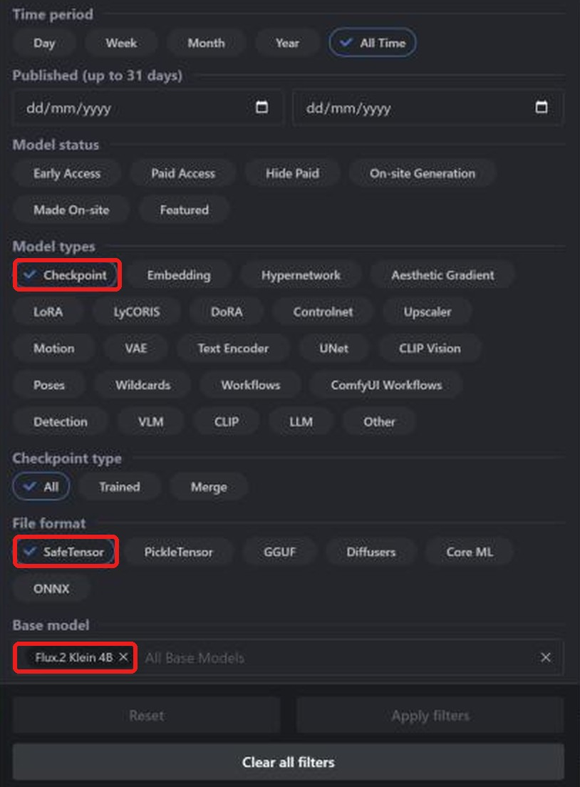
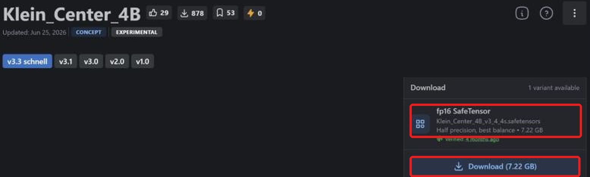
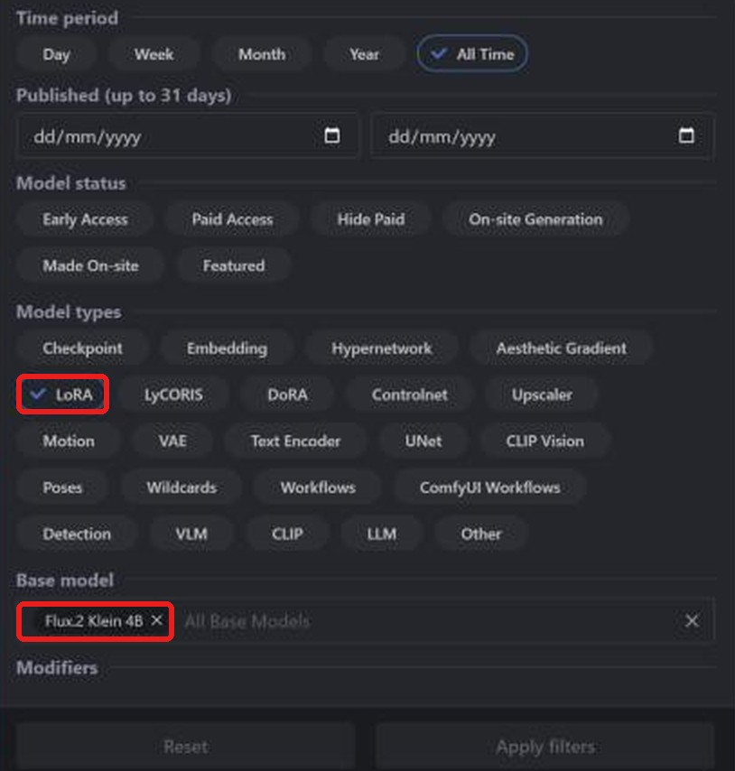
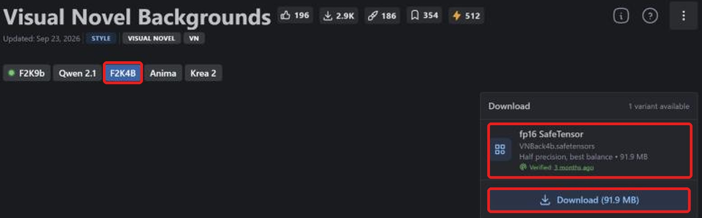

**Layla importe les checkpoints safetensors et LoRA FLUX.2 Klein 4B de Civitai pour générer hors ligne sur Android.** Ce modèle texte-image compact dispose de checkpoints et LoRA communautaires sur [Civitai](https://civitai.com/). La conversion est locale : après téléchargement, aucune connexion n'est nécessaire.

Ce tutoriel explique comment trouver un checkpoint compatible, télécharger le bon fichier, l'importer et ajouter un LoRA. Autres familles : [SD 1.5](/fr/how-to-import-sd1-5-safetensor-models-from-civit-ai-into-layla/), [SDXL](/fr/how-to-import-sdxl-safetensor-models-from-civitai-into-layla/), [MOSS Image](/fr/how-to-import-moss-image-safetensor-models-from-civitai-into-layla/), [Qwen Image 2.1](/fr/how-to-import-qwen-image-2-1-safetensor-models-from-civitai-into-layla/). Pour les fichiers GGUF, les zip et Web UI, consultez [Importer des modèles de génération d'images personnalisés dans Layla](/fr/how-to-import-custom-image-generation-models-into-layla/).

## Qu'est-ce que FLUX.2 Klein ?

FLUX.2 [klein] est une famille de Black Forest Labs, créateur de FLUX. Le modèle 4B comporte environ 4 milliards de paramètres et est distillé pour générer en environ 4 étapes. Une version 9B plus grande existe aussi.

Civitai distingue **Flux.2 Klein 4B** et **Flux.2 Klein 9B**. Le choix **Flux 2 Klein** de Layla repose sur 4B : filtrez donc **Flux.2 Klein 4B**. Un LoRA Klein 4B nécessite un checkpoint Klein 4B.

## Prérequis

- Un téléphone Android avec Snapdragon 8 Elite (SM8750) ou ultérieur. Les imports FLUX.2 Klein utilisent le NPU Snapdragon et ne sont pas disponibles sur iPhone. Layla ne vérifie pas la puce à l'importation : contrôlez-la avant de convertir un gros fichier.

- La mini-application **Local Dream**. Consultez [Activer ou désactiver les mini-applications dans Layla](/fr/how-to-enable-disable-mini-apps-within-layla/) pour l'installer.

- Un modèle intégré téléchargé dans Local Dream : **FLUX.2 Klein 4B**. Layla réutilise son tokenizer, son encodeur de texte et son VAE. S'ils manquent, Safetensor affiche un avertissement et désactive l'importation.

- De l'espace pour le checkpoint : Klein 4B fp16 occupe environ 7 Go.

## Quel fichier safetensors télécharger ?

**Layla accepte les safetensors f16 (demi-précision)**, étiquetés **fp16 SafeTensor** sur Civitai. Pour FLUX.2 Klein, les fichiers bf16 sont aussi acceptés. Les variantes quantifiées **fp8**, **int8**, **int4** et **nvfp4** ne sont pas compatibles.

Le bf16 est accepté, y compris le checkpoint officiel FLUX.2 Klein 4B. Beaucoup de checkpoints Klein sont en fp8, plus petits mais non compatibles : vérifiez la zone de téléchargement.

## Importer un checkpoint FLUX.2 Klein depuis Civitai

### Étape 1 : ouvrir Civitai et Models

Ouvrez [civitai.com](https://civitai.com/) et choisissez **Models** dans la navigation supérieure. Les captures proviennent d'un navigateur de bureau ; l'affichage mobile peut différer légèrement.

### Étape 2 : filtrer par Checkpoint, SafeTensor et Flux.2 Klein 4B

Ouvrez **Filters** en haut à droite :

1. **Model types** : **Checkpoint**.
2. **File format** : **SafeTensor**.
3. **Base model** : recherchez et choisissez **Flux.2 Klein 4B**.

La liste affiche maintenant les checkpoints FLUX.2 Klein au format approprié. [Ouvrir la liste filtrée](https://civitai.com/models?types=Checkpoint&fileFormats=SafeTensor&baseModels=Flux.2%20Klein%204B&sort=Most%20Downloaded).

### Étape 3 : télécharger le fichier safetensors fp16

Ouvrez un modèle et regardez **Download** à droite. Choisissez **fp16 SafeTensor**, ici 7.22 GB, puis **Download** pour enregistrer sur le téléphone. Si plusieurs variantes existent, sélectionnez fp16. Les exceptions bf16 pour les familles compatibles sont précisées ci-dessus.

Seul le checkpoint est nécessaire. Les **Required Components** indiqués par Civitai, comme l'encodeur de texte et le VAE, servent à d'autres outils. Layla utilise ceux du modèle de base déjà téléchargé dans Local Dream.

### Étape 4 : importer dans Layla

Ouvrez **Settings** → **Inference Settings** → **Image Generation** → **Add Custom Model**, ou **Local Dream** → **Add Model**.

Dans **Safetensor**, choisissez **Flux 2 Klein** dans **Base Model**.

Dans **MODEL CHECKPOINT**, choisissez le fichier, vérifiez **MODEL NAME** et appuyez sur **Import & Convert**. Layla le convertit en modèle de diffusion GGUF Q4_0. Cela peut prendre plusieurs minutes : laissez l'application ouverte. Le modèle est ensuite enregistré et sélectionné automatiquement.

Layla ne vérifie pas la famille du fichier. Choisir **Flux 2 Klein** pour un checkpoint d'une autre famille peut faire échouer l'importation ou la génération.

### Étape 5 : générer une image

Ouvrez **Local Dream**, vérifiez le modèle et saisissez une invite. Klein est conçu pour peu d'étapes : Layla démarre à 4 étapes et CFG 1. Ces valeurs sont modifiables.

## Ajouter un LoRA FLUX.2 Klein depuis Civitai

Un LoRA est un petit fichier qui modifie le style ou apprend un personnage, un objet ou un concept au modèle. La recherche suit celle des checkpoints, avec un autre type de modèle.

### Étape 1 : filtrer par LoRA et Flux.2 Klein 4B

Ouvrez **Models** → **Filters**, choisissez **LoRA** dans **Model types** et **Flux.2 Klein 4B** dans **Base model**. [Ouvrir la liste filtrée](https://civitai.com/models?types=LORA&fileFormats=SafeTensor&baseModels=Flux.2%20Klein%204B&sort=Most%20Downloaded). Le panneau de filtres est le même que pour les checkpoints.

### Étape 2 : télécharger le LoRA safetensors

La page peut s'ouvrir sur **F2K9b**, destiné au modèle 9B. Passez à **F2K4B**, la version 4B, puis vérifiez **fp16 SafeTensor**, ici 91,9 Mo, avant **Download**.

### Étape 3 : ajouter le LoRA pendant l'importation

Dans **Safetensor**, choisissez **Flux 2 Klein** comme **Base Model** et votre checkpoint. Sous **LORA FILES (OPTIONAL)**, appuyez sur **Add LoRA**, choisissez le fichier et sa force (1.0 par défaut). Vous pouvez en ajouter plusieurs. Lancez **Import & Convert** lorsque tout est prêt.

Pour FLUX.2 Klein, les LoRA sont copiés dans le dossier du modèle et appliqués pendant la génération. Après l'importation, choisissez le modèle dans Local Dream et ouvrez **Model setup** pour consulter ou modifier ses fichiers, son échantillonneur et ses LoRA.

### Utiliser un LoRA sans importer un checkpoint complet

Pour FLUX.2 Klein, cochez **LoRA only** dans **Safetensor**. Vous créez un nouveau modèle à partir de la base déjà téléchargée dans Local Dream et de vos LoRA, sans checkpoint. Cela économise le temps et le stockage d'une conversion complète.

## Questions fréquentes

### Puis-je utiliser FLUX.2 Klein sur mon téléphone ?

Oui, selon les prérequis indiqués ci-dessus. Choisissez **Flux 2 Klein** dans **Base Model** et importez le checkpoint Civitai. Les familles qui réutilisent une base exigent son téléchargement préalable dans Local Dream.

### Quel fichier FLUX.2 Klein télécharger sur Civitai ?

**fp16 SafeTensor**, ou bf16. Évitez fp8, int8, int4 et nvfp4.

### Puis-je importer des checkpoints FLUX.2 Klein 9B ?

Le choix Flux 2 Klein de Layla repose sur 4B. Utilisez le filtre **Flux.2 Klein 4B** pour checkpoints et LoRA.

### Puis-je importer FLUX.1 ?

Non. FLUX.1 est une autre famille, absente de Base Model.

### Puis-je importer FLUX.2 Klein sur iPhone ?

Non. iOS importe uniquement les safetensors SD 1.5. Consultez le guide SD 1.5 lié au début de cet article.

### Faut-il Internet pour importer un modèle Civitai ?

Seulement pour télécharger les fichiers. La conversion et la génération s'effectuent sur votre appareil.

### Comment supprimer un modèle importé ?

Ouvrez **Local Dream**, choisissez le modèle et appuyez sur **Delete Model** pour libérer son stockage.

## FLUX.2 Klein hors ligne sur votre téléphone

Après l'importation, FLUX.2 Klein s'exécute sur le téléphone sans Internet, compte ou abonnement. Vos invites, votre modèle et vos images restent sur l'appareil.
