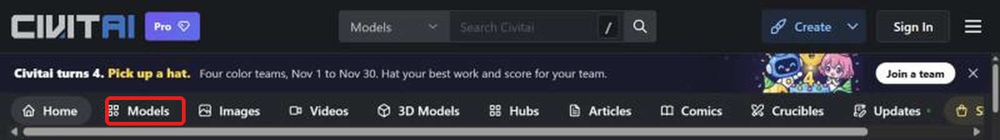
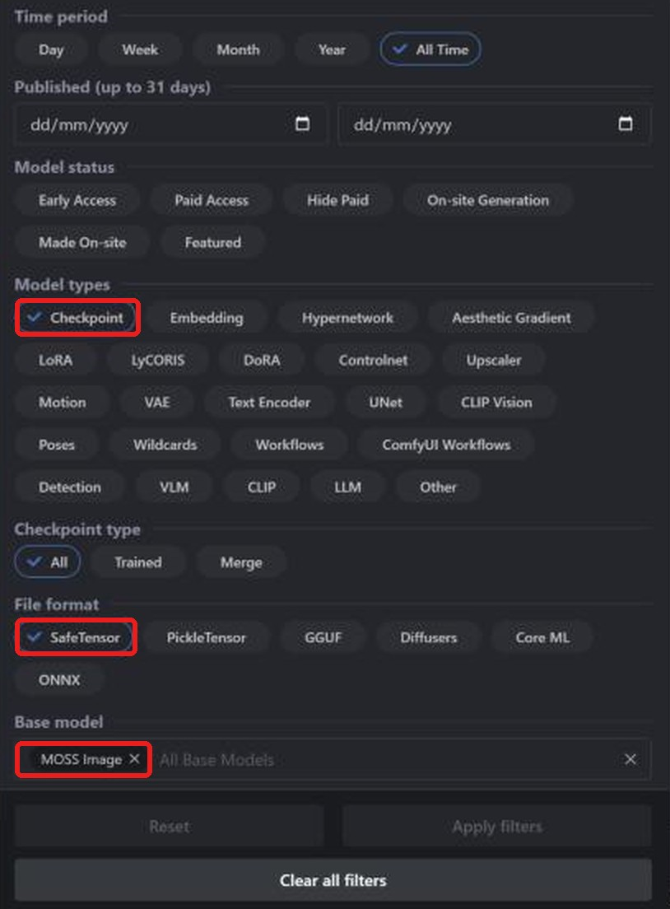
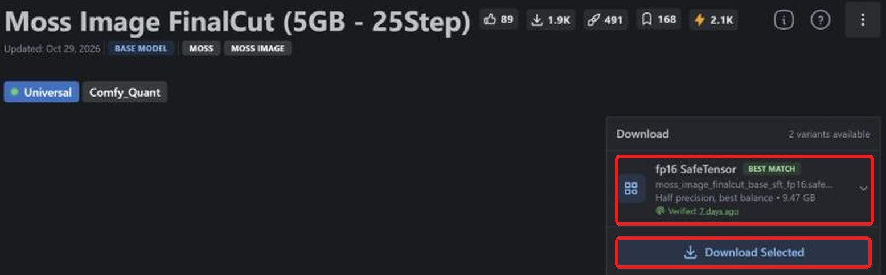
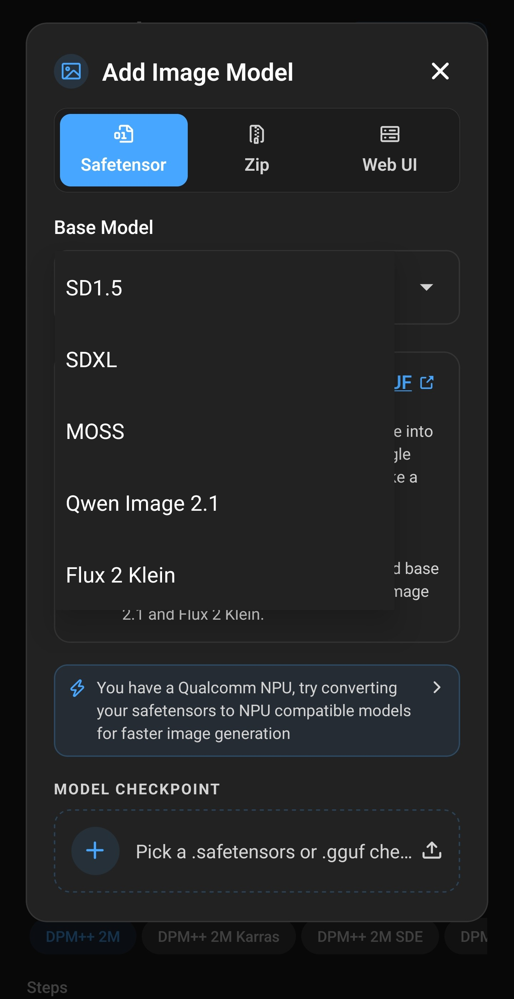
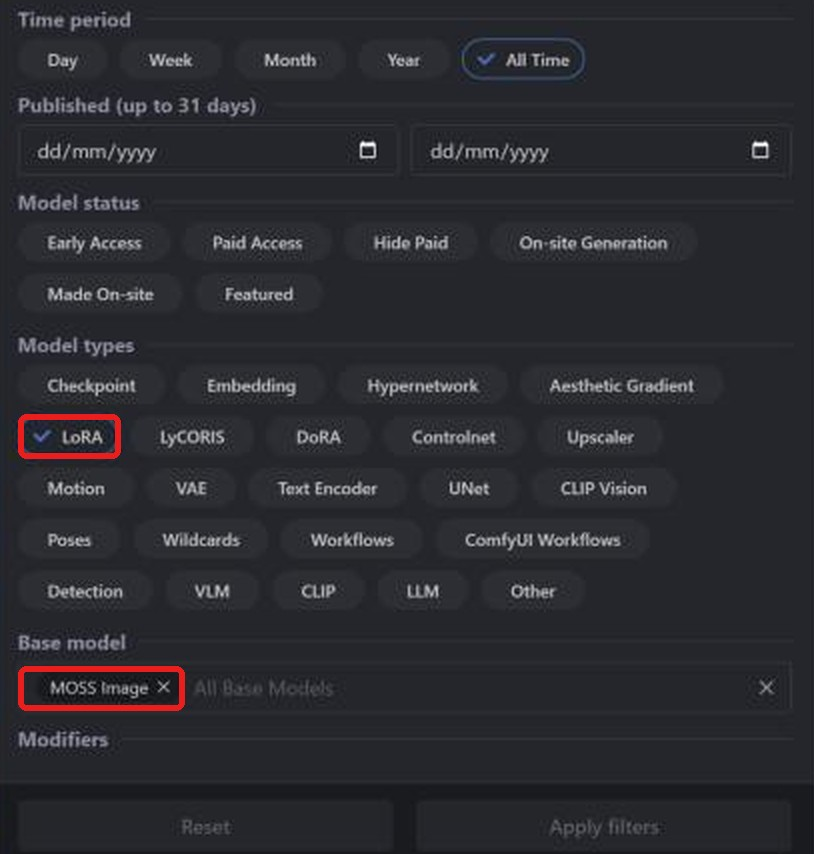
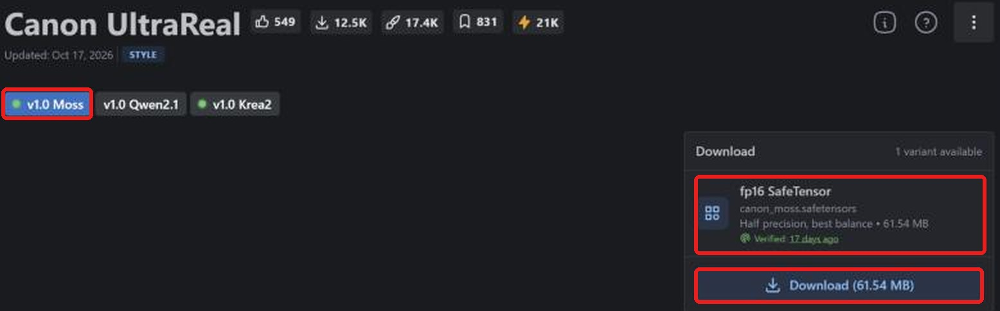

**Layla importe les checkpoints safetensors et LoRA MOSS Image de Civitai pour générer hors ligne sur Android.** Plus récent que Stable Diffusion, MOSS Image dispose déjà de checkpoints et LoRA communautaires sur [Civitai](https://civitai.com/). Layla convertit le fichier sur votre appareil : aucun Internet n'est nécessaire ensuite.

Ce tutoriel explique comment trouver un checkpoint compatible, télécharger le bon fichier, l'importer et ajouter un LoRA. Autres familles : [SD 1.5](/fr/how-to-import-sd1-5-safetensor-models-from-civit-ai-into-layla/), [SDXL](/fr/how-to-import-sdxl-safetensor-models-from-civitai-into-layla/), [Qwen Image 2.1](/fr/how-to-import-qwen-image-2-1-safetensor-models-from-civitai-into-layla/), [FLUX.2 Klein](/fr/how-to-import-flux-2-klein-safetensor-models-from-civitai-into-layla/). Pour les fichiers GGUF, les zip et Web UI, consultez [Importer des modèles de génération d'images personnalisés dans Layla](/fr/how-to-import-custom-image-generation-models-into-layla/).

## Qu'est-ce que MOSS Image ?

MOSS-Image est un modèle texte-image à poids ouverts de l'équipe OpenMOSS : un transformeur de diffusion de 5 milliards de paramètres publié en octobre 2026. **Base** vise l'affinage et l'entraînement de LoRA ; **SFT** est adapté à la génération courante. Les créateurs Civitai utilisent les deux comme base.

Sur Civitai, le filtre **Base model** s'appelle **MOSS Image** ; dans Layla, choisissez **MOSS**. Un LoRA MOSS Image nécessite un checkpoint de cette même famille.

## Prérequis

- Un téléphone Android avec Snapdragon 8 Elite (SM8750) ou ultérieur. Les imports MOSS Image utilisent le NPU Snapdragon et ne sont pas disponibles sur iPhone. Layla ne vérifie pas la puce à l'importation : contrôlez-la avant de convertir un gros fichier.

- La mini-application **Local Dream**. Consultez [Activer ou désactiver les mini-applications dans Layla](/fr/how-to-enable-disable-mini-apps-within-layla/) pour l'installer.

- Un modèle intégré téléchargé dans Local Dream : **MOSS-Image Turbo** / **MOSS-Image Base**. Layla réutilise son tokenizer, son encodeur de texte et son VAE. S'ils manquent, Safetensor affiche un avertissement et désactive l'importation.

- Beaucoup d'espace libre : un checkpoint MOSS fp16 approche 10 Go.

## Quel fichier safetensors télécharger ?

**Layla accepte les safetensors f16 (demi-précision)**, étiquetés **fp16 SafeTensor** sur Civitai. Pour MOSS Image, les fichiers bf16 sont aussi acceptés. Les variantes quantifiées **fp8**, **int8**, **int4** et **nvfp4** ne sont pas compatibles.

De nombreux checkpoints MOSS ne sont proposés qu'en int8 ou bf16. **Best match** peut désigner une version quantifiée : ouvrez la liste des variantes et vérifiez l'étiquette avant téléchargement.

## Importer un checkpoint MOSS Image depuis Civitai

### Étape 1 : ouvrir Civitai et Models

Ouvrez [civitai.com](https://civitai.com/) et choisissez **Models** dans la navigation supérieure. Les captures proviennent d'un navigateur de bureau ; l'affichage mobile peut différer légèrement.

### Étape 2 : filtrer par Checkpoint, SafeTensor et MOSS Image

Ouvrez **Filters** en haut à droite :

1. **Model types** : **Checkpoint**.
2. **File format** : **SafeTensor**.
3. **Base model** : recherchez et choisissez **MOSS Image**.

La liste affiche maintenant les checkpoints MOSS Image au format approprié. [Ouvrir la liste filtrée](https://civitai.com/models?types=Checkpoint&fileFormats=SafeTensor&baseModels=MOSS%20Image&sort=Most%20Downloaded).

### Étape 3 : télécharger le fichier safetensors fp16

Ouvrez un modèle et regardez **Download** à droite. Choisissez **fp16 SafeTensor**, ici 9.47 GB, puis **Download** pour enregistrer sur le téléphone. Si plusieurs variantes existent, sélectionnez fp16. Les exceptions bf16 pour les familles compatibles sont précisées ci-dessus.

Seul le checkpoint est nécessaire. Les **Required Components** indiqués par Civitai, comme l'encodeur de texte et le VAE, servent à d'autres outils. Layla utilise ceux du modèle de base déjà téléchargé dans Local Dream.

### Étape 4 : importer dans Layla

Ouvrez **Settings** → **Inference Settings** → **Image Generation** → **Add Custom Model**, ou **Local Dream** → **Add Model**.

Dans **Safetensor**, choisissez **MOSS** dans **Base Model**.

Dans **MODEL CHECKPOINT**, choisissez le fichier, vérifiez **MODEL NAME** et appuyez sur **Import & Convert**. Layla le convertit en modèle de diffusion GGUF Q4_0. Cela peut prendre plusieurs minutes : laissez l'application ouverte. Le modèle est ensuite enregistré et sélectionné automatiquement.

Layla ne vérifie pas la famille du fichier. Choisir **MOSS** pour un checkpoint d'une autre famille peut faire échouer l'importation ou la génération.

### Étape 5 : générer une image

Ouvrez **Local Dream**, vérifiez le modèle et saisissez une invite. Les valeurs initiales sont 20 étapes et CFG 5, modifiables. Les variantes Turbo ou conçues pour peu d'étapes nécessitent généralement des valeurs inférieures.

## Ajouter un LoRA MOSS Image depuis Civitai

Un LoRA est un petit fichier qui modifie le style ou apprend un personnage, un objet ou un concept au modèle. La recherche suit celle des checkpoints, avec un autre type de modèle.

### Étape 1 : filtrer par LoRA et MOSS Image

Ouvrez **Models** → **Filters**, choisissez **LoRA** dans **Model types** et **MOSS Image** dans **Base model**. [Ouvrir la liste filtrée](https://civitai.com/models?types=LORA&fileFormats=SafeTensor&baseModels=MOSS%20Image&sort=Most%20Downloaded). Le panneau de filtres est le même que pour les checkpoints.

### Étape 2 : télécharger le LoRA safetensors

Certains LoRA proposent une version par modèle de base. Choisissez celle de MOSS Image, ici **v1.0 Moss**. Vérifiez **fp16 SafeTensor**, ici 61,54 Mo, puis **Download**.

### Étape 3 : ajouter le LoRA pendant l'importation

Dans **Safetensor**, choisissez **MOSS** comme **Base Model** et votre checkpoint. Sous **LORA FILES (OPTIONAL)**, appuyez sur **Add LoRA**, choisissez le fichier et sa force (1.0 par défaut). Vous pouvez en ajouter plusieurs. Lancez **Import & Convert** lorsque tout est prêt.

Pour MOSS Image, les LoRA sont copiés dans le dossier du modèle et appliqués pendant la génération. Après l'importation, choisissez le modèle dans Local Dream et ouvrez **Model setup** pour consulter ou modifier ses fichiers, son échantillonneur et ses LoRA.

### Utiliser un LoRA sans importer un checkpoint complet

Pour MOSS Image, cochez **LoRA only** dans **Safetensor**. Vous créez un nouveau modèle à partir de la base déjà téléchargée dans Local Dream et de vos LoRA, sans checkpoint. Cela économise le temps et le stockage d'une conversion complète.

## Questions fréquentes

### Puis-je utiliser MOSS Image sur mon téléphone ?

Oui, selon les prérequis indiqués ci-dessus. Choisissez **MOSS** dans **Base Model** et importez le checkpoint Civitai. Les familles qui réutilisent une base exigent son téléchargement préalable dans Local Dream.

### Quel fichier MOSS Image télécharger sur Civitai ?

**fp16 SafeTensor**, ou bf16. Évitez fp8, int8, int4 et nvfp4, même si Civitai les propose par défaut.

### Pourquoi les checkpoints MOSS Image sont-ils volumineux ?

Un checkpoint fp16 stocke tous les poids en demi-précision : près de 10 Go pour 5 milliards de paramètres. Les variantes quantifiées sont plus petites mais ne sont pas importables.

### Quelle différence entre MOSS Base et SFT ?

Base vise l'affinage et l'entraînement de LoRA, SFT la génération courante. Les deux utilisent **MOSS** dans Layla.

### Puis-je importer MOSS Image sur iPhone ?

Non. iOS importe uniquement les safetensors SD 1.5. Consultez le guide SD 1.5 lié au début de cet article.

### Faut-il Internet pour importer un modèle Civitai ?

Seulement pour télécharger les fichiers. La conversion et la génération s'effectuent sur votre appareil.

### Comment supprimer un modèle importé ?

Ouvrez **Local Dream**, choisissez le modèle et appuyez sur **Delete Model** pour libérer son stockage.

## MOSS Image hors ligne sur votre téléphone

Après l'importation, MOSS Image s'exécute sur le téléphone sans Internet, compte ou abonnement. Vos invites, votre modèle et vos images restent sur l'appareil.
