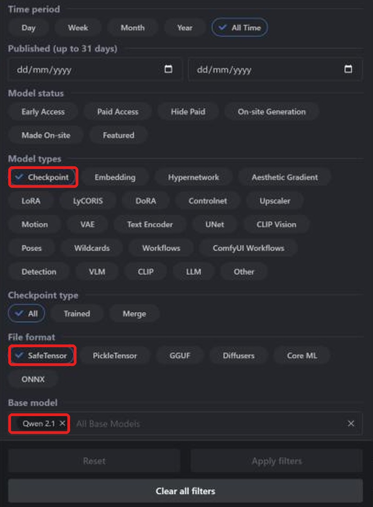
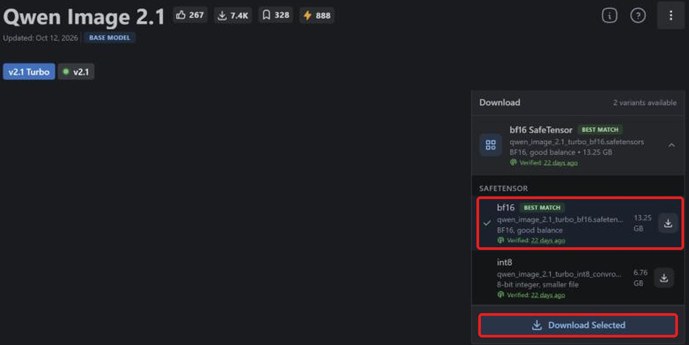
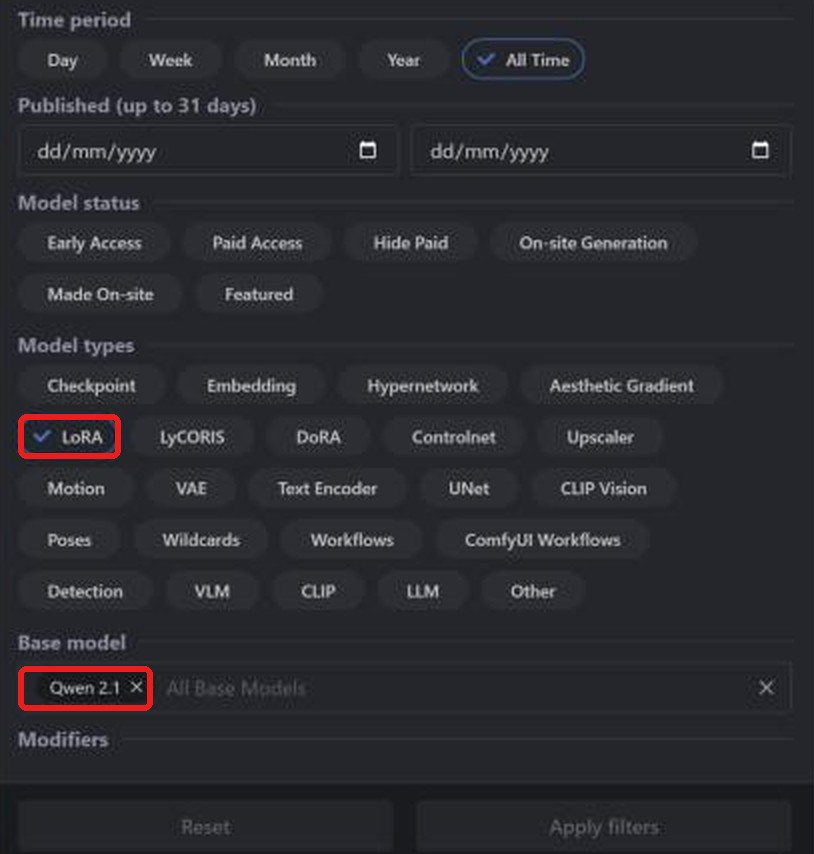
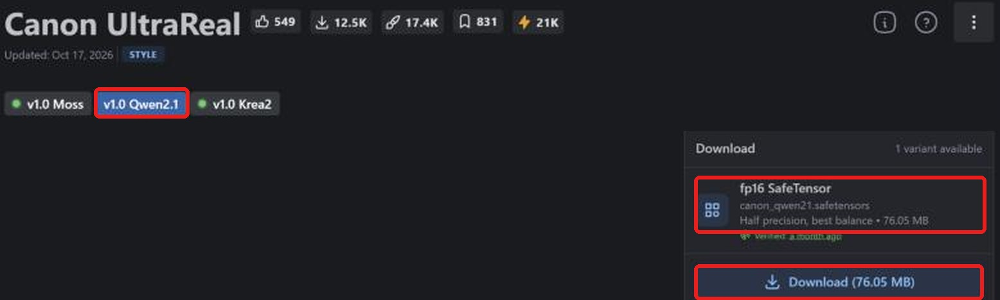

**Layla importe les checkpoints safetensors et LoRA Qwen Image 2.1 de Civitai pour générer hors ligne sur Android.** Ce modèle texte-image récent dispose de versions affinées et de LoRA sur [Civitai](https://civitai.com/). Layla convertit le checkpoint sur l'appareil ; après téléchargement, la génération est hors ligne.

Ce tutoriel explique comment trouver un checkpoint compatible, télécharger le bon fichier, l'importer et ajouter un LoRA. Autres familles : [SD 1.5](/fr/how-to-import-sd1-5-safetensor-models-from-civit-ai-into-layla/), [SDXL](/fr/how-to-import-sdxl-safetensor-models-from-civitai-into-layla/), [MOSS Image](/fr/how-to-import-moss-image-safetensor-models-from-civitai-into-layla/), [FLUX.2 Klein](/fr/how-to-import-flux-2-klein-safetensor-models-from-civitai-into-layla/). Pour les fichiers GGUF, les zip et Web UI, consultez [Importer des modèles de génération d'images personnalisés dans Layla](/fr/how-to-import-custom-image-generation-models-into-layla/).

## Qu'est-ce que Qwen Image 2.1 ?

Qwen-Image-2.1 est un modèle d'images à poids ouverts de l'équipe Qwen d'Alibaba, publié en septembre 2026. Son générateur comporte environ 7 milliards de paramètres et permet la génération texte-image ainsi que la retouche. Vérifiez la licence avant un usage commercial : elle diffère des versions Qwen-Image précédentes.

Sur Civitai, choisissez **Qwen 2.1** ; dans Layla, **Qwen Image 2.1**. Les LoRA nécessitent la même base. Les filtres Civitai **Qwen**, **Qwen 2** et **Qwen 3** désignent d'autres familles.

## Prérequis

- Un téléphone Android avec Snapdragon 8 Elite (SM8750) ou ultérieur. Les imports Qwen Image 2.1 utilisent le NPU Snapdragon et ne sont pas disponibles sur iPhone. Layla ne vérifie pas la puce à l'importation : contrôlez-la avant de convertir un gros fichier.

- La mini-application **Local Dream**. Consultez [Activer ou désactiver les mini-applications dans Layla](/fr/how-to-enable-disable-mini-apps-within-layla/) pour l'installer.

- Un modèle intégré téléchargé dans Local Dream : **Qwen Image 2.1** / **Qwen Image 2.1 Turbo**. Layla réutilise son tokenizer, son encodeur de texte et son VAE. S'ils manquent, Safetensor affiche un avertissement et désactive l'importation.

- Beaucoup d'espace libre : un checkpoint Qwen Image 2.1 bf16 dépasse 13 Go.

## Quel fichier safetensors télécharger ?

**Layla accepte les safetensors f16 (demi-précision)**, étiquetés **fp16 SafeTensor** sur Civitai. Pour Qwen Image 2.1, les fichiers bf16 sont aussi acceptés. Les variantes quantifiées **fp8**, **int8**, **int4** et **nvfp4** ne sont pas compatibles.

Au moment de la rédaction, nous n'avons pas trouvé de checkpoint Qwen 2.1 fp16 sur Civitai : ils sont en bf16 ou quantifiés. Choisissez **bf16 SafeTensor**. **Best match** désigne bf16 sur la page officielle, mais peut pointer vers un fichier quantifié ailleurs. Vérifiez chaque page.

## Importer un checkpoint Qwen Image 2.1 depuis Civitai

### Étape 1 : ouvrir Civitai et Models

Ouvrez [civitai.com](https://civitai.com/) et choisissez **Models** dans la navigation supérieure. Les captures proviennent d'un navigateur de bureau ; l'affichage mobile peut différer légèrement.

### Étape 2 : filtrer par Checkpoint, SafeTensor et Qwen 2.1

Ouvrez **Filters** en haut à droite :

1. **Model types** : **Checkpoint**.
2. **File format** : **SafeTensor**.
3. **Base model** : recherchez et choisissez **Qwen 2.1**.

La liste affiche maintenant les checkpoints Qwen Image 2.1 au format approprié. [Ouvrir la liste filtrée](https://civitai.com/models?types=Checkpoint&fileFormats=SafeTensor&baseModels=Qwen%202.1&sort=Most%20Downloaded).

### Étape 3 : télécharger le fichier safetensors bf16

Ouvrez la liste des variantes dans **Download** et sélectionnez **bf16 SafeTensor**, ici 13,25 Go, puis **Download Selected**. Ne prenez pas le fichier **int8**, plus petit mais incompatible. Si **fp16 SafeTensor** est proposé, préférez-le. Pour cette famille, f16 et bf16 sont acceptés.

Seul le checkpoint est nécessaire. Les **Required Components** indiqués par Civitai, comme l'encodeur de texte et le VAE, servent à d'autres outils. Layla utilise ceux du modèle de base déjà téléchargé dans Local Dream.

### Étape 4 : importer dans Layla

Ouvrez **Settings** → **Inference Settings** → **Image Generation** → **Add Custom Model**, ou **Local Dream** → **Add Model**.

Dans **Safetensor**, choisissez **Qwen Image 2.1** dans **Base Model**.

Dans **MODEL CHECKPOINT**, choisissez le fichier, vérifiez **MODEL NAME** et appuyez sur **Import & Convert**. Layla le convertit en modèle de diffusion GGUF Q4_0. Cela peut prendre plusieurs minutes : laissez l'application ouverte. Le modèle est ensuite enregistré et sélectionné automatiquement.

Layla ne vérifie pas la famille du fichier. Choisir **Qwen Image 2.1** pour un checkpoint d'une autre famille peut faire échouer l'importation ou la génération.

### Étape 5 : générer une image

Ouvrez **Local Dream**, vérifiez le modèle et saisissez une invite. Les valeurs initiales sont 20 étapes et CFG 5, modifiables. Les checkpoints Turbo nécessitent généralement moins d'étapes et des valeurs inférieures.

## Ajouter un LoRA Qwen Image 2.1 depuis Civitai

Un LoRA est un petit fichier qui modifie le style ou apprend un personnage, un objet ou un concept au modèle. La recherche suit celle des checkpoints, avec un autre type de modèle.

### Étape 1 : filtrer par LoRA et Qwen 2.1

Ouvrez **Models** → **Filters**, choisissez **LoRA** dans **Model types** et **Qwen 2.1** dans **Base model**. [Ouvrir la liste filtrée](https://civitai.com/models?types=LORA&fileFormats=SafeTensor&baseModels=Qwen%202.1&sort=Most%20Downloaded). Le panneau de filtres est le même que pour les checkpoints.

### Étape 2 : télécharger le LoRA safetensors

Choisissez la version Qwen Image 2.1 du LoRA, ici **v1.0 Qwen2.1**, puis vérifiez **fp16 SafeTensor**, ici 76,05 Mo. Appuyez sur **Download**.

### Étape 3 : ajouter le LoRA pendant l'importation

Dans **Safetensor**, choisissez **Qwen Image 2.1** comme **Base Model** et votre checkpoint. Sous **LORA FILES (OPTIONAL)**, appuyez sur **Add LoRA**, choisissez le fichier et sa force (1.0 par défaut). Vous pouvez en ajouter plusieurs. Lancez **Import & Convert** lorsque tout est prêt.

Pour Qwen Image 2.1, les LoRA sont copiés dans le dossier du modèle et appliqués pendant la génération. Après l'importation, choisissez le modèle dans Local Dream et ouvrez **Model setup** pour consulter ou modifier ses fichiers, son échantillonneur et ses LoRA.

### Utiliser un LoRA sans importer un checkpoint complet

Pour Qwen Image 2.1, cochez **LoRA only** dans **Safetensor**. Vous créez un nouveau modèle à partir de la base déjà téléchargée dans Local Dream et de vos LoRA, sans checkpoint. Cela économise le temps et le stockage d'une conversion complète.

## Questions fréquentes

### Puis-je utiliser Qwen Image 2.1 sur mon téléphone ?

Oui, selon les prérequis indiqués ci-dessus. Choisissez **Qwen Image 2.1** dans **Base Model** et importez le checkpoint Civitai. Les familles qui réutilisent une base exigent son téléchargement préalable dans Local Dream.

### Quel fichier Qwen Image 2.1 télécharger sur Civitai ?

**fp16 SafeTensor** s'il existe, sinon **bf16 SafeTensor**. Évitez fp8, int8, int4 et nvfp4.

### Existe-t-il un Qwen Image 2.1 fp16 sur Civitai ?

Au moment de la rédaction, nous n'en avons pas trouvé parmi les checkpoints Qwen 2.1. Ils sont en bf16 ou quantifiés ; Layla importe bf16 pour cette famille.

### Quelle différence avec la version Turbo ?

Turbo génère en moins d'étapes. Les deux versions peuvent servir de base à l'importation, à condition d'en avoir téléchargé une dans Local Dream.

### Puis-je importer Qwen Image 2.1 sur iPhone ?

Non. iOS importe uniquement les safetensors SD 1.5. Consultez le guide SD 1.5 lié au début de cet article.

### Faut-il Internet pour importer un modèle Civitai ?

Seulement pour télécharger les fichiers. La conversion et la génération s'effectuent sur votre appareil.

### Comment supprimer un modèle importé ?

Ouvrez **Local Dream**, choisissez le modèle et appuyez sur **Delete Model** pour libérer son stockage.

## Qwen Image 2.1 hors ligne sur votre téléphone

Après l'importation, Qwen Image 2.1 s'exécute sur le téléphone sans Internet, compte ou abonnement. Vos invites, votre modèle et vos images restent sur l'appareil.
