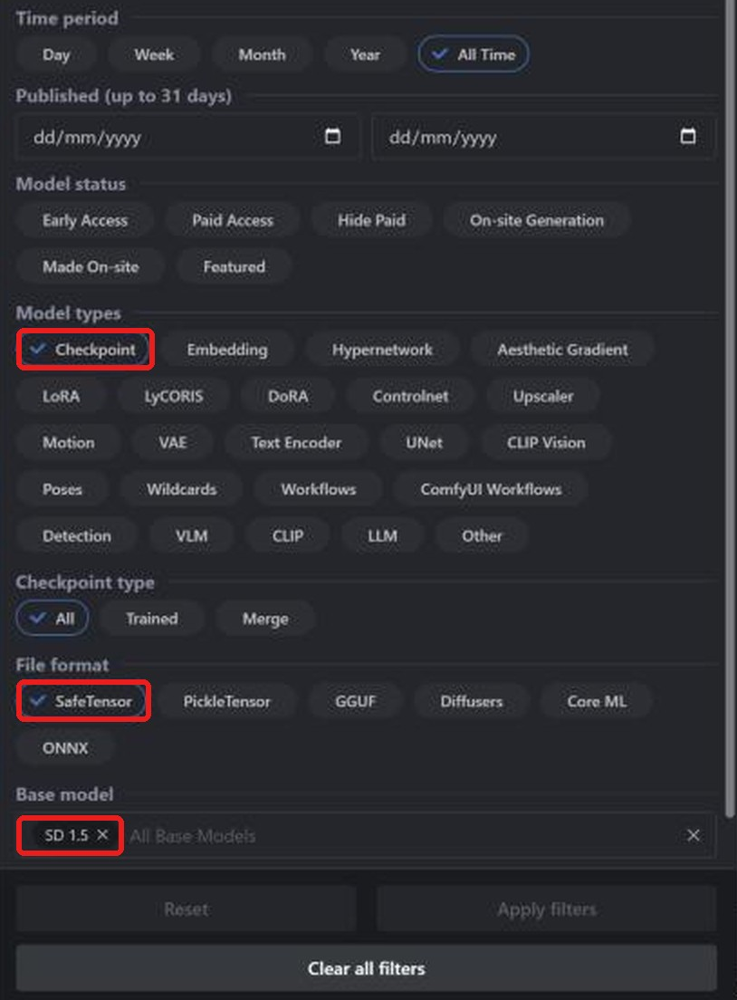
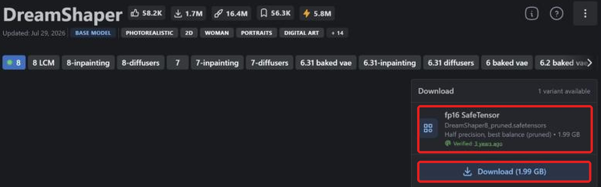
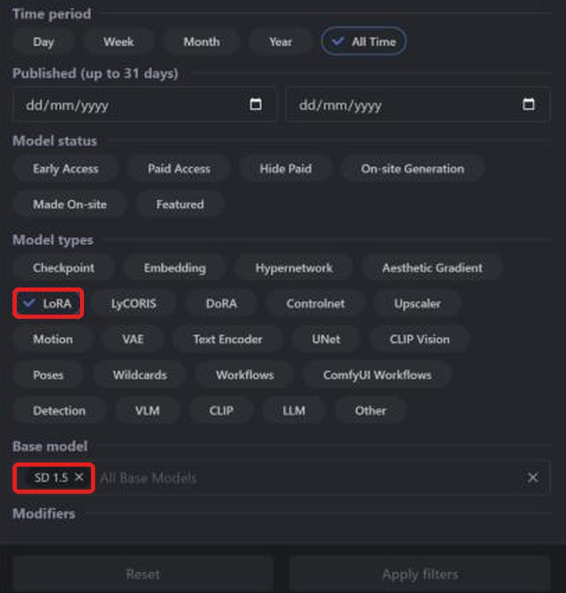
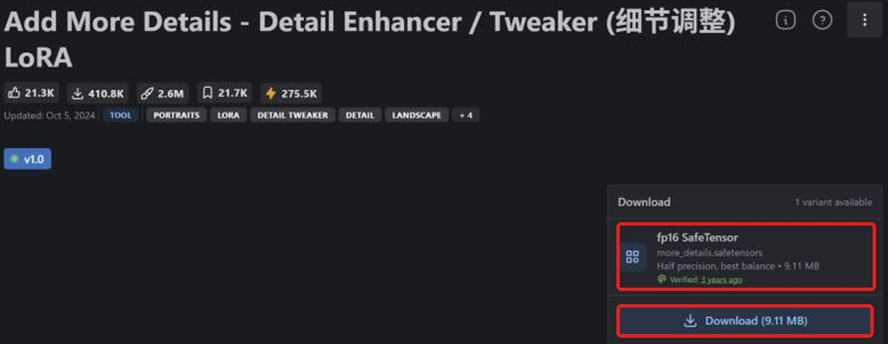

**Layla importe les checkpoints safetensors et LoRA Stable Diffusion 1.5 (SD 1.5) de Civitai pour générer hors ligne sur Android ou iPhone.** La plupart des modèles communautaires Stable Diffusion sur [Civitai](https://civitai.com/) utilisent safetensors. Layla les convertit sur l'appareil : après téléchargement, aucune connexion n'est nécessaire pour générer.

Ce tutoriel explique comment trouver un checkpoint compatible, télécharger le bon fichier, l'importer et ajouter un LoRA. Autres familles : [SDXL](/fr/how-to-import-sdxl-safetensor-models-from-civitai-into-layla/), [MOSS Image](/fr/how-to-import-moss-image-safetensor-models-from-civitai-into-layla/), [Qwen Image 2.1](/fr/how-to-import-qwen-image-2-1-safetensor-models-from-civitai-into-layla/), [FLUX.2 Klein](/fr/how-to-import-flux-2-klein-safetensor-models-from-civitai-into-layla/). Pour les fichiers GGUF, les zip et Web UI, consultez [Importer des modèles de génération d'images personnalisés dans Layla](/fr/how-to-import-custom-image-generation-models-into-layla/).

## Qu'est-ce que SD 1.5 ?

SD 1.5 est Stable Diffusion 1.5, une version du modèle [Stable Diffusion](https://en.wikipedia.org/wiki/Stable_Diffusion) générant en 512 x 512. C'est la famille la plus répandue sur Civitai : des milliers de checkpoints et LoRA photoréalistes, anime ou illustration en dérivent. Elle figure donc dans le filtre **Base model** sous **SD 1.5**.

Un LoRA ne fonctionne qu'avec un checkpoint de la même base. Un LoRA SD 1.5 ne fonctionne pas avec SDXL, et inversement.

## Quel fichier safetensors télécharger ?

**Layla accepte uniquement les safetensors f16 (demi-précision).** Sur Civitai, recherchez **fp16 SafeTensor** dans la zone de téléchargement. Vérifiez la précision avant de télécharger.

Un checkpoint SD 1.5 fp16 fait généralement environ 2 Go. Une variante pleine précision peut être plus volumineuse de plusieurs gigaoctets : choisissez fp16.

## Importer un checkpoint SD 1.5 depuis Civitai

### Étape 1 : ouvrir Civitai et Models

Ouvrez [civitai.com](https://civitai.com/) et choisissez **Models** dans la navigation supérieure. Les captures proviennent d'un navigateur de bureau ; l'affichage mobile peut différer légèrement.

### Étape 2 : filtrer par Checkpoint, SafeTensor et SD 1.5

Ouvrez **Filters** en haut à droite :

1. **Model types** : **Checkpoint**.
2. **File format** : **SafeTensor**.
3. **Base model** : recherchez et choisissez **SD 1.5**.

La liste affiche maintenant les checkpoints SD 1.5 au format approprié. [Ouvrir la liste filtrée](https://civitai.com/models?types=Checkpoint&fileFormats=SafeTensor&baseModels=SD%201.5&sort=Most%20Downloaded).

Vous pouvez commencer par les tris **Most Downloaded** ou **Highest Rated**.

### Étape 3 : télécharger le fichier safetensors fp16

Ouvrez un modèle et regardez **Download** à droite. Choisissez **fp16 SafeTensor**, ici 1.99 GB, puis **Download** pour enregistrer sur le téléphone. Si plusieurs variantes existent, sélectionnez fp16. Les exceptions bf16 pour les familles compatibles sont précisées ci-dessus.

### Étape 4 : importer dans Layla

Ouvrez **Settings** → **Inference Settings** → **Image Generation** → **Add Custom Model**, ou **Local Dream** → **Add Model**.

Dans **Safetensor**, laissez **Base Model** sur **SD1.5**. Sur iPhone, la liste n'apparaît pas, car seule cette famille est disponible.

Dans **MODEL CHECKPOINT**, choisissez le fichier, vérifiez le nom et appuyez sur **Import & Convert**. Gardez Layla ouverte pendant les quelques minutes nécessaires. Le modèle est ensuite enregistré et sélectionné automatiquement.

### Étape 5 : générer une image

Ouvrez **Local Dream**, vérifiez le modèle sélectionné et saisissez une invite.

Ces imports SD 1.5 utilisent le CPU, jusqu'à 512 x 512. Avec un Qualcomm Snapdragon compatible, convertissez le même checkpoint pour le NPU afin d'accélérer. Consultez [NPU Forge](/fr/how-to-convert-safetensors-to-qnn-with-npu-forge-in-layla/).

## Ajouter un LoRA SD 1.5 depuis Civitai

Un LoRA est un petit fichier qui modifie le style ou apprend un personnage, un objet ou un concept au modèle. La recherche suit celle des checkpoints, avec un autre type de modèle.

### Étape 1 : filtrer par LoRA et SD 1.5

Ouvrez **Models** → **Filters**, choisissez **LoRA** dans **Model types** et **SD 1.5** dans **Base model**. [Ouvrir la liste filtrée](https://civitai.com/models?types=LORA&fileFormats=SafeTensor&baseModels=SD%201.5&sort=Most%20Downloaded). Le panneau de filtres est le même que pour les checkpoints.

### Étape 2 : télécharger le LoRA safetensors

Un LoRA est bien plus petit qu'un checkpoint, souvent de 10 à 150 Mo ; l'exemple fait 9,11 Mo. Choisissez **fp16 SafeTensor** lorsque la précision est indiquée, puis **Download**.

### Étape 3 : ajouter le LoRA pendant l'importation

Dans **Safetensor**, choisissez **SD1.5** comme **Base Model** et votre checkpoint. Sous **LORA FILES (OPTIONAL)**, appuyez sur **Add LoRA**, choisissez le fichier et sa force (1.0 par défaut). Vous pouvez en ajouter plusieurs. Lancez **Import & Convert** lorsque tout est prêt.

Pour SD 1.5, les LoRA sont fusionnés au modèle converti et ne peuvent plus être modifiés ou retirés. Réimportez le checkpoint original sous un nouveau nom pour changer la combinaison.

## Questions fréquentes

### Puis-je utiliser SD 1.5 sur mon téléphone ?

Oui, selon les prérequis indiqués ci-dessus. Choisissez **SD1.5** dans **Base Model** et importez le checkpoint Civitai. Les familles qui réutilisent une base exigent son téléchargement préalable dans Local Dream.

### Quel fichier SD 1.5 télécharger sur Civitai ?

**fp16 SafeTensor**. Les autres précisions et formats comme PickleTensor (`.ckpt`) ne conviennent pas.

### Faut-il Internet pour importer un modèle Civitai ?

Seulement pour télécharger les fichiers. La conversion et la génération s'effectuent sur votre appareil.

### Puis-je importer SD 1.5 sur iPhone ?

Oui. iOS importe SD 1.5 dans **Safetensor**. Les autres familles sont réservées à Android.

### Puis-je importer SDXL ou d'autres familles ?

Sur Android, oui : SDXL, MOSS Image, Qwen Image 2.1 et FLUX.2 Klein. Leurs guides sont liés au début de l'article.

### Puis-je utiliser des LoRA SD 1.5 ?

Oui, pendant l'importation dans **Safetensor**. Ils doivent être de la famille SD 1.5 et leur force est figée lors de la conversion.

### Pourquoi l'importation est-elle longue ?

La conversion du checkpoint complet peut prendre plusieurs minutes. Gardez Layla ouverte jusqu'à la fin.

### Comment supprimer un modèle importé ?

Ouvrez **Local Dream**, choisissez le modèle et appuyez sur **Delete Model** pour libérer son stockage.

## SD 1.5 hors ligne sur votre téléphone

Après l'importation, SD 1.5 s'exécute sur le téléphone sans Internet, compte ou abonnement. Vos invites, votre modèle et vos images restent sur l'appareil.
