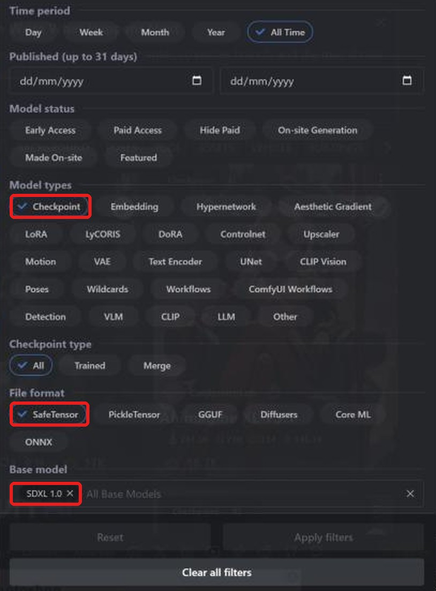
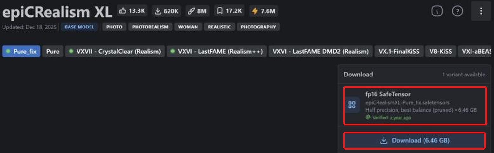
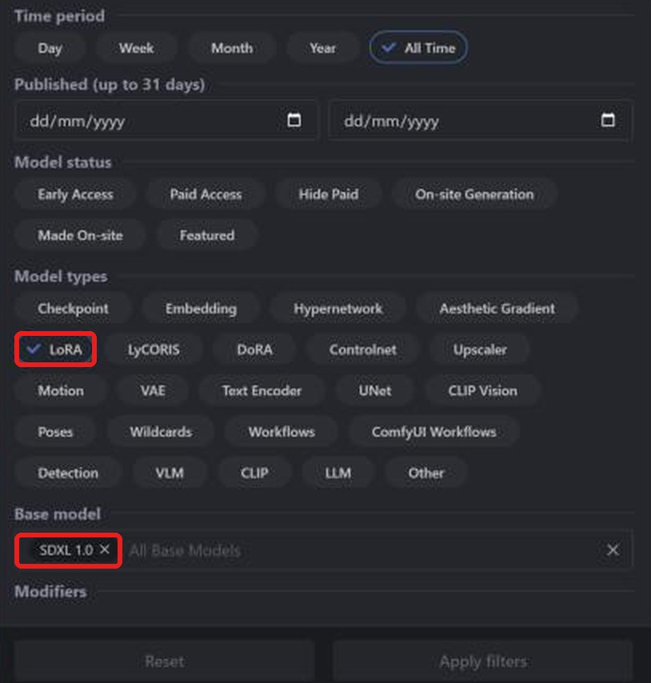
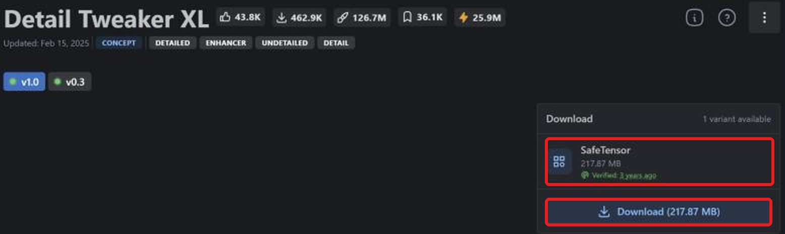

**Layla importe les checkpoints safetensors et LoRA Stable Diffusion XL (SDXL) de Civitai pour les exécuter sur le NPU Snapdragon de votre téléphone Android.** La plupart sont distribués sur [Civitai](https://civitai.com/) en safetensors. La conversion est locale ; après téléchargement, la génération ne nécessite pas Internet.

Ce tutoriel explique comment trouver un checkpoint compatible, télécharger le bon fichier, l'importer et ajouter un LoRA. Autres familles : [SD 1.5](/fr/how-to-import-sd1-5-safetensor-models-from-civit-ai-into-layla/), [MOSS Image](/fr/how-to-import-moss-image-safetensor-models-from-civitai-into-layla/), [Qwen Image 2.1](/fr/how-to-import-qwen-image-2-1-safetensor-models-from-civitai-into-layla/), [FLUX.2 Klein](/fr/how-to-import-flux-2-klein-safetensor-models-from-civitai-into-layla/). Pour les fichiers GGUF, les zip et Web UI, consultez [Importer des modèles de génération d'images personnalisés dans Layla](/fr/how-to-import-custom-image-generation-models-into-layla/).

## Qu'est-ce que SDXL ?

SDXL est Stable Diffusion XL 1.0, successeur plus grand de SD 1.5, publié par Stability AI en 2023. Il génère en 1024 x 1024 plutôt qu'en 512 x 512. Civitai le classe sous **SDXL 1.0**, avec de nombreux checkpoints photoréalistes et anime affinés à partir de cette base.

Un LoRA SDXL nécessite un checkpoint SDXL. Dans **Base Model** de Layla, cette famille s'appelle **SDXL**.

## Prérequis

- Un téléphone Android avec Snapdragon 8 Elite (SM8750) ou ultérieur. Les imports SDXL utilisent le NPU Snapdragon et ne sont pas disponibles sur iPhone. Layla ne vérifie pas la puce à l'importation : contrôlez-la avant de convertir un gros fichier.

- La mini-application **Local Dream**. Consultez [Activer ou désactiver les mini-applications dans Layla](/fr/how-to-enable-disable-mini-apps-within-layla/) pour l'installer.

- Assez d'espace pour le checkpoint de plusieurs gigaoctets et le modèle converti.

## Quel fichier safetensors télécharger ?

**Layla accepte uniquement les safetensors f16 (demi-précision).** Sur Civitai, recherchez **fp16 SafeTensor** dans la zone de téléchargement. Vérifiez la précision avant de télécharger.

Un checkpoint SDXL fp16 fait environ 6,5 Go. La même page peut proposer des variantes pleine précision ou autres : vérifiez l'étiquette.

## Importer un checkpoint SDXL depuis Civitai

### Étape 1 : ouvrir Civitai et Models

Ouvrez [civitai.com](https://civitai.com/) et choisissez **Models** dans la navigation supérieure. Les captures proviennent d'un navigateur de bureau ; l'affichage mobile peut différer légèrement.

### Étape 2 : filtrer par Checkpoint, SafeTensor et SDXL 1.0

Ouvrez **Filters** en haut à droite :

1. **Model types** : **Checkpoint**.
2. **File format** : **SafeTensor**.
3. **Base model** : recherchez et choisissez **SDXL 1.0**.

La liste affiche maintenant les checkpoints SDXL au format approprié. [Ouvrir la liste filtrée](https://civitai.com/models?types=Checkpoint&fileFormats=SafeTensor&baseModels=SDXL%201.0&sort=Most%20Downloaded).

### Étape 3 : télécharger le fichier safetensors fp16

Ouvrez un modèle et regardez **Download** à droite. Choisissez **fp16 SafeTensor**, ici 6.46 GB, puis **Download** pour enregistrer sur le téléphone. Si plusieurs variantes existent, sélectionnez fp16. Les exceptions bf16 pour les familles compatibles sont précisées ci-dessus.

### Étape 4 : importer dans Layla

Ouvrez **Settings** → **Inference Settings** → **Image Generation** → **Add Custom Model**, ou **Local Dream** → **Add Model**.

Dans **Safetensor**, choisissez **SDXL** dans **Base Model**.

Dans **MODEL CHECKPOINT**, choisissez le fichier, vérifiez **MODEL NAME** et appuyez sur **Import & Convert**. Layla le convertit en modèle de diffusion GGUF Q4_0. Cela peut prendre plusieurs minutes : laissez l'application ouverte. Le modèle est ensuite enregistré et sélectionné automatiquement.

Layla ne vérifie pas la famille du fichier. Choisir **SDXL** pour un checkpoint d'une autre famille peut faire échouer l'importation ou la génération.

### Étape 5 : générer une image

Ouvrez **Local Dream**, vérifiez le modèle et saisissez une invite. Les valeurs initiales sont 20 étapes et CFG 5, modifiables. SDXL est conçu pour 1024 x 1024.

## Ajouter un LoRA SDXL depuis Civitai

Un LoRA est un petit fichier qui modifie le style ou apprend un personnage, un objet ou un concept au modèle. La recherche suit celle des checkpoints, avec un autre type de modèle.

### Étape 1 : filtrer par LoRA et SDXL 1.0

Ouvrez **Models** → **Filters**, choisissez **LoRA** dans **Model types** et **SDXL 1.0** dans **Base model**. [Ouvrir la liste filtrée](https://civitai.com/models?types=LORA&fileFormats=SafeTensor&baseModels=SDXL%201.0&sort=Most%20Downloaded). Le panneau de filtres est le même que pour les checkpoints.

### Étape 2 : télécharger le LoRA safetensors

Choisissez **Download** pour le fichier SafeTensor, ici 217,87 Mo. L'étiquette peut simplement indiquer **SafeTensor**. Si plusieurs précisions sont proposées, choisissez **fp16**, comme pour le checkpoint.

### Étape 3 : ajouter le LoRA pendant l'importation

Dans **Safetensor**, choisissez **SDXL** comme **Base Model** et votre checkpoint. Sous **LORA FILES (OPTIONAL)**, appuyez sur **Add LoRA**, choisissez le fichier et sa force (1.0 par défaut). Vous pouvez en ajouter plusieurs. Lancez **Import & Convert** lorsque tout est prêt.

Pour SDXL, les LoRA sont copiés dans le dossier du modèle et appliqués pendant la génération. Après l'importation, choisissez le modèle dans Local Dream et ouvrez **Model setup** pour consulter ou modifier ses fichiers, son échantillonneur et ses LoRA.

## Questions fréquentes

### Puis-je utiliser SDXL sur mon téléphone ?

Oui, selon les prérequis indiqués ci-dessus. Choisissez **SDXL** dans **Base Model** et importez le checkpoint Civitai. Les familles qui réutilisent une base exigent son téléchargement préalable dans Local Dream.

### Quel fichier SDXL télécharger sur Civitai ?

**fp16 SafeTensor**. Layla n'accepte que f16 pour SDXL. **Best match** peut désigner une autre variante : vérifiez la liste.

### Puis-je importer Pony, Illustrious ou NoobAI ?

Ces familles dérivent de SDXL mais Civitai les classe séparément de **SDXL 1.0**. Ce guide couvre ce dernier filtre. Layla ne confirme pas la famille du fichier ; les autres familles ne sont donc pas garanties.

### Puis-je importer SDXL sur iPhone ?

Non. iOS importe uniquement les safetensors SD 1.5. Consultez le guide SD 1.5 lié au début de cet article.

### Faut-il un Snapdragon pour SDXL ?

Oui pour l'importation SDXL ciblant le NPU dans Layla. Sur Snapdragon 8 Gen 3 ou ultérieur, [NPU Forge](/fr/how-to-convert-safetensors-to-qnn-with-npu-forge-in-layla/) peut aussi convertir SDXL en QNN.

### Faut-il Internet pour importer un modèle Civitai ?

Seulement pour télécharger les fichiers. La conversion et la génération s'effectuent sur votre appareil.

### Pourquoi le fichier est-il signalé comme Safetensor invalide ?

Layla n'a pas pu le lire. Vérifiez l'extension `.safetensors`, la précision fp16 et la famille SDXL, puis réessayez.

### Comment supprimer un modèle importé ?

Ouvrez **Local Dream**, choisissez le modèle et appuyez sur **Delete Model** pour libérer son stockage.

## SDXL hors ligne sur votre téléphone

Après l'importation, SDXL s'exécute sur le téléphone sans Internet, compte ou abonnement. Vos invites, votre modèle et vos images restent sur l'appareil.
