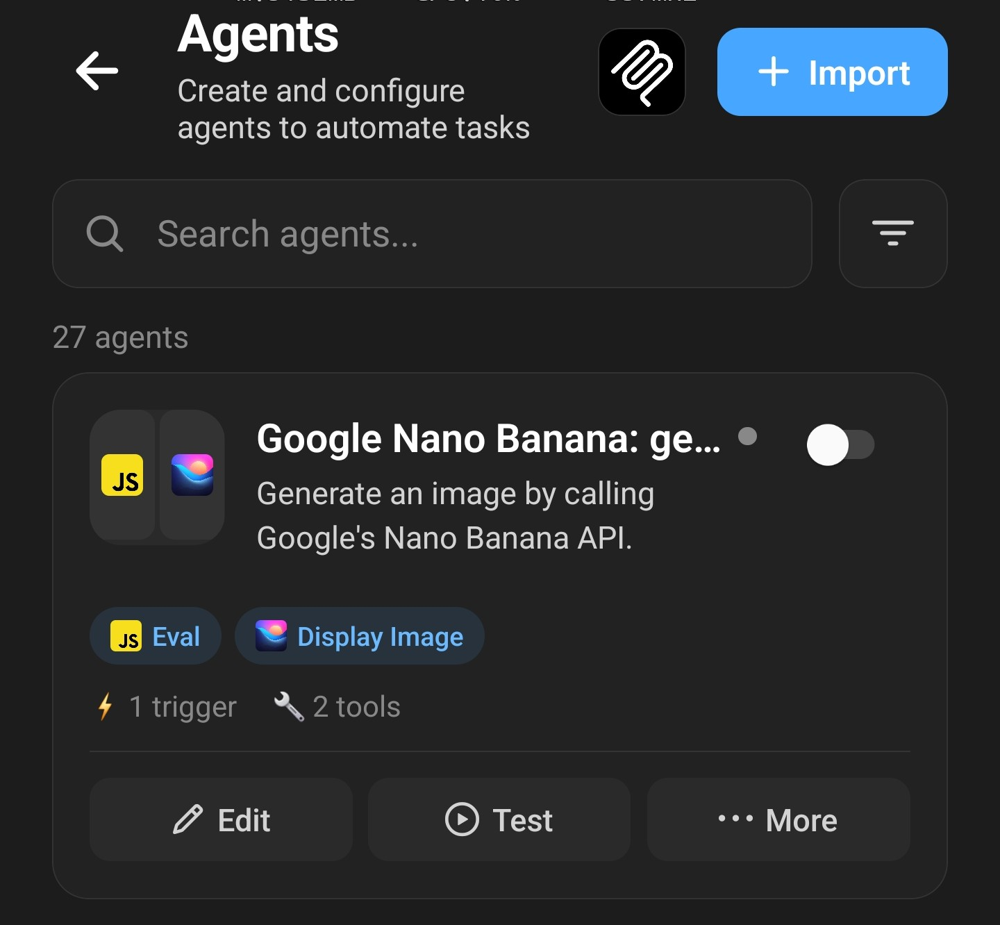

**Un Agent personnalisé de génération d'images transforme Layla en chatbot IA capable de générer des images avec n'importe quel service proposant une API, au lieu de se limiter aux modèles intégrés à l'application.** Lorsque votre personnage IA décrit une image dans sa réponse, l'Agent envoie cette description au service, reçoit l'image terminée et l'affiche dans votre chat.

Layla génère déjà des images avec des modèles Stable Diffusion, sur votre appareil ou via Layla Cloud. Un Agent ajoute une autre option : vous choisissez le service, le modèle et les paramètres, et vous utilisez votre propre clé API, une approche souvent appelée « bring your own key ». Cet article en construit un autour de l'API Nano Banana. Nano Banana est le nom donné par Google à ses modèles Gemini de génération d'images, et l'Agent de cet article utilise Nano Banana Pro, dont le nom d'API est `gemini-3-pro-image`.

L'article poursuit trois objectifs. Il montre comment obtenir une clé API Nano Banana et configurer l'Agent. Il explique ensuite chaque étape du code de l'Agent, puis décrit comment réutiliser le même schéma pour créer des Agents destinés à d'autres services d'images.

Contrairement aux modèles locaux de Layla, cet Agent nécessite une connexion Internet. Votre description d'image est envoyée à Google, et Google facture chaque image. Si vous discutez avec un modèle local, le reste de votre conversation reste sur votre appareil.

Voici l'Agent en action. Le personnage répond, et la description d'image qu'il a écrite est suivie de l'image terminée :


Si vous voulez l'essayer tout de suite, téléchargez ici le fichier de l'Agent : [google-nano-banana-generate-image.json](/assets/articles/how-to-use-the-google-nano-banana-image-generation-agent/google-nano-banana-generate-image.json). Il ne fonctionnera pas sans clé API Google, que l'article explique plus bas.

## Pourquoi utiliser Nano Banana dans Layla ?

Les modèles Stable Diffusion de Layla sont le bon choix lorsque vous voulez que les images soient générées entièrement sur votre appareil. L'API Nano Banana répond à d'autres besoins :

- **Une qualité d'image qui ne dépend pas de votre téléphone.** L'image est générée sur les serveurs de Google, donc la vitesse du CPU ou du NPU de votre appareil ne limite ni le résultat ni l'attente.
- **Des images qui suivent la conversation.** Votre personnage écrit la description de l'image à partir du chat lui-même, de sorte que l'image correspond à la scène, à la tenue ou au lieu dont vous parlez. Cela fonctionne aussi bien pour le jeu de rôle IA que pour les chats avec un compagnon IA.
- **Un modèle de chat local avec des images dans le cloud.** L'Agent ne réagit qu'à la réponse du personnage, il fonctionne donc avec le modèle que vous utilisez pour discuter. Vous pouvez garder un LLM local pour la conversation, et seule la description de l'image part chez Google.
- **Un paiement à l'image, sans abonnement.** Google facture les images que vous générez, et vous pouvez consulter votre utilisation et vos dépenses dans Google AI Studio.
- **Votre propre clé.** Vous pouvez révoquer la clé API à tout moment, et l'Agent continue de fonctionner avec toute autre clé que vous créez.

L'application Gemini de Google propose aussi Nano Banana sur Android. La différence ici, c'est que les images sont créées dans vos propres chats Layla, avec vos propres personnages et votre propre clé API.

## Fonctionnement de l'Agent en bref

Tout Agent de génération d'images qui fonctionne depuis le chat suit le même déroulement en quatre étapes :

```text
Vous demandez une image
  -> le personnage répond avec une description d'image balisée
  -> le déclencheur de l'Agent repère la balise
  -> l'outil Eval appelle l'API de Google et enregistre l'image
  -> l'outil Display Image l'affiche dans le chat
```

1. **Le prompt système demande une balise au modèle.** L'Agent ajoute une instruction qui indique au modèle de langage de votre personnage d'écrire une description d'image détaillée entre les balises `<stable_diffusion_prompt></stable_diffusion_prompt>` chaque fois que vous demandez une image.
2. **Un déclencheur repère la balise.** L'Agent possède un déclencheur regex qui surveille les réponses du modèle. Lorsqu'il voit la balise, il capture le texte qu'elle contient et démarre l'Agent.
3. **Un script appelle l'API.** Le premier outil de l'Agent exécute un court programme JavaScript. Il envoie la description à Google, reçoit l'image et l'enregistre dans un fichier.
4. **L'image apparaît dans le chat.** Le deuxième outil, _Display Image_, prend le fichier enregistré et l'affiche dans la conversation.

Le modèle de langage ne parle jamais directement à Google. Il se contente d'écrire du texte. Tout le reste est pris en charge par l'Agent, ce qui explique pourquoi le même schéma fonctionne avec n'importe quel service disposant d'une API.

La balise s'appelle `<stable_diffusion_prompt>` parce que la génération d'images propre à Layla écoute aussi cette balise. Cela compte pour la configuration, et c'est traité dans la section de configuration plus bas.

## Ce dont vous avez besoin

- La mini-app _Agents_ installée. Si vous n'avez jamais utilisé les Agents, lisez d'abord [Comment activer les Agents, les fonctions et l'appel d'outils dans Layla](/how-to-enable-agents-functions-and-tool-calling-in-layla/).
- Un compte Google.
- Une clé API Gemini, c'est-à-dire la clé API Nano Banana, avec la facturation activée. La section suivante explique comment faire.
- Une connexion Internet.
- Le fichier de l'Agent, dont le lien se trouve à la fin de cet article.

Cet Agent utilise l'outil _Eval_, intégré à Layla. Vous n'avez pas besoin de la mini-app Interpréteur Python.

## Comment obtenir une clé API Nano Banana dans Google AI Studio

Il n'existe pas de clé Nano Banana distincte. La clé dont vous avez besoin est une clé API Gemini, que Google délivre via Google AI Studio et qui fonctionne avec ses modèles d'images une fois la facturation activée. Une clé API est une longue chaîne de caractères qui identifie votre compte Google lorsque l'Agent envoie une requête. La procédure prend quelques minutes.

### Étape 1 : ouvrir Google AI Studio

Allez sur [aistudio.google.com](https://aistudio.google.com) et connectez-vous avec votre compte Google. Si c'est votre première visite, acceptez les conditions d'utilisation. Google crée alors un projet par défaut et une clé API pour vous.

Sélectionnez **Get API key** en bas de la barre latérale gauche.


### Étape 2 : créer une clé

La page _API Keys_ liste les clés de vos projets. Sélectionnez **Create API key**.


### Étape 3 : nommer la clé et choisir un projet

Saisissez un nom que vous reconnaîtrez, par exemple « Layla », et choisissez un projet. Les nouveaux comptes disposent d'un projet nommé _Default Gemini Project_. Sélectionnez **Create key**.


Chaque clé API appartient à un projet Google Cloud, et le projet gère la facturation et les limites d'utilisation. Si vous utilisez déjà Google Cloud, AI Studio n'affiche pas automatiquement vos projets existants. Utilisez le bouton _Import projects_ pour ajouter celui que vous voulez. Google l'explique dans [Using Gemini API keys](https://ai.google.dev/gemini-api/docs/api-key).

### Étape 4 : copier la clé

Votre nouvelle clé apparaît dans la liste. Sélectionnez l'icône de copie sur sa ligne pour copier la clé dans le presse-papiers. Vous pouvez revenir plus tard sur cette page pour la copier à nouveau.


Traitez la clé comme un mot de passe. Toute personne qui la possède peut envoyer des requêtes que Google facture à votre compte. Si vous pensez qu'une clé a été exposée, supprimez-la sur cette page et créez-en une nouvelle.

### Étape 5 : configurer la facturation

La colonne Quota Tier de la capture d'écran précédente affiche _Free tier_, avec un lien **Set up billing** à côté. Cette étape est obligatoire, car Google ne propose pas d'offre gratuite pour les modèles d'images Nano Banana dans l'API. Le projet auquel appartient votre clé doit avoir un compte de facturation.

Sélectionnez **Set up billing** et suivez les instructions de Google : choisissez votre pays, acceptez les conditions et ajoutez un moyen de paiement. Selon votre compte, Google peut vous demander de prépayer un montant minimum de crédit, actuellement 5 $. Le [guide de facturation](https://ai.google.dev/gemini-api/docs/billing) de Google présente les étapes et les offres en vigueur.

Google facture chaque image. Au moment de la rédaction, une image 1K ou 2K de Nano Banana Pro coûte 0,134 $ et une image 4K coûte 0,24 $. L'Agent de cet article demande des images 1K. Les prix évoluent, consultez donc la [page des tarifs](https://ai.google.dev/gemini-api/docs/pricing) de Google avant de commencer. Vous pouvez suivre votre utilisation dans AI Studio, sous _Dashboard_ puis _Usage_.

La page des tarifs de Google indique aussi que le contenu envoyé avec l'offre payante n'est pas utilisé pour améliorer les produits de Google.

## Quel modèle Nano Banana choisir ?

Google propose plusieurs modèles Nano Banana via la même API. L'Agent utilise Nano Banana Pro, et vous pouvez modifier une seule ligne du script pour en utiliser un autre. Voici les modèles que Google répertorie au moment de la rédaction, avec le prix qu'il indique pour une image 1K :

| Modèle             | Nom d'API                     | Prix par image 1K | Remarques                                                                                                  |
| ------------------ | ----------------------------- | ----------------- | ---------------------------------------------------------------------------------------------------------- |
| Nano Banana 2.1    | `gemini-nano-banana-2.1`      | 0,0336 $          | Le modèle recommandé par Google pour les nouveaux projets. Prend en charge les images 1K, 2K et 4K.        |
| Nano Banana 2 Lite | `gemini-3.1-flash-lite-image` | 0,0336 $          | Le modèle le plus rapide et le moins cher. Prend en charge uniquement les images 1K.                       |
| Nano Banana 2      | `gemini-3.1-flash-image`      | 0,067 $           | Le modèle de la génération précédente dans la même famille.                                                |
| Nano Banana Pro    | `gemini-3-pro-image`          | 0,134 $           | Le modèle premium de Google pour les tâches visuelles les plus complexes. Le modèle utilisé par cet Agent. |
| Nano Banana        | `gemini-2.5-flash-image`      | 0,039 $           | Le modèle d'origine. Google le qualifie d'ancien et indique une date d'arrêt au 15 mars 2027.              |

Dans la comparaison Nano Banana Pro vs Nano Banana 2, Pro coûte environ deux fois plus cher par image 1K et vise les scènes complexes, tandis que Nano Banana 2 et 2.1 sont les modèles plus rapides et moins chers. Les images plus grandes coûtent plus cher quel que soit le modèle. Nano Banana Pro facture 0,24 $ pour une image 4K, Nano Banana 2 facture 0,151 $ et Nano Banana 2.1 facture 0,113 $.

Pour changer de modèle, modifiez `MODEL_ID` dans le script et utilisez le bouton **Test**. La [documentation sur la génération d'images](https://ai.google.dev/gemini-api/docs/image-generation) de Google indique ce que chaque modèle prend en charge. Si un modèle renvoie une erreur, il n'accepte peut-être pas l'un des paramètres de la requête de l'Agent, comme la taille 2K, ou il attend le nouveau format d'API de Google. Les prix et les noms de modèles changent souvent. Consultez donc la [page des tarifs](https://ai.google.dev/gemini-api/docs/pricing) et la [page des modèles retirés](https://ai.google.dev/gemini-api/docs/deprecations) de Google avant de choisir.

## Configurer l'Agent dans Layla

### Étape 1 : désactiver la génération d'images par défaut de Layla

Ouvrez vos _Paramètres d'inférence_, faites défiler jusqu'à la section _Génération d'images_ et sélectionnez le modèle de génération d'images. Dans la liste _Select Model_, choisissez **No Image Generation** (aucune génération d'images).


La génération d'images intégrée de Layla lit la même balise `<stable_diffusion_prompt>` dans la réponse d'un personnage. Si un modèle est encore sélectionné, Layla génère sa propre image à partir de la balise et vous recevez deux images. Avec _No Image Generation_ sélectionné, la balise est laissée à l'Agent. [Comment activer la génération d'images dans Layla](/how-to-enable-image-generation-in-layla/) montre où se trouve ce réglage.

### Étape 2 : importer l'Agent

Téléchargez le fichier de l'Agent à la fin de cet article. Ouvrez la mini-app _Agents_ et utilisez le bouton **Import** en haut à droite pour l'importer. L'Agent s'appelle _Google Nano Banana: generate image_, et sa carte indique les deux outils qu'il utilise : _Eval_ et _Display Image_.



Vérifiez que l'interrupteur en haut à droite de la carte de l'Agent est activé. Sur la capture d'écran, il est encore désactivé.

### Étape 3 : ajouter votre clé API

Ouvrez l'Agent avec son bouton **Edit** et repérez l'outil _Eval_. Près du début de son code se trouve cette ligne :

```js
const API_KEY = "PUT YOUR API KEY HERE";
```

Remplacez `PUT YOUR API KEY HERE` par votre clé, en conservant les guillemets. Enregistrez l'Agent.

Votre clé est désormais stockée dans l'Agent. Avant de partager ou de téléverser le fichier de l'Agent où que ce soit, remettez le texte de remplacement à la place de la clé.

### Étape 4 : demander une image

Démarrez un chat et demandez une image, par exemple « montre-moi un phare sur une falaise au crépuscule ». Le personnage répond avec une description d'image, l'Agent s'exécute, et l'image apparaît dans le chat après quelques secondes, comme sur la capture d'écran au début de cet article.

Si quelque chose ne fonctionne pas, utilisez le bouton **Test** de la mini-app Agents. Il affiche l'entrée et la sortie de chaque étape, comme décrit dans [Exploration approfondie des Agents Layla](/deep-dive-into-layla-agents/).

## Fonctionnement de l'Agent, étape par étape

Un Agent comporte trois parties : un prompt système, un déclencheur et une liste d'outils exécutés l'un après l'autre. La sortie de chaque outil est l'entrée du suivant. [Exploration approfondie des Agents Layla](/deep-dive-into-layla-agents/) présente ces éléments de façon générale. Cette section suit l'Agent Nano Banana à travers chacun d'eux.

### 1. Le prompt système

Le prompt système est une instruction que Layla ajoute à la conversation tant que l'Agent est activé. Le prompt de l'Agent est rédigé en anglais, et le fichier le contient tel quel :

```text
When the user asks you to generate, draw or create an image, write a detailed
description of the image (subject, setting, style, lighting, composition) inside
<stable_diffusion_prompt></stable_diffusion_prompt> tags, e.g.
<stable_diffusion_prompt>a lighthouse on a cliff at dusk, oil painting, warm
light</stable_diffusion_prompt>. The image is generated from the text inside the
tags and shown in the chat. Use the tags only when an image is requested, and
never put backticks inside them.
```

Chaque partie de l'instruction a une raison d'être :

- **« When the user asks you to generate, draw or create an image »** (quand l'utilisateur vous demande de générer, dessiner ou créer une image) limite le comportement aux demandes d'images, de sorte que la conversation normale n'est pas affectée.
- **« A detailed description (subject, setting, style, lighting, composition) »** (une description détaillée : sujet, décor, style, éclairage, composition) donne une liste de contrôle au modèle. Nano Banana est un modèle de langage qui lit des descriptions, donc une phrase complète avec ces détails produit généralement une meilleure image qu'une liste de mots-clés.
- **L'exemple** montre le format exact de la balise. Les modèles de langage suivent un exemple de façon plus fiable qu'une description de format.
- **« Use the tags only when an image is requested »** (n'utilisez les balises que lorsqu'une image est demandée) empêche le modèle d'ajouter des balises à chaque réponse, ce qui démarrerait l'Agent, et vous facturerait, à chaque fois.
- **« Never put backticks inside them »** (ne mettez jamais d'accents graves à l'intérieur) protège le script. La raison est expliquée dans la présentation du code plus bas.

Lorsque vous écrivez vos propres Agents, le prompt système remplit le même rôle : il enseigne au modèle un nouveau comportement, montre le format de sortie et indique quand ne pas l'utiliser.

### 2. Le déclencheur

L'Agent a un seul déclencheur, un _déclencheur regex_ qui s'applique à la **sortie** du modèle plutôt qu'à votre saisie. Son motif est :

```text
/<stable_diffusion_prompt>(.*?)<\/stable_diffusion_prompt>/s
```

- Les balises ouvrante et fermante correspondent aux balises littérales.
- `(.*?)` est un groupe de capture. Il collecte tout ce qui se trouve entre les balises, et le `?` lui fait s'arrêter à la première balise fermante.
- Le drapeau `s` permet à la description de s'étendre sur plusieurs lignes.

Le texte capturé par le groupe devient disponible pour l'Agent sous la forme `{{match$1}}`. C'est le lien entre le modèle de langage et le code : tout ce que le modèle écrit entre les balises est transmis au premier outil.

### 3. L'outil Eval : appeler l'API

Le premier outil est _Eval_. Il exécute du JavaScript dans un environnement isolé à l'intérieur de Layla. Cet environnement dispose de `fetch` pour les requêtes web et d'un objet global nommé `layla` qui donne aux scripts accès aux fonctions de Layla, comme l'enregistrement de fichiers. Il n'y a ni page de navigateur ni modules Node.js.

Eval renvoie la valeur de la dernière expression du script et l'attend s'il s'agit d'une promesse. Cela explique la dernière ligne du script, qui lance le travail : `generateImage(PROMPT);`.

Le script comporte huit parties.

#### Les réglages en haut

```js
const API_KEY = "PUT YOUR API KEY HERE";
const PROMPT = String.raw`{{match$1}}`.trim();

const MODEL_ID = "gemini-3-pro-image";
const API_METHOD = "streamGenerateContent";
const API_URL = `https://generativelanguage.googleapis.com/v1beta/models/${MODEL_ID}:${API_METHOD}`;
const TIMEOUT_MS = 60000;
```

Tout ce que vous pourriez vouloir modifier se trouve au même endroit :

- `API_KEY` est votre clé.
- `PROMPT` est la description écrite par le modèle. Avant l'exécution du script, Layla remplace `{{match$1}}` par le texte capturé, de sorte que la description fait partie du programme. Elle est placée dans un littéral de gabarit avec `String.raw` pour que les barres obliques inverses soient conservées telles quelles, et `.trim()` supprime les espaces et sauts de ligne superflus. Un accent grave ou les caractères `${` dans la description mettraient fin au littéral prématurément et casseraient le script, c'est pourquoi le prompt système interdit les accents graves.
- `MODEL_ID` est le modèle à utiliser. Google renomme et retire des modèles de temps à autre, c'est donc la ligne que vous modifierez le plus probablement par la suite.
- `API_URL` est construite à partir du modèle et de la méthode. `streamGenerateContent` renvoie la réponse sous forme de liste de fragments (chunks).
- `TIMEOUT_MS` est la durée d'attente avant d'abandonner : 60 secondes.

Le reste du script se trouve dans une fonction nommée `generateImage`. Elle reçoit la description dans un paramètre nommé `prompt`, et la dernière ligne du script l'appelle avec `PROMPT`.

#### Vérifier les entrées

```js
if (!prompt) throw new Error("The stable diffusion prompt was empty.");
if (!API_KEY || API_KEY === "PUT YOUR API KEY HERE")
  throw new Error("Set API_KEY in this agent first.");
```

Le script échoue tôt, avec un message lisible, lorsqu'il n'y a rien à envoyer ou que la clé n'a pas été renseignée. Lorsqu'un script lève une erreur, l'Agent s'arrête et aucune image n'apparaît. Le bouton **Test** affiche le message.

#### Construire la requête

```js
const imageConfig = { imageSize: "1K" };

const payload = {
  contents: [{ role: "user", parts: [{ text: prompt }] }],
  generationConfig: {
    responseModalities: ["IMAGE", "TEXT"],
    imageConfig,
  },
  tools: [{ googleSearch: {} }],
};
```

La charge utile (payload) correspond aux données envoyées à Google :

- `contents` est la conversation envoyée au modèle. Ici, c'est un seul message de l'utilisateur contenant un seul morceau de texte : la description.
- `responseModalities` liste les types de sortie que le modèle peut renvoyer. Demander `IMAGE` est ce qui pousse le modèle à dessiner une image, et `TEXT` lui permet d'ajouter un commentaire.
- `imageConfig` contient les réglages de l'image. `imageSize` peut valoir `'1K'`, `'2K'` ou `'4K'` avec un K majuscule, et les tailles plus grandes coûtent plus cher. Vous pouvez aussi ajouter un `aspectRatio` comme `'16:9'` ou `'9:16'`. Le script n'envoie que les réglages qui ont une valeur, car Google répond par une erreur lorsqu'il reçoit une valeur vide.
- `tools: [{ googleSearch: {} }]` permet au modèle de faire des recherches sur Google Search pendant son travail, ce qui aide pour les lieux et objets réels. Supprimez cette ligne si vous n'en voulez pas. Google inclut un quota mensuel de requêtes de recherche pour les modèles Gemini 3 et facture au-delà, comme indiqué sur la page des tarifs.

#### Envoyer la requête avec une limite de temps

```js
const controller = new AbortController();
const timer = setTimeout(() => controller.abort(), TIMEOUT_MS);
let response;
let body;
try {
  response = await fetch(API_URL, {
    method: "POST",
    headers: { "Content-Type": "application/json", "x-goog-api-key": API_KEY },
    body: JSON.stringify(payload),
    signal: controller.signal,
  });
  body = await response.text();
} catch (error) {
  if (controller.signal.aborted)
    throw new Error(`Image generation timed out after ${TIMEOUT_MS / 1000} s.`);
  throw new Error(`Image generation request failed: ${error.message}`);
} finally {
  clearTimeout(timer);
}
```

C'est la partie qui communique avec Google :

- `fetch` envoie une requête `POST` avec la charge utile convertie en texte JSON.
- La clé API voyage dans l'en-tête `x-goog-api-key`, elle ne fait donc pas partie de l'adresse web.
- L'`AbortController` et le minuteur annulent la requête au bout de 60 secondes. Sans eux, une connexion bloquée laisserait l'Agent en attente.
- Le bloc `catch` distingue un dépassement de délai des autres échecs réseau, de sorte que le message d'erreur indique ce qui s'est passé. Le bloc `finally` arrête le minuteur dans les deux cas.

#### Vérifier l'état de la réponse

```js
if (!response.ok) {
  throw new Error(
    `HTTP error ${response.status} ${response.statusText}. Response body: ${body.slice(0, 500)}`,
  );
}
```

Lorsque Google rejette une requête, il en explique la raison dans le corps de la réponse. Le script inclut les 500 premiers caractères de cette explication dans l'erreur, si bien qu'une mauvaise clé, une facturation manquante ou une limite dépassée apparaît sous forme de message clair lorsque vous utilisez le bouton **Test**.

#### Trouver l'image dans la réponse

```js
const data = JSON.parse(body);
const chunks = Array.isArray(data) ? data : [data];

for (const chunk of chunks) {
  for (const candidate of chunk.candidates || []) {
    for (const part of (candidate.content && candidate.content.parts) || []) {
      const inline = part.inlineData;
      if (
        !inline ||
        !inline.data ||
        !String(inline.mimeType || "").startsWith("image/")
      )
        continue;
      // ...save the image
    }
  }
}
```

La méthode de streaming répond par une liste JSON de fragments. Chaque fragment contient des `candidates` (les réponses du modèle), chaque candidat a un `content`, et ce contenu est une liste de `parts`. Une partie est soit du texte, soit des données intégrées. Les données intégrées comportent un `mimeType`, comme `image/png`, et l'image elle-même sous forme de texte base64, une manière d'écrire des données binaires avec des caractères ordinaires.

La boucle parcourt chaque fragment, chaque candidat et chaque partie, ignore le texte et s'arrête à la première partie qui est une image. Les protections `|| []` évitent que le script plante lorsqu'un fragment n'a pas de candidats.

#### Enregistrer l'image

```js
const extension =
  inline.mimeType
    .split("/")
    .pop()
    .replace(/[^a-z0-9]/gi, "") || "png";
const id = Math.random().toString(16).slice(2, 10).padEnd(8, "0");
const path = `generated-images/output_image_${id}.${extension}`;

await layla.utils.saveFile(path, inline.data);
return path;
```

- L'extension du fichier provient du type d'image indiqué par Google, avec `png` comme valeur de repli.
- Un identifiant aléatoire de huit caractères donne à chaque image son propre nom de fichier, de sorte qu'une nouvelle image n'écrase jamais une image précédente de votre historique de chat.
- `layla.utils.saveFile` écrit le fichier dans le dossier de travail privé du personnage. Le chemin est relatif à ce dossier, et les dossiers manquants sont créés automatiquement. La fonction attend du texte base64, ce que Google envoie, donc les données sont enregistrées sans conversion.
- La fonction renvoie le chemin. Ce chemin est la sortie de l'outil.

#### Signaler clairement un échec

```js
const keys =
  chunks.length && typeof chunks[0] === "object"
    ? Object.keys(chunks[0]).join(", ")
    : "Unknown error";
throw new Error(
  `No image was found in the response. Full API Response Keys: ${keys}`,
);
```

Si la boucle se termine sans avoir trouvé d'image, par exemple parce que le modèle a refusé la requête et répondu uniquement par du texte, le script indique ce que contenait la réponse. Cela facilite beaucoup le diagnostic des échecs inhabituels.

### 4. L'outil Display Image

Le deuxième outil est _Display Image_, et son seul réglage est :

```text
{{input}}
```

`{{input}}` est remplacé par la sortie de l'outil précédent, c'est-à-dire le chemin de fichier renvoyé par le script. _Display Image_ ouvre ce fichier depuis le dossier de travail du personnage et le joint à la réponse, et l'image apparaît dans le chat.

## Garder des images cohérentes pour votre personnage IA

Un modèle de langage écrit chaque description d'image de zéro. Sans consigne, un personnage peut donc avoir un aspect différent d'une image à l'autre. Ces approches permettent d'obtenir des images cohérentes de personnage IA et de décider à quelle fréquence les images apparaissent :

- **Décrire le personnage une seule fois.** Dans le _Scénario_ du personnage, ajoutez une instruction comme : « Chaque fois que tu écris un `<stable_diffusion_prompt>`, commence par cette description de toi : une femme d'une vingtaine d'années, cheveux roux courts, yeux verts et taches de rousseur. Décris ensuite la scène. » Le modèle répète l'apparence dans chaque prompt, ce qui aide le modèle d'images à dessiner le même personnage à chaque fois.
- **Fixer le style artistique.** Ajoutez un style à la même instruction, par exemple « photographie argentique 35 mm, lumière naturelle » ou « illustration à l'aquarelle ». [Comment générer des images IA dans Layla avec l'Agent Perchance](/how-to-use-the-perchance-image-generation-agent/) décrit la même approche, qui fonctionne avec tout Agent utilisant cette balise.
- **Générer une image après chaque message.** Ajoutez au _Scénario_ une instruction demandant de terminer chaque réponse par la balise, comme dans [Créer un Agent de génération d'images](/creating-an-image-generation-agent/). Chaque réponse est alors accompagnée d'une image, ce qui convient au jeu de rôle IA et à la narration. Chaque image est facturée, donc cela coûte plus cher que de demander des images à la demande.
- **Utiliser des images de référence.** Les modèles Nano Banana peuvent aussi prendre une image en entrée, ce qui aide un personnage à garder le même visage. Cet Agent n'envoie que du texte, donc ajouter une image de référence à la requête est un bon projet pour la suite.

## Réutiliser le même schéma pour d'autres Agents

L'Agent Nano Banana est un modèle de base. Le prompt système, le déclencheur regex et l'étape Display Image restent identiques pour n'importe quel service d'images. Seul le script change. Ces idées s'appuient dessus.

- **Changer le modèle ou les réglages.** Modifiez `MODEL_ID` ou `imageSize`, ou ajoutez `aspectRatio` dans le script. Google propose plusieurs modèles Nano Banana à des prix différents, listés sur sa [page des tarifs](https://ai.google.dev/gemini-api/docs/pricing).
- **Utiliser un autre service d'images.** Remplacez la requête et le traitement de la réponse. Si le service renvoie du texte base64, l'étape d'enregistrement reste la même. S'il renvoie une adresse web, récupérez cette adresse et convertissez les octets avec `toBase64()` avant d'appeler `layla.utils.saveFile`.
- **Demander au modèle plus qu'une description.** Le prompt système peut demander quelques champs au lieu d'un texte libre, par exemple un court objet JSON avec un `prompt` et un `aspect_ratio`. Le script lit ensuite les champs dans le texte capturé. Gardez le texte de remplacement à l'intérieur d'un littéral de chaîne, comme le fait l'Agent avec `PROMPT`, et analysez le texte dans votre propre code.
- **Faire autre chose que des images.** Choisissez une autre balise, comme `<weather_request>`, laissez _Eval_ appeler une autre API et terminez par l'outil _Provide Context_ pour que le personnage puisse parler du résultat. L'[Agent de recherche Brave](/how-to-create-a-brave-search-agent/) est un exemple de ce déroulement.

Lorsque vous écrivez votre propre Agent, quelques habitudes de celui-ci méritent d'être conservées :

- **Regrouper tous les réglages dans un bloc en haut.** La clé, le modèle, la taille et le délai sont faciles à trouver et à modifier.
- **Vérifier les entrées avant de dépenser de l'argent.** Une protection qui bloque une requête vide ne coûte rien.
- **Toujours définir un délai d'attente.** Une requête qui ne se termine jamais est pire qu'une requête qui échoue avec un message.
- **Renvoyer quelque chose de lisible en cas d'échec.** Le texte de l'erreur est ce qu'affiche le bouton **Test**, alors faites en sorte qu'il dise ce qui s'est mal passé.
- **Transmettre un chemin, pas des données.** Le script enregistre l'image et transmet un chemin court à l'outil suivant, ce qui évite de faire circuler de gros volumes de données dans la chaîne.
- **Un seul Agent par balise.** Si vous créez un autre Agent qui réagit à `<stable_diffusion_prompt>`, désactivez celui-ci. Sinon, donnez au nouvel Agent une balise distincte, à la fois dans son prompt système et dans son déclencheur.
- **Traiter `{{match$1}}` comme du code.** Le texte capturé est collé dans le script avant son exécution. Placez-le donc dans un littéral de chaîne et indiquez au modèle les caractères à éviter.

## Questions fréquentes

### Comment obtenir une clé API Nano Banana ?

Il n'existe pas de clé Nano Banana distincte. Connectez-vous à [Google AI Studio](https://aistudio.google.com), ouvrez la page _API Keys_ et sélectionnez **Create API key**. Activez ensuite la facturation sur le projet de la clé, car les modèles Nano Banana n'ont pas d'offre gratuite dans l'API.

### L'API Nano Banana est-elle gratuite ?

Créer une clé est gratuit, mais Google ne propose pas d'offre gratuite pour les modèles d'images Nano Banana dans l'API, donc chaque image est facturée. Consultez la [page des tarifs](https://ai.google.dev/gemini-api/docs/pricing) de Google pour les prix actuels.

### Combien coûte l'API Nano Banana par image ?

Au moment de la rédaction, Nano Banana Pro coûte 0,134 $ pour une image 1K ou 2K et 0,24 $ pour une image 4K. Nano Banana 2.1 coûte 0,0336 $ pour une image 1K. Le tableau de la section sur les modèles ci-dessus liste tous les modèles.

### Quelle est la différence entre Nano Banana Pro et Nano Banana 2 ?

Nano Banana Pro est le modèle d'images premium de Google pour les scènes complexes et coûte plus cher par image. Nano Banana 2 est un modèle plus rapide et moins cher de la même famille, et Google recommande désormais Nano Banana 2.1 pour les nouveaux projets. Consultez le tableau des modèles ci-dessus pour les noms et les prix.

### Puis-je utiliser Nano Banana sur Android ?

Oui. L'application Gemini de Google inclut Nano Banana. Cet Agent est destiné aux cas où vous voulez que les images soient créées dans vos propres chats Layla, avec vos propres personnages et votre propre clé API.

### Mon personnage IA peut-il envoyer des images pendant un chat ou un jeu de rôle ?

Oui. Demandez une image dans le chat, ou ajoutez au _Scénario_ du personnage une instruction pour que chaque réponse se termine par une description d'image. La section sur la cohérence des images explique les deux options.

### Nano Banana filtre-t-il les images ?

Oui. Google applique ses propres politiques de sécurité à l'API Gemini, et une requête qu'il refuse peut ne renvoyer aucune image. L'Agent indique alors qu'aucune image n'a été trouvée dans la réponse. Pour une génération d'images entièrement réalisée sur votre appareil, utilisez les modèles Stable Diffusion locaux décrits dans [Comment activer la génération d'images dans Layla](/how-to-enable-image-generation-in-layla/).

### Pourquoi ai-je reçu deux images ?

La génération d'images intégrée de Layla est probablement encore activée. Sélectionnez _No Image Generation_ dans les Paramètres d'inférence pour que seul l'Agent traite la balise.

### L'Agent affiche « Set API_KEY in this agent first. »

Le texte de remplacement de la clé figure encore dans le script. Ouvrez l'Agent, modifiez l'outil _Eval_ et remplacez `PUT YOUR API KEY HERE` par votre clé.

### L'Agent affiche une erreur HTTP. Que signifie-t-elle ?

Le message contient l'explication de Google. Les causes courantes sont une clé mal saisie, une facturation non configurée sur le projet auquel appartient la clé, ou une limite d'utilisation atteinte. Un nom de modèle que Google a retiré peut aussi provoquer une erreur.

### Les anciens guides utilisent `gemini-3-pro-image-preview`. Fonctionne-t-il encore ?

Google a retiré ce nom de préversion le 25 juin 2026 et recommande `gemini-3-pro-image` à la place, que cet Agent utilise. La [page des modèles retirés](https://ai.google.dev/gemini-api/docs/deprecations) de Google liste les noms de modèles actuels et les dates d'arrêt.

### Cet Agent utilise-t-il la dernière API de Google ?

L'Agent utilise l'API `generateContent` de Google, qui consiste en une seule requête web et se suit facilement dans un script. Google la qualifie désormais d'ancienne (« legacy ») dans sa documentation et recommande une nouvelle API Interactions pour les nouveaux projets, mais indique que `generateContent` reste prise en charge. Si Google la modifie un jour, seules les parties du script consacrées à la requête et à la réponse devront être réécrites. Le reste de l'Agent ne change pas.

### Mon prompt est-il privé ?

La description de l'image est envoyée à Google pour générer l'image. Si vous discutez avec un modèle local, le reste de votre conversation reste sur votre appareil. D'après la page des tarifs de Google, avec l'offre payante, le contenu n'est pas utilisé pour améliorer ses produits.

### Les images portent-elles un filigrane ?

Google indique que toutes les images générées avec ses modèles Nano Banana comportent un filigrane SynthID.

### Puis-je utiliser cet Agent sans connexion Internet ?

Non. L'Agent appelle les serveurs de Google. Pour la génération d'images hors ligne, utilisez l'un des modèles locaux décrits dans [Comment activer la génération d'images dans Layla](/how-to-enable-image-generation-in-layla/).

## Conclusion

L'Agent Nano Banana montre à quel point un Agent de génération d'images pour chat IA peut être petit. Un prompt système pousse le modèle à écrire une description balisée, un déclencheur regex la capture, un court script échange la description contre une image, et _Display Image_ place le résultat dans votre chat. Une fois ces quatre éléments compris, vous pouvez changer le service, le modèle ou les réglages, et créer des Agents pour des services d'images que Layla ne prend pas en charge d'origine.

Les modèles locaux de Layla restent le choix pour une génération d'images entièrement hors ligne. Les Agents comme celui-ci sont une option lorsque vous préférez un modèle en ligne particulier et acceptez la connexion et le coût.

## Télécharger l'Agent

[Télécharger google-nano-banana-generate-image.json](/assets/articles/how-to-use-the-google-nano-banana-image-generation-agent/google-nano-banana-generate-image.json)

Utilisez le bouton _Import_ de la mini-app Agents pour l'importer, puis ajoutez votre clé API.
