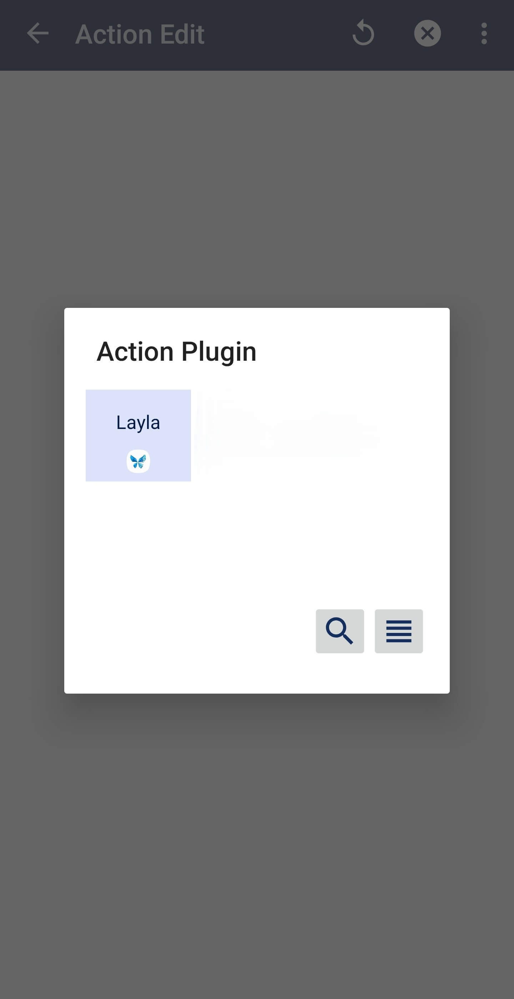

Layla inclut un plugin Tasker qui ajoute une IA sur l'appareil à vos automatisations Android. Une tâche Tasker peut envoyer une requête à un LLM local, générer des images, de la voix et de la musique, lire et écrire l'historique des conversations, enregistrer des souvenirs et programmer des messages de vos personnages. Lorsque vous utilisez des modèles présents sur votre appareil, rien de tout cela n'est envoyé à un service en ligne.

## Qu'est-ce que Tasker ?

Tasker est une application Android d'automatisation très répandue. Elle vous permet de créer des tâches qui s'exécutent lorsqu'une condition est remplie sur votre appareil. Par exemple, vous pouvez demander à Layla de résumer un nouvel e-mail dès son arrivée, ou faire envoyer un rappel par un personnage dans une heure.

Comme Layla exécute les modèles en local, ces automatisations peuvent fonctionner sans connexion Internet et sans frais par requête. Layla utilise le moteur d'inférence que vous avez défini par défaut, si bien que les tâches suivent la même configuration que vos conversations.

*Remarque : Tasker est une application distincte et son achat est payant sur [Google Play](https://play.google.com/store/apps/details?id=net.dinglisch.android.taskerm&hl=fr). Layla n'est pas affiliée à Tasker.*

L'intégration de Tasker n'est disponible que sur Android.

## Que pouvez-vous automatiser avec Layla et Tasker ?

N'importe quel déclencheur Tasker peut lancer une action Layla, et le résultat peut alimenter l'action suivante de la tâche. Quelques exemples :

- **Résumer des notifications ou des e-mails.** Transmettez le texte d'une nouvelle notification à **Ask Layla** et demandez à un LLM local d'en rédiger un résumé en une phrase.
- **Lire des messages à voix haute.** Envoyez le texte entrant à **Speak Text** pour que Layla le lise avec la voix de votre choix.
- **Vérifier le ton d'un message.** Faites analyser un texte par **Analyze Sentiment** et orientez votre tâche selon l'émotion dominante.
- **Générer des images ou de la musique sur un déclencheur.** Utilisez **Generate Image** ou **Generate Music** avec une description construite à partir de variables Tasker, comme l'heure de la journée ou un événement du calendrier.
- **Programmer des rappels d'un personnage.** Utilisez **Schedule Character Message** pour qu'un de vos personnages vous envoie un message à une heure précise.
- **Conserver des notes comme souvenirs.** Utilisez **Remember Text** pour enregistrer du texte dans la mémoire à long terme d'un personnage.

## Pas à pas : créer votre première tâche Layla

Ce tutoriel crée une tâche Tasker qui envoie un message à Layla et affiche la réponse à l'écran. Une fois que vous l'aurez fait, l'ajout de n'importe quelle autre action Layla fonctionne de la même manière.

### Étape 1 : créer une tâche et ajouter une action

Ouvrez Tasker, créez une nouvelle tâche, puis appuyez sur **+** pour ajouter une action. Tasker vous demande de sélectionner une catégorie d'action. Choisissez **Plugin**.


### Étape 2 : choisir Layla

Tasker affiche la liste des applications qui fournissent des actions de plugin. Appuyez sur **Layla**.



Si Layla n'apparaît pas, vérifiez que Layla est installée sur le même appareil et à jour.

### Étape 3 : choisir une action

Layla affiche toutes ses actions Tasker. Pour ce tutoriel, choisissez **Chat Completions**. Consultez [Actions disponibles](#actions-disponibles) plus bas pour savoir ce que fait chaque action.


Tasker peut retirer « Layla » du nom d'une action dans cette liste, de sorte que **Ask Layla** peut apparaître sous le nom **Ask**.

### Étape 4 : ouvrir la configuration

Sur la page de l'action, appuyez sur l'icône en forme de crayon à côté de **Configuration**. Cela ouvre l'écran propre à Layla pour paramétrer l'action.


### Étape 5 : saisir votre requête et enregistrer

Saisissez le message que vous souhaitez envoyer à Layla. Par exemple :

```
{"messages":[{"role":"user","content":"Hello, how are you?"}]}
```

Vous pouvez aussi utiliser une variable Tasker à la place du texte, comme `%prompt`. Laissez **JSON-escape variable values** activé afin que les guillemets et les retours à la ligne présents dans vos variables ne posent pas de problème. Appuyez ensuite sur **Save** pour revenir à Tasker.


Le délai d'expiration est réglé sur **None** par défaut. Layla peut ainsi prendre tout le temps nécessaire pour répondre.

### Étape 6 : afficher le résultat

Layla renvoie sa réponse dans la variable `%layla_text`. Pour la voir, ajoutez une autre action après Chat Completions : choisissez la catégorie **Alert**, puis **Popup**, et saisissez `%layla_text` comme **Text**.


### Étape 7 : exécuter la tâche

Appuyez sur le bouton de lecture en bas de l'écran de la tâche. Layla génère une réponse et Tasker l'affiche dans la fenêtre contextuelle.


La première exécution peut être plus longue, car Layla doit charger son modèle.

## Utiliser les variables et les sorties

Chaque champ de texte d'une action Layla accepte les variables Tasker, ce qui vous permet de transmettre la sortie d'une action à la suivante. Par exemple, vous pouvez affecter à une variable le texte d'une notification, puis l'utiliser comme requête pour **Ask Layla**.

Chaque action renvoie ses résultats sous forme de variables Tasker, que vous pouvez utiliser dans toute action suivante, comme l'a fait la fenêtre contextuelle dans le tutoriel ci-dessus. Les actions Layla lancent Layla en arrière-plan si elle n'est pas déjà en cours d'exécution ; vous n'avez donc pas besoin d'ouvrir l'application au préalable.

## Actions disponibles

### Discussion et texte

| Action | Ce qu'elle fait |
| --- | --- |
| **Ask Layla** | Envoie une requête à Layla, avec des instructions système facultatives, et renvoie la réponse. Chaque requête est indépendante et ne lit ni ne modifie aucun historique de conversation. |
| **Analyze Sentiment** | Analyse les émotions d'un texte. |
| **Chat Completions** | Une action avancée qui accepte une requête de conversation complète avec plusieurs messages, lorsque vous voulez fournir vous-même toute la conversation. |

Ask Layla et Chat Completions sont les actions à utiliser pour exécuter une requête LLM depuis Tasker. Elles utilisent le moteur d'inférence que vous avez défini par défaut dans Layla, si bien qu'un modèle local sur votre appareil fonctionne sans configuration supplémentaire dans Tasker.

**Ask Layla** renvoie :

- `%layla_text` : la réponse de Layla.

**Analyze Sentiment** renvoie :

- `%layla_emotion` : l'émotion dominante détectée dans le texte.
- `%layla_emotion_score` : le score de cette émotion, de 0 à 1.
- Un score pour chaque émotion, par exemple `%layla_sentiment_joy` ou `%layla_sentiment_sadness`.

### Voix, images et musique

Ces actions apportent à Tasker la synthèse vocale par IA, la génération d'images et la génération de musique. Consultez [Comment activer la génération d'images dans Layla](/fr/how-to-enable-image-generation-in-layla/), [Comment entendre vos personnages parler dans Layla](/fr/how-to-hear-your-characters-speak-in-layla/) et [Comment générer de la musique hors ligne dans Layla avec ACE-Step](/fr/how-to-generate-music-offline-in-layla-with-ace-step/) pour configurer les modèles utilisés par ces actions.

| Action | Ce qu'elle fait |
| --- | --- |
| **Speak Text** | Lit un texte à voix haute avec la voix de Layla et attend la fin de la lecture. Laissez la voix vide pour utiliser votre voix par défaut. |
| **Generate Speech File** | Convertit un texte en fichier audio sans le lire. La voix est facultative. |
| **Generate Image** | Génère une image à partir d'une description. Le modèle d'image est facultatif ; laissez-le vide pour utiliser votre modèle par défaut. |
| **Generate Music** | Génère un morceau à partir d'une description de style. Les paroles, la durée en secondes et le modèle de musique sont facultatifs. |

Les images et les fichiers audio générés sont renvoyés sous forme de fichiers que Tasker peut lire :

- Images : `%layla_image_uri`, `%layla_image_mime` et `%layla_image_name`.
- Voix et musique : `%layla_audio_uri`, `%layla_audio_mime` et `%layla_audio_name`.

Ces fichiers sont conservés dans le cache de Layla. Ils y restent jusqu'à ce que vous vidiez les caches de Layla ou qu'Android les supprime ; utilisez donc l'action **Copy File** de Tasker pour les enregistrer de façon permanente. Rien n'est lu automatiquement.

La génération de fichiers vocaux nécessite une voix de synthèse vocale capable de créer des fichiers audio. La génération de musique nécessite que le modèle de génération de musique soit configuré dans Layla.

### Personnages, conversations et souvenirs

| Action | Ce qu'elle fait |
| --- | --- |
| **List Characters** | Renvoie les noms et les identifiants de vos personnages. |
| **List Chat Sessions** | Renvoie les conversations d'un personnage, avec le dernier message de chacune. |
| **Get Chat History** | Renvoie les messages d'une conversation. Vous pouvez choisir combien en renvoyer et combien en ignorer. |
| **Save Chat Message** | Ajoute un message à une conversation, de votre part ou de celle d'un personnage. Cela ne génère pas de réponse. |
| **Remember Text** | Ajoute un nouveau souvenir à un personnage. Le modèle de mémoire à long terme doit être téléchargé. |
| **Get Memories** | Renvoie les souvenirs les plus récents d'un personnage, ou ses principaux souvenirs. |
| **List Voices** | Renvoie les noms et les identifiants des voix disponibles. |

Les actions de liste renvoient leurs résultats sous forme de tableaux correspondants. L'entrée en position 1 des noms correspond à l'entrée en position 1 des identifiants, et ainsi de suite :

- List Characters : `%layla_character_ids()` et `%layla_character_names()`.
- List Chat Sessions : `%layla_session_ids()` et `%layla_last_messages()`.
- List Voices : `%layla_voice_ids()` et `%layla_voice_names()`.

Utilisez les identifiants renvoyés par ces actions dans les autres actions. Par exemple, exécutez **List Characters** pour trouver l'identifiant d'un personnage, puis transmettez-le à **Remember Text** ou **Get Memories**.

Autres sorties :

- Get Chat History : `%layla_text` est une transcription lisible, du plus ancien au plus récent.
- Get Memories : `%layla_memory_ids()` et `%layla_memory_texts()`.
- Remember Text : `%layla_memory_id` et `%layla_session_id`.
- Save Chat Message : `%layla_message_id` et `%layla_session_id`.

Quelques points à connaître :

- **Save Chat Message** nécessite une conversation existante pour y ajouter un message de votre part. Pour démarrer une nouvelle conversation, fournissez un nouvel identifiant de session et enregistrez d'abord un message d'un personnage.
- **Get Memories** renvoie les souvenirs récents ou les mieux classés. Elle ne recherche pas les souvenirs par texte.
- **Remember Text** peut rédiger le résumé du souvenir à votre place si vous laissez le champ de résumé vide.
- Les horodatages de **Get Memories** sont exprimés en millisecondes Unix. La variable Tasker `%TIMEMS` donne l'heure actuelle dans ce format.

### Messages de personnages programmés

| Action | Ce qu'elle fait |
| --- | --- |
| **Schedule Character Message** | Programme la remise d'un message d'un personnage à une heure ultérieure. |
| **List Scheduled Character Messages** | Liste tous les messages de personnages programmés et non lus, y compris ceux qui n'ont pas été créés via Tasker. |
| **Cancel Scheduled Character Message** | Annule un message programmé à partir de son identifiant. |

La programmation remet exactement le texte que vous fournissez à l'heure que vous choisissez. Layla ne rédige pas de nouvelle réponse au moment de la remise. Layla a besoin de l'autorisation de notification pour remettre les messages programmés.

L'heure de remise est un horodatage Unix en millisecondes. Dans Tasker, vous pouvez la calculer avec **Variable Set** et **Do Maths**. Par exemple, `%TIMEMS + 60000` correspond à une minute à partir de maintenant. Transmettez cette variable comme heure de remise.

**Schedule Character Message** renvoie `%layla_scheduled_id`, que vous pouvez utiliser pour annuler le message plus tard. L'annulation supprime un message qui n'a pas encore été remis. Elle ne ferme pas une notification déjà affichée.

### Avancé

| Action | Ce qu'elle fait |
| --- | --- |
| **Get Execution Context** | Renvoie dans `%layla_app_version` la version de Layla installée sur votre appareil. Utile pour vérifier que Tasker peut joindre Layla. |
| **Raw Layla API Request** | Envoie une requête directement à Layla, destinée aux développeurs. Consultez le [SDK Layla](https://github.com/l3utterfly/layla-sdk) pour voir ce qui est disponible. |

## Gérer les erreurs et les délais d'expiration

Si une action échoue, Tasker renseigne `%err` et `%errmsg`. Activez **Continue Task After Error** pour l'action si vous voulez que votre tâche se poursuive et lise le message.

Les actions Layla attendent aussi longtemps que le travail le demande, ce qui peut être long pour la génération d'images et de musique. Les nouvelles actions utilisent par défaut un délai d'expiration Tasker de **None**, c'est-à-dire sans limite de temps. Si vous définissez une limite de temps, Layla la respecte.

## Exemple : réagir à une notification

1. Utilisez un plugin Tasker comme AutoNotification pour capturer le texte d'une notification entrante dans une variable, par exemple `%ntext`.
2. Ajoutez **Ask Layla** avec la requête `Summarise this notification in one sentence: %ntext`.
3. Ajoutez l'action **Flash** de Tasker avec `%layla_text` pour afficher le résumé à l'écran, ou **Speak Text** pour que Layla le lise à voix haute.

## Conseils

- Les restrictions d'arrière-plan d'Android continuent de s'appliquer. Si des actions échouent lorsque votre téléphone est inactif, vérifiez que l'optimisation de la batterie ne restreint pas Layla.
- Assurez-vous que les modèles dont une action a besoin sont d'abord téléchargés dans Layla, par exemple un modèle d'image, un modèle de musique ou le modèle de mémoire à long terme.
- Les variables peuvent contenir des guillemets, des retours à la ligne et d'autres caractères spéciaux. Layla les gère pour vous dans les champs standard.

## Foire aux questions

### Puis-je utiliser un LLM dans Tasker sans connexion Internet ?

Oui. Si votre moteur d'inférence par défaut dans Layla est un modèle téléchargé sur votre appareil, les actions Tasker comme **Ask Layla** s'exécutent entièrement sur le téléphone. Si vous avez défini un moteur cloud ou distant par défaut, les requêtes passent par ce moteur.

### Ai-je besoin d'une clé API pour utiliser Layla avec Tasker ?

Non. Les actions Tasker de Layla ne demandent pas de clé API. Elles utilisent le moteur d'inférence déjà configuré dans Layla.

### Layla doit-elle être ouverte pour qu'une action Tasker s'exécute ?

Non. Layla se lance en arrière-plan lorsqu'une action s'exécute. Les restrictions d'arrière-plan d'Android continuent de s'appliquer ; si des actions échouent lorsque votre téléphone est inactif, vérifiez donc les paramètres de batterie de Layla.

### Tasker peut-il générer des images avec Layla ?

Oui. Utilisez l'action **Generate Image** avec une description et, éventuellement, un modèle d'image. Tasker reçoit l'image sous forme de fichier que vous pouvez copier, partager ou utiliser dans les actions suivantes. Configurez d'abord un modèle en consultant [Comment activer la génération d'images dans Layla](/fr/how-to-enable-image-generation-in-layla/).

### Tasker peut-il faire parler Layla ou créer de la musique ?

Oui. **Speak Text** lit un texte avec la voix de Layla, **Generate Speech File** enregistre la voix dans un fichier audio, et **Generate Music** crée un morceau à partir d'une description et de paroles facultatives.

### Où vont les images et les fichiers audio générés ?

Ils sont stockés dans le cache de Layla et y restent jusqu'à ce que vous vidiez le cache ou qu'Android les supprime. Utilisez l'action **Copy File** de Tasker pour les conserver de façon permanente.
