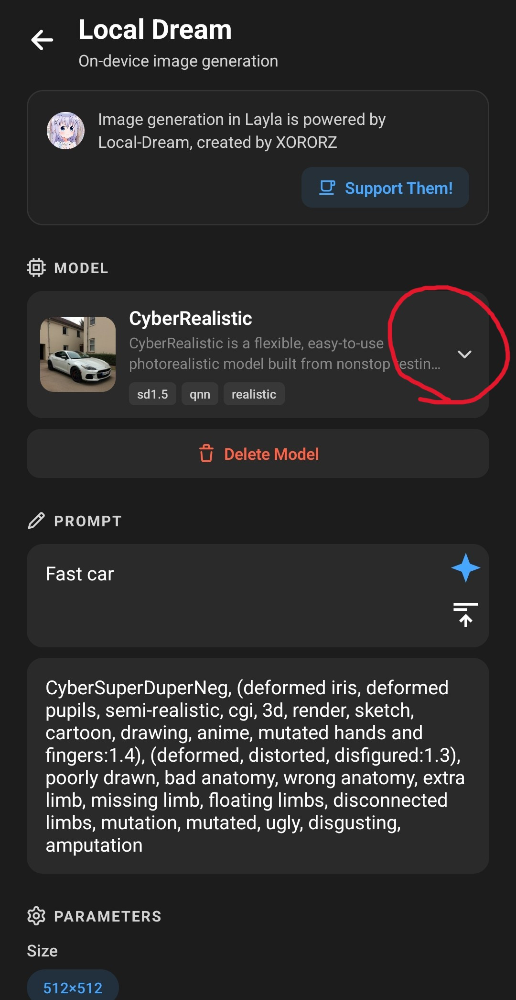

**NPU Forge is a Layla mini-app that converts a Stable Diffusion safetensors checkpoint into a QNN model, the format that runs on the Qualcomm NPU in Snapdragon phones.** You pick a `.safetensors` file, Layla checks that it can be converted, and the conversion runs on your phone. When it finishes, the model appears in Local Dream, ready to generate images.

Layla can already import a safetensors checkpoint directly, as described in [How to import SD1.5 Safetensor models from Civit.ai into Layla](/how-to-import-sd1-5-safetensor-models-from-civit-ai-into-layla/). That route creates a model that runs on your device's CPU. NPU Forge adds a second route for phones with a supported Snapdragon chip: the same checkpoint, converted so the image is generated on the NPU, which is faster.

This article explains what you need, how to convert a checkpoint step by step, how long it takes, and how to generate images with the result. The conversion and the image generation both happen on your device, so nothing is uploaded.

## What NPU Forge converts

NPU Forge works with two kinds of checkpoint:

- **Stable Diffusion 1.5 (SD 1.5)**, the most common family of checkpoints on Civitai.
- **Stable Diffusion XL (SDXL)**, the larger family that produces 1024 x 1024 images.

You do not have to tell Layla which one you picked. It reads the file and detects the family itself. Models are converted for the standard resolution of each family: 512 x 512 for SD 1.5 and 1024 x 1024 for SDXL.

Some checkpoints cannot be converted. SD 2.x models, inpainting models, and SDXL refiner models are not supported. Layla tells you this before it starts, so you do not lose time on a file that will not work.

## What you need

- An Android phone with a Qualcomm Snapdragon chip that has an NPU. NPU Forge shows a message at the top of the screen if Layla does not recognise your chip.
- A Snapdragon 8 Gen 3 or newer if you want to convert SDXL checkpoints. SD 1.5 works on a wider range of Snapdragon chips.
- Android 13 or newer.
- The _NPU Forge_ mini-app, which downloads about 216 MB of conversion tools. See [How to enable or disable mini-apps within Layla](/how-to-enable-disable-mini-apps-within-layla/) if you have not installed a mini-app before.
- The _Local Dream_ mini-app, which is the app you use to generate images. It also downloads the NPU runtime that converted models need. NPU Forge can convert a model without it, but the model will not run until Local Dream has fetched those files.
- A `.safetensors` checkpoint saved on your phone.
- Free storage and memory. The next section gives the numbers.

NPU Forge only exists on Android. The mini-app is not available on iOS because the NPU it targets is a Qualcomm feature.

## Storage, memory, and time

Conversion is demanding. Layla measures your phone before it starts and warns you if it looks short. These are the approximate amounts it recommends, which include some spare room for Android and your other apps:

|                              | SD 1.5          | SDXL             |
| ---------------------------- | --------------- | ---------------- |
| Memory (RAM)                 | about 5 GB      | about 8 GB       |
| Free storage                 | about 3 GB      | about 23 GB      |
| Time on a Snapdragon 8 Elite | about 2 minutes | about 22 minutes |

The storage figure is measured after Layla has copied your checkpoint into its own space, so you need that free space on top of the checkpoint itself. A slower chip takes longer than the times above.

The warning is advice, not a block. If your phone falls short, you can still start the conversion, but it may run out of memory or storage partway through and fail.

## How to convert a safetensors checkpoint

### Step 1: Get a checkpoint

Download an SD 1.5 or SDXL checkpoint to your phone. On [Civitai](https://civitai.com/), filter by **Model Type: Checkpoint**, **File format: SafeTensor**, and the **Base Model** you want.

Keep the file after you download it. NPU Forge converts the original `.safetensors` file, not a model you have already imported into Layla. If you imported it earlier through **Add Custom Model**, you still need the original file for this.

### Step 2: Open NPU Forge

Open the NPU Forge mini-app from **My Apps**. There is also a shortcut: on a phone with a supported Qualcomm NPU, the **Add Custom Model** screen in Inference Settings shows a notice that suggests converting your safetensors for faster image generation. Tapping it opens NPU Forge in Browse Apps, where you can install it.

If the screen shows a message such as _NPU Forge assets missing_, the conversion tools have not been downloaded yet. Download them from the mini-app page first.

### Step 3: Select your checkpoint

Tap **Select a safetensors checkpoint** and choose your file. Layla copies it into its own storage and inspects it. Large files take a moment to copy.

If you choose a file that does not end in `.safetensors`, Layla rejects it.

### Step 4: Read the detected model

When the inspection finishes, a **Detected model** card shows what Layla found:

- the model family, SD 1.5 or SDXL;
- the number of weights and the file size;
- whether the three main parts of the model were found: the UNet, the CLIP text encoder, and the VAE;
- a **Convertible** or **Not convertible** label.

If the label says _Not convertible_, the card explains why, for example that required parts of the model are missing. Choose a different checkpoint in that case.

If you picked an SDXL checkpoint and your phone has an older chip, Layla tells you that SDXL needs a Snapdragon 8 Gen 3 or newer, and the **Start conversion** button stays disabled.

### Step 5: Add LoRAs (optional)

A LoRA is a small add-on file that changes a model's style or teaches it a character or concept. NPU Forge can merge LoRAs into your model as part of the conversion.

1. Tap **Add a LoRA** and choose a `.safetensors` LoRA file.
2. Set its strength. The default is 1.0. Lower values apply the LoRA more weakly.
3. Repeat for more LoRAs. They are applied in the order listed.
4. Tap the bin icon next to a LoRA to remove it.

LoRAs are baked into the model. You cannot switch them off or change their strength afterwards. To use a different combination, convert the checkpoint again with the LoRAs you want. Only the part of a LoRA that affects the image model itself is merged, and some LoRA formats may not be supported.

### Step 6: Name the model

Layla suggests the checkpoint's file name. You can change it. The name must not match an existing model folder, and characters that file systems do not allow, such as `/` and `:`, are replaced with spaces.

### Step 7: Start the conversion

Tap **Start conversion**. A full-screen progress sheet appears and reports the current stage, for example _Extracting weights_ or _Compiling for the NPU_, with the part of the model being processed.

Keep these points in mind while it runs:

- **It cannot be cancelled or sent to the background.** Keep Layla open in the foreground.
- **Plug your phone in.** The longest stage can take many minutes, especially for SDXL.
- A notification shows while the conversion runs so that Android does not stop the process.
- The screen may dim. That is fine.

The conversion converts the text encoder, then quantizes and compiles the UNet for the NPU. For SD 1.5 it does the same for the VAE. For SDXL, Layla uses a shared VAE that is bundled with NPU Forge instead of converting the VAE inside your checkpoint, so an SDXL checkpoint's own VAE does not affect the result.

### Step 8: Finish

When the conversion finishes, Layla shows **Conversion complete**. The model is saved in your image generation models and selected automatically, and the temporary copy of your checkpoint is deleted. Your original file is not touched.

If the conversion fails, Layla shows an error and removes any partial output, so the name stays available to try again.

## Generate images with the converted model

Open the **Local Dream** mini-app. Your converted model is already selected. To switch to a different model, choose it from the model list.

Enter a prompt and tap **Generate**.

Layla fills in starting settings for each family: 30 steps and a CFG scale of 7 for SD 1.5, and 20 steps and a CFG scale of 4 for SDXL. You can change both in Local Dream, and the converted model keeps its original checkpoint's style, including any LoRAs you merged.

If your phone's chip does not match what the model needs, Local Dream shows a warning above **Generate**. You can still try to generate, but it may fail.

Converted models also work when your characters generate images in chat, because they are normal entries in your image generation model list. See [How to enable image generation in Layla](/how-to-enable-image-generation-in-layla/) for how to choose a model per character.

## Frequently asked questions

### Do I need to convert a checkpoint to use it in Layla?

No. Layla can import a safetensors file directly and run it on the CPU. Converting it with NPU Forge is the option to choose when you have a supported Snapdragon NPU and want faster generation.

### Can I convert a model I already imported into Layla?

Not directly. NPU Forge reads the original `.safetensors` file. If you still have it, select it in NPU Forge. If you deleted it, download it again.

### Can I convert an SD 2.x, inpainting, or SDXL refiner model?

No. Only SD 1.5 and SDXL base-style checkpoints are supported.

### Why does NPU Forge say my phone has no Qualcomm NPU?

Layla decides this from the chipset your phone reports. Phones with other chips, such as MediaTek or Samsung Exynos, cannot run QNN models, so NPU Forge cannot be used on them.

### Does the conversion need an internet connection?

Only to download the mini-apps and their files at the start. The conversion itself runs on your phone and your checkpoint stays on it.

### Can I stop a conversion halfway?

No. NPU Forge cannot cancel or background a conversion, so start it when you can leave the phone alone, ideally on a charger.

### Can I change the LoRA strength after converting?

No. Strengths are fixed at conversion time. Convert the original checkpoint again with the new values and a new model name.

### How do I delete a converted model?

Open Local Dream, select the model, and use its delete option. This frees the storage the model uses.

### Where can I find more control over the conversion?

NPU Forge in Layla uses sensible defaults that suit most checkpoints. If you want options such as clip skip and different VAE precisions, see the original project on [GitHub](https://github.com/AbrahamPaulJ/npuforge).

## Credits

NPU Forge was created by AbrahamPaulJ, and the mini-app links to the [original project on GitHub](https://github.com/AbrahamPaulJ/npuforge). Image generation in Layla is powered by [Local Dream](https://github.com/xororz/local-dream), created by XORORZ.
