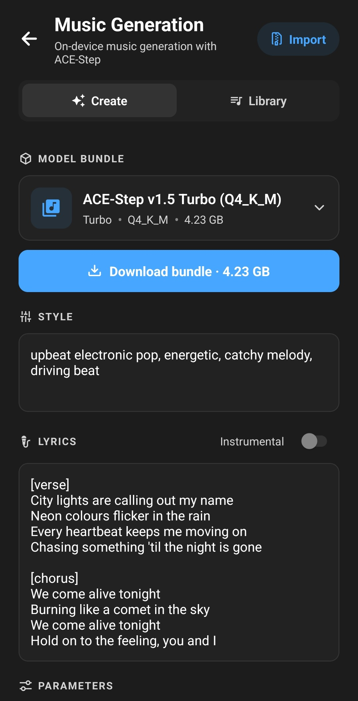

**Layla can generate complete songs — style, melody, arrangement, and sung lyrics — entirely on your phone, using the ACE-Step 1.5 music model. Nothing is uploaded, no account is needed, and it works with the network switched off.**


This article covers installing the Music Generation mini-app, downloading a model bundle, writing a prompt, and using the parameters that control speed and quality.

## What is ACE-Step?

ACE-Step is a music generation model built by ACE Studio and StepFun. It takes a text description of a song — genre, mood, instruments, tempo — and optionally lyrics, and renders finished audio at 48kHz in stereo.

Unlike the online AI music generators you may have used, ACE-Step in Layla runs locally on your device's CPU or GPU. There is no queue, no credit system, and no per-track limit. The trade-off is that generation takes real time on a phone rather than seconds on a datacentre GPU, and the model files are large.

Layla runs ACE-Step through [acestep.cpp](https://github.com/ServeurpersoCom/acestep.cpp), a GGML-based implementation of the model. This is the same idea as Layla's text models running on [llama.cpp](https://github.com/ggerganov/llama.cpp): the model is quantised down to a size a phone can hold, then run on the hardware you already own.

## What you need

- **Layla on Android or iOS.** Music generation works the same way on both.
- **The premium version of Layla.** All mini-apps require it. Layla is a one-time purchase, not a subscription.
- **About 5 GB of free storage** for a model bundle. Bundles range from roughly 4.2 GB to 5.3 GB.
- **6 GB of device RAM** for the smaller quantisations, **8 GB** for the larger ones.
- **Patience on the first run.** The model has to be loaded into memory before the first track of a session.

## Step 1: Enable the Music Generation mini-app

Music generation is an optional feature, so it is not enabled by default. Open _My Apps_, tap the plus sign in the top-right corner to browse all available features, and enable **Music Generation (Ace Step)**.

If you have not used the mini-app system before, see [how to enable or disable mini-apps within Layla](/docs/how-to-enable-disable-mini-apps-within-layla/).

Once enabled, the app appears in your app list and opens onto two tabs: **Create** and **Library**.

## Step 2: Download a model bundle

Tap the model card at the top of the Create tab to open the bundle picker. Each entry is a self-contained bundle: the language model that writes the lyrics and melody, the diffusion transformer that generates the audio, a text encoder, and the decoder that turns the result into sound. You only ever pick one bundle — there are no separate files to match up.

Bundles differ along two axes.

**Variant** — the musical character of the model:

| Variant                 | What it is                                                                           |
| ----------------------- | ------------------------------------------------------------------------------------ |
| Turbo                   | Fast 8-step generation. The best default for phones.                                 |
| SFT-Turbo50             | A merge of the turbo and fine-tuned models. Turbo speed with slightly richer output. |
| Turbo Continuous        | Turbo tuned for continuous or seamless-loop material.                                |
| Turbo Shift-1 / Shift-3 | Turbo with alternative sampling schedules. Different timbre feel.                    |

**Quantisation** — the size and quality trade-off, the same concept as [GGUF quants for text models](/docs/what-are-gguf-models-what-are-model-quants/):

| Quant  | Notes                               |
| ------ | ----------------------------------- |
| Q4_K_M | Smallest, lowest quality. 6 GB RAM. |
| Q5_K_M | Small and balanced. 6 GB RAM.       |
| Q6_K   | Larger, higher quality. 8 GB RAM.   |
| Q8_0   | Largest, near-lossless. 8 GB RAM.   |

If you are unsure, start with **Turbo Q5_K_M**.

Tap _Download bundle_ and the download runs in the background — you can leave the mini-app, and even leave Layla, without losing progress. When the transfer finishes, Layla unpacks the archive and verifies that all four model files arrived. The card shows _Installed_ when the bundle is ready.

A bundle you no longer want can be removed with _Delete bundle_ and re-downloaded later.

## Step 3: Describe the music

The **Style** field is the main control. Describe the music the way you would describe it to a musician: genre, mood, instrumentation, production, tempo.

Weak prompt:

> pop song

Better prompt:

> dreamy synthpop, warm analog pads, gated reverb drums, breathy female vocals, 120 bpm, bright and nostalgic

Detail helps. The model reads this text twice — once when the language model plans the structure and lyrics, and again when the audio itself is generated — so specific instruments, production adjectives, and a tempo all pull the result in a definite direction.



## Step 4: Lyrics, or no lyrics

Below the style box is the **Lyrics** field with an **Instrumental** switch.

- **Leave the lyrics box empty** and the model writes its own lyrics from your style description. This is the fastest way to get a full song out of a one-line prompt.
- **Write your own lyrics** and the model sings them as written. Use section tags on their own lines to shape the arrangement:

```
[verse]
Streetlights blink along the empty road
Radio static, half a song I know

[chorus]
Drive until the morning finds us
Nothing in the mirror behind us
```

Tags like `[intro]`, `[verse]`, `[pre-chorus]`, `[chorus]`, `[bridge]`, `[guitar solo]`, and `[outro]` are understood, and a tag can carry a description of its own, such as `[bridge - saxophone and strings]`.

The vocal language is detected from the lyrics you write, so you can write in French, Japanese, or any other language the model supports and it will be sung in that language.

- **Turn on Instrumental** for a track with no vocals at all.

## Step 5: Length and seed

**Duration** offers presets from 30 seconds to 3 minutes. Longer tracks take proportionally longer to generate, so 30 seconds is the sensible length while you are still refining a prompt.

**Seed** controls the randomness. Leave it blank for a different result every time, or set a number — or tap the dice — to make a run repeatable. The same seed with the same prompt and settings produces the same track, which is what you want when you have something close and only wish to adjust one word of the prompt.


## Generating a track

Tap **Generate music**. A single progress bar runs across the whole job, with a label naming the current stage:

1. **Loading model** — the language model is read into memory.
2. **Writing structure / Writing lyrics** — tempo, key, time signature, and the lyrics, if you did not supply them.
3. **Composing melody** — the musical content is planned.
4. **Generating music** — the audio itself is generated, one step at a time.
5. **Decoding audio** — the result is turned into a waveform.

You can press **Stop** at any time. Generation halts once the current step finishes, so there is a short wait before the run actually ends. Layla keeps the screen awake for the duration so the job is not interrupted.

When the run completes, a player card appears with a waveform. Tap the waveform to scrub, use the play button to listen, the download icon to save or share the file, and the trash icon to delete it.

Every track is written as a 48kHz stereo WAV into the mini-app's own folder and listed in the **Library** tab, tagged with the model, step count, and seed that produced it. Nothing is deleted automatically — clear out what you do not want, since WAV files at this quality add up quickly.

## Advanced parameters

Open **Advanced** under Parameters for finer control. Most people never need to touch these, and the defaults are correct for the bundled models.

**Steps and Shift** are blank by default, which means each model uses the values it was trained with — 8 steps for the turbo family, 50 for base and fine-tuned models. Enter a number to override. More steps generally means more detail and more time.

**Solver** selects the sampling algorithm: Euler, SDE, DPM++ 3M, or STORK-4. Euler is the default. Switching solvers changes the texture of the output at the same step count and is worth experimenting with once you have a prompt you like.

**Guidance (CFG)** controls how tightly the audio follows your style prompt. It is only shown for models where it applies — turbo models have guidance baked into the weights, so Layla fixes it at 1.0 and tells you so rather than letting you oversaturate the output.

**LM Guidance (CFG)** does the same for the lyrics and melody stage, and applies to every model. The default of 1.0 is the fastest setting. Raising it toward 2.0 tightens how closely the composition follows your prompt, at the cost of roughly doubling the time that stage takes.

**Use GPU** moves audio generation onto your device's GPU — Metal on iOS, OpenCL on Android — with a fallback to the CPU if that fails. The lyrics and melody stage always runs on the CPU: it is memory-bound rather than compute-bound, and a mobile GPU is slower at it. GPU is off by default because the CPU path is the compatible baseline; whether it is faster is worth testing on your own device.

**Flash attention** speeds up audio generation at some cost to quality. Off by default.

**VAE tile size** sets how much audio is decoded at once. Lowering it reduces peak memory use during the final stage at the cost of some speed — useful if generation completes but the app is killed right at the end on a device with less RAM.


The panel at the bottom summarises what you are actually running: the model family, the Qwen3-Embedding text encoder, the size of the bundled language model, and the output format.

## Importing your own model bundle

The picker ships the turbo family, which is what makes sense on a phone. The slower base and SFT variants, and any other compatible bundle, can be side-loaded.

Tap _Import_ in the top-right corner of the mini-app and select a `.zip` containing `lm.gguf`, `dit.gguf`, `text_encoder.gguf`, and `vae.gguf`. Layla extracts it, flattens any nested folders, and checks that all four files are present before adding the bundle to your list. Imported bundles behave exactly like the built-in ones and can be deleted the same way.

## Getting better results

- **Iterate at 30 seconds.** Find a prompt and seed you like on a short clip, then regenerate at full length with the same seed.
- **Name the production, not just the genre.** "Warm vinyl crackle", "polished modern mix", and "vintage analog warmth" all do real work.
- **Give a tempo.** A bpm figure in the style prompt anchors the rhythm.
- **Keep lyrics sectioned.** Untagged blocks of text give the model no structure to arrange around.
- **Change one thing at a time.** With a fixed seed, you can hear exactly what a single prompt edit did.

## Frequently asked questions

### Does AI music generation in Layla work offline?

Yes. Once a model bundle is downloaded, generation runs entirely on your device. You can put the phone in airplane mode and it will still work. Your prompts and lyrics never leave the device.

### How long does it take to generate a song on a phone?

It depends heavily on your device, the track length, the quantisation, and the step count. A 30-second turbo generation is the quickest way to find out where your own device lands. Longer durations and higher step counts scale the time up roughly proportionally.

### Do I need a subscription to generate music?

No. Music generation is included with Layla's premium unlock, which is a one-time purchase. There are no credits, no per-track charges, and no monthly fee.

### Can I use the generated music commercially?

That depends on the licence of the ACE-Step model weights, not on Layla. Check the terms published by the model's authors before using output commercially.

### Why is my first generation slower than the rest?

The model has to be loaded into memory before the first track. Subsequent runs in the same session skip part of that cost.

### What audio format does Layla produce?

48kHz stereo WAV. Use the download icon on any track to save it to your device or share it into another app.

---

Music generation joins [image generation](/docs/how-to-enable-image-generation-in-layla/) and offline text chat as things Layla does on the device itself. No account, no upload, no connection required.
