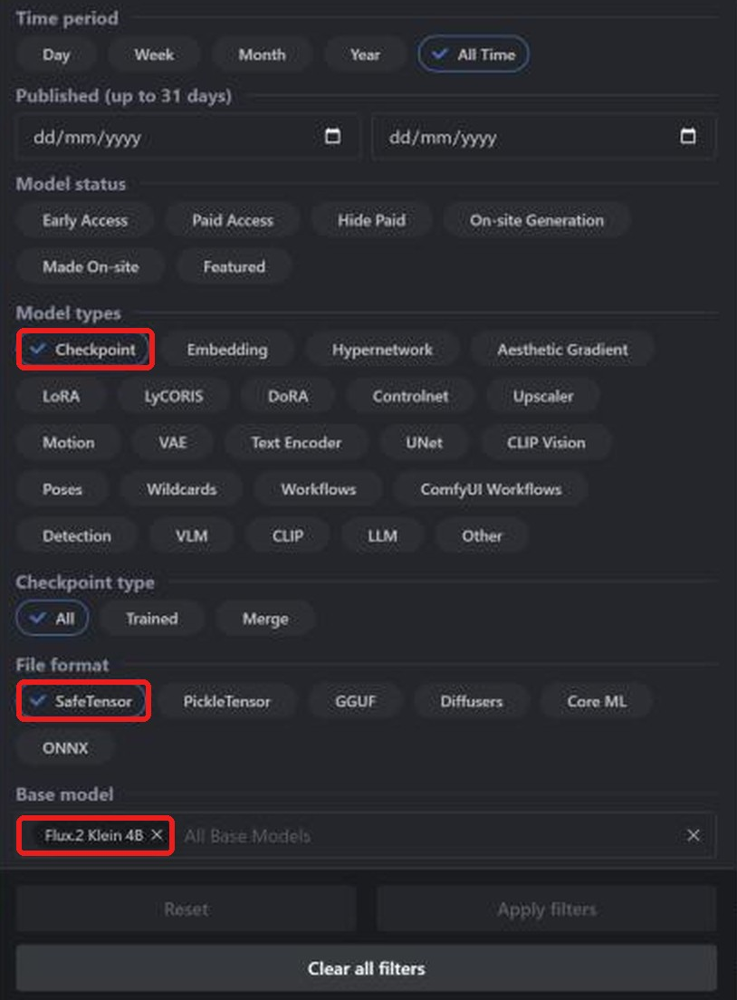
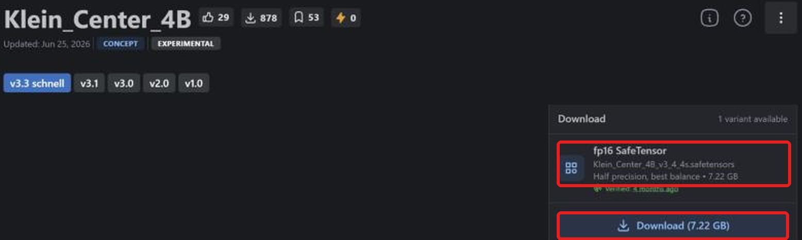
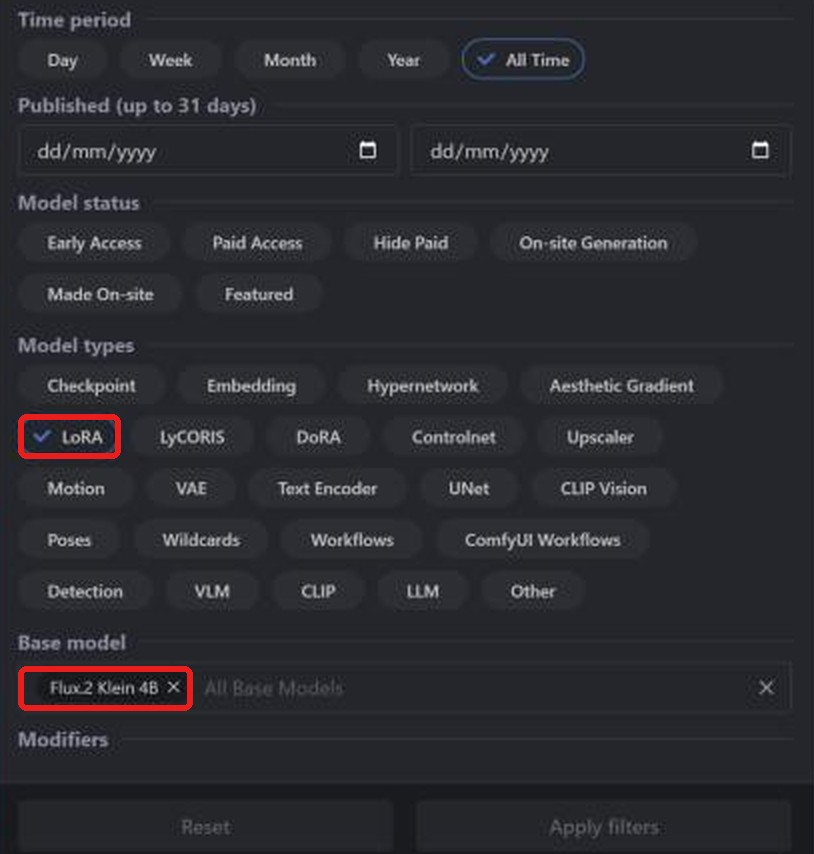
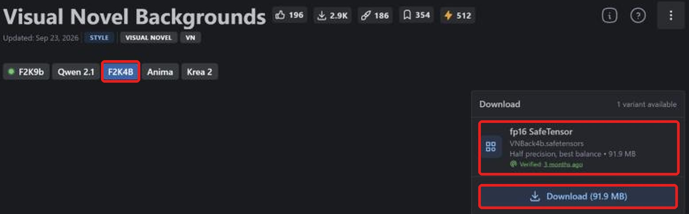

**Layla can import FLUX.2 Klein 4B safetensors checkpoints and LoRAs from Civitai and generate images with them offline on your Android phone.** FLUX.2 Klein is a compact text-to-image model, and the community publishes fine-tuned checkpoints and LoRAs for it on [Civitai](https://civitai.com/). Layla converts the checkpoint on your device, so after the download you do not need an internet connection to generate images.

This tutorial shows how to find a FLUX.2 Klein checkpoint on Civitai, download the correct file, import it into Layla, and add a Klein LoRA. For the other model families, see [SD 1.5](/how-to-import-sd1-5-safetensor-models-from-civit-ai-into-layla/), [SDXL](/how-to-import-sdxl-safetensor-models-from-civitai-into-layla/), [MOSS Image](/how-to-import-moss-image-safetensor-models-from-civitai-into-layla/), and [Qwen Image 2.1](/how-to-import-qwen-image-2-1-safetensor-models-from-civitai-into-layla/). For an overview of every import method, see [How to import custom image generation models into Layla](/how-to-import-custom-image-generation-models-into-layla/).

## What is FLUX.2 Klein?

FLUX.2 [klein] is a family of image models from Black Forest Labs, the company behind the FLUX models. The 4B model has about 4 billion parameters and is step-distilled to generate an image in around 4 steps. A larger 9B model also exists.

On Civitai the family appears under several base models, including **Flux.2 Klein 4B** and **Flux.2 Klein 9B**. In Layla's **Base Model** list it is called **Flux 2 Klein**, and it is built around the 4B model, so filter by **Flux.2 Klein 4B**. A LoRA only works with checkpoints built on the same base, so a Klein 4B LoRA needs a Klein 4B checkpoint.

## What you need

- An Android phone with a Snapdragon 8 Elite (SM8750) or newer chip. Flux 2 Klein imports run on the Snapdragon NPU, and they are not available on iPhone. Layla does not check your chip when you import, so confirm it before you convert a large file.
- The **Local Dream** mini-app. See [How to enable or disable mini-apps within Layla](/how-to-enable-disable-mini-apps-within-layla/) if you have not installed one before.
- The built-in **FLUX.2 Klein 4B** model downloaded in Local Dream. Layla reuses its tokenizer, text encoder, and VAE to convert your checkpoint. If it is missing, the Safetensor tab shows a warning and the import button stays disabled.
- Free storage for the checkpoint. An fp16 Klein 4B checkpoint is about 7 GB.

## Download the fp16 safetensors file

**Layla supports f16 (half precision) safetensors files.** On Civitai the file is labelled **fp16 SafeTensor** in the download box. For Flux 2 Klein, bf16 files also import, which includes the official FLUX.2 Klein 4B checkpoint. Quantized files, such as **fp8**, **int8**, **int4**, and **nvfp4**, are not supported.

Many Klein checkpoints on Civitai are published as fp8, which is smaller but not supported. Check the label in the download box before you download.

## How to import a FLUX.2 Klein checkpoint from Civitai

### Step 1: Open Civitai and go to Models

Open [civitai.com](https://civitai.com/) in your browser and select **Models** in the top navigation bar. The screenshots in this tutorial were taken in a desktop browser, so the layout on a phone may differ slightly.

### Step 2: Filter by Checkpoint, SafeTensor, and Flux.2 Klein 4B

Select **Filters** at the top right and set three things:

1. Under **Model types**, select **Checkpoint**.
2. Under **File format**, select **SafeTensor**.
3. Under **Base model**, search for and select **Flux.2 Klein 4B**.

The list now shows Klein 4B checkpoints in a format Layla can import. You can also [open this filtered list directly](https://civitai.com/models?types=Checkpoint&fileFormats=SafeTensor&baseModels=Flux.2%20Klein%204B&sort=Most%20Downloaded).

### Step 3: Download the fp16 safetensors file

Open a model and look at the **Download** box on the right. It should read **fp16 SafeTensor**, here with a size of 7.22 GB. Select **Download** to save the file to your phone. _Only f16 safetensors files are supported, with bf16 also accepted for Flux 2 Klein, so if the box offers several variants, choose the fp16 one._

You only need the checkpoint. If the page lists **Required Components**, such as a text encoder and a VAE, those are files that other tools need. Layla uses the supporting files from the FLUX.2 Klein 4B model you downloaded in Local Dream.

### Step 4: Import the checkpoint into Layla

Go to **Settings** → **Inference Settings**, scroll down to **Image Generation**, and tap **Add Custom Model**. You can also open the **Local Dream** mini-app and tap **Add Model**.

On the **Safetensor** tab, open the **Base Model** list and choose **Flux 2 Klein**.

Under **MODEL CHECKPOINT**, pick the safetensors file you downloaded, check the **MODEL NAME**, and tap **Import & Convert**. Layla converts the checkpoint into a Q4_0 GGUF diffusion model, which can take several minutes, so keep Layla open until it finishes. When it is done, the model is saved and selected automatically.

Layla does not inspect the file to confirm its family. If you pick Flux 2 Klein for a checkpoint that is not a Klein model, the import or the generation can fail.

### Step 5: Generate!

Open **Local Dream**, check that your model is selected, and enter a prompt. Because Klein is built for few-step generation, Layla starts imported Flux 2 Klein models at 4 steps and a CFG scale of 1. You can change both in Local Dream.

## How to add a FLUX.2 Klein LoRA from Civitai

A LoRA is a small file that changes a model's style or teaches it a character, object, or concept.

### Step 1: Filter by LoRA and Flux.2 Klein 4B

Open **Models** → **Filters**, then under **Model types** select **LoRA**, and under **Base model** select **Flux.2 Klein 4B**. You can also [open the filtered LoRA list directly](https://civitai.com/models?types=LORA&fileFormats=SafeTensor&baseModels=Flux.2%20Klein%204B&sort=Most%20Downloaded).

### Step 2: Download the LoRA safetensors file

Many Klein LoRAs publish one version for each base model, and the page may open on a different one. In this example it opens on **F2K9b**, the 9B model. Select the **F2K4B** version, which is the 4B model, then check that the download box reads **fp16 SafeTensor**, here 91.9 MB, and select **Download**.

### Step 3: Add the LoRA while importing

On the **Safetensor** tab, set **Base Model** to **Flux 2 Klein**, then under **LORA FILES (OPTIONAL)** tap **Add LoRA**, choose the LoRA file, and set its strength. The default is 1.0, and you can add several.

For Flux 2 Klein, LoRAs are copied into the model's folder and applied while generating. After the import, select the model in Local Dream and tap **Model setup** to see the files the model uses, its sampler, and its LoRAs.

### Use a LoRA without importing a whole checkpoint

For Flux 2 Klein, the **Safetensor** tab has a **LoRA only** checkbox. It lets you skip the checkpoint and create a new model from the FLUX.2 Klein 4B model you already downloaded in Local Dream, plus only your LoRAs. This saves the time and storage of converting a checkpoint.

## Frequently asked questions

### Can I run FLUX on my phone?

Yes, FLUX.2 Klein 4B, on an Android phone with a Snapdragon 8 Elite (SM8750) or newer. Download FLUX.2 Klein 4B in Local Dream, then import a checkpoint from Civitai with **Flux 2 Klein** as the Base Model.

### Which FLUX.2 Klein file should I download from Civitai?

The one labelled **fp16 SafeTensor**. A bf16 file also imports. Do not download fp8, int8, int4, or nvfp4 variants.

### Can I import FLUX.2 Klein 9B checkpoints?

Layla's Flux 2 Klein option is built around the 4B model, so use checkpoints and LoRAs filtered by **Flux.2 Klein 4B**.

### Can I import FLUX.1 checkpoints?

No. FLUX.1 is a different model family and is not in Layla's Base Model list.

### Can I run FLUX.2 Klein on an iPhone?

No. iOS imports SD 1.5 safetensors only. See [How to import SD 1.5 safetensors models from Civitai into Layla](/how-to-import-sd1-5-safetensor-models-from-civit-ai-into-layla/).

### Does importing a Civitai model need an internet connection?

Only to download the files. The conversion and the image generation both happen on your device.

### How do I delete an imported model?

Open **Local Dream**, select the model, and tap **Delete Model**.

## Offline FLUX.2 Klein on Android

After the import, FLUX.2 Klein runs on your phone with no internet connection, account, or subscription. Your prompts and images stay on the device.
