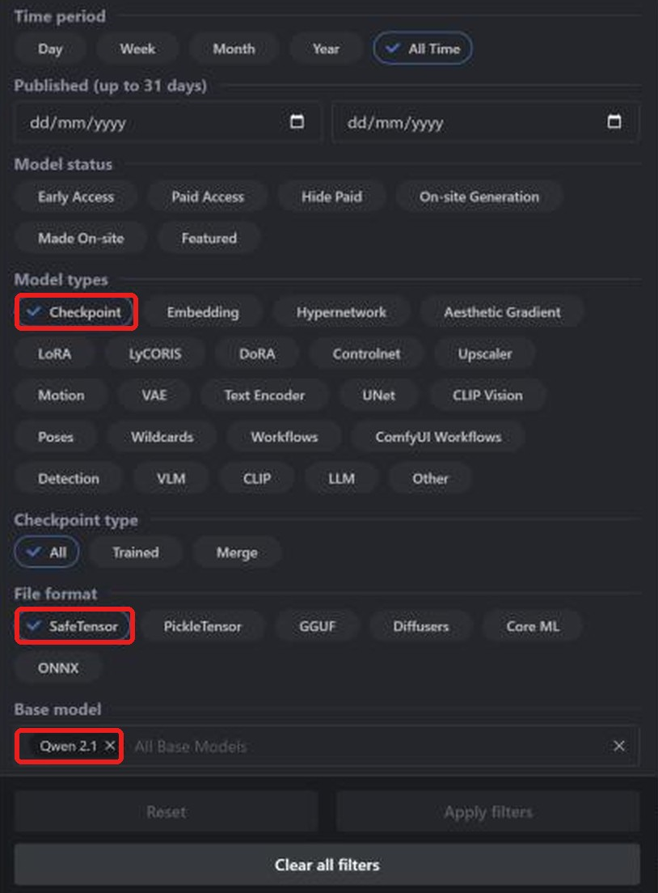
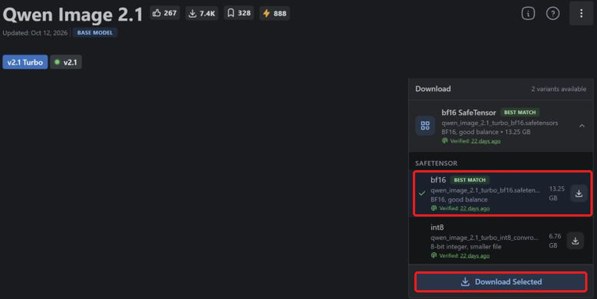
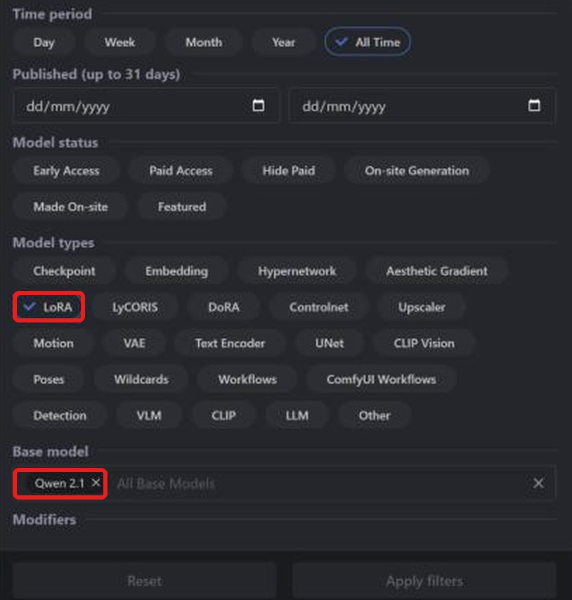
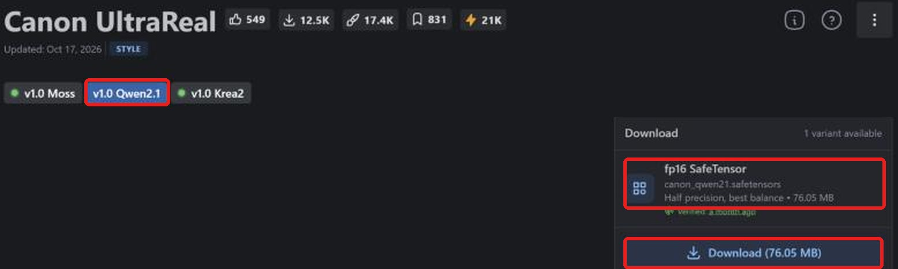

**Layla can import Qwen Image 2.1 safetensors checkpoints and LoRAs from Civitai and generate images with them offline on your Android phone.** Qwen Image 2.1 is a recent text-to-image model, and the community publishes fine-tuned checkpoints and LoRAs for it on [Civitai](https://civitai.com/). Layla converts the checkpoint on your device, so after the download you do not need an internet connection to generate images.

This tutorial shows how to find a Qwen Image 2.1 checkpoint on Civitai, download the correct file, import it into Layla, and add a Qwen Image 2.1 LoRA. For the other model families, see [SD 1.5](/how-to-import-sd1-5-safetensor-models-from-civit-ai-into-layla/), [SDXL](/how-to-import-sdxl-safetensor-models-from-civitai-into-layla/), [MOSS Image](/how-to-import-moss-image-safetensor-models-from-civitai-into-layla/), and [FLUX.2 Klein](/how-to-import-flux-2-klein-safetensor-models-from-civitai-into-layla/). For an overview of every import method, see [How to import custom image generation models into Layla](/how-to-import-custom-image-generation-models-into-layla/).

## What is Qwen Image 2.1?

Qwen-Image-2.1 is an open-weight image model from Alibaba's Qwen team, released in September 2026. It has about 7 billion parameters in the image generator, and it handles text-to-image generation as well as image editing. Check the license on the model page before you use its output commercially, because it differs from earlier Qwen-Image releases.

On Civitai it appears as **Qwen 2.1** in the **Base model** filter, and in Layla's **Base Model** list it is called **Qwen Image 2.1**. A LoRA only works with checkpoints built on the same base, so a Qwen 2.1 LoRA needs a Qwen 2.1 checkpoint. Civitai also has separate base models called **Qwen**, **Qwen 2**, and **Qwen 3**, which are not the same family.

## What you need

- An Android phone with a Snapdragon 8 Elite (SM8750) or newer chip. Qwen Image 2.1 imports run on the Snapdragon NPU, and they are not available on iPhone. Layla does not check your chip when you import, so confirm it before you convert a large file.
- The **Local Dream** mini-app. See [How to enable or disable mini-apps within Layla](/how-to-enable-disable-mini-apps-within-layla/) if you have not installed one before.
- A built-in Qwen model downloaded in Local Dream: **Qwen Image 2.1** or **Qwen Image 2.1 Turbo**. Layla reuses its tokenizer, text encoder, and VAE to convert your checkpoint. If they are missing, the Safetensor tab shows a warning and the import button stays disabled.
- A lot of free storage. A bf16 Qwen Image 2.1 checkpoint is more than 13 GB.

## Which file to download

**Layla supports f16 (half precision) safetensors files.** On Civitai the file is labelled **fp16 SafeTensor** in the download box. For Qwen Image 2.1, bf16 files also import. Quantized files, such as **fp8**, **int8**, **int4**, and **nvfp4**, are not supported.

At the time of writing, we did not find a Qwen 2.1 checkpoint on Civitai published in fp16. They are published as **bf16** or as quantized files, so the file to choose is the **bf16 SafeTensor**. On the official Qwen Image 2.1 page, Civitai's **Best match** label points at the bf16 file, but it can point at a quantized file on other models, so check the label on every page.

## How to import a Qwen Image 2.1 checkpoint from Civitai

### Step 1: Open Civitai and go to Models

Open [civitai.com](https://civitai.com/) in your browser and select **Models** in the top navigation bar. The screenshots in this tutorial were taken in a desktop browser, so the layout on a phone may differ slightly.

### Step 2: Filter by Checkpoint, SafeTensor, and Qwen 2.1

Select **Filters** at the top right and set three things:

1. Under **Model types**, select **Checkpoint**.
2. Under **File format**, select **SafeTensor**.
3. Under **Base model**, search for and select **Qwen 2.1**.

The list now shows Qwen Image 2.1 checkpoints in a format Layla can import. You can also [open this filtered list directly](https://civitai.com/models?types=Checkpoint&fileFormats=SafeTensor&baseModels=Qwen%202.1&sort=Most%20Downloaded).

### Step 3: Download the bf16 safetensors file

Open a model and look at the **Download** box on the right. Open the variants list, as in the screenshot, and select the **bf16** SafeTensor, here 13.25 GB. Do not pick the **int8** file below it, which is smaller but not supported. Then select **Download Selected**. If a checkpoint offers an **fp16 SafeTensor**, that is the preferred file. _Only f16 safetensors files are supported, with bf16 also accepted for Qwen Image 2.1._

You only need the checkpoint. Civitai's **Required Components** list names a text encoder and a VAE that other tools need to run the model. Layla uses the supporting files from the Qwen model you downloaded in Local Dream.

### Step 4: Import the checkpoint into Layla

Go to **Settings** → **Inference Settings**, scroll down to **Image Generation**, and tap **Add Custom Model**. You can also open the **Local Dream** mini-app and tap **Add Model**.

On the **Safetensor** tab, open the **Base Model** list and choose **Qwen Image 2.1**.

Under **MODEL CHECKPOINT**, pick the safetensors file you downloaded, check the **MODEL NAME**, and tap **Import & Convert**. Layla converts the checkpoint into a Q4_0 GGUF diffusion model, which can take several minutes for a file this size, so keep Layla open until it finishes. When it is done, the model is saved and selected automatically.

Layla does not inspect the file to confirm its family. If you pick Qwen Image 2.1 for a checkpoint that is not a Qwen Image 2.1 model, the import or the generation can fail.

### Step 5: Generate!

Open **Local Dream**, check that your model is selected, and enter a prompt. Layla starts imported models at 20 steps and a CFG scale of 5, and you can change both in Local Dream. Turbo checkpoints are made to generate in fewer steps, so they usually need lower values than these defaults.

## How to add a Qwen Image 2.1 LoRA from Civitai

A LoRA is a small file that changes a model's style or teaches it a character, object, or concept.

### Step 1: Filter by LoRA and Qwen 2.1

Open **Models** → **Filters**, then under **Model types** select **LoRA**, and under **Base model** select **Qwen 2.1**. You can also [open the filtered LoRA list directly](https://civitai.com/models?types=LORA&fileFormats=SafeTensor&baseModels=Qwen%202.1&sort=Most%20Downloaded).

### Step 2: Download the LoRA safetensors file

Some LoRAs publish one version for each base model. Select the version that matches Qwen Image 2.1, such as **v1.0 Qwen2.1** in this example, then check the download box. It should read **fp16 SafeTensor**, here 76.05 MB. Select **Download**.

### Step 3: Add the LoRA while importing

On the **Safetensor** tab, set **Base Model** to **Qwen Image 2.1**, then under **LORA FILES (OPTIONAL)** tap **Add LoRA**, choose the LoRA file, and set its strength. The default is 1.0, and you can add several.

For Qwen Image 2.1, LoRAs are copied into the model's folder and applied while generating. After the import, select the model in Local Dream and tap **Model setup** to see the files the model uses, its sampler, and its LoRAs.

### Use a LoRA without importing a whole checkpoint

For Qwen Image 2.1, the **Safetensor** tab has a **LoRA only** checkbox. It lets you skip the checkpoint and create a new model from the Qwen model you already downloaded in Local Dream, plus only your LoRAs. This saves the time and storage of converting a large checkpoint.

## Frequently asked questions

### Can I run Qwen Image 2.1 on my phone?

Yes, on an Android phone with a Snapdragon 8 Elite (SM8750) or newer. Download a Qwen Image 2.1 model in Local Dream, then import a checkpoint from Civitai with **Qwen Image 2.1** as the Base Model.

### Which Qwen Image 2.1 file should I download from Civitai?

An **fp16 SafeTensor** if one exists, otherwise the **bf16 SafeTensor**. Do not download fp8, int8, int4, or nvfp4 variants.

### Is there an fp16 version of Qwen Image 2.1 on Civitai?

At the time of writing, we did not find one among the Qwen 2.1 checkpoints. They are published as bf16 or quantized files. Layla imports the bf16 file for this family.

### What is the difference between Qwen Image 2.1 and the Turbo version?

Turbo versions are made to generate images in fewer steps. Either one works as a base for the import, as long as you have downloaded one of them in Local Dream first.

### Can I run Qwen Image 2.1 on an iPhone?

No. iOS imports SD 1.5 safetensors only. See [How to import SD 1.5 safetensors models from Civitai into Layla](/how-to-import-sd1-5-safetensor-models-from-civit-ai-into-layla/).

### Does importing a Civitai model need an internet connection?

Only to download the files. The conversion and the image generation both happen on your device.

### How do I delete an imported model?

Open **Local Dream**, select the model, and tap **Delete Model**.

## Offline Qwen Image 2.1 on Android

After the import, Qwen Image 2.1 runs on your phone with no internet connection, account, or subscription. Your prompts and images stay on the device.
