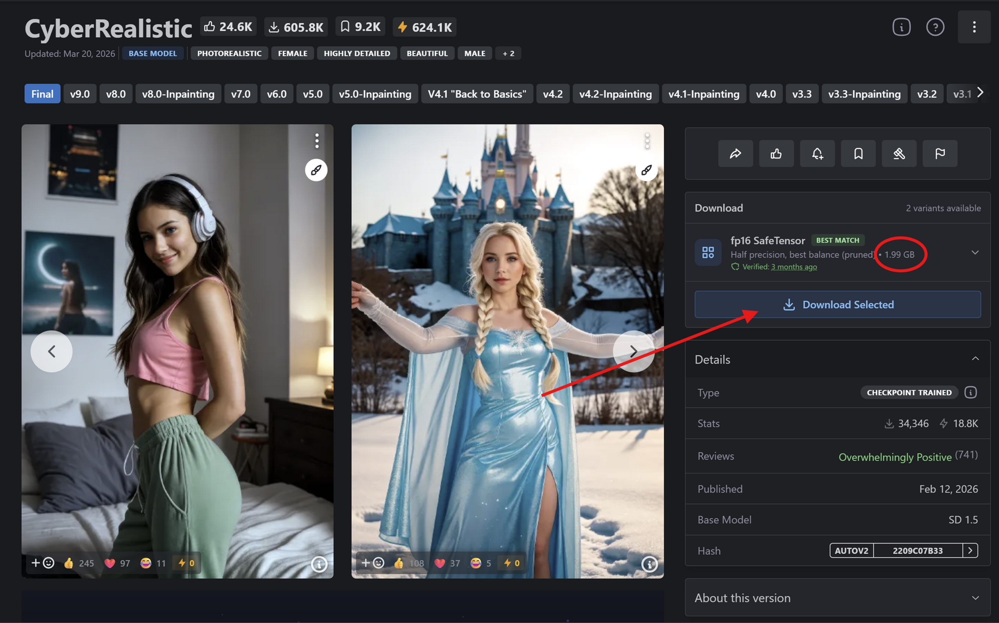
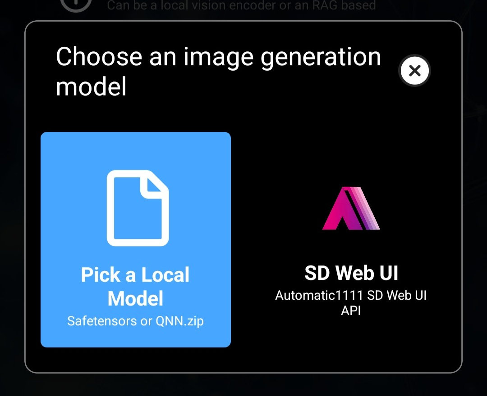
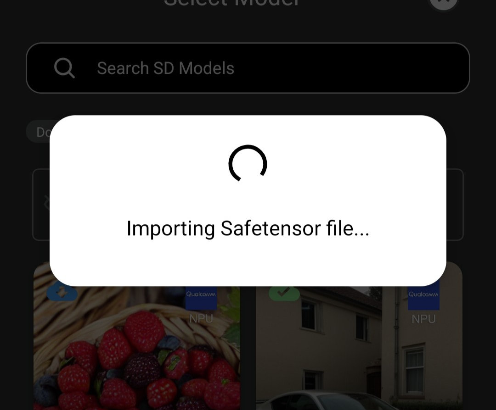

**Layla can import Stable Diffusion 1.5 (SD 1.5) safetensors checkpoints from Civitai and use them to generate images offline on your Android phone or iPhone.** Most community Stable Diffusion models on [Civitai](https://civitai.com/) are shared as safetensors files. Layla converts them on your device, so once the file is downloaded you do not need an internet connection to generate images.

This tutorial walks you through finding a compatible SD 1.5 model on Civitai, importing it into Layla, and generating your first image. For SDXL and other model families, GGUF files, zip packages, and connecting a Web UI, see [How to import custom image generation models into Layla](/how-to-import-custom-image-generation-models-into-layla/).

## What is SD 1.5?

SD 1.5 is Stable Diffusion 1.5, a version of the Stable Diffusion text-to-image model that is trained to produce 512 x 512 images. Many community checkpoints and LoRAs on Civitai are fine-tuned from it, which is why **SD 1.5** is one of the **Base Model** filters on the site.

The base model matters because a LoRA only works with checkpoints built on the same base. An SD 1.5 LoRA does not work with an SDXL checkpoint, and the reverse is also true.

## How to import an SD 1.5 model from Civitai

### Step 1: Go to Civitai

Go to the **Models** section of [Civitai](https://civitai.com/). In the filters at the top-right corner, filter by **Model Type** and select **Checkpoint**. Under **File format**, select **SafeTensor**, and under **Base Model**, select **SD 1.5**.

This will give you a list of Stable Diffusion models that Layla can import.

### Step 2: Download the safetensors file

Download the safetensors file from the model's download page to your phone. _Make sure the file size is around 2 GB. That will let you know the file is formatted correctly._

### Step 3: Import the model into Layla

Go to **Settings** → **Inference Settings**.

Scroll down to **Image Generation** settings and tap **Add Custom Model**. You can also open the **Local Dream** mini-app and tap **Add Model**.

On the **Safetensor** tab, leave **Base Model** set to **SD1.5** if the list is shown on your device. Pick the safetensors file you just downloaded, check the model name, and tap **Import & Convert**. Layla begins to import the file.

The import can take a few minutes, so keep Layla open until it finishes. When it is done, the model is saved and selected automatically.

#### Optional: add a LoRA

A LoRA is a small file that changes a model's style or adds a character or concept. Under **LORA FILES (OPTIONAL)**, tap **Add LoRA**, pick an SD 1.5 LoRA safetensors file, and set its strength. The default is 1.0. For SD 1.5 models, LoRAs are merged into the converted model, so you cannot change or remove them afterwards. To use a different combination, import the original checkpoint again under a new name.

### Step 4: Generate!

After your image model is imported, go to the Local Dream mini-app and use it to generate an image!

SD 1.5 models imported this way run on your device's CPU, at sizes up to 512 x 512. If your phone has a supported Qualcomm Snapdragon chip, you can convert the same checkpoint for the NPU to generate faster. See [NPU Forge in Layla: convert Stable Diffusion safetensors to QNN for the Snapdragon NPU](/how-to-convert-safetensors-to-qnn-with-npu-forge-in-layla/).

## Frequently asked questions

### Can I use Civitai models on my Android phone?

Yes. Download an SD 1.5 checkpoint in safetensors format from Civitai and import it with **Add Custom Model** in Layla. The model then runs on your phone, with no account or internet connection needed to generate images.

### Does importing a Civitai model need an internet connection?

Only to download the file from Civitai. The conversion and the image generation both happen on your device.

### Can I import SDXL or other models from Civitai?

On Android, yes for SDXL and a few newer families, but the steps differ from this tutorial. See [How to import custom image generation models into Layla](/how-to-import-custom-image-generation-models-into-layla/) for which models are supported and what each needs. On iPhone, only SD 1.5 is available.

### Can I use LoRAs with my SD 1.5 model?

Yes. Add them on the **Safetensor** tab while importing. They must be SD 1.5 LoRAs, and their strengths are fixed when the model is converted.

### Why does the import take so long?

Layla converts the whole checkpoint into an on-device model, which can take a few minutes. Keep Layla open and do not close it until the import finishes.

### How do I delete an imported model?

Open **Local Dream**, select the model, and tap **Delete Model**. This frees the storage the model uses.
