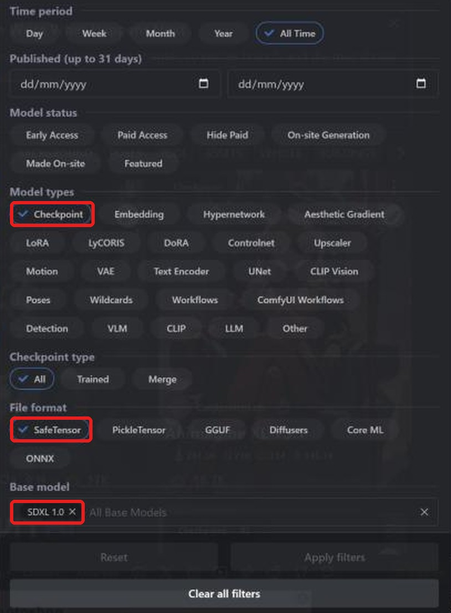
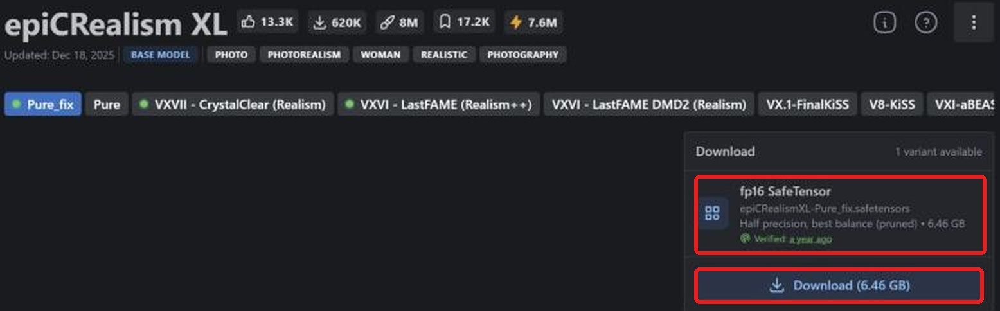
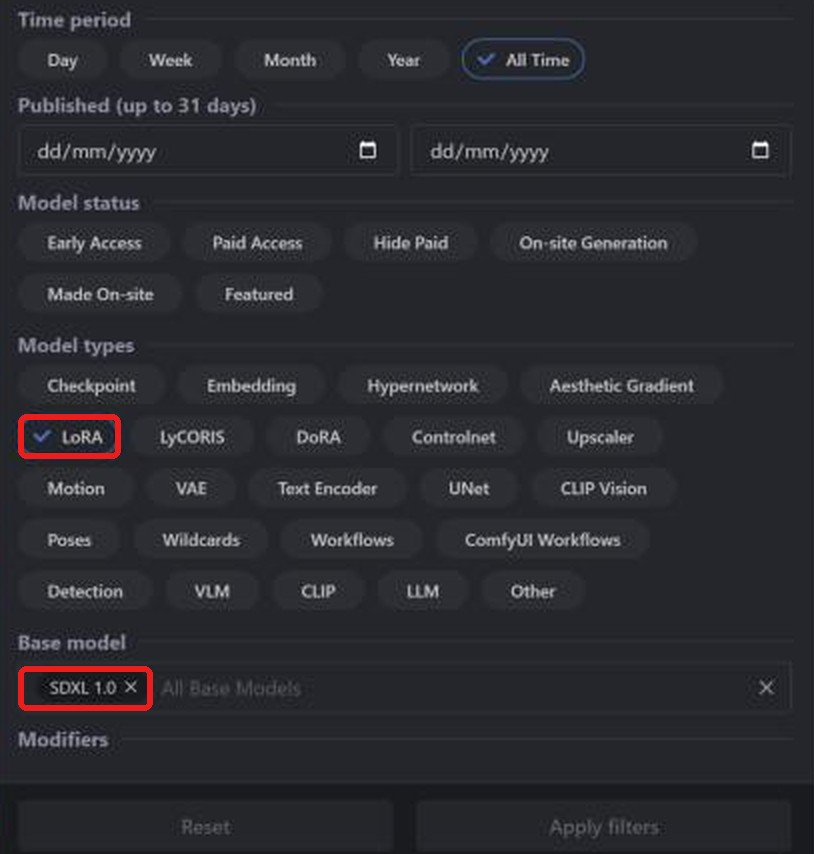
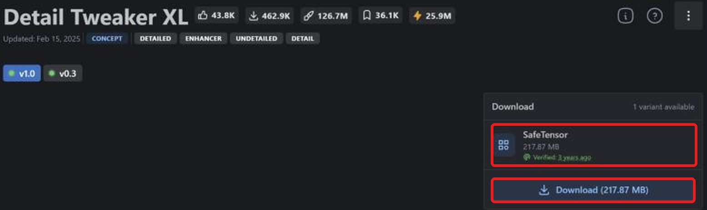

**Layla can import Stable Diffusion XL (SDXL) safetensors checkpoints and LoRAs from Civitai and run them on your Android phone, using the Snapdragon NPU.** Most SDXL models on [Civitai](https://civitai.com/) are shared as safetensors files. Layla converts the checkpoint on your device, so after the download you do not need an internet connection to generate images.

This tutorial shows how to find an SDXL checkpoint on Civitai, download the correct file, import it into Layla, and add an SDXL LoRA. For the other model families, see [SD 1.5](/how-to-import-sd1-5-safetensor-models-from-civit-ai-into-layla/), [MOSS Image](/how-to-import-moss-image-safetensor-models-from-civitai-into-layla/), [Qwen Image 2.1](/how-to-import-qwen-image-2-1-safetensor-models-from-civitai-into-layla/), and [FLUX.2 Klein](/how-to-import-flux-2-klein-safetensor-models-from-civitai-into-layla/). For an overview of every import method, see [How to import custom image generation models into Layla](/how-to-import-custom-image-generation-models-into-layla/).

## What is SDXL?

SDXL is Stable Diffusion XL 1.0, the larger successor to Stable Diffusion 1.5, released by Stability AI in 2023. It generates 1024 x 1024 images, compared with 512 x 512 for SD 1.5. On Civitai it appears as **SDXL 1.0** in the **Base model** filter, and many photorealistic and anime checkpoints are fine-tuned from it.

A LoRA only works with checkpoints built on the same base, so an SDXL LoRA needs an SDXL checkpoint. In Layla's **Base Model** list, this family is called **SDXL**.

## What you need

- An Android phone with a Snapdragon 8 Elite (SM8750) or newer chip. SDXL imports run on the Snapdragon NPU, and they are not available on iPhone. Layla does not check your chip when you import, so confirm it before you convert a large file.
- The **Local Dream** mini-app. See [How to enable or disable mini-apps within Layla](/how-to-enable-disable-mini-apps-within-layla/) if you have not installed one before.
- Enough free storage for the checkpoint, which is several gigabytes, plus the converted model.

## Download the fp16 safetensors file

**Layla only supports f16 (half precision) safetensors files.** On Civitai the file is labelled **fp16 SafeTensor** in the download box. An SDXL checkpoint in this format is around 6.5 GB. Civitai can also list full-precision or other variants of the same model, so check the label before you download.

## How to import an SDXL checkpoint from Civitai

### Step 1: Open Civitai and go to Models

Open [civitai.com](https://civitai.com/) in your browser and select **Models** in the top navigation bar. The screenshots in this tutorial were taken in a desktop browser, so the layout on a phone may differ slightly.

### Step 2: Filter by Checkpoint, SafeTensor, and SDXL 1.0

Select **Filters** at the top right and set three things:

1. Under **Model types**, select **Checkpoint**.
2. Under **File format**, select **SafeTensor**.
3. Under **Base model**, search for and select **SDXL 1.0**.

The list now shows SDXL checkpoints in a format Layla can import. You can also [open this filtered list directly](https://civitai.com/models?types=Checkpoint&fileFormats=SafeTensor&baseModels=SDXL%201.0&sort=Most%20Downloaded).

### Step 3: Download the fp16 safetensors file

Open a model and look at the **Download** box on the right. It should read **fp16 SafeTensor**, here with a size of 6.46 GB. Select **Download** to save the file to your phone. _Only f16 safetensors files are supported, so if the box offers several variants, choose the fp16 one._

### Step 4: Import the checkpoint into Layla

Go to **Settings** → **Inference Settings**, scroll down to **Image Generation**, and tap **Add Custom Model**. You can also open the **Local Dream** mini-app and tap **Add Model**.

On the **Safetensor** tab, open the **Base Model** list and choose **SDXL**.

Under **MODEL CHECKPOINT**, pick the safetensors file you downloaded, check the **MODEL NAME**, and tap **Import & Convert**. Layla converts the checkpoint into a Q4_0 GGUF model, which can take several minutes, so keep Layla open until it finishes. When it is done, the model is saved and selected automatically.

Layla does not inspect the file to confirm its family. If you pick SDXL for a checkpoint that is not SDXL, the import or the generation can fail.

### Step 5: Generate!

Open **Local Dream**, check that your model is selected, and enter a prompt. Layla starts imported models at 20 steps and a CFG scale of 5, and you can change both in Local Dream. SDXL models are built for 1024 x 1024 images.

## How to add an SDXL LoRA from Civitai

A LoRA is a small file that changes a model's style or teaches it a character, object, or concept.

### Step 1: Filter by LoRA and SDXL 1.0

Open **Models** → **Filters**, then under **Model types** select **LoRA**, and under **Base model** select **SDXL 1.0**. You can also [open the filtered LoRA list directly](https://civitai.com/models?types=LORA&fileFormats=SafeTensor&baseModels=SDXL%201.0&sort=Most%20Downloaded).

### Step 2: Download the LoRA safetensors file

On the LoRA's page, select **Download** for the SafeTensor file. Many LoRA pages label the file only as **SafeTensor**, as in this example. If a page offers several precisions, choose **fp16**, in line with the rule for checkpoints.

### Step 3: Add the LoRA while importing

On the **Safetensor** tab, pick your SDXL checkpoint, then under **LORA FILES (OPTIONAL)** tap **Add LoRA**, choose the LoRA file, and set its strength. The default is 1.0, and you can add several.

For SDXL, LoRAs are copied into the model's folder and applied while generating. That means you can review and edit them afterwards: select the model in Local Dream and tap **Model setup**, which shows the files the model uses, its sampler, and its LoRAs.

## Frequently asked questions

### Can I run SDXL on my phone?

Yes, on an Android phone with a Snapdragon 8 Elite (SM8750) or newer. Pick **SDXL** as the Base Model on the **Safetensor** tab and Layla converts the checkpoint into a model that runs on the Snapdragon NPU.

### Which SDXL file should I download from Civitai?

The one labelled **fp16 SafeTensor**. Layla supports only f16 safetensors files. Civitai's "best match" label may point to a different variant on some models, so open the variants list and check.

### Can I import Pony, Illustrious, or NoobAI checkpoints?

Those families are fine-tuned from SDXL, but Civitai lists them under their own base models, not **SDXL 1.0**. This guide covers checkpoints filtered by **SDXL 1.0**. Layla does not inspect the file to confirm its family, so other families are not guaranteed to work.

### Can I run SDXL on an iPhone?

No. iOS imports SD 1.5 safetensors only. See [How to import SD 1.5 safetensors models from Civitai into Layla](/how-to-import-sd1-5-safetensor-models-from-civit-ai-into-layla/).

### Do I need a Snapdragon phone for SDXL?

Yes for importing SDXL checkpoints in Layla, which target the Snapdragon NPU. On a Snapdragon 8 Gen 3 or newer, [NPU Forge](/how-to-convert-safetensors-to-qnn-with-npu-forge-in-layla/) can also convert SDXL checkpoints into QNN models.

### Does importing a Civitai model need an internet connection?

Only to download the file from Civitai. The conversion and the image generation both happen on your device.

### Why does Layla say the file is not a valid Safetensor model?

Layla could not read the file. Check that you downloaded a `.safetensors` file, that it is the fp16 variant, and that it is an SDXL checkpoint, then try the import again.

### How do I delete an imported model?

Open **Local Dream**, select the model, and tap **Delete Model**.

## Offline SDXL on Android

After the import, SDXL runs on your phone with no internet connection, account, or subscription. Your prompts and images stay on the device.
