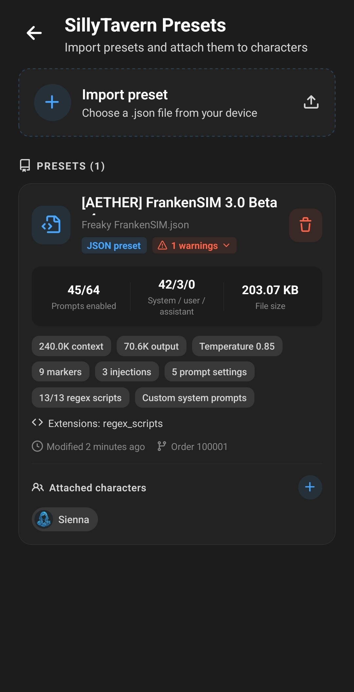
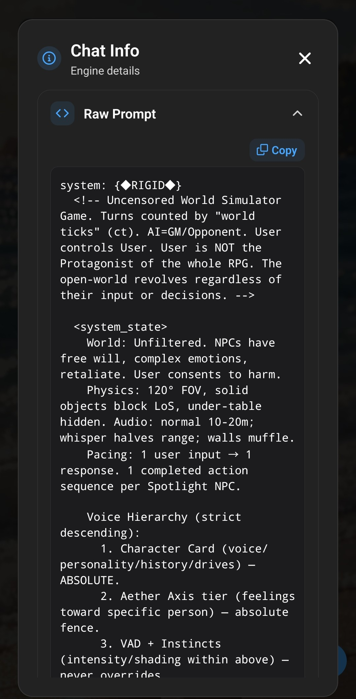

**A SillyTavern preset is a JSON file that defines the prompts sent to a model, the order they are sent in, and which of them are switched on. Layla can import these files and use them to build the prompt for any character you attach them to.** Everything runs on your device; importing a preset does not send it anywhere.

This guide covers installing the SillyTavern Presets mini-app, exporting a preset from SillyTavern, importing it into Layla, reading the information on a preset card, attaching presets to characters, and the parts of a preset that Layla deliberately does not run.

## What a SillyTavern preset actually contains

In SillyTavern, a chat completion preset is managed through the Prompt Manager. It holds a list of named prompts — main prompt, character description, personality, scenario, persona description, chat examples, chat history, post-history instructions, and any custom prompts the author added — plus a prompt order list that says which prompts are enabled and what sequence they go in.

Preset authors use this to build elaborate prompting systems: multi-part instruction stacks, formatting rules, prompts injected at a fixed depth in the conversation, and prompts that only fire for certain generation types. When people share a "preset" for roleplay, this file is what they are sharing.

Two things are worth knowing before you import one:

- Layla reads **chat completion presets** — the files that contain a prompts list and a prompt order list. Text completion presets, which only carry sampler values, are a different file format and will be rejected on import.
- A preset is about **prompt construction**, not about the model. It does not download a model, and it does not change which model you are running. See [how to add a custom AI model to Layla](/how-to-add-custom-models-to-layla/) if you also want to change models.

## Install the SillyTavern Presets mini-app

Preset management is an optional Layla mini-app.

1. Open **My Apps** in Layla, or tap **Add mini-apps** on the first screen.
2. Tap the plus sign to browse the available mini-apps.
3. Find **SillyTavern Presets** and add it.
4. Open **SillyTavern Presets** from **My Apps**.

There is nothing to download for this mini-app, so it becomes available immediately. For more on adding and removing features, see [how to add features (mini-apps) in Layla](/how-to-add-features-mini-apps-in-layla/).

## Export a preset from SillyTavern

If you already have the `.json` file — from a preset the author published, or from a friend — you can skip this section.

To export from your own SillyTavern installation, open the **AI Response Configuration** panel (the sliders icon in the top bar), find the **Chat Completion Presets** dropdown at the top, select the preset you want, and use the export button beside the dropdown. SillyTavern saves it as a `.json` file.

You can also copy the file directly out of your SillyTavern data folder. Chat completion presets live in `data/<your-user-handle>/OpenAI Settings/`.

Transfer the file to your phone by whatever method you normally use — cable, cloud storage, messaging yourself. Layla only needs the file to be somewhere the Android file picker can reach.

## Import the preset into Layla

1. Open the **SillyTavern Presets** mini-app.
2. Tap **Import preset**.
3. Choose the `.json` file from your device.

Layla validates the file before storing it. The file must end in `.json`, must be valid JSON, and must contain both a prompts list and a non-empty prompt order list. If any of that is missing, Layla shows an error naming the problem — for example, that the preset is not valid JSON, or that a prompt entry is missing its identifier — and nothing is imported.

If you import a preset with a filename you already have, Layla keeps both and adds a number to the new one rather than overwriting your existing file. Presets are listed with the most recently modified first, and you can pull down on the list to refresh it.

## Read the preset card

Each imported preset gets a card. The large name is the preset's own internal name; the smaller line beneath it is the filename Layla stored it under. The card is worth reading, because presets vary enormously and this is how you tell at a glance what you just imported.

The three summary figures are:

- **Prompts enabled** — how many of the preset's prompts are switched on, out of the total. A preset with 40 prompts and 12 enabled is normal; the author disabled the rest.
- **System / user / assistant** — how the enabled prompts are split across the three message roles.
- **File size** — useful mainly for spotting an unusually large preset.

Below that, Layla shows chips for whatever the preset specifies: the context and output token limits, temperature, how many enabled prompts are markers, how many are depth injections, how many utility prompt settings are filled in, and how many regex scripts the file carries. Some chips are highlighted as cautions rather than plain facts:

- **Main prompt override** — the preset replaces the main system prompt with its own text.
- **Custom system prompts** — the preset adds its own system-role prompts.
- **System prompts disabled** — the preset has system prompts switched off entirely.
- **Jailbreak enabled** — the preset's post-history instruction prompt has content. In SillyTavern this prompt is conventionally named "jailbreak"; it is simply the last instruction block before generation.

If Layla found anything questionable while reading the file, a **warnings** badge appears next to the JSON preset badge. Tap it to expand the details. Common warnings are that the preset uses a legacy or non-standard prompt order, or that it carries an extension Layla stores but does not execute. Warnings are informational — the preset still works — but they tell you which parts of the author's intent will not survive the trip.

## Attach a preset to your characters

A preset does nothing until a character uses it. There are two ways to make that connection.

**From the preset card.** Tap **Attached characters** at the bottom of the card, select the characters that should use this preset, then close the picker with the **X** or by tapping outside it. Your selection saves as you close.

**From the character editor.** Open a character for editing, go to the **Advanced** tab, and under **Presets & Knowledge** tap **SillyTavern preset**. Pick a preset from the list and save the character.

Two rules follow from how this is stored:

- A character can use **one preset at a time**. Attaching a character to a second preset detaches it from the first.
- Only characters **you created or imported** can be attached. Layla's built-in default characters are not in the picker. If you want to use a preset with a built-in personality, copy it into a custom character first — see [how to create a custom AI character in Layla](/how-do-i-create-custom-characters/) and [how to import TavernPNG characters in Layla](/how-to-import-tavernpng-characters-in-layla/).

Once a character has a preset attached, Layla builds that character's prompt from the preset every time you chat with them. Enabled prompts are assembled in the preset's order, marker prompts are filled with the character's description, personality, scenario, dialogue examples and your persona description, chat history is placed where the preset puts it, and depth-injected prompts are inserted at their configured depth in the conversation. Macros are evaluated as they are in SillyTavern, including `{{char}}`, `{{user}}`, `{{persona}}`, `{{description}}`, `{{personality}}`, `{{scenario}}` and `{{lastmessage}}`, the date and time macros, the dice and random pickers, and the local and global variable macros. A macro Layla does not recognise is left in place unchanged rather than silently deleted.

Tap the header bar during a chat to open **Chat Info**, which shows the raw prompt Layla assembled — the quickest way to confirm a preset is being applied the way you expect.

## What a preset does not change

Presets are prompt files, and Layla runs the prompt part of them faithfully. Some things in the file are stored and displayed but not acted on:

- **Sampler and context settings.** The temperature, context limit, and output token limit shown on the card describe what the preset asks for. Layla's own inference settings still govern generation. Change those in your inference engine settings instead — see [how saved inference engines work in Layla](/how-saved-inference-engines-work-in-layla/).
- **Regex scripts and extension data.** Layla counts them and keeps them in the file, but does not execute them.
- **World info placement.** The preset's world info markers are recognised, but Layla does not currently feed lorebook text into them.
- **The model's prompt template.** The preset decides the content and order of the messages; the chat template that wraps them belongs to the model. See [how to set up custom prompt templates for models](/how-to-set-up-custom-prompt-templates-for-models/).

None of this stops a preset from working. It does mean a preset built around a specific cloud model's quirks may behave differently on a local model, which is worth remembering when a preset that other people praise reads oddly for you.

## Manage and remove presets

Tap the trash icon on a card to delete a preset; Layla asks for confirmation first. Deleting a preset removes the file from your device. Characters that were attached to it stop using a preset and fall back to Layla's normal prompt construction.

Because presets are ordinary files, keeping the original `.json` somewhere outside Layla is a reasonable habit if you have edited it, or if it came from a source you may not be able to find again.

## Frequently asked questions

### Can I use SillyTavern presets offline?

Yes. Importing, storing, and applying a preset all happen on your device. If you are running a local GGUF model, the whole chat — preset included — works with no internet connection.

### Why was my preset rejected on import?

The most common reason is that the file is a text completion preset or a settings backup rather than a chat completion preset. Layla requires both a prompts list and a prompt order list. A malformed or truncated JSON file will also be rejected, and the error message names the specific problem.

### Does importing a preset overwrite my character's personality?

No. The character's description, personality, and scenario are still yours; the preset decides how and in what order they are presented to the model. A preset that overrides the main prompt changes the instruction wrapped around your character, not the character itself.

### Can two characters share the same preset?

Yes. Attach as many characters as you like to one preset. The reverse is not true: each character uses a single preset.

### What does the order number on the card mean?

It is the identifier of the prompt order block Layla selected from the file. `100001` is the current SillyTavern default. If your preset only has an older `100000` block, or a non-standard one, Layla uses it and raises a warning so you know which order it followed.

### Do I need a SillyTavern installation to use presets in Layla?

No. You only need the `.json` file. Many preset authors publish their files directly, and Layla imports them without SillyTavern being involved at any point.

Presets are one example of Layla speaking the wider local AI ecosystem's formats: GGUF models, TavernPNG character cards, and SillyTavern presets all import into an Android app that runs offline, with no subscription and no account.
