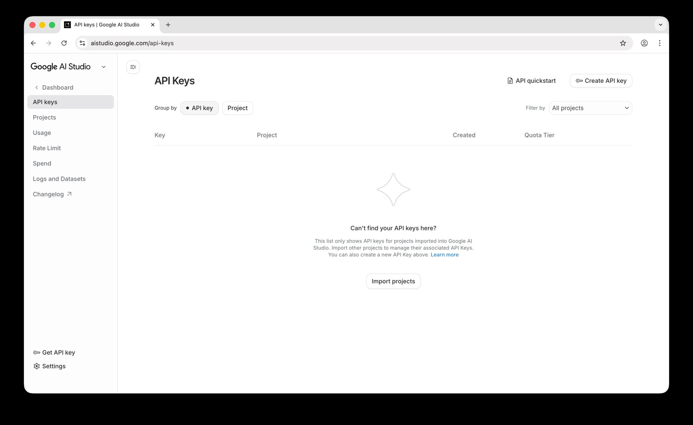

**A custom image generation Agent turns Layla into an AI chatbot that generates images with any service that offers an API, instead of being limited to the models built into the app.** When your AI character describes a picture in its reply, the Agent sends that description to the service, receives the finished image, and shows it in your chat.

Layla already generates images with Stable Diffusion models, either on your device or through Layla Cloud. An Agent adds another option: you choose the service, the model, and the settings, and you use your own API key, an approach often called bring your own key. This article builds one around the Nano Banana API. Nano Banana is Google's name for its Gemini image generation models, and the Agent in this article uses Nano Banana Pro, whose API name is `gemini-3-pro-image`.

The article has three goals. It shows how to get a Nano Banana API key and set the Agent up. It then explains every step of the Agent's code, and finally it describes how to reuse the same pattern to build Agents for other image services.

Unlike Layla's local models, this Agent needs an internet connection. Your image description is sent to Google, and Google charges per image. If you chat with a local model, the rest of your conversation stays on your device.

Here is the Agent in action. The character replies, and the image description it wrote is followed by the finished picture:


If you want to try it right away, download the Agent file here: [google-nano-banana-generate-image.json](/assets/articles/how-to-use-the-google-nano-banana-image-generation-agent/google-nano-banana-generate-image.json). You will need a Google API key before it works, which the article explains below.

## Why use Nano Banana in Layla?

Layla's own Stable Diffusion models are the right choice when you want images generated entirely on your device. The Nano Banana API suits a different set of needs:

- **Image quality that does not depend on your phone.** The picture is generated on Google's servers, so the speed of your device's CPU or NPU does not limit the result or the wait.
- **Images that follow the conversation.** Your character writes the image description from the chat itself, so the picture matches the scene, the outfit, or the place you are talking about. This works for AI roleplay and AI companion chats alike.
- **A local chat model with cloud images.** The Agent only reacts to the character's reply, so it works with whichever model you chat with. You can keep a local LLM for the conversation, and only the image description goes to Google.
- **Pay per image, with no subscription.** Google bills the images you generate, and you can see your usage and spend in Google AI Studio.
- **Your own key.** You can revoke the API key at any time, and the Agent keeps working with any other key you create.

Google's Gemini app also offers Nano Banana on Android. The difference here is that the pictures are made inside your own Layla chats, with your own characters, using your own API key.

## How the Agent works at a glance

Every image generation Agent that works from chat follows the same four-step flow:

```text
You ask for an image
  -> the character replies with a tagged image description
  -> the Agent's trigger spots the tag
  -> the Eval tool calls Google's API and saves the picture
  -> the Display Image tool shows it in the chat
```

1. **The system prompt asks the model for a tag.** The Agent adds an instruction that tells your character's language model to write a detailed image description inside `<stable_diffusion_prompt></stable_diffusion_prompt>` tags whenever you ask for a picture.
2. **A trigger picks up the tag.** The Agent has a regex trigger that watches the model's replies. When it sees the tag, it captures the text inside and starts the Agent.
3. **A script calls the API.** The Agent's first tool runs a short JavaScript program. It sends the description to Google, receives the image, and saves it as a file.
4. **The image appears in the chat.** The second tool, _Display Image_, takes the saved file and shows it in the conversation.

The language model never talks to Google directly. It only writes text. Everything after that is handled by the Agent, which is why the same pattern works with any service that has an API.

The tag is named `<stable_diffusion_prompt>` because that is the tag Layla's own image generation also listens for. This matters for setup, and it is covered in the setup section below.

## What you need

- The _Agents_ mini-app installed. If you have not used Agents before, read [How to enable Agents, Functions, and Tool-calling in Layla](/how-to-enable-agents-functions-and-tool-calling-in-layla/) first.
- A Google account.
- A Gemini API key, which is the Nano Banana API key, with billing enabled. The next section shows how.
- An internet connection.
- The Agent file, which is linked at the end of this article.

This Agent uses the _Eval_ tool, which is built into Layla. You do not need the Python Interpreter mini-app.

## How to get a Nano Banana API key from Google AI Studio

There is no separate Nano Banana key. The key you need is a Gemini API key, which Google issues through Google AI Studio and which works with its image models once billing is enabled. An API key is a long string of characters that identifies your Google account when the Agent sends a request. The process takes a few minutes.

### Step 1: Open Google AI Studio

Go to [aistudio.google.com](https://aistudio.google.com) and sign in with your Google account. If this is your first visit, accept the terms of service. Google then creates a default project and an API key for you.

Select **Get API key** at the bottom of the left sidebar.


### Step 2: Create a key

The _API Keys_ page lists the keys in your projects. Select **Create API key**.



### Step 3: Name the key and choose a project

Enter a name you will recognise, such as "Layla", and choose a project. New accounts have a project called _Default Gemini Project_. Select **Create key**.


Every API key belongs to a Google Cloud project, and the project controls billing and usage limits. If you already use Google Cloud, AI Studio does not show your existing projects automatically. Use the _Import projects_ button to add the one you want. Google explains this in [Using Gemini API keys](https://ai.google.dev/gemini-api/docs/api-key).

### Step 4: Copy the key

Your new key appears in the list. Select the copy icon on its row to copy the key to your clipboard. You can return to this page later and copy it again.


Treat the key like a password. Anyone who has it can make requests that Google bills to your account. If you think a key has been exposed, delete it on this page and create a new one.

### Step 5: Set up billing

The Quota Tier column in the previous screenshot reads _Free tier_ with a **Set up billing** link next to it. This step is required, because Google does not offer a free tier for the Nano Banana image models in the API. The project that owns your key needs a billing account.

Select **Set up billing** and follow Google's prompts: choose your country, accept the terms, and add a payment method. Depending on your account, Google may ask you to prepay a minimum amount of credit, currently $5. Google's [billing guide](https://ai.google.dev/gemini-api/docs/billing) lists the current steps and plans.

Google charges per image. At the time of writing, a 1K or 2K image from Nano Banana Pro costs $0.134 and a 4K image costs $0.24. The Agent in this article requests 1K images. Prices change, so check Google's [pricing page](https://ai.google.dev/gemini-api/docs/pricing) before you start. You can watch your usage in AI Studio under _Dashboard_ and then _Usage_.

Google's pricing page also states that content sent on the paid tier is not used to improve Google's products.

## Which Nano Banana model should you use?

Google offers several Nano Banana models through the same API. The Agent uses Nano Banana Pro, and you can change one line of the script to use another model. These are the models Google lists at the time of writing, with the price Google lists for a 1K image:

| Model              | API name                      | Price per 1K image | Notes                                                                                   |
| ------------------ | ----------------------------- | ------------------ | --------------------------------------------------------------------------------------- |
| Nano Banana 2.1    | `gemini-nano-banana-2.1`      | $0.0336            | Google's recommended model for new projects. Supports 1K, 2K and 4K images.             |
| Nano Banana 2 Lite | `gemini-3.1-flash-lite-image` | $0.0336            | The fastest and cheapest model. Supports 1K images only.                                |
| Nano Banana 2      | `gemini-3.1-flash-image`      | $0.067             | The previous-generation model in the same family.                                       |
| Nano Banana Pro    | `gemini-3-pro-image`          | $0.134             | Google's premium model for the most complex visual tasks. The model this Agent uses.    |
| Nano Banana        | `gemini-2.5-flash-image`      | $0.039             | The original model. Google calls it legacy and lists a shutdown date of March 15, 2027. |

In the Nano Banana Pro vs Nano Banana 2 comparison, Pro costs about twice as much per 1K image and is aimed at complex scenes, while Nano Banana 2 and 2.1 are the faster, cheaper models. Larger images cost more on every model. Nano Banana Pro charges $0.24 for a 4K image, Nano Banana 2 charges $0.151, and Nano Banana 2.1 charges $0.113.

To switch models, change `MODEL_ID` in the script and run the **Test** button. Google's [image generation documentation](https://ai.google.dev/gemini-api/docs/image-generation) lists what each model supports. If a model returns an error, it may not accept one of the settings in the Agent's request, such as a 2K size, or it may expect Google's newer API format. Prices and model names change often, so check Google's [pricing page](https://ai.google.dev/gemini-api/docs/pricing) and [deprecations page](https://ai.google.dev/gemini-api/docs/deprecations) before you choose.

## Set up the Agent in Layla

### Step 1: Turn off Layla's default image generation

Open your _Inference Settings_, scroll to the _Image Generation_ section, and select the image generation model. In the _Select Model_ list, choose **No Image Generation**.


Layla's built-in image generation reads the same `<stable_diffusion_prompt>` tag from a character's reply. If a model is still selected, Layla generates its own image from the tag and you receive two pictures. With _No Image Generation_ selected, the tag is left for the Agent. [How to enable image generation in Layla](/how-to-enable-image-generation-in-layla/) shows where this setting is.

### Step 2: Import the Agent

Download the Agent file at the end of this article. Open the _Agents_ mini-app and use the **Import** button at the top right to import it. The Agent is named _Google Nano Banana: generate image_, and its card lists the two tools it uses: _Eval_ and _Display Image_.


Make sure the switch at the top right of the Agent's card is on. In the screenshot it is still off.

### Step 3: Add your API key

Open the Agent with its **Edit** button and find the _Eval_ tool. Near the top of its code is this line:

```js
const API_KEY = "PUT YOUR API KEY HERE";
```

Replace `PUT YOUR API KEY HERE` with your key, and keep the quotation marks. Save the Agent.

Your key is now stored inside the Agent. Before you share or upload the Agent file anywhere, replace the key with the placeholder again.

### Step 4: Ask for an image

Start a chat and ask for a picture, for example "show me a lighthouse on a cliff at dusk". The character replies with an image description, the Agent runs, and the picture appears in the chat after a few seconds, as in the screenshot at the top of this article.

If something goes wrong, use the **Test** button in the Agents mini-app. It shows the input and output of every step, as described in [Deep dive into Layla Agents](/deep-dive-into-layla-agents/).

## How the Agent works, step by step

An Agent has three parts: a system prompt, a trigger, and a list of tools that run one after another. The output of each tool is the input of the next. [Deep dive into Layla Agents](/deep-dive-into-layla-agents/) covers these building blocks in general. This section follows the Nano Banana Agent through each of them.

### 1. The system prompt

The system prompt is an instruction that Layla adds to the conversation whenever the Agent is enabled:

```text
When the user asks you to generate, draw or create an image, write a detailed
description of the image (subject, setting, style, lighting, composition) inside
<stable_diffusion_prompt></stable_diffusion_prompt> tags, e.g.
<stable_diffusion_prompt>a lighthouse on a cliff at dusk, oil painting, warm
light</stable_diffusion_prompt>. The image is generated from the text inside the
tags and shown in the chat. Use the tags only when an image is requested, and
never put backticks inside them.
```

Each part of the instruction has a purpose:

- **"When the user asks you to generate, draw or create an image"** limits the behaviour to image requests, so normal conversation is unaffected.
- **"A detailed description (subject, setting, style, lighting, composition)"** gives the model a checklist. Nano Banana is a language model that reads descriptions, so a full sentence with these details usually produces a better picture than a list of keywords.
- **The example** shows the exact tag format. Language models follow an example more reliably than a description of a format.
- **"Use the tags only when an image is requested"** stops the model from adding tags to every reply, which would start the Agent, and bill you, each time.
- **"Never put backticks inside them"** protects the script. The reason is explained in the code walkthrough below.

When you write your own Agents, the system prompt does the same job: it teaches the model one new behaviour, shows the output format, and states when not to use it.

### 2. The trigger

The Agent has one trigger, a _Regex trigger_ that runs on the model's **output** instead of your input. Its pattern is:

```text
/<stable_diffusion_prompt>(.*?)<\/stable_diffusion_prompt>/s
```

- The opening and closing tags match the literal tags.
- `(.*?)` is a capture group. It collects everything between the tags, and the `?` makes it stop at the first closing tag.
- The `s` flag lets the description span several lines.

The text captured by the group becomes available to the Agent as `{{match$1}}`. This is the link between the language model and the code: whatever the model writes between the tags is handed to the first tool.

### 3. The Eval tool: calling the API

The first tool is _Eval_. It runs JavaScript in a sandboxed runtime inside Layla. The runtime has `fetch` for web requests and a global object called `layla` that gives scripts access to Layla's features, such as saving files. It does not have a browser page or Node.js modules.

Eval returns the value of the script's last expression and waits for it if it is a promise. This explains the last line of the script, which starts the work: `generateImage(PROMPT);`.

The script has eight parts.

#### Settings at the top

```js
const API_KEY = "PUT YOUR API KEY HERE";
const PROMPT = String.raw`{{match$1}}`.trim();

const MODEL_ID = "gemini-3-pro-image";
const API_METHOD = "streamGenerateContent";
const API_URL = `https://generativelanguage.googleapis.com/v1beta/models/${MODEL_ID}:${API_METHOD}`;
const TIMEOUT_MS = 60000;
```

Everything you might want to change sits in one place:

- `API_KEY` is your key.
- `PROMPT` is the description the model wrote. Before the script runs, Layla replaces `{{match$1}}` with the captured text, so the description becomes part of the program. It is wrapped in a template literal with `String.raw` so that backslashes are kept as typed, and `.trim()` removes stray spaces and line breaks. A backtick or the characters `${` inside the description would end the literal early and break the script, which is why the system prompt forbids backticks.
- `MODEL_ID` is the model to use. Google renames and retires models from time to time, so this is the line you are most likely to edit later.
- `API_URL` is built from the model and the method. `streamGenerateContent` returns the answer as a list of chunks.
- `TIMEOUT_MS` is how long to wait before giving up: 60 seconds.

The rest of the script lives in a function called `generateImage`. It receives the description as a parameter named `prompt`, and the last line of the script calls it with `PROMPT`.

#### Check the inputs

```js
if (!prompt) throw new Error("The stable diffusion prompt was empty.");
if (!API_KEY || API_KEY === "PUT YOUR API KEY HERE")
  throw new Error("Set API_KEY in this agent first.");
```

The script fails early, with a readable message, when there is nothing to send or the key has not been set. When a script throws an error, the Agent stops and no image appears. The **Test** button shows the message.

#### Build the request

```js
const imageConfig = { imageSize: "1K" };

const payload = {
  contents: [{ role: "user", parts: [{ text: prompt }] }],
  generationConfig: {
    responseModalities: ["IMAGE", "TEXT"],
    imageConfig,
  },
  tools: [{ googleSearch: {} }],
};
```

The payload is the data sent to Google:

- `contents` is the conversation sent to the model. Here it is a single message from the user containing one piece of text: the description.
- `responseModalities` lists the kinds of output the model may return. Asking for `IMAGE` is what makes the model draw a picture, and `TEXT` allows it to add a comment.
- `imageConfig` holds the picture settings. `imageSize` can be `'1K'`, `'2K'` or `'4K'` with an uppercase K, and larger sizes cost more. You can also add an `aspectRatio` such as `'16:9'` or `'9:16'`. The script only sends settings that have a value, because Google answers with an error when it receives an empty one.
- `tools: [{ googleSearch: {} }]` lets the model look things up on Google Search while it works, which helps with real places and objects. Remove this line if you do not want it. Google includes a monthly allowance of search requests for Gemini 3 models and charges beyond it, as listed on the pricing page.

#### Send the request with a time limit

```js
const controller = new AbortController();
const timer = setTimeout(() => controller.abort(), TIMEOUT_MS);
let response;
let body;
try {
  response = await fetch(API_URL, {
    method: "POST",
    headers: { "Content-Type": "application/json", "x-goog-api-key": API_KEY },
    body: JSON.stringify(payload),
    signal: controller.signal,
  });
  body = await response.text();
} catch (error) {
  if (controller.signal.aborted)
    throw new Error(`Image generation timed out after ${TIMEOUT_MS / 1000} s.`);
  throw new Error(`Image generation request failed: ${error.message}`);
} finally {
  clearTimeout(timer);
}
```

This is the part that talks to Google:

- `fetch` sends a `POST` request with the payload converted to JSON text.
- The API key travels in the `x-goog-api-key` header, so it is not part of the web address.
- The `AbortController` and the timer cancel the request after 60 seconds. Without them, a stalled connection would leave the Agent waiting.
- The `catch` block tells a timeout apart from other network failures, so the error message says which one happened. The `finally` block clears the timer in both cases.

#### Check the response status

```js
if (!response.ok) {
  throw new Error(
    `HTTP error ${response.status} ${response.statusText}. Response body: ${body.slice(0, 500)}`,
  );
}
```

When Google rejects a request, it explains why in the response body. The script includes the first 500 characters of that explanation in the error, so a wrong key, missing billing, or an exceeded limit shows up as a clear message when you use the **Test** button.

#### Find the image in the response

```js
const data = JSON.parse(body);
const chunks = Array.isArray(data) ? data : [data];

for (const chunk of chunks) {
  for (const candidate of chunk.candidates || []) {
    for (const part of (candidate.content && candidate.content.parts) || []) {
      const inline = part.inlineData;
      if (
        !inline ||
        !inline.data ||
        !String(inline.mimeType || "").startsWith("image/")
      )
        continue;
      // ...save the image
    }
  }
}
```

The streaming method answers with a JSON list of chunks. Each chunk has `candidates` (the model's answers), each candidate has `content`, and the content is a list of `parts`. A part is either text or inline data. Inline data carries a `mimeType`, such as `image/png`, and the picture itself as base64 text, which is a way of writing binary data as plain characters.

The loop walks through every chunk, candidate and part, skips text, and stops at the first part that is an image. The `|| []` guards keep the script from crashing when a chunk has no candidates.

#### Save the image

```js
const extension =
  inline.mimeType
    .split("/")
    .pop()
    .replace(/[^a-z0-9]/gi, "") || "png";
const id = Math.random().toString(16).slice(2, 10).padEnd(8, "0");
const path = `generated-images/output_image_${id}.${extension}`;

await layla.utils.saveFile(path, inline.data);
return path;
```

- The file extension comes from the image type that Google reports, with a fallback to `png`.
- A random eight-character ID gives every picture its own file name, so a new image never overwrites an earlier one in your chat history.
- `layla.utils.saveFile` writes the file into the character's private workspace folder. The path is relative to that folder, and any missing folders are created automatically. The function expects base64 text, which is what Google sends, so the data is saved without conversion.
- The function returns the path. That path is the output of the tool.

#### Report a failure clearly

```js
const keys =
  chunks.length && typeof chunks[0] === "object"
    ? Object.keys(chunks[0]).join(", ")
    : "Unknown error";
throw new Error(
  `No image was found in the response. Full API Response Keys: ${keys}`,
);
```

If the loop finishes without finding an image, for example because the model refused the request and replied with text only, the script reports what the response contained. This makes unusual failures much easier to diagnose.

### 4. The Display Image tool

The second tool is _Display Image_, and its only setting is:

```text
{{input}}
```

`{{input}}` is replaced with the output of the previous tool, which is the file path that the script returned. _Display Image_ opens that file from the character's workspace and attaches it to the reply, and the picture appears in the chat.

## Make your AI character's images consistent

A language model writes each image description from scratch, so without guidance a character can look different from one picture to the next. These approaches keep AI character images consistent and let you decide how often pictures appear:

- **Describe the character once.** In the character's _Scenario_, add an instruction such as: "Whenever you write a `<stable_diffusion_prompt>`, begin with this description of yourself: a woman in her late twenties with short red hair, green eyes and freckles. Then describe the scene." The model repeats the appearance in every prompt, which helps the image model draw the same character each time.
- **Fix the art style.** Add a style to the same instruction, for example "35mm film photograph, natural light" or "watercolor illustration". [How to use the Perchance image generation Agent](/how-to-use-the-perchance-image-generation-agent/) describes the same approach, and it works with any Agent that uses this tag.
- **Generate an image after every message.** Add an instruction to the _Scenario_ to end each reply with the tag, as in [Creating an image generation Agent](/creating-an-image-generation-agent/). Every reply then comes with a picture, which suits AI roleplay and storytelling. Each picture is billed, so this costs more than asking for images on request.
- **Use reference images.** Nano Banana models can also take an image as input, which helps a character keep the same face. This Agent sends text only, so adding a reference image to the request is a good next project.

## Use the same pattern for other Agents

The Nano Banana Agent is a template. The system prompt, the regex trigger, and the Display Image step stay the same for any image service. Only the script changes. These ideas build on it.

- **Change the model or the settings.** Edit `MODEL_ID`, `imageSize` or add `aspectRatio` in the script. Google offers several Nano Banana models at different prices, which are listed on its [pricing page](https://ai.google.dev/gemini-api/docs/pricing).
- **Use a different image service.** Replace the request and the response handling. If the service returns base64 text, the saving step stays the same. If it returns a web address, fetch that address and convert the bytes with `toBase64()` before calling `layla.utils.saveFile`.
- **Ask the model for more than a description.** The system prompt can request a few fields instead of free text, for example a short JSON object with a `prompt` and an `aspect_ratio`. The script then reads the fields from the captured text. Keep the placeholder inside a string literal, as the Agent does with `PROMPT`, and parse the text in your own code.
- **Do something other than images.** Choose a different tag, such as `<weather_request>`, let _Eval_ call a different API, and finish with the _Provide Context_ tool so the character can talk about the result. The [Brave Search Agent](/how-to-create-a-brave-search-agent/) is an example of this flow.

When you write your own Agent, a few habits from this one are worth keeping:

- **Put every setting in one block at the top.** The key, the model, the size, and the timeout are easy to find and change.
- **Check inputs before spending money.** A guard that stops an empty request costs nothing.
- **Always set a timeout.** A request that never finishes is worse than one that fails with a message.
- **Return something readable on failure.** The error text is what the **Test** button shows, so make it say what went wrong.
- **Hand over a path, not a payload.** The script saves the image and passes a short path to the next tool, which keeps large data out of the chain.
- **Pick one Agent per tag.** If you build another Agent that reacts to `<stable_diffusion_prompt>`, disable this one. Alternatively, give the new Agent a distinctive tag in both its system prompt and its trigger.
- **Treat `{{match$1}}` as code.** The captured text is pasted into the script before it runs, so wrap it in a string literal and tell the model which characters to avoid.

## Frequently asked questions

### How do I get a Nano Banana API key?

There is no separate Nano Banana key. Sign in to [Google AI Studio](https://aistudio.google.com), open the _API Keys_ page, and select **Create API key**. Then enable billing on the key's project, because the Nano Banana models have no free tier in the API.

### Is the Nano Banana API free?

Creating a key is free, but Google does not offer a free tier for the Nano Banana image models in the API, so each image is billed. See Google's [pricing page](https://ai.google.dev/gemini-api/docs/pricing) for current prices.

### How much does the Nano Banana API cost per image?

At the time of writing, Nano Banana Pro costs $0.134 for a 1K or 2K image and $0.24 for a 4K image. Nano Banana 2.1 costs $0.0336 for a 1K image. The table in the model section above lists every model.

### What is the difference between Nano Banana Pro and Nano Banana 2?

Nano Banana Pro is Google's premium image model for complex scenes and costs more per image. Nano Banana 2 is a faster, cheaper model from the same family, and Google now recommends Nano Banana 2.1 for new projects. See the model table above for names and prices.

### Can I use Nano Banana on Android?

Yes. Google's Gemini app includes Nano Banana. This Agent is for when you want the pictures made inside your own Layla chats, with your own characters and your own API key.

### Can my AI character send pictures during a chat or roleplay?

Yes. Ask for a picture in the chat, or add an instruction to the character's _Scenario_ so that each reply ends with an image description. The section on keeping images consistent explains both options.

### Does Nano Banana filter images?

Yes. Google applies its own safety policies to the Gemini API, and a request it declines can return no picture. The Agent then reports that no image was found in the response. For image generation that happens entirely on your device, use the local Stable Diffusion models described in [How to enable image generation in Layla](/how-to-enable-image-generation-in-layla/).

### Why did I get two images?

Layla's built-in image generation is probably still enabled. Select _No Image Generation_ in the Inference Settings so that only the Agent handles the tag.

### The Agent says "Set API_KEY in this agent first."

The key placeholder is still in the script. Open the Agent, edit the _Eval_ tool, and replace `PUT YOUR API KEY HERE` with your key.

### The Agent shows an HTTP error. What does it mean?

The message includes Google's own explanation. Common causes are a mistyped key, billing not being set up on the project that owns the key, or a usage limit being reached. A model name that Google has retired can also cause an error.

### Older guides use `gemini-3-pro-image-preview`. Does it still work?

Google retired that preview name on June 25, 2026 and recommends `gemini-3-pro-image` instead, which is what this Agent uses. Google's [deprecations page](https://ai.google.dev/gemini-api/docs/deprecations) lists current model names and shutdown dates.

### Does this Agent use Google's newest API?

The Agent uses Google's `generateContent` API, which is a single web request and easy to follow in a script. Google now labels it as legacy in its documentation and promotes a newer Interactions API for new projects, but states that `generateContent` remains supported. If Google ever changes it, only the request and response parts of the script need to be rewritten. The rest of the Agent stays the same.

### Is my prompt private?

The image description is sent to Google to generate the picture. If you chat with a local model, the rest of your conversation stays on your device. On the paid tier, Google's pricing page states that the content is not used to improve its products.

### Do the images carry a watermark?

Google states that all images generated with its Nano Banana models include a SynthID watermark.

### Can I use this Agent without an internet connection?

No. The Agent calls Google's servers. For offline image generation, use one of the local models described in [How to enable image generation in Layla](/how-to-enable-image-generation-in-layla/).

## Conclusion

The Nano Banana Agent shows how small an AI chat image generation Agent can be. A system prompt makes the model write a tagged description, a regex trigger catches it, a short script exchanges the description for an image, and _Display Image_ puts the result in your chat. Once you understand those four pieces, you can swap the service, the model, or the settings, and build Agents for image services that Layla does not support out of the box.

Layla's local models remain the choice for fully offline image generation. Agents like this one are an option for when you prefer a particular online model and accept the connection and the cost.

## Download the Agent

[Download google-nano-banana-generate-image.json](/assets/articles/how-to-use-the-google-nano-banana-image-generation-agent/google-nano-banana-generate-image.json)

Use the _Import_ button in the Agents mini-app to import it, then add your API key.
