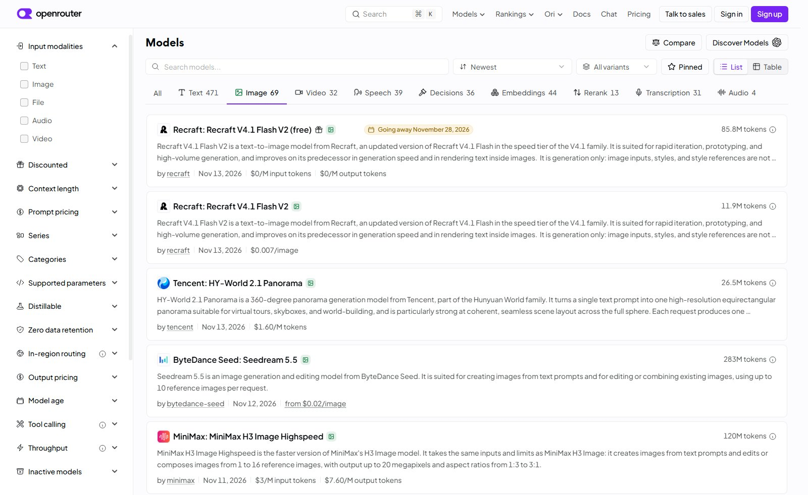

**OpenRouter is a single API that gives you access to image generation models from many companies, including Black Forest Labs, ByteDance, Google, OpenAI and Qwen, with one API key and one account balance.** This article builds a Layla Agent around OpenRouter's image generation API. When your AI character describes a picture in its reply, the Agent sends that description to OpenRouter, receives the finished image, and shows it in your chat.

Layla already generates images with Stable Diffusion models, either on your device or through Layla Cloud. An Agent adds another option: you choose the service, the model and the settings, and you use your own API key. [Nano Banana API in Layla](/how-to-use-the-google-nano-banana-image-generation-agent/) does this with one Google model. The OpenRouter Agent follows the same method, but switching to a model from a different company only means changing one line.

The article shows how to get an OpenRouter API key and set the Agent up, explains every step of the Agent's code, and lists the image models you can switch to.

Unlike Layla's local models, this Agent needs an internet connection. Your image description is sent to OpenRouter and the company that runs the model, and each image is paid for from your OpenRouter credits. If you chat with a local model, the rest of your conversation stays on your device.

<div class="file-download">
  <div class="file-download-info">
    <span class="file-download-label">Agent file</span>
    <span class="file-download-name">openrouter-generate-image.json</span>
    <span class="file-download-hint">You will need an OpenRouter API key before it works, which the article explains below.</span>
  </div>
  <a class="file-download-button" href="/assets/articles/how-to-use-the-openrouter-image-generation-agent/openrouter-generate-image.json" download="openrouter-generate-image.json"><svg viewBox="0 0 24 24" fill="none" stroke="currentColor" stroke-width="2" stroke-linecap="round" stroke-linejoin="round" aria-hidden="true"><path d="M12 4v11"/><path d="m7 10 5 5 5-5"/><path d="M5 20h14"/></svg>Download</a>
</div>

## Why use OpenRouter for image generation in Layla?

Layla's own Stable Diffusion models are the right choice when you want images generated entirely on your device. OpenRouter suits a different set of needs:

- **Many image models behind one key.** FLUX, Seedream, GPT Image, Nano Banana, Qwen Image, Grok Imagine and others all use the same request. You can try a new model without creating another account or rewriting the Agent.
- **Low prices per image.** At the time of writing, the model this Agent uses by default, FLUX 3 Image Klein, costs $0.009 for a 1K image. OpenRouter passes on the price of the company that runs the model and adds no markup to it.
- **A spending limit on the key.** OpenRouter lets you give each API key its own credit limit, so the key stored in your Agent can only ever spend what you allow.
- **Image quality that does not depend on your phone.** The picture is generated on a server, so the speed of your device's CPU or NPU does not limit the result or the wait.
- **A local chat model with cloud images.** The Agent only reacts to the character's reply, so it works with whichever model you chat with. You can keep a local LLM for the conversation, and only the image description leaves your phone.

## How the Agent works at a glance

The Agent uses the same four-step flow as every image generation Agent that works from chat:

```text
You ask for an image
  -> the character replies with a tagged image description
  -> the Agent's trigger spots the tag
  -> the Eval tool calls OpenRouter's API and saves the picture
  -> the Display Image tool shows it in the chat
```

1. **The system prompt asks the model for a tag.** The Agent tells your character's language model to write a detailed image description inside `<stable_diffusion_prompt></stable_diffusion_prompt>` tags whenever you ask for a picture.
2. **A trigger picks up the tag.** A regex trigger watches the model's replies. When it sees the tag, it captures the text inside and starts the Agent.
3. **A script calls the API.** The Agent's first tool runs a short JavaScript program. It sends the description to OpenRouter, receives the image, and saves it as a file.
4. **The image appears in the chat.** The second tool, _Display Image_, takes the saved file and shows it in the conversation.

The language model never talks to OpenRouter directly. It only writes text, and the Agent handles everything after that.

The tag is named `<stable_diffusion_prompt>` because that is the tag Layla's own image generation also listens for. This matters for setup, as explained below.

## What you need

- The _Agents_ mini-app installed. If you have not used Agents before, read [How to enable Agents, Functions, and Tool-calling in Layla](/how-to-enable-agents-functions-and-tool-calling-in-layla/) first.
- An OpenRouter account with credits, and an OpenRouter API key. The next section shows how.
- An internet connection.
- The Agent file, which is linked at the end of this article.

This Agent uses the _Eval_ tool, which is built into Layla. You do not need the Python Interpreter mini-app.

## How to get an OpenRouter API key

An API key is a long string of characters that identifies your OpenRouter account when the Agent sends a request. OpenRouter keys start with `sk-or-v1-`. Getting one takes a few minutes.

### Step 1: Create an OpenRouter account

Go to [openrouter.ai](https://openrouter.ai) and select **Sign up** at the top right. You can sign up with a GitHub or Google account, or with an email address and a password.


### Step 2: Add credits

OpenRouter is prepaid. Image models charge for every picture, so your account needs a balance before the Agent can generate anything.

Open the [Credits page](https://openrouter.ai/settings/credits) and buy credits. OpenRouter accepts major credit cards, AliPay, and USDC. It charges a fee of 5.5% on each card purchase, with a minimum fee of $0.80, so a small top-up is proportionally more expensive than a larger one. OpenRouter's [FAQ](https://openrouter.ai/docs/faq) lists the current fees, and states that unused credits may expire one year after purchase.

At the prices listed below, a few dollars of credits covers hundreds of images with the default model.

### Step 3: Open the API keys page

Open the [API keys page](https://openrouter.ai/settings/keys). In OpenRouter's settings sidebar, it is listed as _Keys_. The page lists the keys you already have, with when each was last used, how much it has spent, and its limit. Select **New key** at the top right.


### Step 4: Name the key and set a limit

The _Create API key_ dialog asks for three things:

- **Name**: a name you will recognise, such as "Layla".
- **Expiration**: when the key stops working. A key that expires is safer, but the Agent stops working on that date until you create a new key and paste it in.
- **Credit limit**: the most this key can spend. Under _Reset limit every_, you can make the limit reset daily, weekly or monthly, or leave it as a total.


OpenRouter recommends setting a credit limit on every key, and it is a good idea here. The key will be stored inside your Agent, and a limit means that a leaked key or a runaway Agent can only spend that amount. When a key reaches its limit, OpenRouter rejects its requests until you raise the limit or, for a daily, weekly or monthly limit, until it resets. A monthly limit of a few dollars is plenty for occasional images with the default model.

Select **Create**.

### Step 5: Copy the key

OpenRouter shows the new key once. Select the copy button next to it and keep the key somewhere safe, such as a password manager. As the dialog says, you will not be able to see it again. If you lose it, delete it on the API keys page and create a new one.


Treat the key like a password. Anyone who has it can generate images that are paid for with your credits. OpenRouter's [authentication guide](https://openrouter.ai/docs/api_reference/authentication) explains the key format and what to do if a key is exposed.

## Which OpenRouter image model should you use?

OpenRouter lists every model that can create images on its [models page, filtered by image output](https://openrouter.ai/models?output_modalities=image). Each entry shows the model's price and the date it was added.



Select a model to open its page. The model ID, which is the name the Agent needs, sits under the title with a copy button next to it. The page also shows the price and has a playground where you can try prompts before you use the model in Layla.


The Agent uses FLUX 3 Image Klein, an open-weights model from Black Forest Labs that is fast and inexpensive. These are some of the image models OpenRouter lists at the time of writing, with the price of a 1K image:

| Model                | Model ID                               | Price per 1K image | Notes                                                                      |
| -------------------- | -------------------------------------- | ------------------ | -------------------------------------------------------------------------- |
| FLUX 3 Image Klein   | `black-forest-labs/flux-3-image-klein` | $0.009             | The model this Agent uses. Supports 768 up to 4K.                          |
| Seedream 5.0 Flash   | `bytedance-seed/seedream-5-0-flash`    | $0.018             | ByteDance's fast model. Supports 1K and 2K.                                |
| Qwen Image 2.1 Turbo | `qwen/qwen-image-2.1-turbo`            | $0.0184            | The fast version of Qwen Image 2.1. Supports 1K and 2K.                    |
| Seedream 5.5         | `bytedance-seed/seedream-5-5`          | $0.02              | ByteDance's newest model. Higher resolutions cost $0.035.                  |
| Nano Banana 2.1      | `google/gemini-nano-banana-2.1`        | about $0.034       | Google's model, billed per token. Supports 1K, 2K and 4K.                  |
| FLUX 3 Image         | `black-forest-labs/flux-3-image`       | $0.048             | The larger FLUX 3 model. Higher resolutions cost more, up to $0.607 at 4K. |
| Nano Banana Pro      | `google/gemini-3-pro-image`            | about $0.134       | Google's premium model, billed per token.                                  |
| GPT Image 2          | `openai/gpt-image-2`                   | varies             | OpenAI's model, billed per token. The cost depends on size and quality.    |

Larger images cost more on most models. Some models, such as the GPT Image and Recraft models, do not accept the `resolution` setting the Agent sends. Others, such as the Recraft vector models, return SVG drawings instead of pictures, which _Display Image_ may not show. If you pick one of these, read the next paragraph.

To switch models, copy the model ID from its page, paste it into `MODEL_ID` in the script, and run the **Test** button. If the model returns an error, check which settings it supports. The code walkthrough below explains how to change or remove them. Prices and models change often, so check the model's page on OpenRouter before you choose.

## Set up the Agent in Layla

### Step 1: Turn off Layla's default image generation

Open your _Inference Settings_, scroll to the _Image Generation_ section, and select the image generation model. In the _Select Model_ list, choose **No Image Generation**.


Layla's built-in image generation reads the same `<stable_diffusion_prompt>` tag from a character's reply. If a model is still selected, Layla generates its own image from the tag and you receive two pictures. With _No Image Generation_ selected, the tag is left for the Agent. [How to enable image generation in Layla](/how-to-enable-image-generation-in-layla/) shows where this setting is.

### Step 2: Import the Agent

Download the Agent file at the end of this article. Open the _Agents_ mini-app and use the **Import** button at the top right to import it. The Agent is named _OpenRouter: generate image_, and its card lists the two tools it uses: _Eval_ and _Display Image_.

Make sure the switch at the top right of the Agent's card is on.

If you already use the [Nano Banana Agent](/how-to-use-the-google-nano-banana-image-generation-agent/) or another Agent that reacts to `<stable_diffusion_prompt>`, turn it off. Otherwise both Agents run on every image request, and you pay for two pictures.

### Step 3: Add your API key

Open the Agent with its **Edit** button and find the _Eval_ tool. Near the top of its code is this line:

```js
const API_KEY = "PUT YOUR API KEY HERE";
```

Replace `PUT YOUR API KEY HERE` with your key, and keep the quotation marks. Save the Agent.

Your key is now stored inside the Agent. Before you share or upload the Agent file anywhere, replace the key with the placeholder again.

### Step 4: Ask for an image

Start a chat and ask for a picture, for example "show me a lighthouse on a cliff at dusk". The character replies with an image description, the Agent runs, and the picture appears in the chat after a few seconds.

If something goes wrong, use the **Test** button in the Agents mini-app. It shows the input and output of every step, as described in [Deep dive into Layla Agents](/deep-dive-into-layla-agents/). You can also see every request, its model and its cost on OpenRouter's [Activity page](https://openrouter.ai/activity).

## How the Agent works, step by step

An Agent has three parts: a system prompt, a trigger, and a list of tools that run one after another. The output of each tool is the input of the next. [Deep dive into Layla Agents](/deep-dive-into-layla-agents/) covers these building blocks in general. This section follows the OpenRouter Agent through each of them.

### 1. The system prompt

The system prompt is an instruction that Layla adds to the conversation whenever the Agent is enabled:

```text
When the user asks you to generate, draw or create an image, write a detailed
description of the image (subject, setting, style, lighting, composition) inside
<stable_diffusion_prompt></stable_diffusion_prompt> tags, e.g.
<stable_diffusion_prompt>a lighthouse on a cliff at dusk, oil painting, warm
light</stable_diffusion_prompt>. The image is generated from the text inside the
tags and shown in the chat. Use the tags only when an image is requested, and
never put backticks inside them.
```

It is the same instruction the Nano Banana Agent uses, because it does not depend on the image service:

- **"When the user asks you to generate, draw or create an image"** limits the behaviour to image requests, so normal conversation is unaffected.
- **"A detailed description (subject, setting, style, lighting, composition)"** gives the model a checklist. Current image models such as FLUX 3 and Seedream understand full sentences, so a detailed description usually produces a better picture than a list of keywords.
- **The example** shows the exact tag format. Language models follow an example more reliably than a description of a format.
- **"Use the tags only when an image is requested"** stops the model from adding tags to every reply, which would start the Agent, and spend credits, each time.
- **"Never put backticks inside them"** protects the script. The code walkthrough below explains why.

### 2. The trigger

The Agent has one trigger, a _Regex trigger_ that runs on the model's **output** instead of your input. Its pattern is:

```text
/<stable_diffusion_prompt>(.*?)<\/stable_diffusion_prompt>/s
```

- The opening and closing tags match the literal tags.
- `(.*?)` is a capture group. It collects everything between the tags, and the `?` makes it stop at the first closing tag.
- The `s` flag lets the description span several lines.

The text captured by the group becomes available to the Agent as `{{match$1}}`. Whatever the model writes between the tags is handed to the first tool.

### 3. The Eval tool: calling the API

The first tool is _Eval_. It runs JavaScript in a sandboxed runtime inside Layla. The runtime has `fetch` for web requests and a global object called `layla` that gives scripts access to Layla's features, such as saving files. It does not have a browser page or Node.js modules.

Eval returns the value of the script's last expression and waits for it if it is a promise. The last line of the script, `generateImage(PROMPT);`, starts the work.

#### Settings at the top

```js
const API_KEY = "PUT YOUR API KEY HERE";
const PROMPT = String.raw`{{match$1}}`.trim();

const MODEL_ID = "black-forest-labs/flux-3-image-klein";
const RESOLUTION = "1K";
const ASPECT_RATIO = "";
const API_URL = "https://openrouter.ai/api/v1/images";
const TIMEOUT_MS = 90000;
```

Everything you might want to change sits in one place:

- `API_KEY` is your key.
- `PROMPT` is the description the model wrote. Before the script runs, Layla replaces `{{match$1}}` with the captured text, so the description becomes part of the program. It is wrapped in a template literal with `String.raw` so that backslashes are kept as typed, and `.trim()` removes stray spaces and line breaks. A backtick or the characters `${` inside the description would end the literal early and break the script, which is why the system prompt forbids backticks.
- `MODEL_ID` is the model to use, copied from its page on OpenRouter.
- `RESOLUTION` is the size of the picture. OpenRouter accepts `'512'`, `'768'`, `'1K'`, `'1.5K'`, `'2K'` and `'4K'`, and each model supports some of them. Set it to `''` for models that do not accept a resolution, such as GPT Image.
- `ASPECT_RATIO` is the shape of the picture, for example `'9:16'` for a tall picture that fills a phone screen or `'16:9'` for a wide one. When it is `''`, the model uses its default.
- `API_URL` is OpenRouter's image generation endpoint. It is the same for every model.
- `TIMEOUT_MS` is how long to wait before giving up: 90 seconds. Some models take longer than others, especially at large sizes.

The rest of the script lives in a function called `generateImage`. It receives the description as a parameter named `prompt`, and the last line of the script calls it with `PROMPT`.

#### Check the inputs

```js
if (!prompt) throw new Error("The stable diffusion prompt was empty.");
if (!API_KEY || API_KEY === "PUT YOUR API KEY HERE")
  throw new Error("Set API_KEY in this agent first.");
```

The script fails early, with a readable message, when there is nothing to send or the key has not been set. When a script throws an error, the Agent stops and no image appears. The **Test** button shows the message.

#### Build the request

```js
const payload = { model: MODEL_ID, prompt };
if (RESOLUTION) payload.resolution = RESOLUTION;
if (ASPECT_RATIO) payload.aspect_ratio = ASPECT_RATIO;
```

The payload is the data sent to OpenRouter. Only `model` and `prompt` are required. The script adds `resolution` and `aspect_ratio` only when they have a value, because not every model accepts every setting.

OpenRouter's [image generation guide](https://openrouter.ai/docs/guides/overview/multimodal/image-generation) lists the other settings you can add to the payload, such as `seed` to repeat a result, `quality` for the GPT Image models, and `output_format` to choose between PNG, JPEG and WebP. Each model's page shows which of them it supports.

#### Send the request with a time limit

```js
const controller = new AbortController();
const timer = setTimeout(() => controller.abort(), TIMEOUT_MS);
let response;
let body;
try {
  response = await fetch(API_URL, {
    method: "POST",
    headers: {
      "Content-Type": "application/json",
      Authorization: `Bearer ${API_KEY}`,
    },
    body: JSON.stringify(payload),
    signal: controller.signal,
  });
  body = await response.text();
} catch (error) {
  if (controller.signal.aborted)
    throw new Error(`Image generation timed out after ${TIMEOUT_MS / 1000} s.`);
  throw new Error(`Image generation request failed: ${error.message}`);
} finally {
  clearTimeout(timer);
}
```

This is the part that talks to OpenRouter:

- `fetch` sends a `POST` request with the payload converted to JSON text.
- The API key travels in the `Authorization` header as a bearer token, which is the format OpenRouter expects. It is not part of the web address.
- The `AbortController` and the timer cancel the request after 90 seconds. Without them, a stalled connection would leave the Agent waiting.
- The `catch` block tells a timeout apart from other network failures, so the error message says which one happened. The `finally` block clears the timer in both cases.

OpenRouter only charges for images that are completed. A generation that fails or times out is not billed.

#### Check the response status

```js
if (!response.ok) {
  throw new Error(
    `HTTP error ${response.status} ${response.statusText}. Response body: ${body.slice(0, 500)}`,
  );
}
```

When OpenRouter rejects a request, it explains why in the response body. The script includes the first 500 characters of that explanation in the error, so a wrong key, an empty balance, a reached credit limit, or a setting the model does not support shows up as a clear message when you use the **Test** button.

#### Find the image in the response

```js
let data;
try {
  data = JSON.parse(body);
} catch (error) {
  throw new Error(`The response was not JSON: ${body.slice(0, 200)}`);
}

for (const image of data.data || []) {
  if (!image || !image.b64_json) continue;
  // ...save the image
}
```

OpenRouter answers every image request in the same format, whichever model made the picture:

```json
{
  "created": 1748372400,
  "data": [{ "b64_json": "<base64-encoded-image>", "media_type": "image/png" }],
  "usage": { "cost": 0.009 }
}
```

The script first turns the response text into an object, and stops with a message if the text is not valid JSON. In that object, `data` is a list of images. Each one carries the picture as base64 text, which is a way of writing binary data as plain characters, and a `media_type` such as `image/png` or `image/jpeg`. The script takes the first image in the list. The `|| []` guard keeps it from crashing when the list is missing. The `usage` field reports what the request cost.

This shared format is the main advantage of OpenRouter for an Agent. The script reads the same fields for FLUX, Seedream, Nano Banana or GPT Image, so changing `MODEL_ID` is enough to switch between them.

#### Save the image

```js
const mediaType = String(image.media_type || "image/png");
const extension =
  mediaType
    .split("/")
    .pop()
    .split("+")[0]
    .replace(/[^a-z0-9]/gi, "") || "png";
const id = Math.random().toString(16).slice(2, 10).padEnd(8, "0");
const path = `generated-images/output_image_${id}.${extension}`;

await layla.utils.saveFile(path, image.b64_json);
return path;
```

- The file extension comes from the image type that OpenRouter reports, with a fallback to `png`.
- A random eight-character ID gives every picture its own file name, so a new image never overwrites an earlier one in your chat history.
- `layla.utils.saveFile` writes the file into the character's private workspace folder. The path is relative to that folder, and any missing folders are created automatically. The function expects base64 text, which is what OpenRouter sends, so the data is saved without conversion.
- The function returns the path. That path is the output of the tool.

#### Report a failure clearly

```js
const detail =
  data.error && data.error.message
    ? data.error.message
    : `Response keys: ${Object.keys(data).join(", ")}`;
throw new Error(`No image was found in the response. ${detail}`);
```

If the loop finishes without finding an image, for example because the model's safety filter refused the request, the script reports OpenRouter's error message or the fields the response contained. This makes unusual failures much easier to diagnose.

### 4. The Display Image tool

The second tool is _Display Image_, and its only setting is:

```text
{{input}}
```

`{{input}}` is replaced with the output of the previous tool, which is the file path that the script returned. _Display Image_ opens that file from the character's workspace and attaches it to the reply, and the picture appears in the chat.

## Make your AI character's images consistent

A language model writes each image description from scratch, so without guidance a character can look different from one picture to the next. These approaches keep AI character images consistent and let you decide how often pictures appear:

- **Describe the character once.** In the character's _Scenario_, add an instruction such as: "Whenever you write a `<stable_diffusion_prompt>`, begin with this description of yourself: a woman in her late twenties with short red hair, green eyes and freckles. Then describe the scene." The model repeats the appearance in every prompt, which helps the image model draw the same character each time.
- **Fix the art style.** Add a style to the same instruction, for example "35mm film photograph, natural light" or "watercolor illustration".
- **Generate an image after every message.** Add an instruction to the _Scenario_ to end each reply with the tag, as in [Creating an image generation Agent](/creating-an-image-generation-agent/). Every reply then comes with a picture, which suits AI roleplay and storytelling. Each picture is paid for, so this costs more than asking for images on request. A low-cost model such as FLUX 3 Image Klein keeps the cost down.
- **Use reference images.** Most image models on OpenRouter also accept reference images through the `input_references` setting, which helps a character keep the same face. OpenRouter's description of FLUX 3 Image Klein lists multi-reference editing that keeps characters consistent across images. This Agent sends text only, so adding a reference image to the request is a good next project.

## Use the same pattern for other Agents

The system prompt, the regex trigger, and the _Display Image_ step stay the same for any image service. Only the script changes, which is why this Agent and the [Nano Banana Agent](/how-to-use-the-google-nano-banana-image-generation-agent/) differ only in their request and response handling. A few ideas build on it:

- **Keep two versions.** Duplicate the Agent, give each copy a different `MODEL_ID`, and turn on the one you want. Only one should be enabled at a time, because both react to the same tag.
- **Ask the model for more than a description.** The system prompt can request a few fields instead of free text, for example a short JSON object with a `prompt` and an `aspect_ratio`. The script then reads the fields from the captured text. Keep the placeholder inside a string literal, as the Agent does with `PROMPT`, and parse the text in your own code.
- **Control where your prompt goes.** OpenRouter can restrict a request to providers that do not train on your data. Add `payload.provider = { data_collection: 'deny' };` to the script, or set the same preference for your whole account on OpenRouter's [privacy settings page](https://openrouter.ai/settings/privacy). If no provider of the model meets the condition, the request fails with an error.
- **Do something other than images.** Choose a different tag, let _Eval_ call a different API, and finish with the _Provide Context_ tool so the character can talk about the result. The [Brave Search Agent](/how-to-create-a-brave-search-agent/) is an example of this flow.

## Frequently asked questions

### How do I get an OpenRouter API key?

Create an account at [openrouter.ai](https://openrouter.ai), add credits on the Credits page, then open the API keys page and select **New key**. Give the key a name, an expiration and a credit limit, and copy it when it is shown, because OpenRouter shows it only once.

### Is OpenRouter image generation free?

Creating an account and a key is free, but image models charge for each picture, so you need credits. At the time of writing, FLUX 3 Image Klein costs $0.009 for a 1K image. OpenRouter occasionally lists a free image model for a limited time, marked "(free)" on the models page.

### How much does OpenRouter image generation cost?

Each model has its own price, shown on its page. At the time of writing, prices for a 1K image range from under one cent for FLUX 3 Image Klein to about $0.134 for Nano Banana Pro. OpenRouter adds no markup to model prices but charges a fee when you buy credits.

### Can I use Nano Banana through OpenRouter?

Yes. Set `MODEL_ID` to `google/gemini-3-pro-image` for Nano Banana Pro or `google/gemini-nano-banana-2.1` for Nano Banana 2.1. If you would rather pay Google directly, use the [Nano Banana Agent](/how-to-use-the-google-nano-banana-image-generation-agent/) instead.

### Why did I get two images?

Either Layla's built-in image generation is still enabled, or another Agent that reacts to `<stable_diffusion_prompt>` is turned on. Select _No Image Generation_ in the Inference Settings and turn off other image Agents.

### The Agent says "Set API_KEY in this agent first."

The key placeholder is still in the script. Open the Agent, edit the _Eval_ tool, and replace `PUT YOUR API KEY HERE` with your key.

### The Agent shows an HTTP error. What does it mean?

The message includes OpenRouter's own explanation. A 401 error means the key is wrong, deleted or expired. A 402 error means your balance or the key's credit limit has run out. A 400 error usually means the model does not accept one of the settings, such as the resolution. Check the model's page and change `RESOLUTION` or `ASPECT_RATIO`.

### Does OpenRouter filter images?

Each company applies its own content policy to its models, and a request that a model declines returns no picture. The Agent then reports the error it received. For image generation that happens entirely on your device, use the local Stable Diffusion models described in [How to enable image generation in Layla](/how-to-enable-image-generation-in-layla/).

### Is my prompt private?

The image description is sent to OpenRouter and to the company that runs the model you chose. OpenRouter states that it does not log prompts by default, and the provider's own data policy applies to what it receives. If you chat with a local model, the rest of your conversation stays on your device.

### Can I use this Agent without an internet connection?

No. The Agent calls OpenRouter's servers. For offline image generation, use one of the local models described in [How to enable image generation in Layla](/how-to-enable-image-generation-in-layla/).

## Conclusion

The OpenRouter Agent uses the same four pieces as any image generation Agent in Layla: a system prompt that asks for a tagged description, a regex trigger that catches it, a short script that exchanges the description for an image, and _Display Image_ to put the result in your chat. Because OpenRouter answers in the same format for every model, one script gives your characters access to dozens of image models, and switching between them is a one-line change.

Layla's local models remain the choice for fully offline image generation. This Agent is an option for when you prefer a particular online model and accept the connection and the cost.

## Download the Agent

<div class="file-download">
  <div class="file-download-info">
    <span class="file-download-label">Agent file</span>
    <span class="file-download-name">openrouter-generate-image.json</span>
    <span class="file-download-hint">Use the <em>Import</em> button in the Agents mini-app to import it, then add your API key.</span>
  </div>
  <a class="file-download-button" href="/assets/articles/how-to-use-the-openrouter-image-generation-agent/openrouter-generate-image.json" download="openrouter-generate-image.json"><svg viewBox="0 0 24 24" fill="none" stroke="currentColor" stroke-width="2" stroke-linecap="round" stroke-linejoin="round" aria-hidden="true"><path d="M12 4v11"/><path d="m7 10 5 5 5-5"/><path d="M5 20h14"/></svg>Download</a>
</div>
