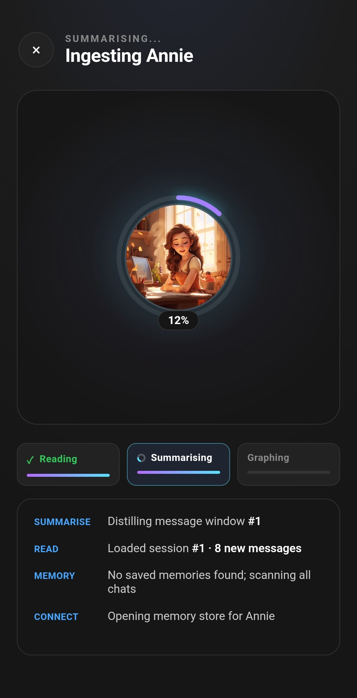

**Layla è un chatbot IA con memoria a lungo termine che funziona sul tuo telefono, e può trasformare le tue conversazioni in ricordi in tre modi: un riassuntore integrato che funziona dopo ogni risposta, un Agent che chiede al tuo modello di chat di scrivere ricordi ogni poche risposte e una mini-app che elabora la cronologia delle chat con un LLM quando glielo chiedi.** Tutti e tre salvano nello stesso archivio Long-Term Memory, quindi il tuo compagno IA o personaggio di gioco di ruolo richiama i ricordi allo stesso modo, indipendentemente dal metodo che li ha creati.

I metodi scambiano velocità con qualità. Questo articolo spiega perché i chatbot IA dimenticano, come funziona ciascun metodo, quanto costa e come configurarlo, così puoi sceglierne uno per ogni personaggio.

## Perché i chatbot IA dimenticano e cosa cambia la memoria a lungo termine

Un modello linguistico non ricorda nulla da un messaggio all'altro. Ogni volta che risponde, rilegge la conversazione dalla sua finestra di contesto, che contiene solo una quantità limitata di testo. Quando una chat supera questo limite, i messaggi più vecchi non ci stanno più e l'IA dimentica il tuo nome, i piani che avete fatto o cosa è successo prima in una storia.

La memoria a lungo termine aggira questo limite. Layla salva brevi ricordi delle tue conversazioni, li cerca mentre chatti e aggiunge quelli rilevanti al contesto del modello prima che risponda. Il personaggio può così ricordare qualcosa di settimane prima senza che l'intera cronologia della chat debba stare nella finestra di contesto. Ogni personaggio ha i propri ricordi, quindi un compagno IA, un personaggio di gioco di ruolo e un assistente ricordano ciascuno le proprie conversazioni con te.

Layla archivia e cerca questi ricordi sul tuo dispositivo. Con un LLM locale, le tue chat e i tuoi ricordi restano sui tuoi dispositivi: ottieni un chatbot IA privato che si ricorda di te, senza che un'azienda conservi le tue conversazioni sui suoi server.

## Tre modi per dare una memoria a lungo termine alla tua IA

|                            | Raccolta automatica integrata             | Agent Auto-collect Memories                      | Mini-app LLM-based Long-term Memory             |
| -------------------------- | ----------------------------------------- | ------------------------------------------------ | ----------------------------------------------- |
| **Cosa scrive il ricordo** | Un piccolo modello di riassunto integrato | Il tuo modello di chat                           | Il motore di inferenza che scegli               |
| **Quando funziona**        | Dopo ogni risposta, in automatico         | Ogni 3 risposte, in automatico                   | Solo quando tocchi **Start ingesting memories** |
| **Lingue**                 | Solo inglese                              | Qualsiasi lingua gestita dal tuo modello di chat | Qualsiasi lingua gestita dal modello scelto     |
| **Qualità**                | Riassunti di base                         | Buona: il personaggio scrive le proprie note     | Massima: controlli tu i prompt                  |
| **Velocità**               | Veloce, nessun effetto sulla chat         | Aggiunge una chiamata al modello ogni 3 risposte | Lenta, ma funziona fuori dalle chat             |
| **Personalizzazione**      | Nessuna                                   | Modifica il prompt nel codice dell'Agent         | Prompt di sistema e istruzione per personaggio  |

Tutti e tre richiedono la mini-app **Long Term Memory**, che archivia i ricordi e scarica i modelli che li cercano. È nella mini-app che attivi o disattivi la memoria per ogni personaggio. [Come aggiungere funzionalità (mini-app) in Layla](/it/how-to-add-features-mini-apps-in-layla/) mostra dove trovarla.

## Metodo 1: raccolta automatica integrata, veloce e automatica

Questo è ciò che Layla fa per impostazione predefinita una volta installata la mini-app Long Term Memory, ed è il modo più semplice per avere un'IA che ricorda le conversazioni.

Dopo ogni risposta del personaggio, Layla prende gli ultimi tre messaggi della chat e li passa a un piccolo modello di riassunto integrato nella mini-app. Il riassunto, i messaggi originali e un semplice grafo delle persone e delle cose citate vengono salvati come un unico ricordo. Questo avviene in background sul tuo dispositivo. Non usa il tuo modello di chat, quindi non rallenta la conversazione e non compete con essa per la memoria.

I limiti derivano da quel piccolo modello:

- **Capisce solo l'inglese.** Le chat in altre lingue producono riassunti scadenti o privi di senso. Se chatti in un'altra lingua, usa uno degli altri due metodi.
- **I riassunti sono brevi e letterali.** Il modello condensa ciò che è stato detto; non decide cosa conta. Le chiacchiere vengono salvate come un evento importante.
- **Non c'è nulla da configurare**, oltre ad attivarlo o disattivarlo per ogni personaggio.

### Come attivarla o disattivarla

1. Apri la mini-app **Long Term Memory**.
2. Seleziona il personaggio in **Characters**.
3. In **Per character settings**, usa **Auto-collect memories for this character**.

**Enable LTM for this character** è un interruttore separato. Controlla se il personaggio usa o meno la Long-Term Memory, incluso il richiamo dei ricordi in chat. Puoi disattivare la raccolta automatica e lasciare attiva la LTM, ciò che serve agli altri due metodi.

## Metodo 2: l'Agent Auto-collect Memories, ricordi con le parole del personaggio

L'Agent **Auto-collect Memories** chiede al tuo personaggio di tenere le proprie note, come dovrebbe fare un compagno IA con memoria: è lui a decidere cosa vale la pena ricordare di te. Ogni 3 risposte del personaggio, mette in pausa il gioco di ruolo e chiede al modello di chat cosa il personaggio vorrebbe ricordare di quei turni: fatti su di te, eventi importanti, promesse o piani e come si sente il personaggio. Il modello vede l'intera conversazione e gli ultimi ricordi del personaggio, quindi può saltare i dettagli già salvati.

L'Agent poi:

- conserva al massimo 3 ricordi per ogni esecuzione,
- scarta tutto ciò che il modello ha valutato sotto 3 su una scala di importanza da 1 a 5,
- salva il resto nella Long-Term Memory, scritto in prima persona con la voce del personaggio, e
- mostra una scheda **Saved to memory** sotto la risposta del personaggio, così vedi cosa è stato conservato.

Poiché è il modello a scrivere i ricordi, sono migliori dei riassunti integrati. Seguono il significato della conversazione anziché le sue parole, mantengono la voce del personaggio, cosa importante nel gioco di ruolo con IA, e funzionano in qualsiasi lingua gestita dal tuo modello. Il costo è la velocità: dopo ogni terza risposta c'è una richiesta aggiuntiva al modello e la scheda del ricordo compare solo quando quella richiesta termina. Se usi un'API a pagamento tramite una [connessione compatibile con OpenAI](/it/how-to-connect-layla-to-any-openai-compatible-api/), quella richiesta consuma anche token.

### Come configurarlo

1. Installa la mini-app **Agents** se non l'hai ancora fatto. [Come attivare Agenti, funzioni e chiamate agli strumenti in Layla](/it/how-to-enable-agents-functions-and-tool-calling-in-layla/) spiega come.
2. Apri le impostazioni del personaggio e associa l'Agent **Auto-collect Memories** nel selettore degli Agent nella scheda **Advanced**. [Come creare un personaggio IA personalizzato in Layla](/it/how-do-i-create-custom-characters/) mostra dove si trova il selettore. Un Agent associato a un personaggio viene eseguito per quel personaggio anche se è disattivato nella mini-app Agents.
3. Nella mini-app **Long Term Memory**, disattiva **Auto-collect memories for this character** per lo stesso personaggio. Se funzionano entrambi, ogni conversazione viene raccolta due volte.
4. Chatta come al solito. Dopo 3 risposte compare la prima scheda **Saved to memory**.

I personaggi Layla predefiniti non usano un elenco di Agent associati; usano ogni Agent attivo nella mini-app Agents. Per usare questo metodo con loro, attiva invece l'Agent Auto-collect Memories nella mini-app Agents. Cercando "memor" nella mini-app Agents lo trovi subito.

### Cambiare ciò che l'Agent ricorda

Tocca **Edit** sulla scheda dell'Agent per aprirlo. La finestra di dialogo inizia con il suo ID, il nome e la descrizione, che ripete il consiglio di configurazione qui sopra.

Il prompt è la prima cosa nel codice dello strumento Eval dell'Agent, più in basso nella finestra. Puoi riscriverlo, per esempio per concentrarti sui fatti e ignorare i sentimenti, purché alla fine mantenga il formato JSON richiesto. Sotto il prompt ci sono le impostazioni per la frequenza di esecuzione (`COLLECT_EVERY_N_REPLIES`), il numero di ricordi conservati a ogni esecuzione (`MAX_MEMORIES`) e l'importanza minima conservata (`MIN_IMPORTANCE`).

Se il salvataggio di un ricordo fallisce, per esempio perché la mini-app Long Term Memory non è installata, l'Agent smette di provare per 24 ore. Ogni esecuzione scrive un log in `auto-collect-memories/last-run.log` nello spazio di lavoro del personaggio, il primo posto da controllare se non compare alcuna scheda.

## Metodo 3: la mini-app LLM-based Long-term Memory, la memoria di qualità più alta

La mini-app **LLM-based Long-term Memory** elabora la cronologia delle chat in un passaggio separato, quando scegli di eseguirla. Usa un LLM a tua scelta, locale o online, per scrivere ogni ricordo e costruire un grafo della conoscenza delle persone, dei luoghi e degli eventi nelle tue chat. Offre la qualità più alta e il maggior controllo, al prezzo di essere lenta e manuale.

È pubblicata su Layla Cloud Apps, la galleria di mini-app create con l'SDK di Layla. Per installarla, apri la [pagina LLM-based Long-term Memory su Layla Cloud Apps](https://apps.layla-cloud.com/app/llm-based-long-term-memory) sul telefono e tocca **Open in Layla**. Serve anche la mini-app Long Term Memory, perché questa salva lì i suoi risultati.

Quando avvii un'acquisizione, la mini-app:

1. **Legge** le chat del personaggio, partendo dopo il ricordo più recente che il personaggio ha già, così elabora solo i nuovi messaggi.
2. **Riassume** i messaggi in finestre sovrapposte di tre, inviando ogni finestra al modello con il tuo prompt di riassunto.
3. **Costruisce il grafo** di ogni riassunto, chiedendo al modello di estrarre persone, luoghi, eventi, tratti e oggetti e le loro relazioni.
4. **Salva** ogni risultato come ricordo con i messaggi originali, il riassunto e il grafo.

### Scrivere i tuoi prompt

Ogni personaggio ha le proprie impostazioni, salvate tra un'esecuzione e l'altra:

- **Inference engine.** Scegli uno dei tuoi [motori di inferenza salvati](/it/how-saved-inference-engines-work-in-layla/) o il motore predefinito. Poiché l'acquisizione funziona fuori dalle chat, puoi scegliere un LLM locale più grande o più lento di quello con cui chatti, oppure un modello online se preferisci.
- **Summarising conversations.** Un **System prompt** e una **Custom instruction** che decidono cosa deve contenere un ricordo. Quello predefinito chiede al modello di conservare fatti duraturi, sentimenti, relazioni e svolte, e di ignorare le chiacchiere. Puoi cambiarlo per concentrarti su qualsiasi cosa: la trama e i personaggi di una storia per un gioco di ruolo, o i tuoi progetti e le scadenze per un assistente.
- **Constructing the knowledge graph.** Un secondo prompt di sistema e un'istruzione per estrarre il grafo. Mantieni il formato JSON richiesto dall'istruzione predefinita.

Entrambi i prompt di sistema accettano i modelli `{{char}}`, `{{user}}`, `{{persona}}`, `{{description}}`, `{{personality}}` e `{{character_card}}`, che vengono compilati dal personaggio e dalla sua persona prima di ogni richiesta.

### Eseguire un'acquisizione

Tocca **Start ingesting memories**. La schermata mostra ogni fase man mano che procede e puoi annullare con il pulsante **X**.

Ogni finestra di messaggi richiede due richieste al modello, quindi una lunga cronologia di chat può richiedere molto tempo su un telefono. Tieni Layla in primo piano mentre funziona. Eseguila di nuovo quando vuoi elaborare nuove conversazioni; non c'è alcuna pianificazione.

### Disattivare i metodi automatici per il personaggio

La mini-app inizia a leggere dopo il ricordo più recente del personaggio. Se per quel personaggio funziona anche la raccolta automatica integrata o l'Agent, il ricordo più recente è sempre recente e la mini-app trova poco o nulla di nuovo da elaborare. Disattiva entrambi per ogni personaggio che acquisisci in questo modo.

## Quale metodo usare?

- **La raccolta automatica integrata** se chatti in inglese e vuoi che la memoria funzioni senza configurazione né effetti sulla velocità. Va bene per un assistente quotidiano che deve solo ricordare il succo delle chat passate.
- **L'Agent Auto-collect Memories** se chatti in un'altra lingua, o vuoi ricordi che catturino ciò che contava anziché ciò che è stato detto, e puoi accettare una risposta un po' più lenta ogni tre turni. Va bene per un compagno o amico IA che deve ricordare te, i tuoi piani e cosa prova per te.
- **La mini-app LLM-based Long-term Memory** se vuoi i ricordi migliori e il pieno controllo su ciò su cui si concentrano, e non ti dispiace eseguirla tu stesso, per esempio una volta al giorno. Va bene per lunghe campagne di gioco di ruolo con IA, dove un prompt personalizzato può seguire la trama, i personaggi e il mondo.

Puoi scegliere un metodo diverso per ogni personaggio. Usa un solo metodo alla volta per personaggio.

## Domande frequenti

### Perché il mio chatbot IA dimentica le cose?

Ogni modello ha una finestra di contesto limitata. Quando una conversazione è più lunga di quella finestra, i messaggi più vecchi vengono lasciati fuori e il modello non può più vederli. La memoria a lungo termine salva le parti importanti di quei messaggi e le riporta quando sono rilevanti.

### Esiste un chatbot IA che ricorda le conversazioni passate?

Sì. Layla ricorda le conversazioni passate con ogni personaggio tramite la mini-app Long-Term Memory, e lo fa sul tuo telefono anziché su un server. I metodi di questo articolo controllano come vengono scritti quei ricordi.

### Layla ricorda tutto ciò che dico?

No. Salva ricordi delle tue conversazioni, poi richiama solo quelli che corrispondono a ciò di cui stai parlando ora. Le impostazioni **Max Number of Memory Injections** e **Minimum Memory Score** nella mini-app Long Term Memory controllano quanti ricordi vengono richiamati e quanto devono corrispondere.

### I ricordi di metodi diversi funzionano insieme?

Sì. Tutti e tre salvano nello stesso archivio Long-Term Memory e il richiamo in chat funziona allo stesso modo per tutti. Puoi passare un personaggio da un metodo a un altro senza perdere ciò che ricorda già.

### Perché i ricordi del mio personaggio sono in inglese quando chatto in un'altra lingua?

Il riassuntore integrato capisce solo l'inglese. Usa l'Agent Auto-collect Memories o la mini-app LLM-based Long-term Memory, che usano un modello linguistico in grado di scrivere i ricordi nella lingua della tua chat.

### La memoria a lungo termine funziona offline?

Sì, con un modello locale. Tutti e tre i metodi funzionano sul tuo dispositivo, quindi puoi avere un chatbot IA offline con memoria e senza connessione a internet.

### Tutto questo invia le mie chat a internet?

Non a meno che tu scelga un modello online. Se il tuo modello di chat o il motore di acquisizione è un'API online, l'Agent e la mini-app inviano i tuoi messaggi a quel servizio, come già fanno le tue chat.

### Posso modificare o eliminare un ricordo?

Sì. Apri la mini-app **Long Term Memory**, seleziona il personaggio e apri un ricordo per modificarne il riassunto e le relazioni o per eliminarlo.

Qualunque metodo scelga, i ricordi restano sul tuo telefono e i tuoi personaggi possono richiamarli nelle chat successive senza servizi cloud né abbonamenti. Questo è ciò che significa memoria a lungo termine in Layla: un'IA offline che si ricorda di te, su hardware che possiedi.
