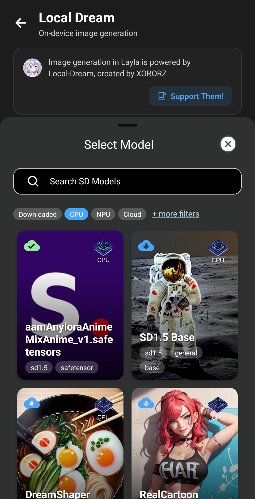

**NPU Forge è una mini-app di Layla che converte un checkpoint safetensors di Stable Diffusion in un modello QNN, il formato eseguito dalla NPU Qualcomm degli smartphone Snapdragon.** Scegli un file `.safetensors`, Layla verifica che possa essere convertito e la conversione viene eseguita sul tuo telefono. Al termine, il modello compare in Local Dream, pronto per generare immagini.

Layla può già importare direttamente un checkpoint safetensors, come descritto in [Come importare i modelli Safetensor SD1.5 da Civit.ai in Layla](/how-to-import-sd1-5-safetensor-models-from-civit-ai-into-layla/). Quel percorso crea un modello che gira sulla CPU del dispositivo. NPU Forge aggiunge un secondo percorso per i telefoni con un chip Snapdragon compatibile: lo stesso checkpoint, convertito in modo che l'immagine venga generata sulla NPU, che è più veloce.

Questo articolo spiega che cosa serve, come convertire un checkpoint passo dopo passo, quanto tempo richiede e come generare immagini con il risultato. Sia la conversione sia la generazione delle immagini avvengono sul tuo dispositivo, quindi non viene caricato nulla.

## Che cosa converte NPU Forge

NPU Forge funziona con due tipi di checkpoint:

- **Stable Diffusion 1.5 (SD 1.5)**, la famiglia di checkpoint più diffusa su Civitai.
- **Stable Diffusion XL (SDXL)**, la famiglia più grande, che produce immagini da 1024 x 1024.

Non devi dire a Layla quale famiglia hai scelto. Legge il file e riconosce da solo la famiglia. I modelli vengono convertiti per la risoluzione standard di ciascuna famiglia: 512 x 512 per SD 1.5 e 1024 x 1024 per SDXL.

Alcuni checkpoint non possono essere convertiti. I modelli SD 2.x, i modelli di inpainting e i modelli SDXL refiner non sono supportati. Layla te lo segnala prima di iniziare, così non perdi tempo con un file che non funzionerebbe.

## Che cosa ti serve

- Un telefono Android con un chip Qualcomm Snapdragon dotato di NPU. NPU Forge mostra un messaggio in cima alla schermata se Layla non riconosce il tuo chip.
- Uno Snapdragon 8 Gen 3 o più recente se vuoi convertire checkpoint SDXL. SD 1.5 funziona su una gamma più ampia di chip Snapdragon.
- Android 13 o successivo.
- La mini-app _NPU Forge_, che scarica circa 216 MB di strumenti di conversione. Se non hai mai installato una mini-app, consulta [Come attivare o disattivare le mini-app in Layla](/how-to-enable-disable-mini-apps-within-layla/).
- La mini-app _Local Dream_, cioè l'app che usi per generare le immagini. Scarica anche il runtime NPU di cui hanno bisogno i modelli convertiti. NPU Forge può convertire un modello anche senza, ma il modello non verrà eseguito finché Local Dream non avrà scaricato quei file.
- Un checkpoint `.safetensors` salvato sul telefono.
- Spazio di archiviazione e memoria liberi. La sezione successiva riporta i valori.

NPU Forge esiste solo per Android. La mini-app non è disponibile su iOS perché la NPU a cui si rivolge è una funzionalità di Qualcomm.

## Archiviazione, memoria e tempi

La conversione è impegnativa. Layla misura il tuo telefono prima di iniziare e ti avvisa se le risorse sembrano scarse. Questi sono i valori approssimativi che consiglia, che comprendono un margine per Android e le tue altre app:

|                                 | SD 1.5         | SDXL            |
| ------------------------------- | -------------- | --------------- |
| Memoria (RAM)                   | circa 5 GB     | circa 8 GB      |
| Spazio di archiviazione libero  | circa 3 GB     | circa 23 GB     |
| Tempo su uno Snapdragon 8 Elite | circa 2 minuti | circa 22 minuti |

Il valore dello spazio di archiviazione viene misurato dopo che Layla ha copiato il checkpoint nel proprio spazio, quindi ti serve quello spazio libero oltre al checkpoint stesso. Un chip più lento impiega più tempo di quanto indicato sopra.

L'avviso è un consiglio, non un blocco. Se il telefono non ha risorse sufficienti, puoi comunque avviare la conversione, ma potrebbe esaurire memoria o spazio a metà strada e fallire.

## Come convertire un checkpoint safetensors

### Passaggio 1: procurati un checkpoint

Scarica sul telefono un checkpoint SD 1.5 o SDXL. Su [Civitai](https://civitai.com/), filtra per **Model Type: Checkpoint**, **File format: SafeTensor** e il **Base Model** che desideri.

Conserva il file dopo averlo scaricato. NPU Forge converte il file `.safetensors` originale, non un modello che hai già importato in Layla. Se lo hai importato in precedenza tramite **Aggiungi modello personalizzato**, ti serve comunque il file originale.

### Passaggio 2: apri NPU Forge

Apri la mini-app NPU Forge da _Le mie app_. Esiste anche una scorciatoia: su un telefono con una NPU Qualcomm supportata, la schermata **Aggiungi modello personalizzato** nelle Impostazioni di inferenza mostra un avviso che suggerisce di convertire i safetensors per una generazione di immagini più veloce. Toccandolo si apre NPU Forge in Sfoglia le app, dove puoi installarla.

Se la schermata mostra un messaggio come _Risorse di NPU Forge mancanti_, gli strumenti di conversione non sono ancora stati scaricati. Scaricali prima dalla pagina della mini-app.

### Passaggio 3: seleziona il checkpoint

Tocca **Select a safetensors checkpoint** («Seleziona un checkpoint safetensors») e scegli il file. Layla lo copia nel proprio spazio di archiviazione e lo analizza. La copia dei file di grandi dimensioni richiede un po' di tempo.

Se scegli un file che non termina con `.safetensors`, Layla lo rifiuta.

### Passaggio 4: leggi il modello rilevato

Quando l'analisi termina, una scheda **Modello rilevato** mostra che cosa ha trovato Layla:

- la famiglia del modello, SD 1.5 o SDXL;
- il numero di pesi e la dimensione del file;
- se sono state trovate le tre parti principali del modello: la UNet, il codificatore di testo CLIP e il VAE;
- un'etichetta **Convertible** («convertibile») oppure **Not convertible** («non convertibile»).

Se l'etichetta indica _Not convertible_, la scheda ne spiega il motivo, per esempio che mancano parti richieste del modello. In tal caso scegli un altro checkpoint.

Se hai scelto un checkpoint SDXL e il tuo telefono ha un chip più vecchio, Layla segnala che SDXL richiede uno Snapdragon 8 Gen 3 o più recente e il pulsante **Start conversion** resta disattivato.

### Passaggio 5: aggiungi i LoRA (facoltativo)

Un LoRA è un piccolo file aggiuntivo che cambia lo stile di un modello o gli insegna un personaggio o un concetto. NPU Forge può unire i LoRA al tuo modello durante la conversione.

1. Tocca **Add a LoRA** («Aggiungi un LoRA») e scegli un file LoRA `.safetensors`.
2. Imposta la sua intensità. Il valore predefinito è 1,0. Valori più bassi applicano il LoRA in modo più debole.
3. Ripeti per altri LoRA. Vengono applicati nell'ordine dell'elenco.
4. Tocca l'icona del cestino accanto a un LoRA per rimuoverlo.

I LoRA vengono incorporati nel modello. Non puoi disattivarli né cambiarne l'intensità in seguito. Per usare una combinazione diversa, converti di nuovo il checkpoint con i LoRA che desideri. Viene unita solo la parte di un LoRA che agisce sul modello di immagine vero e proprio, e alcuni formati di LoRA potrebbero non essere supportati.

### Passaggio 6: dai un nome al modello

Layla propone il nome del file del checkpoint. Puoi modificarlo. Il nome non deve coincidere con quello di una cartella di modello esistente e i caratteri non consentiti dai file system, come `/` e `:`, vengono sostituiti con spazi.

### Passaggio 7: avvia la conversione

Tocca **Start conversion** («Avvia conversione»). Compare una schermata di avanzamento a tutto schermo che indica la fase corrente, per esempio _Estrazione dei pesi_ o _Compilazione per la NPU_, insieme alla parte del modello in elaborazione.

Tieni presente quanto segue mentre è in corso:

- **Non può essere annullata né spostata in background.** Tieni Layla aperta in primo piano.
- **Collega il telefono al caricabatterie.** La fase più lunga può durare molti minuti, soprattutto per SDXL.
- Durante la conversione viene mostrata una notifica, in modo che Android non interrompa il processo.
- Lo schermo può oscurarsi. Non è un problema.

La conversione trasforma il codificatore di testo, poi quantizza e compila la UNet per la NPU. Per SD 1.5 fa lo stesso con il VAE. Per SDXL, Layla usa un VAE condiviso incluso in NPU Forge invece di convertire il VAE contenuto nel checkpoint, quindi il VAE di un checkpoint SDXL non influisce sul risultato.

### Passaggio 8: completamento

Quando la conversione termina, Layla mostra **Conversione completata**. Il modello viene salvato tra i tuoi modelli di generazione di immagini e selezionato automaticamente, e la copia temporanea del checkpoint viene eliminata. Il file originale non viene toccato.

Se la conversione fallisce, Layla mostra un errore e rimuove qualsiasi risultato parziale, così il nome resta disponibile per un nuovo tentativo.

## Genera immagini con il modello convertito

Apri la mini-app **Local Dream**. Il modello convertito è già selezionato. Per passare a un altro modello, sceglilo dall'elenco dei modelli.

Inserisci un prompt e tocca **Genera**.

Layla imposta valori iniziali per ciascuna famiglia: 30 passi e una scala CFG di 7 per SD 1.5, 20 passi e una scala CFG di 4 per SDXL. Puoi modificare entrambi in Local Dream e il modello convertito mantiene lo stile del checkpoint originale, compresi gli eventuali LoRA che hai unito.

Se il chip del tuo telefono non corrisponde a ciò che serve al modello, Local Dream mostra un avviso sopra **Genera**. Puoi comunque provare a generare, ma potrebbe non riuscire.

I modelli convertiti funzionano anche quando i tuoi personaggi generano immagini in chat, perché sono normali voci dell'elenco dei modelli di generazione di immagini. Consulta [Come attivare la generazione di immagini in Layla](/how-to-enable-image-generation-in-layla/) per scegliere un modello per ogni personaggio.

## Domande frequenti

### Devo convertire un checkpoint per usarlo in Layla?

No. Layla può importare direttamente un file safetensors ed eseguirlo sulla CPU. La conversione con NPU Forge è l'opzione da scegliere quando hai una NPU Snapdragon supportata e vuoi una generazione più veloce.

### Posso convertire un modello che ho già importato in Layla?

Non direttamente. NPU Forge legge il file `.safetensors` originale. Se ce l'hai ancora, selezionalo in NPU Forge. Se lo hai eliminato, scaricalo di nuovo.

### Posso convertire un modello SD 2.x, di inpainting o SDXL refiner?

No. Sono supportati solo i checkpoint SD 1.5 e di tipo SDXL base.

### Perché NPU Forge dice che il mio telefono non ha una NPU Qualcomm?

Layla lo stabilisce in base al chipset indicato dal telefono. I telefoni con altri chip, come MediaTek o Samsung Exynos, non possono eseguire modelli QNN, quindi NPU Forge non può essere usato su di essi.

### La conversione richiede una connessione a Internet?

Solo per scaricare all'inizio le mini-app e i loro file. La conversione vera e propria viene eseguita sul telefono e il checkpoint resta lì.

### Posso interrompere una conversione a metà?

No. NPU Forge non può annullare né spostare in background una conversione, quindi avviala quando puoi lasciare il telefono in pace, idealmente collegato al caricabatterie.

### Posso cambiare l'intensità di un LoRA dopo la conversione?

No. Le intensità vengono fissate al momento della conversione. Converti di nuovo il checkpoint originale con i nuovi valori e un nuovo nome di modello.

### Come elimino un modello convertito?

Apri Local Dream, seleziona il modello e usa l'opzione di eliminazione. In questo modo si libera lo spazio occupato dal modello.

### Dove posso trovare più controllo sulla conversione?

NPU Forge in Layla usa impostazioni predefinite sensate, adatte alla maggior parte dei checkpoint. Se vuoi opzioni come il clip skip e diverse precisioni del VAE, consulta il progetto originale su [GitHub](https://github.com/AbrahamPaulJ/npuforge).

## Crediti

NPU Forge è stato creato da AbrahamPaulJ e la mini-app rimanda al [progetto originale su GitHub](https://github.com/AbrahamPaulJ/npuforge). La generazione di immagini in Layla è basata su [Local Dream](https://github.com/xororz/local-dream), creato da XORORZ.
