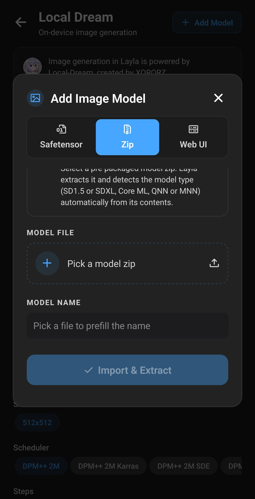
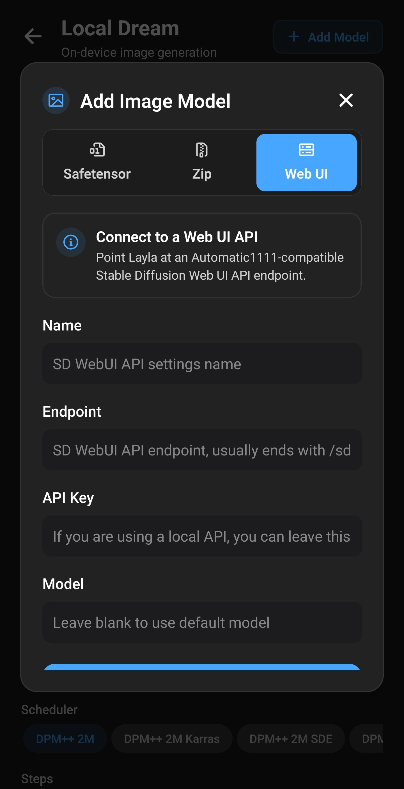

**Layla importa modelli d'immagini personalizzati, inclusi checkpoint Stable Diffusion da Civitai, in tre modi: file safetensors o GGUF convertiti sul dispositivo, zip già preparati o connessione a Stable Diffusion Web UI sul PC.** I modelli importati da file generano offline su Android o iPhone. Il metodo dipende dalla famiglia del modello e dal chip.

La guida presenta schermata, metodi, modelli compatibili e ruolo della mini-app facoltativa NPU Forge. L'importazione avviene interamente sul dispositivo; i file scelti non vengono caricati altrove.

Per usare solo i modelli già offerti, consulta [Attivare la generazione d'immagini](/it/how-to-enable-image-generation-in-layla/).

## Perché importare un modello personalizzato

Layla offre modelli pronti, ma [Civitai](https://civitai.com/) e [Hugging Face](https://huggingface.co/) ospitano molti più checkpoint della comunità, fotorealistici, anime e per illustrazioni, e LoRA per personaggi, abiti o stili specifici. Importarli permette di andare oltre la lista integrata.

I modelli importati funzionano in Local Dream, il generatore locale di Layla. Tutto rimane sul dispositivo:

- **Offline.** Dopo l'importazione non servono Internet, account o abbonamento.
- **Privato.** Prompt e immagini restano sul telefono senza controlli di servizi online.
- **Flessibile.** Testo-immagine e, per la maggior parte dei tipi, immagine-immagine. Anche i personaggi possono usarli in chat.

## Importare un modello personalizzato in Layla

Due percorsi aprono la stessa schermata **Add Image Model**:

- **Settings** → **Inference Settings** → **Image Generation** → **Add Custom Model**.
- In **Local Dream**, tocca **Add Model** in alto.

Local Dream esegue la generazione locale ed è necessaria per tutti i metodi tranne Web UI. Installala prima: [Attivare o disattivare le mini-app](/it/how-to-enable-disable-mini-apps-within-layla/). Se è obsoleta, Layla richiede di aggiornarla prima di importare.

Sono disponibili fino a tre schede: **Safetensor**, **Zip**, **Web UI**. Al termine il modello viene salvato e selezionato automaticamente. Tieni Layla aperta: importazioni grandi richiedono diversi minuti.

## I tre metodi d'importazione

|               | Safetensor                                     | Zip                        | Web UI                  |
| ------------- | ---------------------------------------------- | -------------------------- | ----------------------- |
| Cosa fornisci | Checkpoint `.safetensors` o `.gguf` su Android | Zip preparato per Layla    | Indirizzo API Web UI    |
| Cosa fa Layla | Converte in un modello locale                  | Estrae e riconosce il tipo | Salva la connessione    |
| Dove genera   | Sul dispositivo                                | Sul dispositivo            | Sul computer con Web UI |
| Piattaforme   | Android e iOS (iOS solo SD 1.5)                | Android e iOS              | Android e iOS           |
| Fonte tipica  | [Civitai](https://civitai.com/) e Hugging Face | Pacchetti preconvertiti    | Il tuo PC               |

## Quali modelli d'immagini supporta Layla?

Su Android, **Base Model** nella scheda Safetensor indica come convertire il file. Scegli la famiglia su cui è stato addestrato il checkpoint.

| Base           | Risultato                                                | Esecuzione     | Piattaforme   |
| -------------- | -------------------------------------------------------- | -------------- | ------------- |
| SD 1.5         | Modello locale unico con LoRA incorporati                | CPU            | Android e iOS |
| SDXL           | Modello GGUF Q4_0, LoRA applicati durante la generazione | NPU Snapdragon | Android       |
| MOSS           | Modello di diffusione GGUF Q4_0                          | NPU Snapdragon | Android       |
| Qwen Image 2.1 | Modello di diffusione GGUF Q4_0                          | NPU Snapdragon | Android       |
| Flux 2 Klein   | Modello di diffusione GGUF Q4_0                          | NPU Snapdragon | Android       |

Alcune precisazioni:

- **SD 1.5** è diffusissimo su Civitai ed è l'unica famiglia importabile su iOS. Usa la CPU di quasi tutti i telefoni recenti.
- **SDXL, MOSS, Qwen Image 2.1 e Flux 2 Klein** usano lo stesso motore NPU dei modelli integrati. Serve Snapdragon 8 Elite (SM8750) o successivo. Layla non avverte sul chip durante l'importazione: controllalo prima.
- **MOSS, Qwen Image 2.1 e Flux 2 Klein** riutilizzano tokenizer, codificatore di testo e VAE del modello integrato corrispondente, da scaricare prima. Consulta i [pacchetti di base](#models-that-need-a-base-model-first).
- **Z-Image Turbo, Krea 2 Turbo e gli altri modelli NPU integrati** non compaiono in Base Model. Puoi scaricarli in Local Dream, ma non importare checkpoint personalizzati di quelle famiglie.

Civitai indica il modello di base sulla pagina. Controllalo prima del download: Layla non esamina il file per confermare la famiglia e una scelta errata può far fallire importazione o generazione.

## Importare un checkpoint safetensors o GGUF

1. Scarica il checkpoint sul telefono. Su Civitai filtra **Model Type: Checkpoint**, **File format: SafeTensor** e il **Base Model** desiderato. Vedi l'[esempio SD 1.5 illustrato](/it/how-to-import-sd1-5-safetensor-models-from-civit-ai-into-layla/).
2. Apri **Add Image Model** → **Safetensor**.
3. Su Android scegli **Base Model**. Su iOS la lista non appare perché è disponibile solo SD 1.5.
4. Scegli il file in **MODEL CHECKPOINT**. Sono accettati `.safetensors` e, su Android, `.gguf`.
5. Controlla **MODEL NAME**, compilato dal nome del file e modificabile.
6. Aggiungi eventuali LoRA, descritti sotto.
7. Tocca **Import & Convert**.

Se non serve conversione, come per GGUF o importazioni di soli LoRA, il pulsante indica **Import**. Layla mostra avanzamento di copia e conversione, poi elimina le copie temporanee. Il download originale rimane dov'è.

### File GGUF

Su Android puoi scegliere un modello di diffusione `.gguf` al posto di safetensors. Layla lo copia senza convertirlo, quindi importa più velocemente. Scegli la famiglia corretta per usare i giusti file di supporto.

### LoRA

Un LoRA è un piccolo file aggiuntivo che cambia stile o insegna un personaggio o concetto. In **LORA FILES (OPTIONAL)** tocca **Add LoRA**, scegli `.safetensors` e imposta l'intensità (1.0 iniziale). Puoi aggiungerne diversi.

Il modo di applicarli dipende dalla famiglia:

- **SD 1.5**: incorporati nel modello convertito, non più modificabili o rimovibili.
- **SDXL, MOSS, Qwen Image 2.1 e Flux 2 Klein**: copiati nella cartella e applicati durante la generazione.

### Modelli che richiedono prima un modello di base

MOSS, Qwen Image 2.1 e Flux 2 Klein usano i file di supporto di un modello già scaricato in Local Dream. Se mancano, Safetensor avverte e disattiva l'importazione. Scarica prima:

| Base Model     | Download in Local Dream               |
| -------------- | ------------------------------------- |
| MOSS           | MOSS-Image Turbo o MOSS-Image Base    |
| Qwen Image 2.1 | Qwen Image 2.1 o Qwen Image 2.1 Turbo |
| Flux 2 Klein   | FLUX.2 Klein 4B                       |

Per queste tre famiglie, **LoRA only** crea un modello usando la base già scaricata e solo i tuoi LoRA, senza checkpoint. Risparmia tempo e spazio della conversione completa.

## Importare uno zip

La scheda **Zip** serve per modelli già convertiti e preparati per Layla. Scegli il file, controlla il nome e tocca **Import & Extract**.

Layla estrae lo zip e riconosce il tipo dal contenuto:

- pacchetto Core ML: SD 1.5 Core ML su iOS;
- SDXL con file MNN: SDXL CPU;
- SDXL con file QNN: SDXL NPU;
- pacchetto ANIMA: ANIMA NPU;
- pacchetto con QNN: SD 1.5 NPU;
- altrimenti: SD 1.5 CPU.

L'ultimo caso è un ripiego: zip non preparati per Layla possono essere importati ma fallire in generazione. Usa fonti affidabili che indichino la compatibilità Local Dream. I pacchetti QNN sono specifici per chip Snapdragon: verifica quali supportano prima di scaricare.

## Collegare Web UI

Se usi [AUTOMATIC1111 Stable Diffusion Web UI](https://github.com/AUTOMATIC1111/stable-diffusion-webui) sul PC, la scheda **Web UI** collega Layla a quell'istanza. Le immagini vengono calcolate sul computer: serve una connessione di rete e non è un metodo offline.

Compila:

- **Name**: un nome riconoscibile.
- **Endpoint**: indirizzo API, solitamente termina con `/sdapi/v1/text2img`.
- **API Key**: vuoto per API locale.
- **Model**: vuoto per usare il modello predefinito della Web UI.

Tocca **Save & Select**. [Attivare la generazione](/it/how-to-enable-image-generation-in-layla/) spiega la configurazione della Web UI.

## Accelerare Stable Diffusion sulla NPU Snapdragon con NPU Forge

Gli import SD 1.5 safetensors usano la CPU. Con chip Qualcomm Snapdragon compatibile, **NPU Forge** converte lo stesso checkpoint in QNN per usare la NPU, l'acceleratore IA di Qualcomm, più veloce.

NPU Forge è una mini-app separata solo Android. Gestisce SD 1.5 e SDXL, può incorporare LoRA e aggiunge il risultato a Local Dream. Su chip compatibili, Safetensor mostra un collegamento. La [guida NPU Forge](/it/how-to-convert-safetensors-to-qnn-with-npu-forge-in-layla/) descrive passaggi e requisiti di memoria e spazio.

## Dopo l'importazione

Apri Local Dream: il nuovo modello è selezionato. Puoi cambiarlo dalla lista in alto. Gli import partono da 20 passaggi e CFG 5; Flux 2 Klein da 4 e CFG 1. Puoi modificare entrambi. Modelli addestrati per pochi passaggi richiedono spesso valori più bassi.

Due azioni sono disponibili per il modello selezionato:

- **Model setup**, per gli import sul motore nuovo (SDXL, MOSS, Qwen Image 2.1 e Flux 2 Klein), permette di vedere e modificare file, campionatore e LoRA.
- **Delete Model** rimuove il modello e libera spazio.

I modelli importati compaiono anche nella lista dei personaggi. [Attivare la generazione](/it/how-to-enable-image-generation-in-layla/) spiega come assegnare un modello per ciascuno.

## Domande frequenti

### Posso usare Stable Diffusion offline su Android?

Sì, tramite Local Dream sulla CPU della maggior parte dei telefoni o sulla NPU Snapdragon compatibile. Dopo il download del modello, non serve Internet.

### Posso eseguire SDXL sul telefono?

Sì, su Android con Snapdragon 8 Elite (SM8750) o successivo. Scegli **SDXL** in Safetensor per convertirlo per la NPU. Puoi anche importare pacchetti **Zip** preconvertiti o usare NPU Forge sui chip compatibili.

### Stable Diffusion funziona su iPhone?

Sì, con SD 1.5: safetensors dalla scheda **Safetensor**, pacchetti Core ML da **Zip**. Le altre famiglie sono solo Android.

### Posso usare modelli Civitai sul telefono?

Sì, se il checkpoint safetensors è di una famiglia supportata. Filtra **Checkpoint**, **SafeTensor** e **SD 1.5** o **SDXL**, scarica e importa da **Safetensor**.

### Cos'è un file safetensors?

È un formato per i pesi di modelli di apprendimento automatico, usato dalla maggior parte dei checkpoint Stable Diffusion e LoRA su Civitai. Sostituisce `.ckpt` e, diversamente da questo, non può contenere codice eseguibile: uno dei motivi della sua diffusione.

### Che differenza c'è tra checkpoint e LoRA?

Il checkpoint è un modello completo. Il LoRA è un piccolo componente che modifica lo stile o insegna un soggetto; funziona solo con checkpoint della stessa base. Scegli prima il checkpoint, poi i LoRA.

### Posso usare LoRA in Layla?

Sì. In **Safetensor** aggiungine uno o più, con intensità individuale. Per SD 1.5 sono incorporati; per SDXL, MOSS, Qwen Image 2.1 e Flux 2 Klein sono applicati durante la generazione.

### Serve Snapdragon per importare modelli?

No. SD 1.5 viene importato ed eseguito sulla CPU di quasi tutti i telefoni Android recenti e iPhone. Snapdragon serve solo ai modelli NPU, incluse conversioni NPU Forge e import Android SDXL, MOSS, Qwen Image 2.1 e Flux 2 Klein.

### Posso importare qualsiasi modello Stable Diffusion?

No. Sono supportati SD 1.5 e SDXL, più MOSS, Qwen Image 2.1 e Flux 2 Klein su Android. Altre famiglie, come SD 2.x, non compaiono in Base Model.

### Serve Internet per importare?

Solo per installare mini-app e scaricare eventuali basi. La conversione è locale. Web UI fa eccezione: richiede accesso al PC mentre generi.

### Perché manca Base Model sul mio iPhone?

iOS importa solo safetensors SD 1.5: non c'è nulla da scegliere. Zip accetta anche pacchetti Core ML.

### Il modello importato userà la NPU?

Gli import SD 1.5 safetensors usano la CPU. Per SD 1.5 o SDXL su NPU usa NPU Forge. Gli import Android SDXL, MOSS, Qwen Image 2.1 e Flux 2 Klein già usano la NPU e richiedono Snapdragon 8 Elite o successivo.

### Posso cambiare LoRA dopo l'import SD 1.5?

No, sono incorporati nel modello. Reimporta il checkpoint originale con LoRA e intensità desiderati e un nuovo nome.

### Perché devo aggiornare Local Dream?

L'importazione dipende dai file di conversione inclusi nella mini-app. Aggiornala dalla schermata delle mini-app e riprova.

### Come rimuovo un modello importato?

Apri Local Dream, seleziona il modello e tocca **Delete Model**.

### Dove trovo modelli da importare?

La maggior parte è su [Civitai](https://civitai.com/) e [Hugging Face](https://huggingface.co/). Controlla la base sulla pagina prima di scaricare: determina il metodo d'importazione.

## Riconoscimenti

La generazione usa [Local Dream](https://github.com/xororz/local-dream), creato da XORORZ. NPU Forge è stato creato da AbrahamPaulJ.
