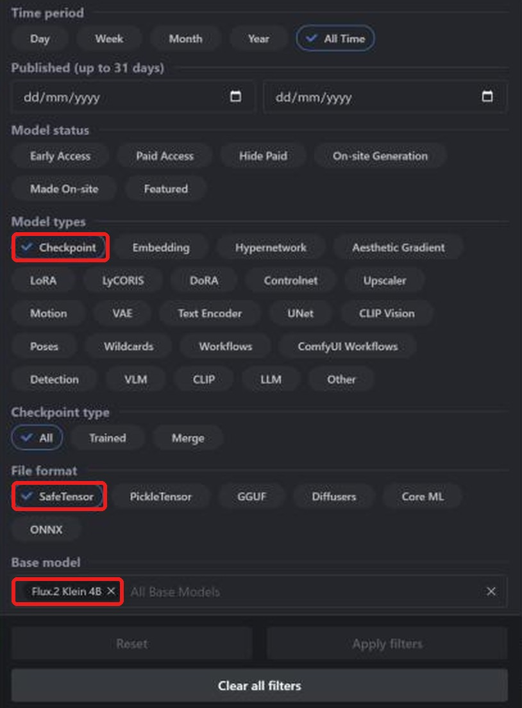
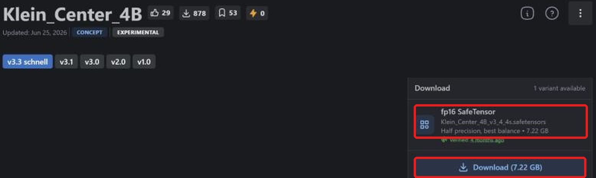
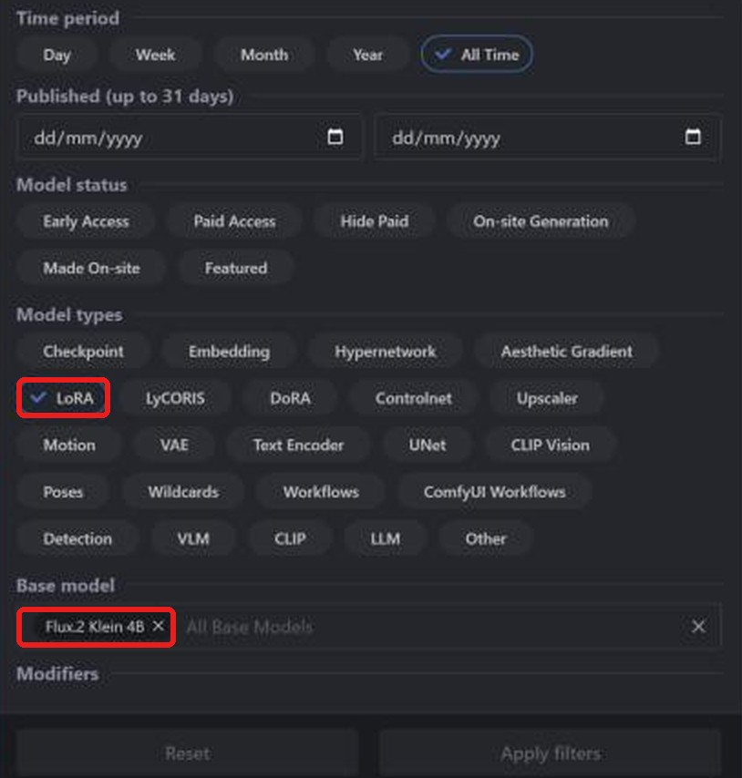
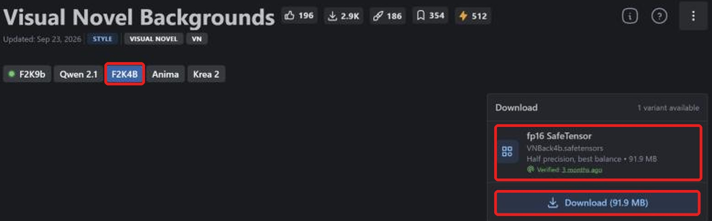

**Layla importa checkpoint safetensors e LoRA FLUX.2 Klein 4B da Civitai per generare offline su Android.** Questo modello testo-immagine compatto ha versioni affinate e LoRA su [Civitai](https://civitai.com/). Il checkpoint viene convertito sul dispositivo; dopo il download non serve Internet.

La guida spiega ricerca, download corretto, importazione e aggiunta di LoRA. Per altre famiglie: [SD 1.5](/it/how-to-import-sd1-5-safetensor-models-from-civit-ai-into-layla/), [SDXL](/it/how-to-import-sdxl-safetensor-models-from-civitai-into-layla/), [MOSS Image](/it/how-to-import-moss-image-safetensor-models-from-civitai-into-layla/), [Qwen Image 2.1](/it/how-to-import-qwen-image-2-1-safetensor-models-from-civitai-into-layla/). Per GGUF, zip e Web UI consulta [Importare modelli di generazione immagini personalizzati in Layla](/it/how-to-import-custom-image-generation-models-into-layla/).

## Che cos'è FLUX.2 Klein?

FLUX.2 [klein] è una famiglia di Black Forest Labs, creatrice di FLUX. Il modello 4B ha circa 4 miliardi di parametri ed è distillato per generare in circa 4 passaggi. Esiste anche un modello 9B più grande.

Civitai distingue **Flux.2 Klein 4B** e **Flux.2 Klein 9B**. **Flux 2 Klein** di Layla è basato su 4B: filtra **Flux.2 Klein 4B**. Un LoRA Klein 4B richiede un checkpoint Klein 4B.

## Requisiti

- Telefono Android con Snapdragon 8 Elite (SM8750) o successivo. Gli import FLUX.2 Klein usano la NPU Snapdragon e non sono disponibili su iPhone. Layla non verifica il chip all'importazione: controllalo prima di convertire file grandi.

- Mini-app **Local Dream**. Per installarla consulta [Attivare o disattivare le mini-app in Layla](/it/how-to-enable-disable-mini-apps-within-layla/).

- Un modello integrato già scaricato in Local Dream: **FLUX.2 Klein 4B**. Layla ne riutilizza tokenizer, codificatore di testo e VAE. Se mancano, Safetensor mostra un avviso e disattiva l'importazione.

- Spazio per il checkpoint: Klein 4B fp16 è circa 7 GB.

## Quale file safetensors scaricare

**Layla supporta safetensors f16 (mezza precisione)**, etichettati **fp16 SafeTensor** su Civitai. Per FLUX.2 Klein accetta anche bf16. I file quantizzati **fp8**, **int8**, **int4** e **nvfp4** non sono supportati.

Sono accettati anche bf16, incluso il checkpoint ufficiale FLUX.2 Klein 4B. Molti checkpoint Klein sono fp8, più piccoli ma incompatibili. Controlla il download.

## Importare un checkpoint FLUX.2 Klein da Civitai

### Passaggio 1: aprire Civitai e Models

Apri [civitai.com](https://civitai.com/) e scegli **Models** nella navigazione superiore. Le schermate provengono da browser desktop; sul telefono la disposizione può cambiare leggermente.

### Passaggio 2: filtrare Checkpoint, SafeTensor e Flux.2 Klein 4B

Apri **Filters** in alto a destra:

1. **Model types**: **Checkpoint**.
2. **File format**: **SafeTensor**.
3. **Base model**: cerca e seleziona **Flux.2 Klein 4B**.

La lista mostra i checkpoint FLUX.2 Klein nel formato adatto. [Apri la lista filtrata](https://civitai.com/models?types=Checkpoint&fileFormats=SafeTensor&baseModels=Flux.2%20Klein%204B&sort=Most%20Downloaded).

### Passaggio 3: scaricare il file safetensors fp16

Apri il modello e controlla **Download** a destra. Scegli **fp16 SafeTensor**, qui 7.22 GB, poi **Download** per salvarlo sul telefono. Se esistono più varianti, scegli fp16. Le eccezioni bf16 supportate sono spiegate sopra.

Serve solo il checkpoint. I **Required Components** di Civitai, come codificatore di testo e VAE, servono ad altri strumenti. Layla usa i file di supporto del modello di base già scaricato in Local Dream.

### Passaggio 4: importare in Layla

Apri **Settings** → **Inference Settings** → **Image Generation** → **Add Custom Model**, oppure **Local Dream** → **Add Model**.

In **Safetensor**, seleziona **Flux 2 Klein** in **Base Model**.

In **MODEL CHECKPOINT** scegli il file, controlla **MODEL NAME** e tocca **Import & Convert**. Layla converte in un modello di diffusione GGUF Q4_0. Può richiedere diversi minuti: tieni l'app aperta. Il modello viene salvato e selezionato automaticamente.

Layla non esamina il file per confermare la famiglia. Scegliere **Flux 2 Klein** per un checkpoint diverso può far fallire importazione o generazione.

### Passaggio 5: generare un'immagine

Apri **Local Dream**, verifica il modello e scrivi un prompt. Klein è pensato per pochi passaggi: Layla parte da 4 e CFG 1. Puoi modificare entrambi.

## Aggiungere un LoRA FLUX.2 Klein da Civitai

Un LoRA è un piccolo file che modifica lo stile o insegna un personaggio, oggetto o concetto. Si cerca come un checkpoint, cambiando il tipo di modello.

### Passaggio 1: filtrare LoRA e Flux.2 Klein 4B

Apri **Models** → **Filters**, scegli **LoRA** in **Model types** e **Flux.2 Klein 4B** in **Base model**. [Apri la lista filtrata](https://civitai.com/models?types=LORA&fileFormats=SafeTensor&baseModels=Flux.2%20Klein%204B&sort=Most%20Downloaded). Il pannello è lo stesso usato per i checkpoint.

### Passaggio 2: scaricare il LoRA safetensors

La pagina può aprirsi su **F2K9b**, per il modello 9B. Passa a **F2K4B** per 4B, verifica **fp16 SafeTensor**, qui 91,9 MB, e tocca **Download**.

### Passaggio 3: aggiungere il LoRA durante l'importazione

In **Safetensor** scegli **Flux 2 Klein** come **Base Model** e il checkpoint. In **LORA FILES (OPTIONAL)** → **Add LoRA** scegli file e intensità, inizialmente 1.0. Puoi aggiungerne diversi. Infine usa **Import & Convert**.

Per FLUX.2 Klein i LoRA vengono copiati nella cartella e applicati durante la generazione. Dopo l'importazione seleziona il modello in Local Dream e **Model setup** per vedere o modificare file, campionatore e LoRA.

### Usare un LoRA senza importare un checkpoint intero

Per FLUX.2 Klein, attiva **LoRA only** in **Safetensor**. Crei un modello dalla base già scaricata in Local Dream e dai LoRA, saltando il checkpoint e risparmiando tempo e spazio di conversione.

## Domande frequenti

### Posso usare FLUX.2 Klein sul telefono?

Sì, rispettando i requisiti sopra. Scegli **Flux 2 Klein** come **Base Model** e importa il checkpoint Civitai. Le famiglie che riutilizzano una base richiedono prima il suo download in Local Dream.

### Quale file FLUX.2 Klein scarico da Civitai?

**fp16 SafeTensor**, oppure bf16. Evita fp8, int8, int4 e nvfp4.

### Posso importare FLUX.2 Klein 9B?

L'opzione Flux 2 Klein di Layla è basata su 4B. Usa **Flux.2 Klein 4B** per checkpoint e LoRA.

### Posso importare FLUX.1?

No. È una famiglia diversa e non compare in Base Model.

### Posso importare FLUX.2 Klein su iPhone?

No. iOS importa solo safetensors SD 1.5. Vedi la guida SD 1.5 collegata all'inizio.

### Serve Internet per importare da Civitai?

Solo per scaricare i file. Conversione e generazione avvengono sul dispositivo.

### Come elimino un modello importato?

Apri **Local Dream**, seleziona il modello e tocca **Delete Model** per liberare spazio.

## FLUX.2 Klein offline sul telefono

Dopo l'importazione, FLUX.2 Klein funziona sul telefono senza Internet, account o abbonamento. Prompt, modello e immagini restano sul dispositivo.
