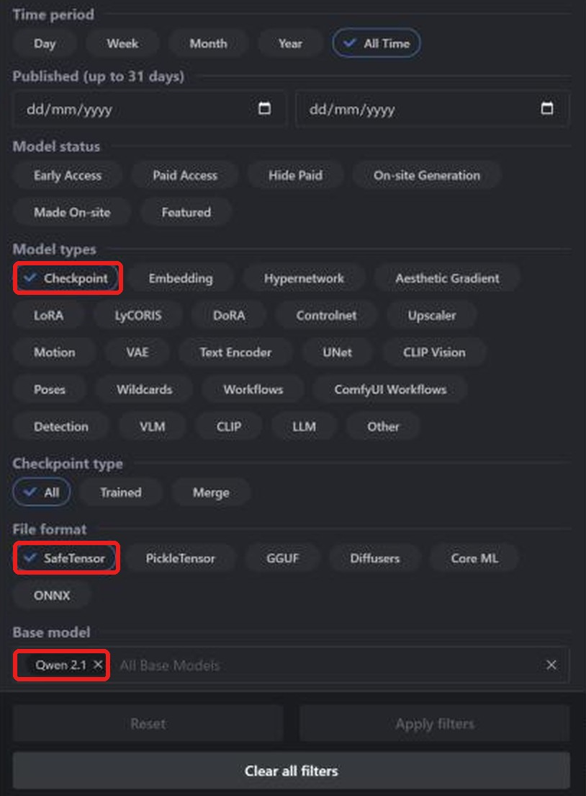
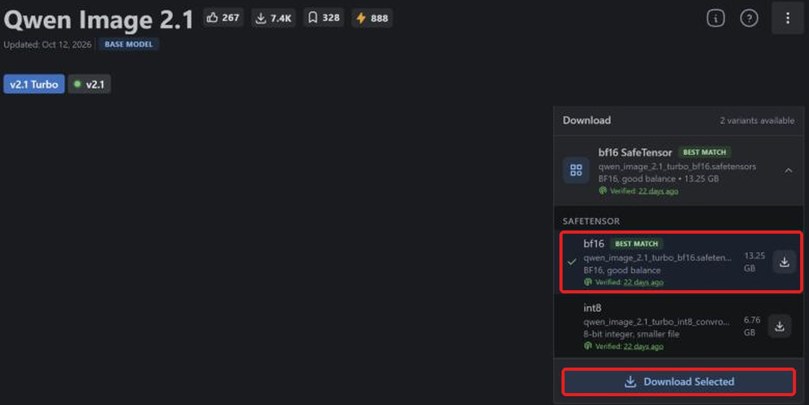
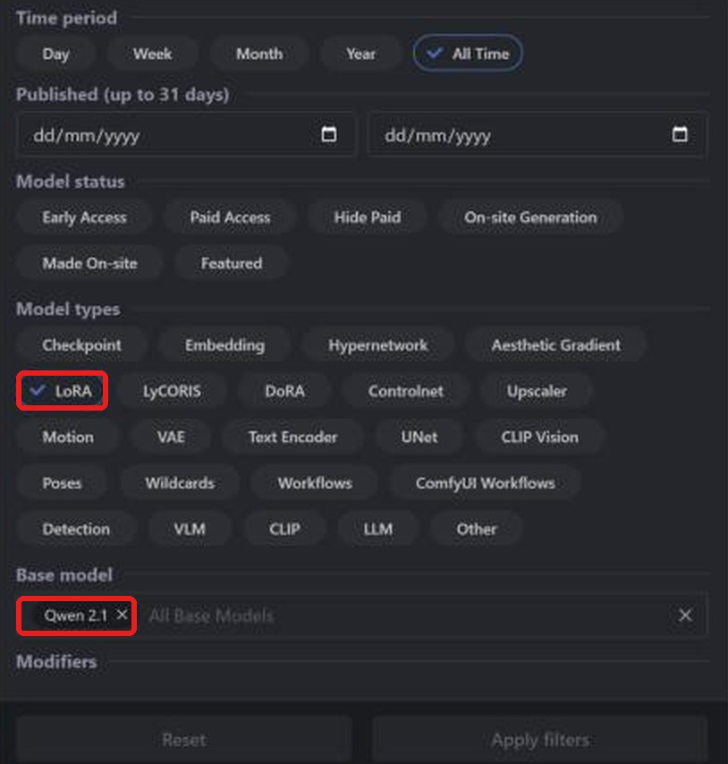
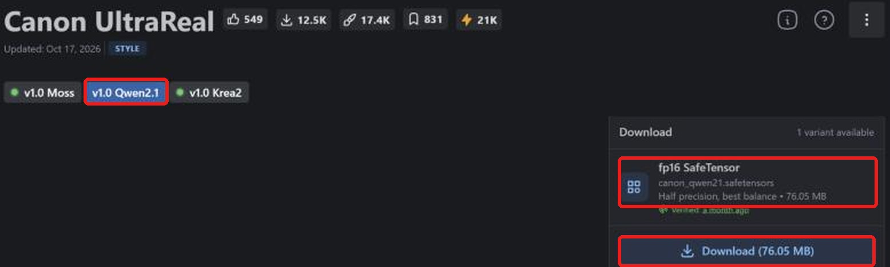

**Layla importa checkpoint safetensors e LoRA Qwen Image 2.1 da Civitai per generare offline su Android.** La comunità offre versioni affinate e LoRA di questo modello recente su [Civitai](https://civitai.com/). Dopo il download, la conversione locale permette di generare senza Internet.

La guida spiega ricerca, download corretto, importazione e aggiunta di LoRA. Per altre famiglie: [SD 1.5](/it/how-to-import-sd1-5-safetensor-models-from-civit-ai-into-layla/), [SDXL](/it/how-to-import-sdxl-safetensor-models-from-civitai-into-layla/), [MOSS Image](/it/how-to-import-moss-image-safetensor-models-from-civitai-into-layla/), [FLUX.2 Klein](/it/how-to-import-flux-2-klein-safetensor-models-from-civitai-into-layla/). Per GGUF, zip e Web UI consulta [Importare modelli di generazione immagini personalizzati in Layla](/it/how-to-import-custom-image-generation-models-into-layla/).

## Che cos'è Qwen Image 2.1?

Qwen-Image-2.1 è un modello a pesi aperti del team Qwen di Alibaba, pubblicato nel settembre 2026. Il generatore ha circa 7 miliardi di parametri e supporta testo-immagine e modifica d'immagini. Verifica la licenza prima dell'uso commerciale: è diversa dalle precedenti versioni Qwen-Image.

Su Civitai scegli **Qwen 2.1**, in Layla **Qwen Image 2.1**. I LoRA richiedono la stessa base. I filtri Civitai **Qwen**, **Qwen 2** e **Qwen 3** indicano famiglie diverse.

## Requisiti

- Telefono Android con Snapdragon 8 Elite (SM8750) o successivo. Gli import Qwen Image 2.1 usano la NPU Snapdragon e non sono disponibili su iPhone. Layla non verifica il chip all'importazione: controllalo prima di convertire file grandi.

- Mini-app **Local Dream**. Per installarla consulta [Attivare o disattivare le mini-app in Layla](/it/how-to-enable-disable-mini-apps-within-layla/).

- Un modello integrato già scaricato in Local Dream: **Qwen Image 2.1** / **Qwen Image 2.1 Turbo**. Layla ne riutilizza tokenizer, codificatore di testo e VAE. Se mancano, Safetensor mostra un avviso e disattiva l'importazione.

- Molto spazio libero: un checkpoint Qwen Image 2.1 bf16 supera 13 GB.

## Quale file safetensors scaricare

**Layla supporta safetensors f16 (mezza precisione)**, etichettati **fp16 SafeTensor** su Civitai. Per Qwen Image 2.1 accetta anche bf16. I file quantizzati **fp8**, **int8**, **int4** e **nvfp4** non sono supportati.

Al momento della stesura non abbiamo trovato checkpoint Qwen 2.1 fp16 su Civitai, ma bf16 o quantizzati. Scegli **bf16 SafeTensor**. Sulla pagina ufficiale **Best match** punta a bf16, ma altrove può indicare un file quantizzato: controlla ogni pagina.

## Importare un checkpoint Qwen Image 2.1 da Civitai

### Passaggio 1: aprire Civitai e Models

Apri [civitai.com](https://civitai.com/) e scegli **Models** nella navigazione superiore. Le schermate provengono da browser desktop; sul telefono la disposizione può cambiare leggermente.

### Passaggio 2: filtrare Checkpoint, SafeTensor e Qwen 2.1

Apri **Filters** in alto a destra:

1. **Model types**: **Checkpoint**.
2. **File format**: **SafeTensor**.
3. **Base model**: cerca e seleziona **Qwen 2.1**.

La lista mostra i checkpoint Qwen Image 2.1 nel formato adatto. [Apri la lista filtrata](https://civitai.com/models?types=Checkpoint&fileFormats=SafeTensor&baseModels=Qwen%202.1&sort=Most%20Downloaded).

### Passaggio 3: scaricare il file safetensors bf16

Apri le varianti in **Download**, scegli **bf16 SafeTensor**, qui 13,25 GB, e **Download Selected**. Non scegliere il file **int8**, più piccolo ma incompatibile. Se disponibile, preferisci **fp16 SafeTensor**. Per questa famiglia sono accettati f16 e bf16.

Serve solo il checkpoint. I **Required Components** di Civitai, come codificatore di testo e VAE, servono ad altri strumenti. Layla usa i file di supporto del modello di base già scaricato in Local Dream.

### Passaggio 4: importare in Layla

Apri **Settings** → **Inference Settings** → **Image Generation** → **Add Custom Model**, oppure **Local Dream** → **Add Model**.

In **Safetensor**, seleziona **Qwen Image 2.1** in **Base Model**.

In **MODEL CHECKPOINT** scegli il file, controlla **MODEL NAME** e tocca **Import & Convert**. Layla converte in un modello di diffusione GGUF Q4_0. Può richiedere diversi minuti: tieni l'app aperta. Il modello viene salvato e selezionato automaticamente.

Layla non esamina il file per confermare la famiglia. Scegliere **Qwen Image 2.1** per un checkpoint diverso può far fallire importazione o generazione.

### Passaggio 5: generare un'immagine

Apri **Local Dream**, verifica il modello e scrivi un prompt. I valori iniziali sono 20 passaggi e CFG 5, modificabili. I checkpoint Turbo sono pensati per meno passaggi e solitamente valori inferiori.

## Aggiungere un LoRA Qwen Image 2.1 da Civitai

Un LoRA è un piccolo file che modifica lo stile o insegna un personaggio, oggetto o concetto. Si cerca come un checkpoint, cambiando il tipo di modello.

### Passaggio 1: filtrare LoRA e Qwen 2.1

Apri **Models** → **Filters**, scegli **LoRA** in **Model types** e **Qwen 2.1** in **Base model**. [Apri la lista filtrata](https://civitai.com/models?types=LORA&fileFormats=SafeTensor&baseModels=Qwen%202.1&sort=Most%20Downloaded). Il pannello è lo stesso usato per i checkpoint.

### Passaggio 2: scaricare il LoRA safetensors

Scegli la versione Qwen Image 2.1, qui **v1.0 Qwen2.1**, poi verifica **fp16 SafeTensor**, qui 76,05 MB, e tocca **Download**.

### Passaggio 3: aggiungere il LoRA durante l'importazione

In **Safetensor** scegli **Qwen Image 2.1** come **Base Model** e il checkpoint. In **LORA FILES (OPTIONAL)** → **Add LoRA** scegli file e intensità, inizialmente 1.0. Puoi aggiungerne diversi. Infine usa **Import & Convert**.

Per Qwen Image 2.1 i LoRA vengono copiati nella cartella e applicati durante la generazione. Dopo l'importazione seleziona il modello in Local Dream e **Model setup** per vedere o modificare file, campionatore e LoRA.

### Usare un LoRA senza importare un checkpoint intero

Per Qwen Image 2.1, attiva **LoRA only** in **Safetensor**. Crei un modello dalla base già scaricata in Local Dream e dai LoRA, saltando il checkpoint e risparmiando tempo e spazio di conversione.

## Domande frequenti

### Posso usare Qwen Image 2.1 sul telefono?

Sì, rispettando i requisiti sopra. Scegli **Qwen Image 2.1** come **Base Model** e importa il checkpoint Civitai. Le famiglie che riutilizzano una base richiedono prima il suo download in Local Dream.

### Quale file Qwen Image 2.1 scarico da Civitai?

**fp16 SafeTensor** se esiste, altrimenti **bf16 SafeTensor**. Evita fp8, int8, int4 e nvfp4.

### Esiste Qwen Image 2.1 fp16 su Civitai?

Al momento della stesura non ne abbiamo trovato tra i checkpoint Qwen 2.1, solo bf16 o quantizzati. Layla importa bf16 per questa famiglia.

### Che differenza c'è con Turbo?

Turbo genera in meno passaggi. Entrambe le versioni sono valide come base, purché una sia già scaricata in Local Dream.

### Posso importare Qwen Image 2.1 su iPhone?

No. iOS importa solo safetensors SD 1.5. Vedi la guida SD 1.5 collegata all'inizio.

### Serve Internet per importare da Civitai?

Solo per scaricare i file. Conversione e generazione avvengono sul dispositivo.

### Come elimino un modello importato?

Apri **Local Dream**, seleziona il modello e tocca **Delete Model** per liberare spazio.

## Qwen Image 2.1 offline sul telefono

Dopo l'importazione, Qwen Image 2.1 funziona sul telefono senza Internet, account o abbonamento. Prompt, modello e immagini restano sul dispositivo.
