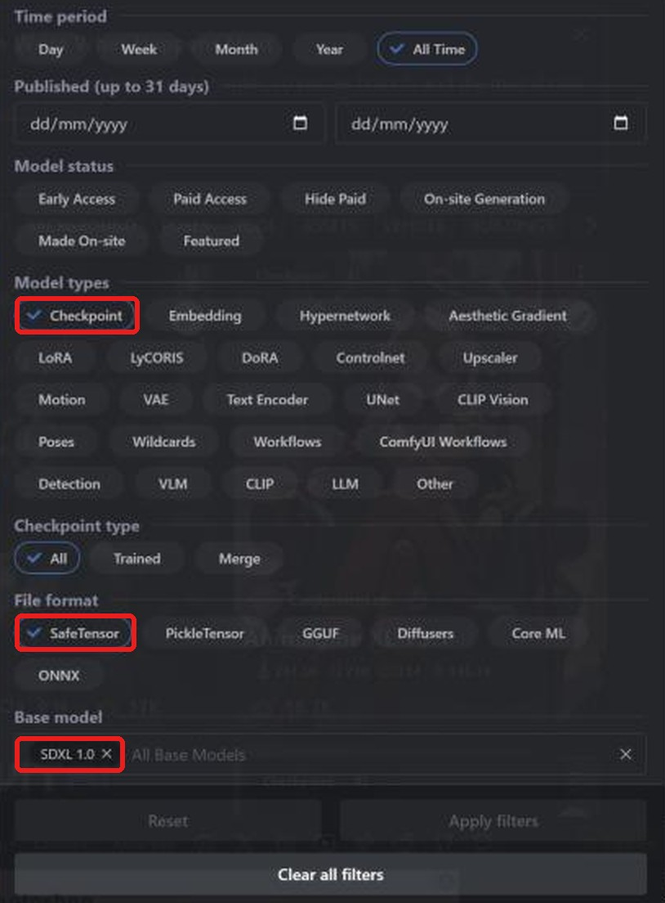
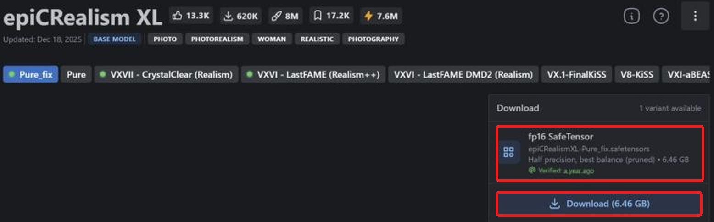
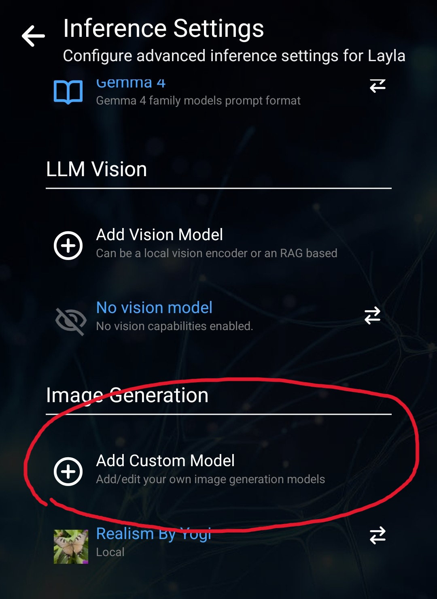
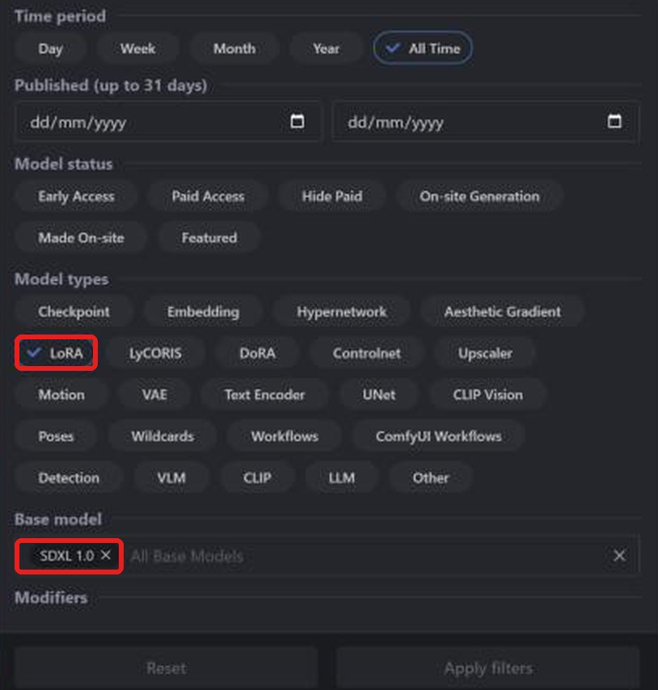
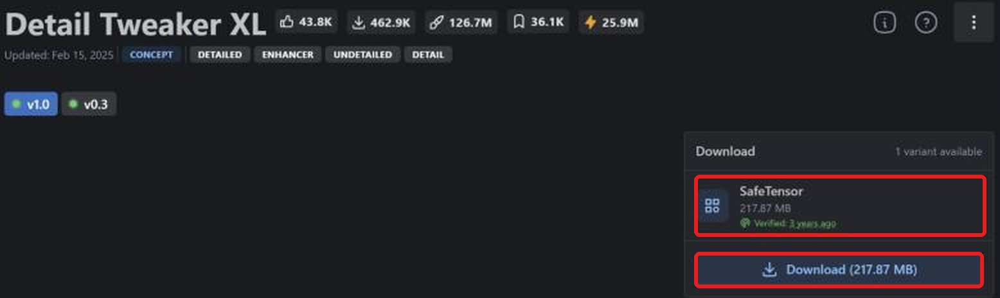

**Layla importa checkpoint safetensors e LoRA Stable Diffusion XL (SDXL) da Civitai per eseguirli sulla NPU Snapdragon del telefono Android.** Quasi tutti i modelli SDXL su [Civitai](https://civitai.com/) sono safetensors. La conversione è locale; dopo il download la generazione è offline.

La guida spiega ricerca, download corretto, importazione e aggiunta di LoRA. Per altre famiglie: [SD 1.5](/it/how-to-import-sd1-5-safetensor-models-from-civit-ai-into-layla/), [MOSS Image](/it/how-to-import-moss-image-safetensor-models-from-civitai-into-layla/), [Qwen Image 2.1](/it/how-to-import-qwen-image-2-1-safetensor-models-from-civitai-into-layla/), [FLUX.2 Klein](/it/how-to-import-flux-2-klein-safetensor-models-from-civitai-into-layla/). Per GGUF, zip e Web UI consulta [Importare modelli di generazione immagini personalizzati in Layla](/it/how-to-import-custom-image-generation-models-into-layla/).

## Che cos'è SDXL?

SDXL è Stable Diffusion XL 1.0, successore più grande di SD 1.5, pubblicato da Stability AI nel 2023. Genera 1024 x 1024 anziché 512 x 512. Civitai lo elenca come **SDXL 1.0**, base di molti checkpoint fotorealistici e anime.

Un LoRA SDXL richiede un checkpoint SDXL. In **Base Model** di Layla la famiglia si chiama **SDXL**.

## Requisiti

- Telefono Android con Snapdragon 8 Elite (SM8750) o successivo. Gli import SDXL usano la NPU Snapdragon e non sono disponibili su iPhone. Layla non verifica il chip all'importazione: controllalo prima di convertire file grandi.

- Mini-app **Local Dream**. Per installarla consulta [Attivare o disattivare le mini-app in Layla](/it/how-to-enable-disable-mini-apps-within-layla/).

- Spazio per il checkpoint di diversi gigabyte e per il modello convertito.

## Quale file safetensors scaricare

**Layla supporta solo safetensors f16 (mezza precisione).** Su Civitai cerca **fp16 SafeTensor** nella sezione download e verifica la precisione.

Un checkpoint SDXL fp16 è circa 6,5 GB. La stessa pagina può offrire varianti a piena precisione o altre: controlla l'etichetta.

## Importare un checkpoint SDXL da Civitai

### Passaggio 1: aprire Civitai e Models

Apri [civitai.com](https://civitai.com/) e scegli **Models** nella navigazione superiore. Le schermate provengono da browser desktop; sul telefono la disposizione può cambiare leggermente.

### Passaggio 2: filtrare Checkpoint, SafeTensor e SDXL 1.0

Apri **Filters** in alto a destra:

1. **Model types**: **Checkpoint**.
2. **File format**: **SafeTensor**.
3. **Base model**: cerca e seleziona **SDXL 1.0**.

La lista mostra i checkpoint SDXL nel formato adatto. [Apri la lista filtrata](https://civitai.com/models?types=Checkpoint&fileFormats=SafeTensor&baseModels=SDXL%201.0&sort=Most%20Downloaded).

### Passaggio 3: scaricare il file safetensors fp16

Apri il modello e controlla **Download** a destra. Scegli **fp16 SafeTensor**, qui 6.46 GB, poi **Download** per salvarlo sul telefono. Se esistono più varianti, scegli fp16. Le eccezioni bf16 supportate sono spiegate sopra.

### Passaggio 4: importare in Layla

Apri **Settings** → **Inference Settings** → **Image Generation** → **Add Custom Model**, oppure **Local Dream** → **Add Model**.

In **Safetensor**, seleziona **SDXL** in **Base Model**.

In **MODEL CHECKPOINT** scegli il file, controlla **MODEL NAME** e tocca **Import & Convert**. Layla converte in un modello di diffusione GGUF Q4_0. Può richiedere diversi minuti: tieni l'app aperta. Il modello viene salvato e selezionato automaticamente.

Layla non esamina il file per confermare la famiglia. Scegliere **SDXL** per un checkpoint diverso può far fallire importazione o generazione.

### Passaggio 5: generare un'immagine

Apri **Local Dream**, verifica il modello e scrivi un prompt. I valori iniziali sono 20 passaggi e CFG 5, modificabili. SDXL è pensato per 1024 x 1024.

## Aggiungere un LoRA SDXL da Civitai

Un LoRA è un piccolo file che modifica lo stile o insegna un personaggio, oggetto o concetto. Si cerca come un checkpoint, cambiando il tipo di modello.

### Passaggio 1: filtrare LoRA e SDXL 1.0

Apri **Models** → **Filters**, scegli **LoRA** in **Model types** e **SDXL 1.0** in **Base model**. [Apri la lista filtrata](https://civitai.com/models?types=LORA&fileFormats=SafeTensor&baseModels=SDXL%201.0&sort=Most%20Downloaded). Il pannello è lo stesso usato per i checkpoint.

### Passaggio 2: scaricare il LoRA safetensors

Scegli **Download** per SafeTensor, qui 217,87 MB. L'etichetta spesso indica solo **SafeTensor**. Se ci sono più precisioni scegli **fp16**, come per il checkpoint.

### Passaggio 3: aggiungere il LoRA durante l'importazione

In **Safetensor** scegli **SDXL** come **Base Model** e il checkpoint. In **LORA FILES (OPTIONAL)** → **Add LoRA** scegli file e intensità, inizialmente 1.0. Puoi aggiungerne diversi. Infine usa **Import & Convert**.

Per SDXL i LoRA vengono copiati nella cartella e applicati durante la generazione. Dopo l'importazione seleziona il modello in Local Dream e **Model setup** per vedere o modificare file, campionatore e LoRA.

## Domande frequenti

### Posso usare SDXL sul telefono?

Sì, rispettando i requisiti sopra. Scegli **SDXL** come **Base Model** e importa il checkpoint Civitai. Le famiglie che riutilizzano una base richiedono prima il suo download in Local Dream.

### Quale file SDXL scarico da Civitai?

**fp16 SafeTensor**. SDXL accetta solo f16. **Best match** può indicare un'altra variante: controlla la lista.

### Posso importare Pony, Illustrious o NoobAI?

Derivano da SDXL ma Civitai li elenca con basi proprie, separate da **SDXL 1.0**. La guida riguarda quest'ultimo filtro. Layla non conferma la famiglia del file: altre famiglie non sono garantite.

### Posso importare SDXL su iPhone?

No. iOS importa solo safetensors SD 1.5. Vedi la guida SD 1.5 collegata all'inizio.

### Serve Snapdragon per SDXL?

Sì per l'import SDXL sulla NPU in Layla. Su Snapdragon 8 Gen 3 o successivo anche [NPU Forge](/it/how-to-convert-safetensors-to-qnn-with-npu-forge-in-layla/) può convertire SDXL in QNN.

### Serve Internet per importare da Civitai?

Solo per scaricare i file. Conversione e generazione avvengono sul dispositivo.

### Perché Layla segnala un Safetensor non valido?

Non riesce a leggere il file. Controlla estensione `.safetensors`, fp16 e famiglia SDXL, poi riprova.

### Come elimino un modello importato?

Apri **Local Dream**, seleziona il modello e tocca **Delete Model** per liberare spazio.

## SDXL offline sul telefono

Dopo l'importazione, SDXL funziona sul telefono senza Internet, account o abbonamento. Prompt, modello e immagini restano sul dispositivo.
