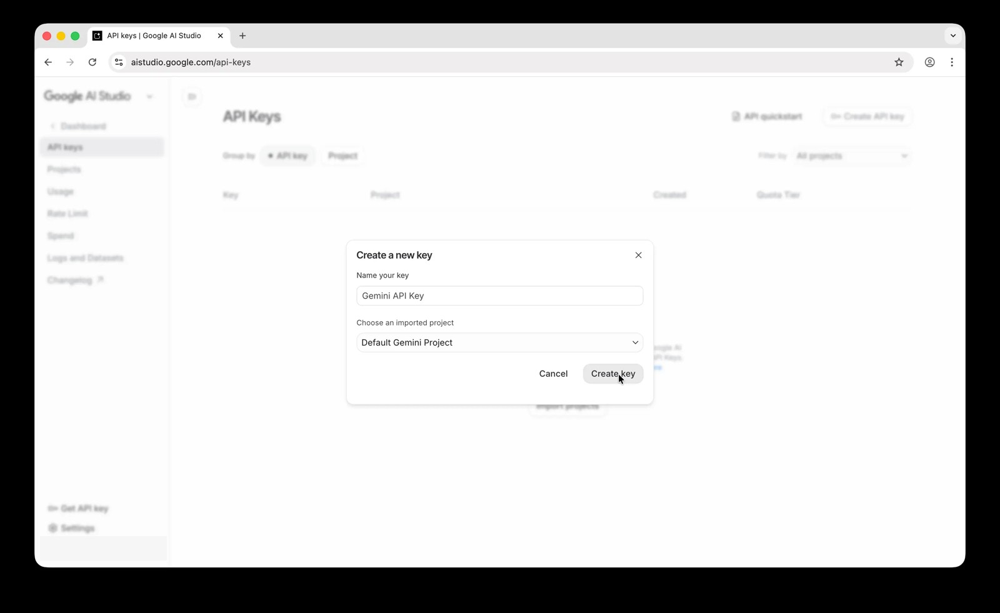

**Un Agente personalizzato per la generazione di immagini trasforma Layla in un chatbot IA che genera immagini con qualsiasi servizio dotato di API, invece di limitarsi ai modelli integrati nell'app.** Quando il tuo personaggio IA descrive un'immagine nella sua risposta, l'Agente invia la descrizione al servizio, riceve l'immagine finita e la mostra nella tua chat.

Layla genera già immagini con modelli Stable Diffusion, sul tuo dispositivo o tramite Layla Cloud. Un Agente aggiunge un'altra possibilità: scegli tu il servizio, il modello e le impostazioni, e usi la tua chiave API, un approccio spesso chiamato "bring your own key". Questo articolo ne costruisce uno intorno all'API Nano Banana. Nano Banana è il nome che Google dà ai suoi modelli Gemini per la generazione di immagini, e l'Agente di questo articolo usa Nano Banana Pro, il cui nome API è `gemini-3-pro-image`.

L'articolo ha tre obiettivi. Mostra come ottenere una chiave API Nano Banana e configurare l'Agente. Spiega poi ogni passaggio del codice dell'Agente e, infine, descrive come riutilizzare lo stesso schema per creare Agenti per altri servizi di immagini.

A differenza dei modelli locali di Layla, questo Agente richiede una connessione a Internet. La descrizione dell'immagine viene inviata a Google, e Google addebita ogni immagine. Se chatti con un modello locale, il resto della conversazione resta sul tuo dispositivo.

Ecco l'Agente in azione. Il personaggio risponde, e la descrizione dell'immagine che ha scritto è seguita dall'immagine finita:


Se vuoi provarlo subito, scarica qui il file dell'Agente: [google-nano-banana-generate-image.json](/assets/articles/how-to-use-the-google-nano-banana-image-generation-agent/google-nano-banana-generate-image.json). Non funzionerà senza una chiave API di Google, che l'articolo spiega più avanti.

## Perché usare Nano Banana in Layla?

I modelli Stable Diffusion di Layla sono la scelta giusta quando vuoi che le immagini siano generate interamente sul tuo dispositivo. L'API Nano Banana risponde a esigenze diverse:

- **Una qualità dell'immagine che non dipende dal tuo telefono.** L'immagine viene generata sui server di Google, quindi la velocità della CPU o della NPU del tuo dispositivo non limita né il risultato né i tempi di attesa.
- **Immagini che seguono la conversazione.** Il tuo personaggio scrive la descrizione dell'immagine a partire dalla chat stessa, così l'immagine corrisponde alla scena, all'abbigliamento o al luogo di cui state parlando. Funziona sia per i giochi di ruolo IA sia per le chat con un compagno IA.
- **Un modello di chat locale con immagini dal cloud.** L'Agente reagisce solo alla risposta del personaggio, quindi funziona con qualsiasi modello tu usi per chattare. Puoi tenere un LLM locale per la conversazione, e solo la descrizione dell'immagine va a Google.
- **Pagamento per immagine, senza abbonamento.** Google addebita le immagini che generi, e puoi vedere consumi e spesa in Google AI Studio.
- **La tua chiave.** Puoi revocare la chiave API in qualsiasi momento, e l'Agente continua a funzionare con qualsiasi altra chiave che crei.

Anche l'app Gemini di Google offre Nano Banana su Android. La differenza è che qui le immagini vengono create all'interno delle tue chat di Layla, con i tuoi personaggi e la tua chiave API.

## Come funziona l'Agente in breve

Ogni Agente di generazione di immagini che lavora dalla chat segue lo stesso flusso in quattro passaggi:

```text
Chiedi un'immagine
  -> il personaggio risponde con una descrizione dell'immagine racchiusa in un tag
  -> l'attivatore dell'Agente individua il tag
  -> lo strumento Eval chiama l'API di Google e salva l'immagine
  -> lo strumento Display Image la mostra nella chat
```

1. **Il prompt di sistema chiede un tag al modello.** L'Agente aggiunge un'istruzione che dice al modello linguistico del tuo personaggio di scrivere una descrizione dettagliata dell'immagine tra i tag `<stable_diffusion_prompt></stable_diffusion_prompt>` ogni volta che chiedi un'immagine.
2. **Un attivatore individua il tag.** L'Agente ha un attivatore regex che controlla le risposte del modello. Quando vede il tag, cattura il testo al suo interno e avvia l'Agente.
3. **Uno script chiama l'API.** Il primo strumento dell'Agente esegue un breve programma JavaScript. Invia la descrizione a Google, riceve l'immagine e la salva come file.
4. **L'immagine compare nella chat.** Il secondo strumento, _Display Image_, prende il file salvato e lo mostra nella conversazione.

Il modello linguistico non parla mai direttamente con Google. Scrive soltanto testo. Tutto il resto è gestito dall'Agente, ed è per questo che lo stesso schema funziona con qualsiasi servizio che abbia un'API.

Il tag si chiama `<stable_diffusion_prompt>` perché è il tag che ascolta anche la generazione di immagini di Layla. Questo è importante per la configurazione, ed è trattato nella sezione di configurazione più avanti.

## Cosa ti serve

- La mini-app _Agenti_ installata. Se non hai mai usato gli Agenti, leggi prima [Come attivare Agenti, funzioni e chiamate agli strumenti in Layla](/how-to-enable-agents-functions-and-tool-calling-in-layla/).
- Un account Google.
- Una chiave API Gemini, cioè la chiave API Nano Banana, con la fatturazione attiva. La sezione successiva spiega come fare.
- Una connessione a Internet.
- Il file dell'Agente, il cui link si trova alla fine di questo articolo.

Questo Agente usa lo strumento _Eval_, integrato in Layla. Non ti serve la mini-app Interprete Python.

## Come ottenere una chiave API Nano Banana da Google AI Studio

Non esiste una chiave Nano Banana separata. La chiave che ti serve è una chiave API Gemini, che Google rilascia tramite Google AI Studio e che funziona con i suoi modelli di immagini una volta attivata la fatturazione. Una chiave API è una lunga stringa di caratteri che identifica il tuo account Google quando l'Agente invia una richiesta. La procedura richiede pochi minuti.

### Passaggio 1: aprire Google AI Studio

Vai su [aistudio.google.com](https://aistudio.google.com) e accedi con il tuo account Google. Se è la prima volta, accetta i termini di servizio. Google crea quindi per te un progetto predefinito e una chiave API.

Seleziona **Get API key** in fondo alla barra laterale sinistra.


### Passaggio 2: creare una chiave

La pagina _API Keys_ elenca le chiavi dei tuoi progetti. Seleziona **Create API key**.


### Passaggio 3: dare un nome alla chiave e scegliere un progetto

Inserisci un nome che riconoscerai, ad esempio "Layla", e scegli un progetto. I nuovi account hanno un progetto chiamato _Default Gemini Project_. Seleziona **Create key**.



Ogni chiave API appartiene a un progetto Google Cloud, e il progetto gestisce la fatturazione e i limiti di utilizzo. Se usi già Google Cloud, AI Studio non mostra automaticamente i tuoi progetti esistenti. Usa il pulsante _Import projects_ per aggiungere quello che vuoi. Google lo spiega in [Using Gemini API keys](https://ai.google.dev/gemini-api/docs/api-key).

### Passaggio 4: copiare la chiave

La tua nuova chiave compare nell'elenco. Seleziona l'icona di copia sulla sua riga per copiare la chiave negli appunti. Puoi tornare su questa pagina più tardi e copiarla di nuovo.


Tratta la chiave come una password. Chiunque la possieda può fare richieste che Google addebita al tuo account. Se pensi che una chiave sia stata esposta, eliminala in questa pagina e creane una nuova.

### Passaggio 5: configurare la fatturazione

La colonna Quota Tier nello screenshot precedente riporta _Free tier_ con accanto un link **Set up billing**. Questo passaggio è obbligatorio, perché Google non offre un piano gratuito per i modelli di immagini Nano Banana nell'API. Il progetto a cui appartiene la tua chiave deve avere un account di fatturazione.

Seleziona **Set up billing** e segui le indicazioni di Google: scegli il tuo paese, accetta i termini e aggiungi un metodo di pagamento. A seconda del tuo account, Google può chiederti di prepagare un credito minimo, attualmente 5 $. La [guida alla fatturazione](https://ai.google.dev/gemini-api/docs/billing) di Google elenca i passaggi e i piani attuali.

Google addebita ogni immagine. Al momento della scrittura, un'immagine 1K o 2K di Nano Banana Pro costa 0,134 $ e un'immagine 4K costa 0,24 $. L'Agente di questo articolo richiede immagini 1K. I prezzi cambiano, quindi controlla la [pagina dei prezzi](https://ai.google.dev/gemini-api/docs/pricing) di Google prima di iniziare. Puoi monitorare l'utilizzo in AI Studio sotto _Dashboard_ e poi _Usage_.

La pagina dei prezzi di Google afferma inoltre che i contenuti inviati con il piano a pagamento non vengono usati per migliorare i prodotti di Google.

## Quale modello Nano Banana usare?

Google offre diversi modelli Nano Banana tramite la stessa API. L'Agente usa Nano Banana Pro, e puoi modificare una sola riga dello script per usarne un altro. Questi sono i modelli elencati da Google al momento della scrittura, con il prezzo indicato per un'immagine 1K:

| Modello            | Nome API                      | Prezzo per immagine 1K | Note                                                                                                   |
| ------------------ | ----------------------------- | ---------------------- | ------------------------------------------------------------------------------------------------------ |
| Nano Banana 2.1    | `gemini-nano-banana-2.1`      | 0,0336 $               | Il modello consigliato da Google per i nuovi progetti. Supporta immagini 1K, 2K e 4K.                  |
| Nano Banana 2 Lite | `gemini-3.1-flash-lite-image` | 0,0336 $               | Il modello più veloce ed economico. Supporta solo immagini 1K.                                         |
| Nano Banana 2      | `gemini-3.1-flash-image`      | 0,067 $                | Il modello della generazione precedente nella stessa famiglia.                                         |
| Nano Banana Pro    | `gemini-3-pro-image`          | 0,134 $                | Il modello premium di Google per i compiti visivi più complessi. Il modello usato da questo Agente.    |
| Nano Banana        | `gemini-2.5-flash-image`      | 0,039 $                | Il modello originale. Google lo definisce obsoleto e indica come data di dismissione il 15 marzo 2027. |

Nel confronto Nano Banana Pro vs Nano Banana 2, Pro costa circa il doppio per immagine 1K ed è pensato per scene complesse, mentre Nano Banana 2 e 2.1 sono i modelli più veloci ed economici. Le immagini più grandi costano di più con ogni modello. Nano Banana Pro addebita 0,24 $ per un'immagine 4K, Nano Banana 2 addebita 0,151 $ e Nano Banana 2.1 addebita 0,113 $.

Per cambiare modello, modifica `MODEL_ID` nello script e usa il pulsante **Test**. La [documentazione sulla generazione di immagini](https://ai.google.dev/gemini-api/docs/image-generation) di Google elenca ciò che ogni modello supporta. Se un modello restituisce un errore, potrebbe non accettare una delle impostazioni della richiesta dell'Agente, come la dimensione 2K, oppure potrebbe aspettarsi il nuovo formato API di Google. Prezzi e nomi dei modelli cambiano spesso, quindi controlla la [pagina dei prezzi](https://ai.google.dev/gemini-api/docs/pricing) e la [pagina dei modelli dismessi](https://ai.google.dev/gemini-api/docs/deprecations) di Google prima di scegliere.

## Configurare l'Agente in Layla

### Passaggio 1: disattivare la generazione di immagini predefinita di Layla

Apri le _Impostazioni di inferenza_, scorri fino alla sezione _Generazione di immagini_ e seleziona il modello di generazione di immagini. Nell'elenco _Select Model_ scegli **No Image Generation** (nessuna generazione di immagini).


La generazione di immagini integrata di Layla legge lo stesso tag `<stable_diffusion_prompt>` dalla risposta di un personaggio. Se un modello è ancora selezionato, Layla genera una propria immagine a partire dal tag e ricevi due immagini. Con _No Image Generation_ selezionato, il tag resta a disposizione dell'Agente. [Come attivare la generazione di immagini in Layla](/how-to-enable-image-generation-in-layla/) mostra dove si trova questa impostazione.

### Passaggio 2: importare l'Agente

Scarica il file dell'Agente alla fine di questo articolo. Apri la mini-app _Agenti_ e usa il pulsante **Import** in alto a destra per importarlo. L'Agente si chiama _Google Nano Banana: generate image_, e la sua scheda elenca i due strumenti che usa: _Eval_ e _Display Image_.


Assicurati che l'interruttore in alto a destra nella scheda dell'Agente sia attivo. Nello screenshot è ancora disattivato.

### Passaggio 3: aggiungere la tua chiave API

Apri l'Agente con il pulsante **Edit** e trova lo strumento _Eval_. Vicino all'inizio del suo codice c'è questa riga:

```js
const API_KEY = "PUT YOUR API KEY HERE";
```

Sostituisci `PUT YOUR API KEY HERE` con la tua chiave, mantenendo le virgolette. Salva l'Agente.

La tua chiave è ora memorizzata all'interno dell'Agente. Prima di condividere o caricare il file dell'Agente ovunque, rimetti il segnaposto al posto della chiave.

### Passaggio 4: chiedere un'immagine

Avvia una chat e chiedi un'immagine, ad esempio "mostrami un faro su una scogliera al crepuscolo". Il personaggio risponde con una descrizione dell'immagine, l'Agente si avvia e dopo alcuni secondi l'immagine compare nella chat, come nello screenshot all'inizio di questo articolo.

Se qualcosa va storto, usa il pulsante **Test** nella mini-app Agenti. Mostra l'input e l'output di ogni passaggio, come descritto in [Analisi approfondita degli Agenti Layla](/deep-dive-into-layla-agents/).

## Come funziona l'Agente, passo dopo passo

Un Agente ha tre parti: un prompt di sistema, un attivatore e un elenco di strumenti che vengono eseguiti uno dopo l'altro. L'output di ogni strumento è l'input del successivo. [Analisi approfondita degli Agenti Layla](/deep-dive-into-layla-agents/) tratta questi elementi in generale. Questa sezione segue l'Agente Nano Banana attraverso ciascuno di essi.

### 1. Il prompt di sistema

Il prompt di sistema è un'istruzione che Layla aggiunge alla conversazione ogni volta che l'Agente è attivo. Il prompt dell'Agente è scritto in inglese, e il file lo contiene esattamente così:

```text
When the user asks you to generate, draw or create an image, write a detailed
description of the image (subject, setting, style, lighting, composition) inside
<stable_diffusion_prompt></stable_diffusion_prompt> tags, e.g.
<stable_diffusion_prompt>a lighthouse on a cliff at dusk, oil painting, warm
light</stable_diffusion_prompt>. The image is generated from the text inside the
tags and shown in the chat. Use the tags only when an image is requested, and
never put backticks inside them.
```

Ogni parte dell'istruzione ha uno scopo:

- **"When the user asks you to generate, draw or create an image"** (quando l'utente ti chiede di generare, disegnare o creare un'immagine) limita il comportamento alle richieste di immagini, così la conversazione normale non viene toccata.
- **"A detailed description (subject, setting, style, lighting, composition)"** (una descrizione dettagliata: soggetto, ambientazione, stile, illuminazione, composizione) dà al modello una lista di controllo. Nano Banana è un modello linguistico che legge descrizioni, quindi una frase completa con questi dettagli di solito produce un'immagine migliore di un elenco di parole chiave.
- **L'esempio** mostra il formato esatto del tag. I modelli linguistici seguono un esempio in modo più affidabile della descrizione di un formato.
- **"Use the tags only when an image is requested"** (usa i tag solo quando viene richiesta un'immagine) impedisce al modello di aggiungere tag a ogni risposta, il che avvierebbe l'Agente, e ti addebiterebbe un costo, ogni volta.
- **"Never put backticks inside them"** (non mettere mai apici inversi al loro interno) protegge lo script. Il motivo è spiegato nella spiegazione del codice più avanti.

Quando scrivi i tuoi Agenti, il prompt di sistema svolge lo stesso compito: insegna al modello un nuovo comportamento, mostra il formato di output e indica quando non usarlo.

### 2. L'attivatore

L'Agente ha un solo attivatore, un _attivatore regex_ che agisce sull'**output** del modello invece che sul tuo input. Il suo schema è:

```text
/<stable_diffusion_prompt>(.*?)<\/stable_diffusion_prompt>/s
```

- I tag di apertura e di chiusura corrispondono ai tag letterali.
- `(.*?)` è un gruppo di cattura. Raccoglie tutto ciò che si trova tra i tag, e il `?` lo fa fermare al primo tag di chiusura.
- Il flag `s` permette alla descrizione di estendersi su più righe.

Il testo catturato dal gruppo diventa disponibile per l'Agente come `{{match$1}}`. È il collegamento tra il modello linguistico e il codice: tutto ciò che il modello scrive tra i tag viene passato al primo strumento.

### 3. Lo strumento Eval: chiamare l'API

Il primo strumento è _Eval_. Esegue JavaScript in un ambiente isolato all'interno di Layla. L'ambiente dispone di `fetch` per le richieste web e di un oggetto globale chiamato `layla` che dà agli script accesso alle funzioni di Layla, come il salvataggio di file. Non ha una pagina del browser né moduli Node.js.

Eval restituisce il valore dell'ultima espressione dello script e lo attende se è una promise. Questo spiega l'ultima riga dello script, che avvia il lavoro: `generateImage(PROMPT);`.

Lo script ha otto parti.

#### Le impostazioni all'inizio

```js
const API_KEY = "PUT YOUR API KEY HERE";
const PROMPT = String.raw`{{match$1}}`.trim();

const MODEL_ID = "gemini-3-pro-image";
const API_METHOD = "streamGenerateContent";
const API_URL = `https://generativelanguage.googleapis.com/v1beta/models/${MODEL_ID}:${API_METHOD}`;
const TIMEOUT_MS = 60000;
```

Tutto ciò che potresti voler cambiare si trova in un unico posto:

- `API_KEY` è la tua chiave.
- `PROMPT` è la descrizione scritta dal modello. Prima dell'esecuzione dello script, Layla sostituisce `{{match$1}}` con il testo catturato, così la descrizione diventa parte del programma. È racchiusa in un template literal con `String.raw` in modo che le barre inverse siano mantenute come scritte, e `.trim()` rimuove spazi e interruzioni di riga superflui. Un apice inverso o i caratteri `${` all'interno della descrizione chiuderebbero il literal in anticipo e romperebbero lo script, ed è per questo che il prompt di sistema vieta gli apici inversi.
- `MODEL_ID` è il modello da usare. Google rinomina e ritira modelli di tanto in tanto, quindi questa è la riga che più probabilmente modificherai in seguito.
- `API_URL` è costruita a partire dal modello e dal metodo. `streamGenerateContent` restituisce la risposta come elenco di frammenti (chunk).
- `TIMEOUT_MS` è il tempo di attesa prima di rinunciare: 60 secondi.

Il resto dello script si trova in una funzione chiamata `generateImage`. Riceve la descrizione come parametro chiamato `prompt`, e l'ultima riga dello script la chiama con `PROMPT`.

#### Controllare gli input

```js
if (!prompt) throw new Error("The stable diffusion prompt was empty.");
if (!API_KEY || API_KEY === "PUT YOUR API KEY HERE")
  throw new Error("Set API_KEY in this agent first.");
```

Lo script si interrompe subito, con un messaggio leggibile, quando non c'è nulla da inviare o la chiave non è stata impostata. Quando uno script genera un errore, l'Agente si ferma e non compare alcuna immagine. Il pulsante **Test** mostra il messaggio.

#### Costruire la richiesta

```js
const imageConfig = { imageSize: "1K" };

const payload = {
  contents: [{ role: "user", parts: [{ text: prompt }] }],
  generationConfig: {
    responseModalities: ["IMAGE", "TEXT"],
    imageConfig,
  },
  tools: [{ googleSearch: {} }],
};
```

Il payload è l'insieme dei dati inviati a Google:

- `contents` è la conversazione inviata al modello. Qui è un singolo messaggio dell'utente contenente un solo pezzo di testo: la descrizione.
- `responseModalities` elenca i tipi di output che il modello può restituire. Richiedere `IMAGE` è ciò che fa disegnare un'immagine al modello, e `TEXT` gli permette di aggiungere un commento.
- `imageConfig` contiene le impostazioni dell'immagine. `imageSize` può essere `'1K'`, `'2K'` o `'4K'` con la K maiuscola, e le dimensioni maggiori costano di più. Puoi anche aggiungere un `aspectRatio` come `'16:9'` o `'9:16'`. Lo script invia solo le impostazioni che hanno un valore, perché Google risponde con un errore quando riceve un valore vuoto.
- `tools: [{ googleSearch: {} }]` permette al modello di cercare informazioni su Google Search mentre lavora, il che aiuta con luoghi e oggetti reali. Rimuovi questa riga se non la vuoi. Google include una quota mensile di richieste di ricerca per i modelli Gemini 3 e addebita quelle oltre la quota, come indicato nella pagina dei prezzi.

#### Inviare la richiesta con un limite di tempo

```js
const controller = new AbortController();
const timer = setTimeout(() => controller.abort(), TIMEOUT_MS);
let response;
let body;
try {
  response = await fetch(API_URL, {
    method: "POST",
    headers: { "Content-Type": "application/json", "x-goog-api-key": API_KEY },
    body: JSON.stringify(payload),
    signal: controller.signal,
  });
  body = await response.text();
} catch (error) {
  if (controller.signal.aborted)
    throw new Error(`Image generation timed out after ${TIMEOUT_MS / 1000} s.`);
  throw new Error(`Image generation request failed: ${error.message}`);
} finally {
  clearTimeout(timer);
}
```

Questa è la parte che comunica con Google:

- `fetch` invia una richiesta `POST` con il payload convertito in testo JSON.
- La chiave API viaggia nell'intestazione `x-goog-api-key`, quindi non fa parte dell'indirizzo web.
- L'`AbortController` e il timer annullano la richiesta dopo 60 secondi. Senza di essi, una connessione bloccata lascerebbe l'Agente in attesa.
- Il blocco `catch` distingue un timeout dagli altri errori di rete, così il messaggio di errore dice cosa è successo. Il blocco `finally` ferma il timer in entrambi i casi.

#### Controllare lo stato della risposta

```js
if (!response.ok) {
  throw new Error(
    `HTTP error ${response.status} ${response.statusText}. Response body: ${body.slice(0, 500)}`,
  );
}
```

Quando Google rifiuta una richiesta, ne spiega il motivo nel corpo della risposta. Lo script include nell'errore i primi 500 caratteri di quella spiegazione, così una chiave sbagliata, una fatturazione mancante o un limite superato compaiono come messaggio chiaro quando usi il pulsante **Test**.

#### Trovare l'immagine nella risposta

```js
const data = JSON.parse(body);
const chunks = Array.isArray(data) ? data : [data];

for (const chunk of chunks) {
  for (const candidate of chunk.candidates || []) {
    for (const part of (candidate.content && candidate.content.parts) || []) {
      const inline = part.inlineData;
      if (
        !inline ||
        !inline.data ||
        !String(inline.mimeType || "").startsWith("image/")
      )
        continue;
      // ...save the image
    }
  }
}
```

Il metodo di streaming risponde con un elenco JSON di frammenti. Ogni frammento ha dei `candidates` (le risposte del modello), ogni candidato ha un `content`, e il contenuto è un elenco di `parts`. Una parte è testo oppure dati incorporati. I dati incorporati contengono un `mimeType`, come `image/png`, e l'immagine stessa come testo base64, un modo di scrivere dati binari con caratteri normali.

Il ciclo scorre ogni frammento, candidato e parte, salta il testo e si ferma alla prima parte che è un'immagine. Le protezioni `|| []` evitano che lo script si blocchi quando un frammento non ha candidati.

#### Salvare l'immagine

```js
const extension =
  inline.mimeType
    .split("/")
    .pop()
    .replace(/[^a-z0-9]/gi, "") || "png";
const id = Math.random().toString(16).slice(2, 10).padEnd(8, "0");
const path = `generated-images/output_image_${id}.${extension}`;

await layla.utils.saveFile(path, inline.data);
return path;
```

- L'estensione del file deriva dal tipo di immagine indicato da Google, con `png` come valore di ripiego.
- Un ID casuale di otto caratteri dà a ogni immagine un proprio nome di file, così una nuova immagine non sovrascrive mai una precedente nella cronologia della chat.
- `layla.utils.saveFile` scrive il file nella cartella di lavoro privata del personaggio. Il percorso è relativo a quella cartella, e le cartelle mancanti vengono create automaticamente. La funzione si aspetta testo base64, che è ciò che invia Google, quindi i dati vengono salvati senza conversione.
- La funzione restituisce il percorso. Quel percorso è l'output dello strumento.

#### Segnalare chiaramente un errore

```js
const keys =
  chunks.length && typeof chunks[0] === "object"
    ? Object.keys(chunks[0]).join(", ")
    : "Unknown error";
throw new Error(
  `No image was found in the response. Full API Response Keys: ${keys}`,
);
```

Se il ciclo termina senza trovare un'immagine, ad esempio perché il modello ha rifiutato la richiesta e ha risposto solo con testo, lo script segnala il contenuto della risposta. Questo rende molto più facile diagnosticare gli errori insoliti.

### 4. Lo strumento Display Image

Il secondo strumento è _Display Image_, e la sua unica impostazione è:

```text
{{input}}
```

`{{input}}` viene sostituito con l'output dello strumento precedente, cioè il percorso del file restituito dallo script. _Display Image_ apre quel file dalla cartella di lavoro del personaggio e lo allega alla risposta, e l'immagine compare nella chat.

## Mantenere coerenti le immagini del tuo personaggio IA

Un modello linguistico scrive ogni descrizione di immagine da zero. Senza indicazioni, un personaggio può quindi avere un aspetto diverso da un'immagine all'altra. Questi approcci mantengono coerenti le immagini del personaggio IA e ti permettono di decidere con quale frequenza compaiono le immagini:

- **Descrivere il personaggio una sola volta.** Nello _Scenario_ del personaggio aggiungi un'istruzione come: "Ogni volta che scrivi uno `<stable_diffusion_prompt>`, inizia con questa descrizione di te stessa: una donna sulla fine dei vent'anni con capelli rossi corti, occhi verdi e lentiggini. Poi descrivi la scena." Il modello ripete l'aspetto in ogni prompt, il che aiuta il modello di immagini a disegnare ogni volta lo stesso personaggio.
- **Fissare lo stile artistico.** Aggiungi uno stile alla stessa istruzione, ad esempio "fotografia a pellicola 35 mm, luce naturale" o "illustrazione ad acquerello". [Come generare immagini IA in Layla con l'Agente Perchance](/how-to-use-the-perchance-image-generation-agent/) descrive lo stesso approccio, e funziona con qualsiasi Agente che usi questo tag.
- **Generare un'immagine dopo ogni messaggio.** Aggiungi allo _Scenario_ un'istruzione per terminare ogni risposta con il tag, come in [Creare un Agente per la generazione di immagini](/creating-an-image-generation-agent/). Ogni risposta è così accompagnata da un'immagine, il che si adatta ai giochi di ruolo IA e alla narrazione. Ogni immagine viene addebitata, quindi costa di più che chiedere le immagini su richiesta.
- **Usare immagini di riferimento.** I modelli Nano Banana possono anche accettare un'immagine come input, il che aiuta un personaggio a mantenere lo stesso volto. Questo Agente invia solo testo, quindi aggiungere un'immagine di riferimento alla richiesta è un buon progetto successivo.

## Usare lo stesso schema per altri Agenti

L'Agente Nano Banana è un modello di partenza. Il prompt di sistema, l'attivatore regex e il passaggio Display Image restano uguali per qualsiasi servizio di immagini. Cambia solo lo script. Queste idee partono da qui.

- **Cambiare il modello o le impostazioni.** Modifica `MODEL_ID` o `imageSize`, oppure aggiungi `aspectRatio` nello script. Google offre diversi modelli Nano Banana a prezzi diversi, elencati nella sua [pagina dei prezzi](https://ai.google.dev/gemini-api/docs/pricing).
- **Usare un altro servizio di immagini.** Sostituisci la richiesta e la gestione della risposta. Se il servizio restituisce testo base64, il passaggio di salvataggio resta lo stesso. Se restituisce un indirizzo web, recupera quell'indirizzo e converti i byte con `toBase64()` prima di chiamare `layla.utils.saveFile`.
- **Chiedere al modello più di una descrizione.** Il prompt di sistema può richiedere alcuni campi invece di testo libero, ad esempio un breve oggetto JSON con un `prompt` e un `aspect_ratio`. Lo script legge poi i campi dal testo catturato. Tieni il segnaposto all'interno di un string literal, come fa l'Agente con `PROMPT`, e analizza il testo nel tuo codice.
- **Fare qualcosa di diverso dalle immagini.** Scegli un altro tag, come `<weather_request>`, lascia che _Eval_ chiami un'altra API e concludi con lo strumento _Provide Context_ in modo che il personaggio possa parlare del risultato. L'[Agente di ricerca Brave](/how-to-create-a-brave-search-agent/) è un esempio di questo flusso.

Quando scrivi un tuo Agente, vale la pena mantenere alcune abitudini di questo:

- **Mettere tutte le impostazioni in un unico blocco all'inizio.** La chiave, il modello, la dimensione e il timeout sono facili da trovare e da modificare.
- **Controllare gli input prima di spendere denaro.** Un controllo che blocca una richiesta vuota non costa nulla.
- **Impostare sempre un timeout.** Una richiesta che non finisce mai è peggio di una che fallisce con un messaggio.
- **Restituire qualcosa di leggibile in caso di errore.** Il testo dell'errore è ciò che mostra il pulsante **Test**, quindi fa' in modo che dica cosa è andato storto.
- **Passare un percorso, non un carico di dati.** Lo script salva l'immagine e passa un breve percorso allo strumento successivo, evitando di far circolare grandi quantità di dati nella catena.
- **Un solo Agente per tag.** Se crei un altro Agente che reagisce a `<stable_diffusion_prompt>`, disattiva questo. In alternativa, dai al nuovo Agente un tag distinto sia nel prompt di sistema sia nell'attivatore.
- **Trattare `{{match$1}}` come codice.** Il testo catturato viene incollato nello script prima dell'esecuzione, quindi racchiudilo in uno string literal e indica al modello quali caratteri evitare.

## Domande frequenti

### Come ottengo una chiave API Nano Banana?

Non esiste una chiave Nano Banana separata. Accedi a [Google AI Studio](https://aistudio.google.com), apri la pagina _API Keys_ e seleziona **Create API key**. Poi attiva la fatturazione sul progetto della chiave, perché i modelli Nano Banana non hanno un piano gratuito nell'API.

### L'API Nano Banana è gratuita?

Creare una chiave è gratuito, ma Google non offre un piano gratuito per i modelli di immagini Nano Banana nell'API, quindi ogni immagine viene addebitata. Consulta la [pagina dei prezzi](https://ai.google.dev/gemini-api/docs/pricing) di Google per i prezzi attuali.

### Quanto costa l'API Nano Banana per immagine?

Al momento della scrittura, Nano Banana Pro costa 0,134 $ per un'immagine 1K o 2K e 0,24 $ per un'immagine 4K. Nano Banana 2.1 costa 0,0336 $ per un'immagine 1K. La tabella nella sezione sui modelli qui sopra elenca tutti i modelli.

### Qual è la differenza tra Nano Banana Pro e Nano Banana 2?

Nano Banana Pro è il modello di immagini premium di Google per scene complesse e costa di più per immagine. Nano Banana 2 è un modello più veloce ed economico della stessa famiglia, e Google ora consiglia Nano Banana 2.1 per i nuovi progetti. Consulta la tabella dei modelli qui sopra per nomi e prezzi.

### Posso usare Nano Banana su Android?

Sì. L'app Gemini di Google include Nano Banana. Questo Agente è pensato per quando vuoi che le immagini vengano create all'interno delle tue chat di Layla, con i tuoi personaggi e la tua chiave API.

### Il mio personaggio IA può inviare immagini durante una chat o un gioco di ruolo?

Sì. Chiedi un'immagine nella chat, oppure aggiungi allo _Scenario_ del personaggio un'istruzione perché ogni risposta termini con una descrizione dell'immagine. La sezione sulla coerenza delle immagini spiega entrambe le opzioni.

### Nano Banana filtra le immagini?

Sì. Google applica alle API Gemini le proprie politiche di sicurezza, e una richiesta che rifiuta può non restituire alcuna immagine. L'Agente segnala allora che nella risposta non è stata trovata alcuna immagine. Per una generazione di immagini che avviene interamente sul tuo dispositivo, usa i modelli Stable Diffusion locali descritti in [Come attivare la generazione di immagini in Layla](/how-to-enable-image-generation-in-layla/).

### Perché ho ricevuto due immagini?

La generazione di immagini integrata di Layla è probabilmente ancora attiva. Seleziona _No Image Generation_ nelle Impostazioni di inferenza in modo che solo l'Agente gestisca il tag.

### L'Agente dice "Set API_KEY in this agent first."

Il segnaposto della chiave è ancora nello script. Apri l'Agente, modifica lo strumento _Eval_ e sostituisci `PUT YOUR API KEY HERE` con la tua chiave.

### L'Agente mostra un errore HTTP. Cosa significa?

Il messaggio include la spiegazione di Google. Le cause comuni sono una chiave digitata male, la fatturazione non configurata sul progetto a cui appartiene la chiave o un limite di utilizzo raggiunto. Anche un nome di modello ritirato da Google può causare un errore.

### Le vecchie guide usano `gemini-3-pro-image-preview`. Funziona ancora?

Google ha ritirato quel nome di anteprima il 25 giugno 2026 e consiglia invece `gemini-3-pro-image`, che è quello usato da questo Agente. La [pagina dei modelli dismessi](https://ai.google.dev/gemini-api/docs/deprecations) di Google elenca i nomi dei modelli attuali e le date di dismissione.

### Questo Agente usa l'API più recente di Google?

L'Agente usa l'API `generateContent` di Google, che consiste in una singola richiesta web ed è facile da seguire in uno script. Google ora la definisce obsoleta ("legacy") nella sua documentazione e promuove una nuova API Interactions per i nuovi progetti, ma afferma che `generateContent` resta supportata. Se Google dovesse cambiarla, basterà riscrivere le parti dello script dedicate a richiesta e risposta. Il resto dell'Agente resta uguale.

### Il mio prompt è privato?

La descrizione dell'immagine viene inviata a Google per generare l'immagine. Se chatti con un modello locale, il resto della conversazione resta sul tuo dispositivo. Secondo la pagina dei prezzi di Google, con il piano a pagamento i contenuti non vengono usati per migliorare i suoi prodotti.

### Le immagini hanno una filigrana?

Google afferma che tutte le immagini generate con i suoi modelli Nano Banana includono una filigrana SynthID.

### Posso usare questo Agente senza connessione a Internet?

No. L'Agente chiama i server di Google. Per la generazione di immagini offline, usa uno dei modelli locali descritti in [Come attivare la generazione di immagini in Layla](/how-to-enable-image-generation-in-layla/).

## Conclusione

L'Agente Nano Banana mostra quanto può essere piccolo un Agente di generazione di immagini per la chat IA. Un prompt di sistema fa scrivere al modello una descrizione racchiusa in un tag, un attivatore regex la cattura, un breve script scambia la descrizione con un'immagine, e _Display Image_ mette il risultato nella tua chat. Una volta comprese queste quattro parti, puoi cambiare il servizio, il modello o le impostazioni e creare Agenti per servizi di immagini che Layla non supporta di serie.

I modelli locali di Layla restano la scelta per la generazione di immagini completamente offline. Agenti come questo sono un'opzione quando preferisci un particolare modello online e accetti la connessione e il costo.

## Scarica l'Agente

[Scarica google-nano-banana-generate-image.json](/assets/articles/how-to-use-the-google-nano-banana-image-generation-agent/google-nano-banana-generate-image.json)

Usa il pulsante _Import_ nella mini-app Agenti per importarlo, poi aggiungi la tua chiave API.
