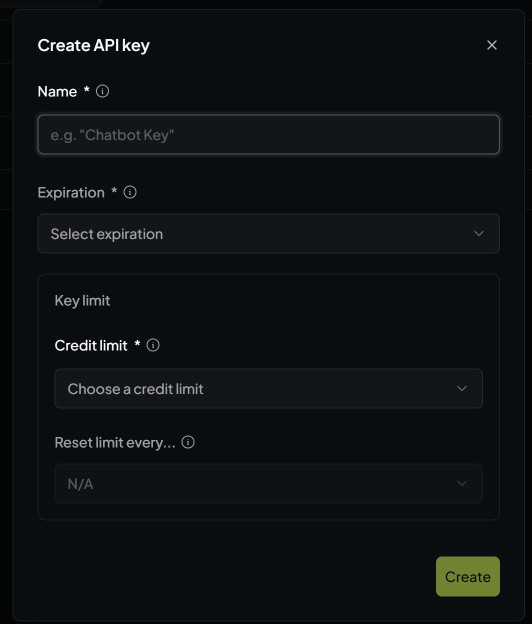
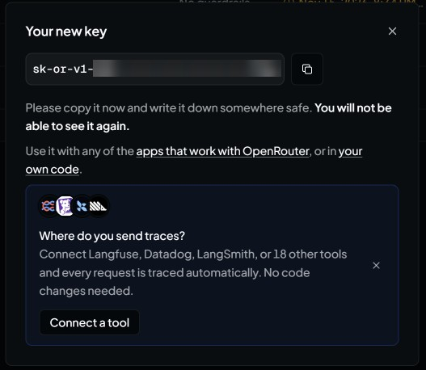

**La generazione di immagini OpenRouter ti dà una sola chiave API per i modelli di immagini di molte aziende, tra cui FLUX di Black Forest Labs, Seedream di ByteDance, Nano Banana di Google e GPT Image di OpenAI.** Questa guida collega l'API di generazione di immagini OpenRouter a Layla, un'app di chat IA per Android, così i tuoi personaggi IA possono inviare immagini in chat. Quando un personaggio descrive un'immagine nella sua risposta, un Agente di Layla invia la descrizione a OpenRouter, riceve l'immagine finita e la mostra nella conversazione.

Layla genera già immagini con modelli Stable Diffusion, sul tuo dispositivo o tramite Layla Cloud. Un Agente aggiunge un'altra possibilità: scegli tu il servizio, il modello e le impostazioni, e usi la tua chiave API. [API Nano Banana in Layla](/it/how-to-use-the-google-nano-banana-image-generation-agent/) fa questo con un solo modello di Google. L'Agente OpenRouter segue lo stesso metodo, ma per passare a un modello di un'altra azienda basta modificare una riga.

L'articolo mostra come ottenere una chiave API OpenRouter e configurare l'Agente, confronta i modelli di generazione di immagini di OpenRouter e i loro prezzi, e spiega ogni passaggio del codice dell'Agente.

A differenza dei modelli locali di Layla, questo Agente richiede una connessione a Internet. La descrizione dell'immagine viene inviata a OpenRouter e all'azienda che gestisce il modello, e ogni immagine viene pagata con i tuoi crediti OpenRouter. Se chatti con un modello locale, il resto della conversazione resta sul tuo dispositivo.

<div class="file-download">
  <div class="file-download-info">
    <span class="file-download-label">File dell&#x27;Agente</span>
    <span class="file-download-name">openrouter-generate-image.json</span>
    <span class="file-download-hint">Non funzionerà senza una chiave API OpenRouter, che l'articolo spiega più avanti.</span>
  </div>
  <a class="file-download-button" href="/assets/articles/how-to-use-the-openrouter-image-generation-agent/openrouter-generate-image.json" download="openrouter-generate-image.json"><svg viewBox="0 0 24 24" fill="none" stroke="currentColor" stroke-width="2" stroke-linecap="round" stroke-linejoin="round" aria-hidden="true"><path d="M12 4v11"/><path d="m7 10 5 5 5-5"/><path d="M5 20h14"/></svg>Scarica</a>
</div>

## Perché usare la generazione di immagini OpenRouter in Layla?

I modelli Stable Diffusion di Layla sono la scelta giusta quando vuoi che le immagini siano generate interamente sul tuo dispositivo. OpenRouter risponde a esigenze diverse:

- **Molti modelli di immagini con una sola chiave.** FLUX, Seedream, GPT Image, Nano Banana, Qwen Image, Grok Imagine e altri usano tutti la stessa richiesta. Puoi provare un nuovo modello senza creare un altro account o riscrivere l'Agente.
- **Prezzi bassi per immagine.** Al momento della scrittura, il modello che questo Agente usa per impostazione predefinita, FLUX 3 Image Klein, costa 0,009 $ per un'immagine 1K. OpenRouter applica il prezzo dell'azienda che gestisce il modello senza aggiungere ricarichi.
- **Un limite di spesa sulla chiave.** OpenRouter ti permette di assegnare a ogni chiave API un proprio limite di credito, così la chiave memorizzata nel tuo Agente non può mai spendere più di quanto consenti.
- **Una qualità dell'immagine che non dipende dal tuo telefono.** L'immagine viene generata su un server, quindi la velocità della CPU o della NPU del tuo dispositivo non limita né il risultato né i tempi di attesa.
- **Un solo account OpenRouter per chat e immagini.** Layla può usare i modelli linguistici di OpenRouter anche per la conversazione stessa, tramite la sua [connessione ad API compatibili con OpenAI](/it/how-to-connect-layla-to-any-openai-compatible-api/). Con questo Agente, lo stesso account alimenta sia le risposte del personaggio sia le sue immagini, così Layla funziona come app OpenRouter per Android per entrambe le cose.
- **Oppure un modello di chat locale con immagini dal cloud.** L'Agente reagisce solo alla risposta del personaggio, quindi funziona con qualsiasi modello tu usi per chattare. Puoi tenere un LLM privato e offline per la conversazione, e solo la descrizione dell'immagine lascia il tuo telefono.

## Come funziona l'Agente in breve

L'Agente usa lo stesso flusso in quattro passaggi di ogni Agente di generazione di immagini che lavora dalla chat:

```text
Chiedi un'immagine
  -> il personaggio risponde con una descrizione dell'immagine racchiusa in un tag
  -> l'attivatore dell'Agente individua il tag
  -> lo strumento Eval chiama l'API di OpenRouter e salva l'immagine
  -> lo strumento Display Image la mostra nella chat
```

1. **Il prompt di sistema chiede un tag al modello.** L'Agente dice al modello linguistico del tuo personaggio di scrivere una descrizione dettagliata dell'immagine tra i tag `<stable_diffusion_prompt></stable_diffusion_prompt>` ogni volta che chiedi un'immagine.
2. **Un attivatore individua il tag.** Un attivatore regex controlla le risposte del modello. Quando vede il tag, cattura il testo al suo interno e avvia l'Agente.
3. **Uno script chiama l'API.** Il primo strumento dell'Agente esegue un breve programma JavaScript. Invia la descrizione a OpenRouter, riceve l'immagine e la salva come file.
4. **L'immagine compare nella chat.** Il secondo strumento, _Display Image_, prende il file salvato e lo mostra nella conversazione.

Il modello linguistico non parla mai direttamente con OpenRouter. Scrive soltanto testo, e tutto il resto è gestito dall'Agente.

Il tag si chiama `<stable_diffusion_prompt>` perché è il tag che ascolta anche la generazione di immagini di Layla. Questo è importante per la configurazione, come spiegato più avanti.

## Cosa ti serve

- La mini-app _Agenti_ installata. Se non hai mai usato gli Agenti, leggi prima [Come attivare Agenti, funzioni e chiamate agli strumenti in Layla](/it/how-to-enable-agents-functions-and-tool-calling-in-layla/).
- Un account OpenRouter con crediti e una chiave API OpenRouter. La sezione successiva spiega come fare.
- Una connessione a Internet.
- Il file dell'Agente, il cui link si trova alla fine di questo articolo.

Questo Agente usa lo strumento _Eval_, integrato in Layla. Non ti serve la mini-app Interprete Python.

## Come ottenere una chiave API OpenRouter

Una chiave API è una lunga stringa di caratteri che identifica il tuo account OpenRouter quando l'Agente invia una richiesta. Le chiavi OpenRouter iniziano con `sk-or-v1-`. Ottenerne una richiede pochi minuti.

### Passaggio 1: creare un account OpenRouter

Vai su [openrouter.ai](https://openrouter.ai) e seleziona **Sign up** in alto a destra. Puoi registrarti con un account GitHub o Google, oppure con un indirizzo email e una password.


### Passaggio 2: aggiungere crediti

OpenRouter è prepagato. I modelli di immagini addebitano ogni immagine, quindi il tuo account deve avere un saldo prima che l'Agente possa generare qualcosa.

Apri la [pagina Credits](https://openrouter.ai/settings/credits) e acquista crediti. OpenRouter accetta le principali carte di credito, AliPay e USDC. Applica una commissione del 5,5% su ogni acquisto con carta, con una commissione minima di 0,80 $, quindi una piccola ricarica costa proporzionalmente di più di una più grande. Le [FAQ](https://openrouter.ai/docs/faq) di OpenRouter elencano le commissioni attuali e indicano che i crediti non usati possono scadere un anno dopo l'acquisto.

Ai prezzi indicati più avanti, pochi dollari di crediti coprono centinaia di immagini con il modello predefinito.

### Passaggio 3: aprire la pagina delle chiavi API

Apri la [pagina delle chiavi API](https://openrouter.ai/settings/keys). Nella barra laterale delle impostazioni di OpenRouter compare come _Keys_. La pagina elenca le chiavi che hai già, con l'ultimo utilizzo di ciascuna, quanto ha speso e il suo limite. Seleziona **New key** in alto a destra.


### Passaggio 4: dare un nome alla chiave e impostare un limite

La finestra _Create API key_ chiede tre cose:

- **Name**: un nome che riconoscerai, ad esempio "Layla".
- **Expiration**: quando la chiave smette di funzionare. Una chiave con scadenza è più sicura, ma da quella data l'Agente smette di funzionare finché non crei una nuova chiave e la incolli.
- **Credit limit**: il massimo che questa chiave può spendere. In _Reset limit every_ puoi far azzerare il limite ogni giorno, settimana o mese, oppure lasciarlo come totale.



OpenRouter consiglia di impostare un limite di credito su ogni chiave, ed è una buona idea anche qui. La chiave sarà memorizzata all'interno del tuo Agente, e un limite fa sì che una chiave trapelata o un Agente fuori controllo possano spendere solo quella cifra. Quando una chiave raggiunge il suo limite, OpenRouter ne rifiuta le richieste finché non alzi il limite oppure, per un limite giornaliero, settimanale o mensile, finché non si azzera. Un limite mensile di pochi dollari è più che sufficiente per immagini occasionali con il modello predefinito.

Seleziona **Create**.

### Passaggio 5: copiare la chiave

OpenRouter mostra la nuova chiave una sola volta. Seleziona il pulsante di copia accanto a essa e conserva la chiave in un posto sicuro, ad esempio un gestore di password. Come indica la finestra, non potrai più vederla. Se la perdi, eliminala nella pagina delle chiavi API e creane una nuova.



Tratta la chiave come una password. Chiunque la possieda può generare immagini pagate con i tuoi crediti. La [guida all'autenticazione](https://openrouter.ai/docs/api_reference/authentication) di OpenRouter spiega il formato delle chiavi e cosa fare se una chiave viene esposta.

## Modelli di generazione di immagini OpenRouter e prezzi

OpenRouter elenca tutti i modelli di generazione di immagini nella sua [pagina dei modelli, filtrata per output di immagini](https://openrouter.ai/models?output_modalities=image). Ogni voce mostra il prezzo del modello e la data in cui è stato aggiunto.


Seleziona un modello per aprirne la pagina. L'ID del modello, cioè il nome che serve all'Agente, si trova sotto il titolo con un pulsante di copia accanto. La pagina mostra anche il prezzo e ha un playground dove puoi provare dei prompt prima di usare il modello in Layla.


L'Agente usa FLUX 3 Image Klein, un modello a pesi aperti di Black Forest Labs, veloce ed economico. Questi sono alcuni dei modelli di immagini elencati da OpenRouter al momento della scrittura, con il prezzo di un'immagine 1K:

| Modello              | ID del modello                         | Prezzo per immagine 1K | Note                                                                                       |
| -------------------- | -------------------------------------- | ---------------------- | ------------------------------------------------------------------------------------------ |
| FLUX 3 Image Klein   | `black-forest-labs/flux-3-image-klein` | 0,009 $                | Il modello usato da questo Agente. Supporta da 768 fino a 4K.                              |
| Seedream 5.0 Flash   | `bytedance-seed/seedream-5-0-flash`    | 0,018 $                | Il modello veloce di ByteDance. Supporta 1K e 2K.                                          |
| Qwen Image 2.1 Turbo | `qwen/qwen-image-2.1-turbo`            | 0,0184 $               | La versione veloce di Qwen Image 2.1. Supporta 1K e 2K.                                    |
| Seedream 5.5         | `bytedance-seed/seedream-5-5`          | 0,02 $                 | Il modello più recente di ByteDance. Le risoluzioni maggiori costano 0,035 $.              |
| Nano Banana 2.1      | `google/gemini-nano-banana-2.1`        | circa 0,034 $          | Il modello di Google, addebitato per token. Supporta 1K, 2K e 4K.                          |
| FLUX 3 Image         | `black-forest-labs/flux-3-image`       | 0,048 $                | Il modello FLUX 3 più grande. Le risoluzioni maggiori costano di più, fino a 0,607 $ a 4K. |
| Nano Banana Pro      | `google/gemini-3-pro-image`            | circa 0,134 $          | Il modello premium di Google, addebitato per token.                                        |
| GPT Image 2          | `openai/gpt-image-2`                   | variabile              | Il modello di OpenAI, addebitato per token. Il costo dipende da dimensione e qualità.      |

A 0,009 $ per immagine, FLUX 3 Image Klein è l'opzione più economica di questa tabella, il che lo rende una scelta predefinita sensata per una chat IA che invia spesso immagini. Nano Banana Pro e FLUX 3 Image costano di più e vale la pena provarli quando vuoi più dettaglio.

Con la maggior parte dei modelli, le immagini più grandi costano di più. Alcuni modelli, come i modelli GPT Image e Recraft, non accettano l'impostazione `resolution` inviata dall'Agente. Altri, come i modelli vettoriali di Recraft, restituiscono disegni SVG invece di immagini, che _Display Image_ potrebbe non mostrare. Se ne scegli uno, leggi il paragrafo successivo.

Per cambiare modello, copia l'ID del modello dalla sua pagina, incollalo in `MODEL_ID` nello script e usa il pulsante **Test**. Se il modello restituisce un errore, controlla quali impostazioni supporta. La spiegazione del codice più avanti mostra come modificarle o rimuoverle. Prezzi e modelli cambiano spesso, quindi controlla la pagina del modello su OpenRouter prima di scegliere.

## Configurare la generazione di immagini OpenRouter in Layla

### Passaggio 1: disattivare la generazione di immagini predefinita di Layla

Apri le _Impostazioni di inferenza_, scorri fino alla sezione _Generazione di immagini_ e seleziona il modello di generazione di immagini. Nell'elenco _Select Model_ scegli **No Image Generation** (nessuna generazione di immagini).


La generazione di immagini integrata di Layla legge lo stesso tag `<stable_diffusion_prompt>` dalla risposta di un personaggio. Se un modello è ancora selezionato, Layla genera una propria immagine a partire dal tag e ricevi due immagini. Con _No Image Generation_ selezionato, il tag resta a disposizione dell'Agente. [Come attivare la generazione di immagini in Layla](/it/how-to-enable-image-generation-in-layla/) mostra dove si trova questa impostazione.

### Passaggio 2: importare l'Agente

Scarica il file dell'Agente alla fine di questo articolo. Apri la mini-app _Agenti_ e usa il pulsante **Import** in alto a destra per importarlo. L'Agente si chiama _OpenRouter: generate image_, e la sua scheda elenca i due strumenti che usa: _Eval_ e _Display Image_.

Assicurati che l'interruttore in alto a destra nella scheda dell'Agente sia attivo.

Se usi già l'[Agente Nano Banana](/it/how-to-use-the-google-nano-banana-image-generation-agent/) o un altro Agente che reagisce a `<stable_diffusion_prompt>`, disattivalo. Altrimenti entrambi gli Agenti si avviano a ogni richiesta di immagine, e paghi due immagini.

### Passaggio 3: aggiungere la tua chiave API

Apri l'Agente con il pulsante **Edit** e trova lo strumento _Eval_. Vicino all'inizio del suo codice c'è questa riga:

```js
const API_KEY = "PUT YOUR API KEY HERE";
```

Sostituisci `PUT YOUR API KEY HERE` con la tua chiave, mantenendo le virgolette. Salva l'Agente.

La tua chiave è ora memorizzata all'interno dell'Agente. Prima di condividere o caricare il file dell'Agente ovunque, rimetti il segnaposto al posto della chiave.

### Passaggio 4: chiedere un'immagine

Avvia una chat e chiedi un'immagine, ad esempio "mostrami un faro su una scogliera al crepuscolo". Il personaggio risponde con una descrizione dell'immagine, l'Agente si avvia e dopo alcuni secondi l'immagine compare nella chat.

Se qualcosa va storto, usa il pulsante **Test** nella mini-app Agenti. Mostra l'input e l'output di ogni passaggio, come descritto in [Analisi approfondita degli Agenti Layla](/it/deep-dive-into-layla-agents/). Puoi anche vedere ogni richiesta, il suo modello e il suo costo nella [pagina Activity](https://openrouter.ai/activity) di OpenRouter.

## Come funziona l'Agente, passo dopo passo

Un Agente ha tre parti: un prompt di sistema, un attivatore e un elenco di strumenti che vengono eseguiti uno dopo l'altro. L'output di ogni strumento è l'input del successivo. [Analisi approfondita degli Agenti Layla](/it/deep-dive-into-layla-agents/) tratta questi elementi in generale. Questa sezione segue l'Agente OpenRouter attraverso ciascuno di essi.

### 1. Il prompt di sistema

Il prompt di sistema è un'istruzione che Layla aggiunge alla conversazione ogni volta che l'Agente è attivo. Il prompt dell'Agente è scritto in inglese, e il file lo contiene esattamente così:

```text
When the user asks you to generate, draw or create an image, write a detailed
description of the image (subject, setting, style, lighting, composition) inside
<stable_diffusion_prompt></stable_diffusion_prompt> tags, e.g.
<stable_diffusion_prompt>a lighthouse on a cliff at dusk, oil painting, warm
light</stable_diffusion_prompt>. The image is generated from the text inside the
tags and shown in the chat. Use the tags only when an image is requested, and
never put backticks inside them.
```

È la stessa istruzione usata dall'Agente Nano Banana, perché non dipende dal servizio di immagini:

- **"When the user asks you to generate, draw or create an image"** (quando l'utente ti chiede di generare, disegnare o creare un'immagine) limita il comportamento alle richieste di immagini, così la conversazione normale non viene toccata.
- **"A detailed description (subject, setting, style, lighting, composition)"** (una descrizione dettagliata: soggetto, ambientazione, stile, illuminazione, composizione) dà al modello una lista di controllo. I modelli di immagini attuali come FLUX 3 e Seedream comprendono frasi complete, quindi una descrizione dettagliata di solito produce un'immagine migliore di un elenco di parole chiave.
- **L'esempio** mostra il formato esatto del tag. I modelli linguistici seguono un esempio in modo più affidabile della descrizione di un formato.
- **"Use the tags only when an image is requested"** (usa i tag solo quando viene richiesta un'immagine) impedisce al modello di aggiungere tag a ogni risposta, il che avvierebbe l'Agente, e spenderebbe crediti, ogni volta.
- **"Never put backticks inside them"** (non mettere mai apici inversi al loro interno) protegge lo script. Il motivo è spiegato nella spiegazione del codice più avanti.

### 2. L'attivatore

L'Agente ha un solo attivatore, un _attivatore regex_ che agisce sull'**output** del modello invece che sul tuo input. Il suo schema è:

```text
/<stable_diffusion_prompt>(.*?)<\/stable_diffusion_prompt>/s
```

- I tag di apertura e di chiusura corrispondono ai tag letterali.
- `(.*?)` è un gruppo di cattura. Raccoglie tutto ciò che si trova tra i tag, e il `?` lo fa fermare al primo tag di chiusura.
- Il flag `s` permette alla descrizione di estendersi su più righe.

Il testo catturato dal gruppo diventa disponibile per l'Agente come `{{match$1}}`. Tutto ciò che il modello scrive tra i tag viene passato al primo strumento.

### 3. Lo strumento Eval: chiamare l'API

Il primo strumento è _Eval_. Esegue JavaScript in un ambiente isolato all'interno di Layla. L'ambiente dispone di `fetch` per le richieste web e di un oggetto globale chiamato `layla` che dà agli script accesso alle funzioni di Layla, come il salvataggio di file. Non ha una pagina del browser né moduli Node.js.

Eval restituisce il valore dell'ultima espressione dello script e lo attende se è una promise. L'ultima riga dello script, `generateImage(PROMPT);`, avvia il lavoro.

#### Le impostazioni all'inizio

```js
const API_KEY = "PUT YOUR API KEY HERE";
const PROMPT = String.raw`{{match$1}}`.trim();

const MODEL_ID = "black-forest-labs/flux-3-image-klein";
const RESOLUTION = "1K";
const ASPECT_RATIO = "";
const API_URL = "https://openrouter.ai/api/v1/images";
const TIMEOUT_MS = 90000;
```

Tutto ciò che potresti voler cambiare si trova in un unico posto:

- `API_KEY` è la tua chiave.
- `PROMPT` è la descrizione scritta dal modello. Prima dell'esecuzione dello script, Layla sostituisce `{{match$1}}` con il testo catturato, così la descrizione diventa parte del programma. È racchiusa in un template literal con `String.raw` in modo che le barre inverse siano mantenute come scritte, e `.trim()` rimuove spazi e interruzioni di riga superflui. Un apice inverso o i caratteri `${` all'interno della descrizione chiuderebbero il literal in anticipo e romperebbero lo script, ed è per questo che il prompt di sistema vieta gli apici inversi.
- `MODEL_ID` è il modello da usare, copiato dalla sua pagina su OpenRouter.
- `RESOLUTION` è la dimensione dell'immagine. OpenRouter accetta `'512'`, `'768'`, `'1K'`, `'1.5K'`, `'2K'` e `'4K'`, e ogni modello ne supporta alcune. Impostala su `''` per i modelli che non accettano una risoluzione, come GPT Image.
- `ASPECT_RATIO` è la forma dell'immagine, ad esempio `'9:16'` per un'immagine verticale che riempie lo schermo del telefono o `'16:9'` per una orizzontale. Quando è `''`, il modello usa il suo valore predefinito.
- `API_URL` è l'endpoint di generazione di immagini di OpenRouter. È lo stesso per tutti i modelli.
- `TIMEOUT_MS` è il tempo di attesa prima di rinunciare: 90 secondi. Alcuni modelli impiegano più tempo di altri, soprattutto con dimensioni grandi.

Il resto dello script si trova in una funzione chiamata `generateImage`. Riceve la descrizione come parametro chiamato `prompt`, e l'ultima riga dello script la chiama con `PROMPT`.

#### Controllare gli input

```js
if (!prompt) throw new Error("The stable diffusion prompt was empty.");
if (!API_KEY || API_KEY === "PUT YOUR API KEY HERE")
  throw new Error("Set API_KEY in this agent first.");
```

Lo script si interrompe subito, con un messaggio leggibile, quando non c'è nulla da inviare o la chiave non è stata impostata. Quando uno script genera un errore, l'Agente si ferma e non compare alcuna immagine. Il pulsante **Test** mostra il messaggio.

#### Costruire la richiesta

```js
const payload = { model: MODEL_ID, prompt };
if (RESOLUTION) payload.resolution = RESOLUTION;
if (ASPECT_RATIO) payload.aspect_ratio = ASPECT_RATIO;
```

Il payload è l'insieme dei dati inviati a OpenRouter. Solo `model` e `prompt` sono obbligatori. Lo script aggiunge `resolution` e `aspect_ratio` solo quando hanno un valore, perché non tutti i modelli accettano tutte le impostazioni.

La [guida alla generazione di immagini](https://openrouter.ai/docs/guides/overview/multimodal/image-generation) di OpenRouter elenca le altre impostazioni che puoi aggiungere al payload, come `seed` per ripetere un risultato, `quality` per i modelli GPT Image e `output_format` per scegliere tra PNG, JPEG e WebP. La pagina di ogni modello mostra quali supporta.

#### Inviare la richiesta con un limite di tempo

```js
const controller = new AbortController();
const timer = setTimeout(() => controller.abort(), TIMEOUT_MS);
let response;
let body;
try {
  response = await fetch(API_URL, {
    method: "POST",
    headers: {
      "Content-Type": "application/json",
      Authorization: `Bearer ${API_KEY}`,
    },
    body: JSON.stringify(payload),
    signal: controller.signal,
  });
  body = await response.text();
} catch (error) {
  if (controller.signal.aborted)
    throw new Error(`Image generation timed out after ${TIMEOUT_MS / 1000} s.`);
  throw new Error(`Image generation request failed: ${error.message}`);
} finally {
  clearTimeout(timer);
}
```

Questa è la parte che comunica con OpenRouter:

- `fetch` invia una richiesta `POST` con il payload convertito in testo JSON.
- La chiave API viaggia nell'intestazione `Authorization` come bearer token, il formato che OpenRouter si aspetta. Non fa parte dell'indirizzo web.
- L'`AbortController` e il timer annullano la richiesta dopo 90 secondi. Senza di essi, una connessione bloccata lascerebbe l'Agente in attesa.
- Il blocco `catch` distingue un timeout dagli altri errori di rete, così il messaggio di errore dice cosa è successo. Il blocco `finally` ferma il timer in entrambi i casi.

OpenRouter addebita solo le immagini completate. Una generazione che fallisce o va in timeout non viene addebitata.

#### Controllare lo stato della risposta

```js
if (!response.ok) {
  throw new Error(
    `HTTP error ${response.status} ${response.statusText}. Response body: ${body.slice(0, 500)}`,
  );
}
```

Quando OpenRouter rifiuta una richiesta, ne spiega il motivo nel corpo della risposta. Lo script include nell'errore i primi 500 caratteri di quella spiegazione, così una chiave sbagliata, un saldo esaurito, un limite di credito raggiunto o un'impostazione non supportata dal modello compaiono come messaggio chiaro quando usi il pulsante **Test**.

#### Trovare l'immagine nella risposta

```js
let data;
try {
  data = JSON.parse(body);
} catch (error) {
  throw new Error(`The response was not JSON: ${body.slice(0, 200)}`);
}

for (const image of data.data || []) {
  if (!image || !image.b64_json) continue;
  // ...save the image
}
```

OpenRouter risponde a ogni richiesta di immagine nello stesso formato, qualunque sia il modello che ha creato l'immagine:

```json
{
  "created": 1748372400,
  "data": [{ "b64_json": "<base64-encoded-image>", "media_type": "image/png" }],
  "usage": { "cost": 0.009 }
}
```

Lo script trasforma prima il testo della risposta in un oggetto, e si ferma con un messaggio se il testo non è JSON valido. In quell'oggetto, `data` è un elenco di immagini. Ognuna contiene l'immagine come testo base64, un modo di scrivere dati binari con caratteri normali, e un `media_type` come `image/png` o `image/jpeg`. Lo script prende la prima immagine dell'elenco. La protezione `|| []` evita che si blocchi quando l'elenco manca. Il campo `usage` riporta il costo della richiesta.

Questo formato comune è il principale vantaggio di OpenRouter per un Agente. Lo script legge gli stessi campi per FLUX, Seedream, Nano Banana o GPT Image, quindi basta cambiare `MODEL_ID` per passare dall'uno all'altro.

#### Salvare l'immagine

```js
const mediaType = String(image.media_type || "image/png");
const extension =
  mediaType
    .split("/")
    .pop()
    .split("+")[0]
    .replace(/[^a-z0-9]/gi, "") || "png";
const id = Math.random().toString(16).slice(2, 10).padEnd(8, "0");
const path = `generated-images/output_image_${id}.${extension}`;

await layla.utils.saveFile(path, image.b64_json);
return path;
```

- L'estensione del file deriva dal tipo di immagine indicato da OpenRouter, con `png` come valore di ripiego.
- Un ID casuale di otto caratteri dà a ogni immagine un proprio nome di file, così una nuova immagine non sovrascrive mai una precedente nella cronologia della chat.
- `layla.utils.saveFile` scrive il file nella cartella di lavoro privata del personaggio. Il percorso è relativo a quella cartella, e le cartelle mancanti vengono create automaticamente. La funzione si aspetta testo base64, che è ciò che invia OpenRouter, quindi i dati vengono salvati senza conversione.
- La funzione restituisce il percorso. Quel percorso è l'output dello strumento.

#### Segnalare chiaramente un errore

```js
const detail =
  data.error && data.error.message
    ? data.error.message
    : `Response keys: ${Object.keys(data).join(", ")}`;
throw new Error(`No image was found in the response. ${detail}`);
```

Se il ciclo termina senza trovare un'immagine, ad esempio perché il filtro di sicurezza del modello ha rifiutato la richiesta, lo script segnala il messaggio di errore di OpenRouter o i campi contenuti nella risposta. Questo rende molto più facile diagnosticare gli errori insoliti.

### 4. Lo strumento Display Image

Il secondo strumento è _Display Image_, e la sua unica impostazione è:

```text
{{input}}
```

`{{input}}` viene sostituito con l'output dello strumento precedente, cioè il percorso del file restituito dallo script. _Display Image_ apre quel file dalla cartella di lavoro del personaggio e lo allega alla risposta, e l'immagine compare nella chat.

## Gioco di ruolo IA con generazione di immagini: mantenere coerente il personaggio

Un modello linguistico scrive ogni descrizione di immagine da zero. Senza indicazioni, un personaggio può quindi avere un aspetto diverso da un'immagine all'altra. Questi approcci mantengono coerenti le immagini del personaggio IA nei giochi di ruolo e nelle chat con un compagno IA, e ti permettono di decidere con quale frequenza compaiono le immagini:

- **Descrivere il personaggio una sola volta.** Nello _Scenario_ del personaggio aggiungi un'istruzione come: "Ogni volta che scrivi uno `<stable_diffusion_prompt>`, inizia con questa descrizione di te stessa: una donna sulla fine dei vent'anni con capelli rossi corti, occhi verdi e lentiggini. Poi descrivi la scena." Il modello ripete l'aspetto in ogni prompt, il che aiuta il modello di immagini a disegnare ogni volta lo stesso personaggio.
- **Fissare lo stile artistico.** Aggiungi uno stile alla stessa istruzione, ad esempio "fotografia a pellicola 35 mm, luce naturale" o "illustrazione ad acquerello".
- **Generare un'immagine dopo ogni messaggio.** Aggiungi allo _Scenario_ un'istruzione per terminare ogni risposta con il tag, come in [Creare un Agente per la generazione di immagini](/it/creating-an-image-generation-agent/). Ogni risposta è così accompagnata da un'immagine, il che si adatta ai giochi di ruolo IA e alla narrazione. Ogni immagine viene pagata, quindi costa di più che chiedere le immagini su richiesta. Un modello economico come FLUX 3 Image Klein mantiene basso il costo.
- **Usare immagini di riferimento.** La maggior parte dei modelli di immagini su OpenRouter accetta anche immagini di riferimento tramite l'impostazione `input_references`, il che aiuta un personaggio a mantenere lo stesso volto. La descrizione di FLUX 3 Image Klein su OpenRouter indica la modifica con più riferimenti, che mantiene i personaggi coerenti tra un'immagine e l'altra. Questo Agente invia solo testo, quindi aggiungere un'immagine di riferimento alla richiesta è un buon progetto successivo.

## Usare lo stesso schema per altri Agenti

Il prompt di sistema, l'attivatore regex e il passaggio _Display Image_ restano uguali per qualsiasi servizio di immagini. Cambia solo lo script, ed è per questo che questo Agente e l'[Agente Nano Banana](/it/how-to-use-the-google-nano-banana-image-generation-agent/) differiscono solo nella gestione di richiesta e risposta. Alcune idee partono da qui:

- **Tenere due versioni.** Duplica l'Agente, dai a ogni copia un `MODEL_ID` diverso e attiva quella che vuoi. Solo una deve essere attiva alla volta, perché entrambe reagiscono allo stesso tag.
- **Chiedere al modello più di una descrizione.** Il prompt di sistema può richiedere alcuni campi invece di testo libero, ad esempio un breve oggetto JSON con un `prompt` e un `aspect_ratio`. Lo script legge poi i campi dal testo catturato. Tieni il segnaposto all'interno di uno string literal, come fa l'Agente con `PROMPT`, e analizza il testo nel tuo codice.
- **Controllare dove va il tuo prompt.** OpenRouter può limitare una richiesta ai provider che non addestrano modelli sui tuoi dati. Aggiungi `payload.provider = { data_collection: 'deny' };` allo script, oppure imposta la stessa preferenza per tutto il tuo account nella [pagina delle impostazioni sulla privacy](https://openrouter.ai/settings/privacy) di OpenRouter. Se nessun provider del modello soddisfa la condizione, la richiesta fallisce con un errore.
- **Fare qualcosa di diverso dalle immagini.** Scegli un altro tag, lascia che _Eval_ chiami un'altra API e concludi con lo strumento _Provide Context_ in modo che il personaggio possa parlare del risultato. L'[Agente di ricerca Brave](/it/how-to-create-a-brave-search-agent/) è un esempio di questo flusso.

## Domande frequenti

### Come ottengo una chiave API OpenRouter?

Crea un account su [openrouter.ai](https://openrouter.ai), aggiungi crediti nella pagina Credits, poi apri la pagina delle chiavi API e seleziona **New key**. Dai alla chiave un nome, una scadenza e un limite di credito, e copiala quando viene mostrata, perché OpenRouter la mostra una sola volta.

### La generazione di immagini OpenRouter è gratuita?

Creare un account e una chiave è gratuito, ma i modelli di immagini addebitano ogni immagine, quindi ti servono crediti. Al momento della scrittura, FLUX 3 Image Klein costa 0,009 $ per un'immagine 1K. Di tanto in tanto OpenRouter elenca per un periodo limitato un modello di generazione di immagini gratuito, contrassegnato da "(free)" nella pagina dei modelli.

### Quanto costa la generazione di immagini OpenRouter?

Ogni modello ha il suo prezzo, indicato nella sua pagina. Al momento della scrittura, i prezzi per un'immagine 1K vanno da meno di un centesimo per FLUX 3 Image Klein a circa 0,134 $ per Nano Banana Pro. OpenRouter non aggiunge ricarichi ai prezzi dei modelli, ma applica una commissione quando acquisti crediti.

### Qual è l'endpoint dell'API di generazione di immagini OpenRouter?

Le richieste vanno a `https://openrouter.ai/api/v1/images` come `POST`, con la tua chiave nell'intestazione `Authorization`. Lo stesso endpoint serve tutti i modelli di immagini, e il campo `model` della richiesta sceglie quale viene eseguito. La [guida alla generazione di immagini](https://openrouter.ai/docs/guides/overview/multimodal/image-generation) di OpenRouter documenta tutte le impostazioni.

### Posso usare Nano Banana Pro tramite OpenRouter?

Sì. Imposta `MODEL_ID` su `google/gemini-3-pro-image` per Nano Banana Pro o su `google/gemini-nano-banana-2.1` per Nano Banana 2.1. Entrambi accettano 1K, 2K e 4K tramite l'impostazione `RESOLUTION`. Se preferisci pagare direttamente Google, usa invece l'[Agente Nano Banana](/it/how-to-use-the-google-nano-banana-image-generation-agent/).

### Esiste un'app OpenRouter per Android?

OpenRouter in sé è un sito web e un'API. Layla è un'app Android che funziona con OpenRouter: può chattare con i suoi modelli linguistici tramite la sua [connessione ad API compatibili con OpenAI](/it/how-to-connect-layla-to-any-openai-compatible-api/) e generare immagini con i suoi modelli di immagini tramite questo Agente.

### Un chatbot IA può inviare immagini su Android?

Sì. Con questo Agente, un personaggio di Layla invia un'immagine ogni volta che la chiedi, oppure dopo ogni messaggio se lo configuri così. Layla può anche inviare immagini senza alcun servizio cloud, usando modelli Stable Diffusion che girano sul tuo telefono, come descritto in [Come attivare la generazione di immagini in Layla](/it/how-to-enable-image-generation-in-layla/).

### Posso usare i miei personaggi SillyTavern con la generazione di immagini OpenRouter?

Sì. Layla importa le [schede personaggio TavernPNG](/it/how-to-import-tavernpng-characters-in-layla/), il formato usato da SillyTavern, e i [preset di SillyTavern](/it/how-to-use-sillytavern-presets-in-layla/), e questo Agente funziona con qualsiasi personaggio. Se usavi la generazione di immagini OpenRouter con SillyTavern su un computer, così ottieni la stessa configurazione in un'app di chat sul telefono.

### Perché ho ricevuto due immagini?

O la generazione di immagini integrata di Layla è ancora attiva, oppure è attivo un altro Agente che reagisce a `<stable_diffusion_prompt>`. Seleziona _No Image Generation_ nelle Impostazioni di inferenza e disattiva gli altri Agenti di immagini.

### L'Agente dice "Set API_KEY in this agent first."

Il segnaposto della chiave è ancora nello script. Apri l'Agente, modifica lo strumento _Eval_ e sostituisci `PUT YOUR API KEY HERE` con la tua chiave.

### Perché la mia chiave API OpenRouter non funziona?

Quando una richiesta fallisce, l'Agente mostra un errore HTTP che include la spiegazione di OpenRouter. Un errore 401 significa che la chiave è sbagliata, eliminata o scaduta. Un errore 402 significa che il saldo o il limite di credito della chiave è esaurito. Un errore 400 di solito significa che il modello non accetta una delle impostazioni, come la risoluzione. Controlla la pagina del modello e modifica `RESOLUTION` o `ASPECT_RATIO`.

### OpenRouter filtra le immagini?

Sì. Ogni azienda applica ai propri modelli la propria politica sui contenuti, e una richiesta che un modello rifiuta non restituisce alcuna immagine. L'Agente segnala allora l'errore ricevuto. Le politiche variano da un modello all'altro, quindi un prompt rifiutato da un modello può funzionare con un altro. Per una generazione di immagini che avviene interamente sul tuo dispositivo, senza inviare il prompt ad alcun provider, usa i modelli Stable Diffusion locali descritti in [Come attivare la generazione di immagini in Layla](/it/how-to-enable-image-generation-in-layla/).

### Il mio prompt è privato?

La descrizione dell'immagine viene inviata a OpenRouter e all'azienda che gestisce il modello che hai scelto. OpenRouter afferma di non registrare i prompt per impostazione predefinita, e a ciò che il provider riceve si applica la sua politica sui dati. Se chatti con un modello locale, il resto della conversazione resta sul tuo dispositivo.

### Posso usare questo Agente senza connessione a Internet?

No. L'Agente chiama i server di OpenRouter. Per la generazione di immagini offline, usa uno dei modelli locali descritti in [Come attivare la generazione di immagini in Layla](/it/how-to-enable-image-generation-in-layla/).

## Conclusione

L'Agente OpenRouter usa le stesse quattro parti di qualsiasi Agente di generazione di immagini in Layla: un prompt di sistema che chiede una descrizione racchiusa in un tag, un attivatore regex che la cattura, un breve script che scambia la descrizione con un'immagine, e _Display Image_ per mettere il risultato nella tua chat. Poiché OpenRouter risponde nello stesso formato per ogni modello, un solo script dà ai tuoi personaggi IA accesso a decine di modelli di generazione di immagini, e passare dall'uno all'altro richiede la modifica di una riga.

Layla è pensata come assistente IA offline per Android, e i suoi modelli locali restano la scelta per chat e generazione di immagini completamente private e offline. La generazione di immagini OpenRouter è un'opzione per quando vuoi un particolare modello online nelle tue chat e accetti la connessione e il costo per immagine.

## Scarica l'Agente

<div class="file-download">
  <div class="file-download-info">
    <span class="file-download-label">File dell&#x27;Agente</span>
    <span class="file-download-name">openrouter-generate-image.json</span>
    <span class="file-download-hint">Usa il pulsante <em>Import</em> nella mini-app Agenti per importarlo, poi aggiungi la tua chiave API.</span>
  </div>
  <a class="file-download-button" href="/assets/articles/how-to-use-the-openrouter-image-generation-agent/openrouter-generate-image.json" download="openrouter-generate-image.json"><svg viewBox="0 0 24 24" fill="none" stroke="currentColor" stroke-width="2" stroke-linecap="round" stroke-linejoin="round" aria-hidden="true"><path d="M12 4v11"/><path d="m7 10 5 5 5-5"/><path d="M5 20h14"/></svg>Scarica</a>
</div>
