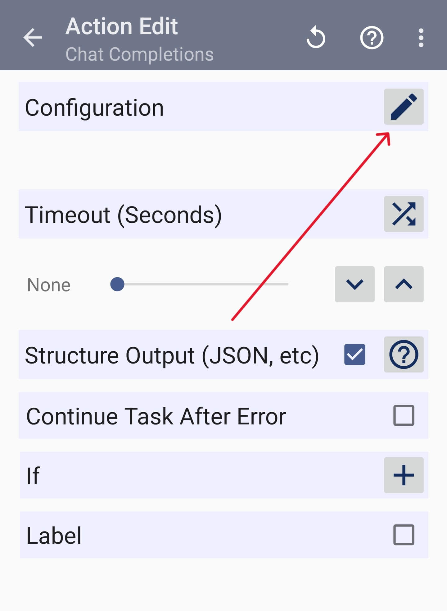
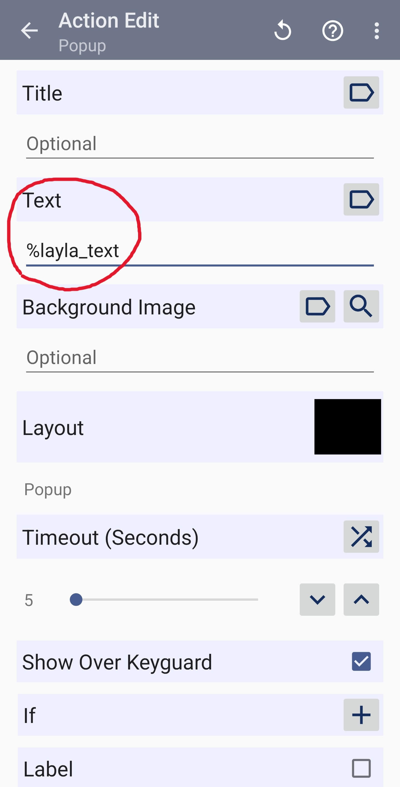

Layla include un plugin Tasker che aggiunge un'IA sul dispositivo alle tue automazioni Android. Un'attività Tasker può inviare un prompt a un LLM locale, generare immagini, voce e musica, leggere e scrivere la cronologia delle chat, salvare ricordi e pianificare messaggi dei tuoi personaggi. Quando usi modelli presenti sul tuo dispositivo, nulla di tutto questo viene inviato a un servizio online.

## Che cos'è Tasker?

Tasker è una popolare app Android per l'automazione. Ti permette di creare attività che vengono eseguite quando sul dispositivo si verifica una condizione. Per esempio, puoi chiedere a Layla di riassumere una nuova e-mail appena arriva, oppure far inviare a un personaggio un promemoria tra un'ora.

Poiché Layla esegue i modelli in locale, queste automazioni possono funzionare senza connessione a Internet e senza costi per richiesta. Layla usa il motore di inferenza che hai impostato come predefinito, quindi le attività seguono la stessa configurazione delle tue chat.

*Nota: Tasker è un'app separata e richiede un acquisto su [Google Play](https://play.google.com/store/apps/details?id=net.dinglisch.android.taskerm&hl=it). Layla non è affiliata a Tasker.*

L'integrazione con Tasker è disponibile solo su Android.

## Cosa puoi automatizzare con Layla e Tasker?

Qualsiasi trigger di Tasker può avviare un'azione di Layla e il risultato può alimentare l'azione successiva dell'attività. Alcuni esempi:

- **Riassumere notifiche o e-mail.** Passa il testo di una nuova notifica a **Ask Layla** e fai scrivere a un LLM locale un riassunto in una frase.
- **Leggere i messaggi ad alta voce.** Invia il testo in arrivo a **Speak Text** perché Layla lo legga con la voce che hai scelto.
- **Controllare il tono di un messaggio.** Analizza un testo con **Analyze Sentiment** e fai diramare l'attività in base all'emozione prevalente.
- **Generare immagini o musica con un trigger.** Usa **Generate Image** o **Generate Music** con una descrizione costruita da variabili Tasker, come l'ora del giorno o un evento del calendario.
- **Pianificare promemoria da un personaggio.** Usa **Schedule Character Message** per far inviare a uno dei tuoi personaggi un messaggio a un'ora stabilita.
- **Conservare appunti come ricordi.** Usa **Remember Text** per salvare del testo nella memoria a lungo termine di un personaggio.

## Passo dopo passo: crea la tua prima attività Layla

Questa guida crea un'attività Tasker che invia un messaggio a Layla e mostra la risposta sullo schermo. Una volta fatto, aggiungere qualsiasi altra azione di Layla funziona allo stesso modo.

### Passo 1: crea un'attività e aggiungi un'azione

Apri Tasker, crea una nuova attività e tocca **+** per aggiungere un'azione. Tasker ti chiede di selezionare una categoria di azioni. Scegli **Plugin**.


### Passo 2: scegli Layla

Tasker elenca le app che offrono azioni plugin. Tocca **Layla**.


Se Layla non compare nell'elenco, verifica che Layla sia installata sullo stesso dispositivo e aggiornata.

### Passo 3: scegli un'azione

Layla mostra tutte le sue azioni Tasker. Per questa guida scegli **Chat Completions**. Consulta [Azioni disponibili](#azioni-disponibili) più avanti per sapere cosa fa ogni azione.


Tasker può omettere «Layla» dal nome di un'azione in questo elenco, quindi **Ask Layla** può comparire come **Ask**.

### Passo 4: apri la configurazione

Nella pagina dell'azione, tocca l'icona a forma di matita accanto a **Configuration**. Si apre la schermata di Layla per configurare l'azione.



### Passo 5: inserisci la richiesta e salva

Inserisci il messaggio che vuoi inviare a Layla. Per esempio:

```
{"messages":[{"role":"user","content":"Hello, how are you?"}]}
```

Al posto del testo puoi anche usare una variabile Tasker, come `%prompt`. Lascia attivata l'opzione **JSON-escape variable values**, così virgolette e interruzioni di riga nelle tue variabili non causano problemi. Poi tocca **Save** per tornare a Tasker.


Il timeout è impostato su **None** per impostazione predefinita. In questo modo Layla può impiegare tutto il tempo necessario per rispondere.

### Passo 6: mostra il risultato

Layla restituisce la sua risposta nella variabile `%layla_text`. Per vederla, aggiungi un'altra azione dopo Chat Completions: scegli la categoria **Alert**, poi **Popup**, e inserisci `%layla_text` come **Text**.



### Passo 7: esegui l'attività

Tocca il pulsante di riproduzione in fondo alla schermata dell'attività. Layla genera una risposta e Tasker la mostra nel popup.


La prima esecuzione può richiedere più tempo, perché Layla deve caricare il suo modello.

## Usare variabili e output

Ogni campo di testo di un'azione di Layla accetta variabili Tasker, così puoi passare l'output di un'azione alla successiva. Per esempio, puoi impostare una variabile con il testo di una notifica e poi usarla come prompt per **Ask Layla**.

Ogni azione restituisce i propri risultati come variabili Tasker, che puoi usare in qualsiasi azione successiva, come ha fatto il popup nella guida qui sopra. Le azioni di Layla avviano Layla in background se non è già in esecuzione, quindi non devi aprire prima l'app.

## Azioni disponibili

### Chat e testo

| Azione | Cosa fa |
| --- | --- |
| **Ask Layla** | Invia un prompt a Layla, con istruzioni di sistema facoltative, e restituisce la risposta. Ogni richiesta è indipendente e non legge né modifica alcuna cronologia chat. |
| **Analyze Sentiment** | Analizza le emozioni in un testo. |
| **Chat Completions** | Un'azione avanzata che accetta una richiesta di chat completa con più messaggi, per quando vuoi fornire tu l'intera conversazione. |

Ask Layla e Chat Completions sono le azioni da usare per eseguire un prompt LLM da Tasker. Usano il motore di inferenza che hai impostato come predefinito in Layla, quindi un modello locale sul tuo dispositivo funziona senza ulteriore configurazione in Tasker.

**Ask Layla** restituisce:

- `%layla_text`: la risposta di Layla.

**Analyze Sentiment** restituisce:

- `%layla_emotion`: l'emozione prevalente trovata nel testo.
- `%layla_emotion_score`: il punteggio di quell'emozione, da 0 a 1.
- Un punteggio per ogni singola emozione, come `%layla_sentiment_joy` o `%layla_sentiment_sadness`.

### Voce, immagini e musica

Queste azioni portano in Tasker la sintesi vocale con IA, la generazione di immagini e la generazione di musica. Consulta [Come attivare la generazione di immagini in Layla](/it/how-to-enable-image-generation-in-layla/), [Come ascoltare i tuoi personaggi parlare in Layla](/it/how-to-hear-your-characters-speak-in-layla/) e [Come generare musica offline in Layla con ACE-Step](/it/how-to-generate-music-offline-in-layla-with-ace-step/) per configurare i modelli usati da queste azioni.

| Azione | Cosa fa |
| --- | --- |
| **Speak Text** | Legge un testo ad alta voce con la voce di Layla e attende la fine della lettura. Lascia vuota la voce per usare quella predefinita. |
| **Generate Speech File** | Trasforma un testo in un file audio senza riprodurlo. La voce è facoltativa. |
| **Generate Image** | Genera un'immagine da un prompt. Il modello di immagini è facoltativo; lascialo vuoto per usare quello predefinito. |
| **Generate Music** | Genera un brano da una descrizione dello stile. Testo, durata in secondi e modello musicale sono facoltativi. |

Le immagini e l'audio generati vengono restituiti come file che Tasker può leggere:

- Immagini: `%layla_image_uri`, `%layla_image_mime` e `%layla_image_name`.
- Voce e musica: `%layla_audio_uri`, `%layla_audio_mime` e `%layla_audio_name`.

Questi file sono conservati nella cache di Layla. Rimangono lì finché non svuoti le cache di Layla o Android non le rimuove, quindi usa l'azione **Copy File** di Tasker per salvarli in modo permanente. Nulla viene riprodotto automaticamente.

Per generare file vocali serve una voce di sintesi vocale in grado di creare file audio. Per generare musica occorre che il modello di generazione musicale sia configurato in Layla.

### Personaggi, chat e ricordi

| Azione | Cosa fa |
| --- | --- |
| **List Characters** | Restituisce i nomi e gli ID dei tuoi personaggi. |
| **List Chat Sessions** | Restituisce le chat di un personaggio, con l'ultimo messaggio di ciascuna. |
| **Get Chat History** | Restituisce i messaggi di una chat. Puoi scegliere quanti restituirne e quanti saltarne. |
| **Save Chat Message** | Aggiunge un messaggio a una chat, da parte tua o di un personaggio. Non genera una risposta. |
| **Remember Text** | Aggiunge un nuovo ricordo a un personaggio. Richiede che il modello di memoria a lungo termine sia scaricato. |
| **Get Memories** | Restituisce i ricordi più recenti di un personaggio oppure i suoi ricordi principali. |
| **List Voices** | Restituisce i nomi e gli ID delle voci disponibili. |

Le azioni di elenco restituiscono i risultati come array corrispondenti. La voce in posizione 1 dei nomi appartiene alla voce in posizione 1 degli ID, e così via:

- List Characters: `%layla_character_ids()` e `%layla_character_names()`.
- List Chat Sessions: `%layla_session_ids()` e `%layla_last_messages()`.
- List Voices: `%layla_voice_ids()` e `%layla_voice_names()`.

Usa gli ID restituiti da queste azioni nelle altre azioni. Per esempio, esegui **List Characters** per trovare l'ID di un personaggio, poi passalo a **Remember Text** o **Get Memories**.

Altri output:

- Get Chat History: `%layla_text` è una trascrizione leggibile, dal più vecchio al più recente.
- Get Memories: `%layla_memory_ids()` e `%layla_memory_texts()`.
- Remember Text: `%layla_memory_id` e `%layla_session_id`.
- Save Chat Message: `%layla_message_id` e `%layla_session_id`.

Alcune cose da sapere:

- **Save Chat Message** richiede una chat esistente per aggiungere un messaggio da parte tua. Per iniziare una nuova chat, fornisci un nuovo ID di sessione e salva prima un messaggio di un personaggio.
- **Get Memories** restituisce i ricordi recenti o quelli con il punteggio più alto. Non cerca i ricordi per testo.
- **Remember Text** può scrivere per te il riassunto del ricordo se lasci vuoto il campo del riassunto.
- I timestamp in **Get Memories** usano i millisecondi Unix. La variabile Tasker `%TIMEMS` restituisce l'ora attuale in questo formato.

### Messaggi dei personaggi pianificati

| Azione | Cosa fa |
| --- | --- |
| **Schedule Character Message** | Pianifica la consegna di un messaggio di un personaggio a un orario futuro. |
| **List Scheduled Character Messages** | Elenca tutti i messaggi dei personaggi pianificati e non letti, compresi quelli non creati tramite Tasker. |
| **Cancel Scheduled Character Message** | Annulla un messaggio pianificato usando il suo ID. |

La pianificazione consegna esattamente il testo che fornisci all'orario che scegli. Layla non scrive una nuova risposta al momento della consegna. Layla ha bisogno del permesso per le notifiche per consegnare i messaggi pianificati.

L'orario di consegna è un timestamp Unix in millisecondi. In Tasker puoi calcolarlo con **Variable Set** e **Do Maths**. Per esempio, `%TIMEMS + 60000` indica un minuto da adesso. Passa quella variabile come orario di consegna.

**Schedule Character Message** restituisce `%layla_scheduled_id`, che puoi usare per annullare il messaggio in seguito. L'annullamento rimuove un messaggio non ancora consegnato. Non chiude una notifica già apparsa.

### Avanzate

| Azione | Cosa fa |
| --- | --- |
| **Get Execution Context** | Restituisce in `%layla_app_version` la versione di Layla installata sul tuo dispositivo. Utile per verificare che Tasker riesca a raggiungere Layla. |
| **Raw Layla API Request** | Invia una richiesta direttamente a Layla, per sviluppatori. Consulta il [Layla SDK](https://github.com/l3utterfly/layla-sdk) per sapere cosa è disponibile. |

## Gestire errori e timeout

Se un'azione non riesce, Tasker imposta `%err` e `%errmsg`. Attiva **Continue Task After Error** per l'azione se vuoi che l'attività prosegua e legga il messaggio.

Le azioni di Layla attendono tutto il tempo necessario al lavoro, che per la generazione di immagini e musica può essere lungo. Le nuove azioni usano per impostazione predefinita un timeout di Tasker pari a **None**, cioè nessun limite di tempo. Se imposti invece un limite di tempo, Layla lo rispetta.

## Esempio: rispondere a una notifica

1. Usa un plugin Tasker come AutoNotification per acquisire il testo di una notifica in arrivo in una variabile, per esempio `%ntext`.
2. Aggiungi **Ask Layla** con il prompt `Summarise this notification in one sentence: %ntext`.
3. Aggiungi l'azione **Flash** di Tasker con `%layla_text` per mostrare il riassunto sullo schermo, oppure **Speak Text** per farlo leggere ad alta voce a Layla.

## Suggerimenti

- Le restrizioni in background di Android continuano ad applicarsi. Se le azioni falliscono quando il telefono è inattivo, controlla che l'ottimizzazione della batteria non limiti Layla.
- Assicurati che i modelli necessari a un'azione siano già scaricati in Layla, come un modello di immagini, un modello musicale o il modello di memoria a lungo termine.
- Le variabili possono contenere virgolette, interruzioni di riga e altri caratteri speciali. Layla li gestisce per te nei campi standard.

## Domande frequenti

### Posso usare un LLM in Tasker senza connessione a Internet?

Sì. Se il tuo motore di inferenza predefinito in Layla è un modello scaricato sul dispositivo, le azioni Tasker come **Ask Layla** vengono eseguite interamente sul telefono. Se hai impostato come predefinito un motore cloud o remoto, le richieste passano invece da quel motore.

### Mi serve una chiave API per usare Layla con Tasker?

No. Le azioni Tasker di Layla non richiedono una chiave API. Usano il motore di inferenza già configurato in Layla.

### Layla deve essere aperta perché un'azione Tasker venga eseguita?

No. Layla si avvia in background quando viene eseguita un'azione. Le restrizioni in background di Android continuano ad applicarsi, quindi se le azioni falliscono quando il telefono è inattivo, controlla le impostazioni della batteria per Layla.

### Tasker può generare immagini con Layla?

Sì. Usa l'azione **Generate Image** con un prompt e, facoltativamente, un modello di immagini. Tasker riceve l'immagine come file che puoi copiare, condividere o usare nelle azioni successive. Per configurare prima un modello, consulta [Come attivare la generazione di immagini in Layla](/it/how-to-enable-image-generation-in-layla/).

### Tasker può far parlare Layla o creare musica?

Sì. **Speak Text** riproduce la voce di Layla, **Generate Speech File** salva la voce come file audio e **Generate Music** crea un brano da una descrizione e da un testo facoltativo.

### Dove finiscono le immagini e i file audio generati?

Vengono salvati nella cache di Layla e rimangono lì finché non svuoti la cache o Android non li rimuove. Usa l'azione **Copy File** di Tasker per conservarli in modo permanente.
