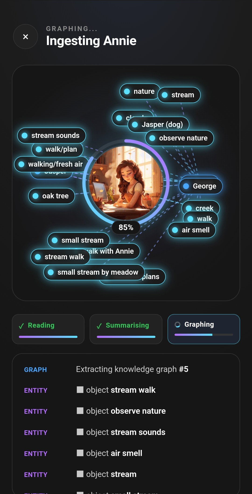

**Laylaはスマートフォン上で動作する長期記憶付きのAIチャットボットで、会話を記憶に変える方法が3つあります。返信のたびに動作する内蔵の要約機能、数回の返信ごとにチャットモデルへ記憶を書かせるAgent、そして指示したときにLLMでチャット履歴を処理するミニアプリです**。3つとも同じLong-Term Memoryストアに保存されるため、どの方法で作られた記憶でも、AIコンパニオンやロールプレイキャラクターは同じように思い出します。

方法によって、速度と品質のバランスが異なります。この記事では、AIチャットボットがそもそも忘れてしまう理由、各方法の仕組みとコスト、設定方法を説明します。キャラクターごとに方法を選ぶ際の参考にしてください。

## AIチャットボットが忘れる理由と、長期記憶で変わること

言語モデルは、メッセージの合間に何も記憶しません。返信のたびに、コンテキストウィンドウから会話を読み直します。コンテキストウィンドウに入るテキストの量には限りがあります。チャットがその上限を超えると、最も古いメッセージが収まらなくなり、AIはあなたの名前や立てた計画、物語の前半の出来事を忘れてしまいます。

長期記憶は、この上限を回避する仕組みです。Laylaは会話の短い記憶を保存し、チャット中にそれを検索して、モデルが返信する前に関連するものをコンテキストに追加します。これにより、チャット履歴の全体がコンテキストウィンドウに収まらなくても、キャラクターは数週間前の出来事を思い出せます。記憶はキャラクターごとに独立しているため、AIコンパニオン、ロールプレイキャラクター、アシスタントはそれぞれ、あなたとの自分の会話を覚えています。

Laylaはこれらの記憶をお使いのデバイス上で保存し、検索します。ローカルLLMを使えば、チャットも記憶も自分のデバイスの中にとどまります。企業のサーバーに会話を預けることなく、あなたを覚えているプライベートなAIチャットボットを使えます。

## AIに長期記憶を持たせる3つの方法

|                        | 内蔵の自動収集             | Auto-collect Memories Agent              | LLM-based Long-term Memoryミニアプリ             |
| ---------------------- | -------------------------- | ---------------------------------------- | ------------------------------------------------ |
| **記憶を書くもの**     | 内蔵の小型要約モデル       | チャットモデル                           | 選択した任意の推論エンジン                       |
| **動作するタイミング** | 返信のたびに自動           | 3回の返信ごとに自動                      | **Start ingesting memories**をタップしたときだけ |
| **対応言語**           | 英語のみ                   | チャットモデルが扱える任意の言語         | 選択したモデルが扱える任意の言語                 |
| **品質**               | 基本的な要約               | 良好：キャラクター自身がメモを書く       | 最高：プロンプトを自分で制御できる               |
| **速度**               | 高速で、チャットに影響なし | 3回の返信ごとにモデル呼び出しが1回増える | 低速だが、チャットの外で実行される               |
| **カスタマイズ**       | なし                       | AgentのコードでPromptを編集              | キャラクターごとのシステムプロンプトと指示       |

3つとも、記憶を保存し、それを検索するモデルをダウンロードする**Long Term Memory**ミニアプリが必要です。キャラクターごとに記憶を有効または無効にするのも、このミニアプリです。見つける場所は、[Laylaに機能（ミニアプリ）を追加する方法](/ja/how-to-add-features-mini-apps-in-layla/)で確認できます。

## 方法1：内蔵の自動収集（高速で自動）

Long Term Memoryミニアプリをインストールすると、Laylaはデフォルトでこの方法を使います。会話を覚えるAIを手に入れる最も簡単な方法です。

キャラクターが返信するたびに、Laylaはチャットの直近3件のメッセージを取り出し、ミニアプリに内蔵された小型の要約モデルに渡します。要約、元のメッセージ、言及された人や物の簡単なグラフが、1つの記憶として保存されます。この処理はデバイス上でバックグラウンドで行われます。チャットモデルは使用しないため、会話が遅くなったり、メモリを奪い合ったりすることはありません。

制限は、この小型モデルに由来します。

- **英語しか理解できません。** 他の言語のチャットでは、品質の低い、または意味をなさない要約になります。他の言語でチャットする場合は、残りの2つの方法のどちらかを使ってください。
- **要約は短く、文字どおりです。** モデルは話された内容を圧縮するだけで、何が重要かは判断しません。雑談も重要な出来事と同じように保存されます。
- **設定項目はありません。** キャラクターごとにオンとオフを切り替えるだけです。

### オンまたはオフにする方法

1. **Long Term Memory**ミニアプリを開きます。
2. **Characters**でキャラクターを選択します。
3. **Per character settings**で**Auto-collect memories for this character**を操作します。

**Enable LTM for this character**は別のスイッチです。チャットでの記憶の呼び出しを含め、そのキャラクターがLong-Term Memoryを使うかどうかを制御します。自動収集をオフにしてLTMをオンのままにできます。ほかの2つの方法はこの状態を必要とします。

## 方法2：Auto-collect Memories Agent（キャラクター自身の言葉による記憶）

**Auto-collect Memories** Agentは、記憶を持つAIコンパニオンのあるべき姿として、キャラクター自身にメモを取らせます。あなたについて何を覚えておく価値があるかを、キャラクターが判断します。キャラクターが3回返信するたびに、ロールプレイを一時停止し、そのやり取りのうちキャラクターが覚えておきたいことをチャットモデルに尋ねます。あなたに関する事実、重要な出来事、約束や計画、そしてキャラクターの気持ちです。モデルは会話の全体とキャラクターの直近の記憶を見ているため、すでに保存した細部は省けます。

Agentは次のように動作します。

- 1回の実行で最大3件の記憶を保持します。
- 1〜5の重要度で、モデルが3未満と評価したものは破棄します。
- 残りをLong-Term Memoryに保存します。記憶はキャラクターの口調で、一人称で書かれます。
- キャラクターの返信の下に**Saved to memory**カードを表示し、何が保存されたかを確認できます。

モデルが記憶を書くため、内蔵の要約より質が高くなります。記憶は言い回しではなく会話の意味に沿い、ロールプレイでは重要なキャラクターの口調を保ち、モデルが扱える任意の言語で動作します。代償は速度です。3回目の返信ごとにモデルへの追加リクエストが発生し、そのリクエストが終わるまで記憶カードは表示されません。[OpenAI互換接続](/ja/how-to-connect-layla-to-any-openai-compatible-api/)で有料APIを使っている場合は、このリクエストでトークンも消費されます。

### 設定方法

1. まだの場合は、**Agents**ミニアプリをインストールします。手順は[LaylaでAgent、Function、Tool Callingを有効にする方法](/ja/how-to-enable-agents-functions-and-tool-calling-in-layla/)で説明しています。
2. キャラクターの設定を開き、**Advanced**タブのAgent選択で**Auto-collect Memories** Agentを関連付けます。選択欄の場所は[LaylaでカスタムAIキャラクターを作成する方法](/ja/how-do-i-create-custom-characters/)で確認できます。キャラクターに関連付けたAgentは、Agentsミニアプリでオフになっていても、そのキャラクターに対して実行されます。
3. **Long Term Memory**ミニアプリで、同じキャラクターの**Auto-collect memories for this character**をオフにします。両方が動作すると、すべての会話が二重に収集されます。
4. いつもどおりチャットします。3回返信すると、最初の**Saved to memory**カードが表示されます。

Laylaのデフォルトキャラクターは、関連付けたAgentの一覧を使わず、AgentsミニアプリでオンになっているすべてのAgentを使います。デフォルトキャラクターでこの方法を使うには、代わりにAgentsミニアプリでAuto-collect Memories Agentをオンにします。Agentsミニアプリで「memor」を検索すると、すぐに見つかります。

### Agentが覚える内容を変更する

Agentのカードで**Edit**をタップして開きます。ダイアログの先頭にはID、名前、説明があり、説明には上記の設定手順が書かれています。

プロンプトは、ダイアログをさらに下へ進んだところにあるAgentのEvalツールのコードの先頭にあります。たとえば事実に集中して感情は無視するように書き換えられますが、末尾で求められているJSON形式は保持してください。プロンプトの下には、実行頻度（`COLLECT_EVERY_N_REPLIES`）、1回の実行で保持する記憶の数（`MAX_MEMORIES`）、保持する最小の重要度（`MIN_IMPORTANCE`）の設定があります。

記憶の保存に失敗した場合、たとえばLong Term Memoryミニアプリがインストールされていない場合、Agentは24時間の間、保存を試みなくなります。実行のたびに、キャラクターのワークスペースにある`auto-collect-memories/last-run.log`へログが書き込まれます。カードが表示されないときは、まずここを確認してください。

## 方法3：LLM-based Long-term Memoryミニアプリ（最高品質の記憶）

**LLM-based Long-term Memory**ミニアプリは、実行を選んだときに、チャット履歴を別の工程で処理します。ローカルでもオンラインでも、選んだLLMを使って各記憶を書き、チャットに登場する人、場所、出来事のナレッジグラフを作成します。品質と制御性は最高ですが、低速で手動です。

このミニアプリは、Layla SDKで作られたミニアプリのギャラリーであるLayla Cloud Appsで公開されています。インストールするには、スマートフォンで[Layla Cloud AppsのLLM-based Long-term Memoryページ](https://apps.layla-cloud.com/app/llm-based-long-term-memory)を開き、**Open in Layla**をタップします。結果の保存先としてLong Term Memoryミニアプリも必要です。

取り込みを開始すると、ミニアプリは次の処理を行います。

1. **読み取り：** キャラクターのチャットを、そのキャラクターがすでに持つ最新の記憶より後から読み取ります。そのため、新しいメッセージだけが処理されます。
2. **要約：** メッセージを3件ずつの重なり合うウィンドウで要約します。各ウィンドウを、要約プロンプトとともにモデルへ送ります。
3. **グラフ化：** 各要約について、含まれる人、場所、出来事、特徴、物と、それらの関係を抽出するようモデルに依頼します。
4. **保存：** 各結果を、元のメッセージ、要約、グラフとともに記憶として保存します。

### 独自のプロンプトを書く

キャラクターごとに設定があり、実行の間も保存されます。

- **Inference engine。** [保存済みの推論エンジン](/ja/how-saved-inference-engines-work-in-layla/)のいずれか、またはデフォルトのエンジンを選びます。取り込みはチャットの外で実行されるため、チャットに使っているものより大きい、または遅いローカルLLMや、好みに応じてオンラインモデルを選べます。
- **Summarising conversations。** 記憶に何を含めるかを決める**System prompt**と**Custom instruction**です。デフォルトでは、継続的に意味を持つ事実、感情、関係、転機を残し、雑談は無視するようモデルに依頼します。ロールプレイなら物語の筋や登場人物、アシスタントならプロジェクトや締め切りなど、好きな内容に集中するよう変更できます。
- **Constructing the knowledge graph。** グラフを抽出するための2つ目のシステムプロンプトと指示です。デフォルトの指示が求めるJSON形式は保持してください。

2つのシステムプロンプトは、テンプレート`{{char}}`、`{{user}}`、`{{persona}}`、`{{description}}`、`{{personality}}`、`{{character_card}}`を使用できます。これらは、リクエストのたびにキャラクターとそのペルソナの内容で置き換えられます。

### 取り込みを実行する

**Start ingesting memories**をタップします。画面には各段階が進行に合わせて表示され、**X**ボタンでキャンセルできます。

メッセージのウィンドウごとにモデルへのリクエストが2回必要なため、チャット履歴が長いとスマートフォンでは長い時間がかかることがあります。実行中は、Laylaを前面に表示したままにしてください。新しい会話を処理したいときは、いつでも再実行できます。スケジュール機能はありません。

### そのキャラクターの自動方式をオフにする

ミニアプリは、キャラクターの最新の記憶より後から読み取りを始めます。そのキャラクターで内蔵の自動収集やAgentも動作していると、最新の記憶は常に直近のものになるため、ミニアプリが処理する新しい内容はほとんど、または全く見つかりません。この方法で取り込むキャラクターでは、両方をオフにしてください。

## どの方法を使うべきか

- **内蔵の自動収集**は、英語でチャットし、設定なしで、速度にも影響せずに記憶を動作させたい場合に向いています。過去のチャットの要点だけを思い出せればよい、日常使いのアシスタントに適しています。
- **Auto-collect Memories Agent**は、他の言語でチャットする場合や、話された内容ではなく重要だった内容を記憶に残したい場合で、3回に1回の返信がやや遅くなってもかまわないときに向いています。あなたや計画、あなたへの気持ちを覚えているべきAIコンパニオンや友人に適しています。
- **LLM-based Long-term Memoryミニアプリ**は、最高の記憶と、何に集中するかの完全な制御を求め、たとえば1日1回など、自分で実行するのを苦にしない場合に向いています。カスタムプロンプトで筋、登場人物、世界観を追跡できる、長いAIロールプレイのキャンペーンに適しています。

キャラクターごとに別の方法を選べます。ただし、1つのキャラクターで同時に使う方法は1つだけにしてください。

## よくある質問

### AIチャットボットが物事を忘れるのはなぜですか。

どのモデルも、コンテキストウィンドウの大きさに限りがあります。会話がそのウィンドウより長くなると、最も古いメッセージが除外され、モデルはそれを見られなくなります。長期記憶は、それらのメッセージの重要な部分を保存し、関連するときに呼び戻します。

### 過去の会話を覚えているAIチャットボットはありますか。

はい。Laylaは、Long-Term Memoryミニアプリを通じて各キャラクターとの過去の会話を覚えています。しかも、サーバーではなくスマートフォン上で行います。この記事の方法は、その記憶がどのように書かれるかを決めるものです。

### Laylaは私が言ったことをすべて覚えていますか。

いいえ。会話の記憶を保存し、今話している内容に合うものだけを呼び出します。呼び出される記憶の数と、どれだけ近い内容でなければならないかは、Long Term Memoryミニアプリの**Max Number of Memory Injections**と**Minimum Memory Score**の設定で制御します。

### 異なる方法で作られた記憶は一緒に使えますか。

はい。3つとも同じLong-Term Memoryストアに保存され、チャットでの呼び出しはすべて同じように動作します。すでにキャラクターが覚えている内容を失うことなく、別の方法に切り替えられます。

### 別の言語でチャットしているのに、キャラクターの記憶が英語になるのはなぜですか。

内蔵の要約機能は英語しか理解できません。チャットの言語で記憶を書ける言語モデルを使う、Auto-collect Memories AgentまたはLLM-based Long-term Memoryミニアプリを使ってください。

### 長期記憶はオフラインで動作しますか。

はい。ローカルモデルを使えば動作します。3つの方法はすべてデバイス上で動作するため、インターネット接続なしで、記憶を持つオフラインAIチャットボットを使えます。

### これでチャットがインターネットに送信されますか。

オンラインモデルを選ばない限り、送信されません。チャットモデルや取り込みエンジンがオンラインAPIの場合は、通常のチャットと同じように、Agentやミニアプリがメッセージをそのサービスへ送信します。

### 記憶を編集または削除できますか。

はい。**Long Term Memory**ミニアプリを開き、キャラクターを選択して、記憶を開きます。要約や関係を編集したり、削除したりできます。

どの方法を選んでも、記憶はスマートフォンの中にとどまり、キャラクターはクラウドサービスやサブスクリプションなしで、以降のチャットで思い出せます。それがLaylaにおける長期記憶です。自分の所有するハードウェア上で、あなたを覚えているオフラインのAIです。
