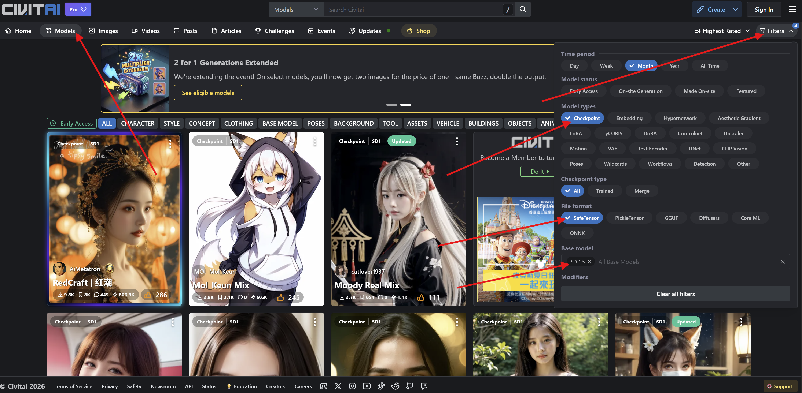

**NPU Forgeは、Stable Diffusionのsafetensorsチェックポイントを、Snapdragonスマートフォンに搭載されたQualcomm NPUで動作する形式であるQNNモデルに変換するLaylaのミニアプリです。** `.safetensors`ファイルを選ぶと、Laylaが変換可能かどうかを確認し、変換がスマートフォン上で実行されます。完了すると、モデルがLocal Dreamに表示され、すぐに画像を生成できます。

Laylaは、[CivitaiのSD1.5 SafetensorモデルをLaylaにインポートする方法](/how-to-import-sd1-5-safetensor-models-from-civit-ai-into-layla/)で説明しているとおり、safetensorsチェックポイントをそのままインポートすることもできます。その方法で作られるモデルは、端末のCPUで動作します。NPU Forgeは、対応するSnapdragonチップを搭載したスマートフォン向けに、もう1つの方法を提供します。同じチェックポイントを変換して、NPUで画像を生成できるようにする方法で、こちらのほうが高速です。

この記事では、必要なもの、チェックポイントを変換する手順、所要時間、変換したモデルで画像を生成する方法を説明します。変換も画像生成も端末上で行われるため、データがアップロードされることはありません。

## NPU Forgeが変換できるもの

NPU Forgeは、次の2種類のチェックポイントに対応しています。

- **Stable Diffusion 1.5(SD 1.5)**: Civitaiで最も一般的なチェックポイントのファミリーです。
- **Stable Diffusion XL(SDXL)**: 1024 x 1024の画像を生成する、より大きなファミリーです。

どちらを選んだかをLaylaに伝える必要はありません。Laylaがファイルを読み取り、ファミリーを自動で判別します。モデルは各ファミリーの標準解像度(SD 1.5は512 x 512、SDXLは1024 x 1024)向けに変換されます。

変換できないチェックポイントもあります。SD 2.xモデル、インペイント用モデル、SDXLリファイナーモデルには対応していません。Laylaは開始前にそのことを知らせるので、使えないファイルに時間を費やすことはありません。

## 必要なもの

- NPUを搭載したQualcomm Snapdragonチップ入りのAndroidスマートフォン。Laylaがチップを認識できない場合、NPU Forgeの画面上部にメッセージが表示されます。
- SDXLチェックポイントを変換する場合は、Snapdragon 8 Gen 3以降。SD 1.5は、より幅広いSnapdragonチップで動作します。
- Android 13以降。
- ミニアプリ_NPU Forge_。約216 MBの変換ツールをダウンロードします。ミニアプリをインストールしたことがない場合は、[Laylaでミニアプリを有効または無効にする方法](/how-to-enable-disable-mini-apps-within-layla/)をご覧ください。
- ミニアプリ_Local Dream_。画像を生成するときに使うアプリです。変換したモデルに必要なNPUランタイムもダウンロードします。NPU ForgeはLocal Dreamがなくてもモデルを変換できますが、Local Dreamがそのファイルを取得するまで、モデルは動作しません。
- スマートフォンに保存した`.safetensors`チェックポイント。
- 空きストレージとメモリ。具体的な数値は次のセクションにあります。

NPU ForgeはAndroidでのみ利用できます。対象となるNPUがQualcommの機能であるため、このミニアプリはiOSでは利用できません。

## ストレージ、メモリ、所要時間

変換は負荷の高い処理です。Laylaは開始前にスマートフォンの状態を測定し、不足していそうな場合は警告します。以下は、Androidや他のアプリのための余裕を含めて推奨される、おおよその量です。

|                                | SD 1.5 | SDXL    |
| ------------------------------ | ------ | ------- |
| メモリ(RAM)                    | 約5 GB | 約8 GB  |
| 空きストレージ                 | 約3 GB | 約23 GB |
| Snapdragon 8 Eliteでの所要時間 | 約2分  | 約22分  |

ストレージの数値は、Laylaがチェックポイントを自身の領域にコピーした後で測定されます。そのため、チェックポイント自体の分に加えて、この空き容量が必要です。チップの処理速度が遅い場合、上記の時間よりも長くかかります。

この警告は助言であり、実行を妨げるものではありません。スマートフォンのリソースが足りない場合でも変換を開始できますが、途中でメモリやストレージが不足して失敗する可能性があります。

## safetensorsチェックポイントを変換する手順

### ステップ1: チェックポイントを入手する

SD 1.5またはSDXLのチェックポイントをスマートフォンにダウンロードします。[Civitai](https://civitai.com/)で、**Model Type: Checkpoint**、**File format: SafeTensor**、目的の**Base Model**で絞り込みます。

ダウンロードしたファイルは削除せずに残しておいてください。NPU Forgeが変換するのは元の`.safetensors`ファイルであり、すでにLaylaにインポートしたモデルではありません。以前に**カスタムモデルを追加**からインポートした場合でも、変換には元のファイルが必要です。

### ステップ2: NPU Forgeを開く

*マイアプリ*からミニアプリNPU Forgeを開きます。ショートカットもあります。対応するQualcomm NPUを搭載したスマートフォンでは、推論設定の**カスタムモデルを追加**画面に、safetensorsを変換して画像生成を高速化することを勧める案内が表示されます。これをタップすると、アプリを閲覧の画面でNPU Forgeが開き、そこからインストールできます。

画面に_NPU Forge のアセットがありません_のようなメッセージが表示された場合は、変換ツールがまだダウンロードされていません。先にミニアプリのページからダウンロードしてください。

### ステップ3: チェックポイントを選択する

**Select a safetensors checkpoint**(safetensorsチェックポイントを選択)をタップして、ファイルを選びます。Laylaはファイルを自身のストレージにコピーして検査します。大きなファイルはコピーに少し時間がかかります。

拡張子が`.safetensors`でないファイルを選ぶと、Laylaは受け付けません。

### ステップ4: 検出されたモデルを確認する

検査が終わると、**検出されたモデル**カードに、Laylaが見つけた内容が表示されます。

- モデルのファミリー(SD 1.5またはSDXL)
- 重みの数とファイルサイズ
- モデルの3つの主要な部分(UNet、CLIPテキストエンコーダー、VAE)が見つかったかどうか
- **Convertible**(変換可能)または**Not convertible**(変換不可)のラベル

ラベルが_Not convertible_の場合、カードに理由が表示されます。たとえば、モデルに必要な部分が欠けている場合などです。その場合は、別のチェックポイントを選んでください。

SDXLチェックポイントを選び、スマートフォンのチップが古い場合、LaylaはSDXLにSnapdragon 8 Gen 3以降が必要であることを知らせ、**Start conversion**ボタンは無効のままになります。

### ステップ5: LoRAを追加する(任意)

LoRAは、モデルのスタイルを変えたり、キャラクターやコンセプトを覚えさせたりする小さな追加ファイルです。NPU Forgeは、変換の際にLoRAをモデルに統合できます。

1. **Add a LoRA**(LoRAを追加)をタップして、`.safetensors`形式のLoRAファイルを選びます。
2. 強度を設定します。デフォルトは1.0です。値を小さくすると、LoRAの効果が弱くなります。
3. 複数のLoRAを追加する場合は、同じ操作を繰り返します。リストの順番に適用されます。
4. LoRAを削除するには、横にあるゴミ箱アイコンをタップします。

LoRAはモデルに組み込まれます。あとからオフにしたり、強度を変更したりすることはできません。別の組み合わせを使いたい場合は、目的のLoRAを指定してチェックポイントをもう一度変換してください。統合されるのはLoRAのうち画像モデル本体に作用する部分だけで、一部のLoRA形式には対応していない場合があります。

### ステップ6: モデルに名前を付ける

Laylaはチェックポイントのファイル名を提案します。変更することもできます。名前は既存のモデルフォルダーと同じにはできません。また、`/`や`:`のようにファイルシステムで使えない文字は、スペースに置き換えられます。

### ステップ7: 変換を開始する

**Start conversion**(変換を開始)をタップします。全画面の進行状況シートが表示され、たとえば_重みを抽出中_や_NPU 用にコンパイル中_といった現在の段階と、処理中のモデルの部分が表示されます。

実行中は次の点に注意してください。

- **キャンセルしたり、バックグラウンドに移したりすることはできません。** Laylaをフォアグラウンドで開いたままにしてください。
- **スマートフォンを充電器につないでください。** 最も長い段階は、特にSDXLでは数十分かかることがあります。
- 変換中は、Androidがプロセスを停止しないように通知が表示されます。
- 画面が暗くなることがありますが、問題ありません。

変換では、まずテキストエンコーダーを変換し、次にUNetを量子化してNPU向けにコンパイルします。SD 1.5では、VAEにも同じ処理を行います。SDXLでは、チェックポイント内のVAEを変換する代わりに、NPU Forgeに同梱された共通のVAEを使用します。そのため、SDXLチェックポイント自身のVAEは結果に影響しません。

### ステップ8: 完了

変換が終わると、Laylaに**変換完了**と表示されます。モデルは画像生成モデルに保存されて自動的に選択され、チェックポイントの一時コピーは削除されます。元のファイルには手を加えません。

変換に失敗した場合は、Laylaがエラーを表示し、途中までの出力を削除します。そのため、同じ名前でもう一度試せます。

## 変換したモデルで画像を生成する

ミニアプリ**Local Dream**を開きます。変換したモデルはすでに選択されています。別のモデルに切り替えるには、モデル一覧から選びます。

プロンプトを入力して、**生成**をタップします。

Laylaは各ファミリーに初期設定を入れます。SD 1.5はステップ数30とCFGスケール7、SDXLはステップ数20とCFGスケール4です。どちらもLocal Dreamで変更でき、変換したモデルは、統合したLoRAを含め、元のチェックポイントのスタイルを保ちます。

スマートフォンのチップがモデルの要件に合わない場合、Local Dreamは**生成**の上に警告を表示します。そのまま生成を試すこともできますが、失敗する可能性があります。

変換したモデルは、キャラクターがチャットで画像を生成するときにも使えます。画像生成モデルの一覧にある通常の項目として扱われるためです。キャラクターごとにモデルを選ぶ方法は、[Laylaで画像生成を有効にする方法](/how-to-enable-image-generation-in-layla/)をご覧ください。

## よくある質問

### Laylaで使うには、チェックポイントを変換する必要がありますか?

いいえ。Laylaはsafetensorsファイルをそのままインポートして、CPUで実行できます。対応するSnapdragon NPUがあり、より高速に生成したい場合に、NPU Forgeで変換します。

### すでにLaylaにインポートしたモデルを変換できますか?

直接はできません。NPU Forgeは元の`.safetensors`ファイルを読み込みます。そのファイルが残っていればNPU Forgeで選択してください。削除してしまった場合は、もう一度ダウンロードします。

### SD 2.x、インペイント用、SDXLリファイナーのモデルを変換できますか?

いいえ。対応しているのは、SD 1.5とSDXLベース型のチェックポイントのみです。

### NPU Forgeに、スマートフォンにQualcomm NPUがないと表示されるのはなぜですか?

Laylaは、スマートフォンが報告するチップセットから判断します。MediaTekやSamsung Exynosなど他社のチップを搭載したスマートフォンはQNNモデルを実行できないため、NPU Forgeは使えません。

### 変換にはインターネット接続が必要ですか?

最初にミニアプリとそのファイルをダウンロードするときだけ必要です。変換自体はスマートフォン上で実行され、チェックポイントも端末内にとどまります。

### 変換を途中で止められますか?

いいえ。NPU Forgeでは変換をキャンセルしたりバックグラウンドに移したりできません。スマートフォンを操作せずに置いておけるときに、できれば充電器につないで開始してください。

### 変換後にLoRAの強度を変更できますか?

いいえ。強度は変換時に固定されます。新しい値と新しいモデル名で、元のチェックポイントをもう一度変換してください。

### 変換したモデルを削除するには?

Local Dreamを開き、モデルを選択して、削除オプションを使います。モデルが使っていたストレージが解放されます。

### 変換をより細かく制御するには?

LaylaのNPU Forgeは、ほとんどのチェックポイントに適した妥当なデフォルト設定を使います。クリップスキップや別のVAE精度などのオプションが必要な場合は、[GitHub](https://github.com/AbrahamPaulJ/npuforge)にある元のプロジェクトをご覧ください。

## クレジット

NPU ForgeはAbrahamPaulJによって作られ、ミニアプリには[GitHub上の元のプロジェクト](https://github.com/AbrahamPaulJ/npuforge)へのリンクがあります。Laylaの画像生成は、XORORZが作った[Local Dream](https://github.com/xororz/local-dream)によって動いています。
