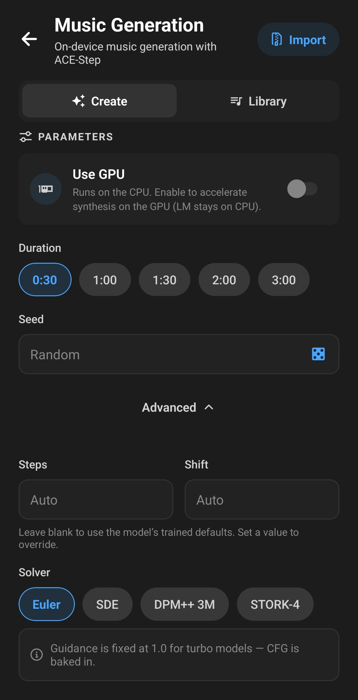
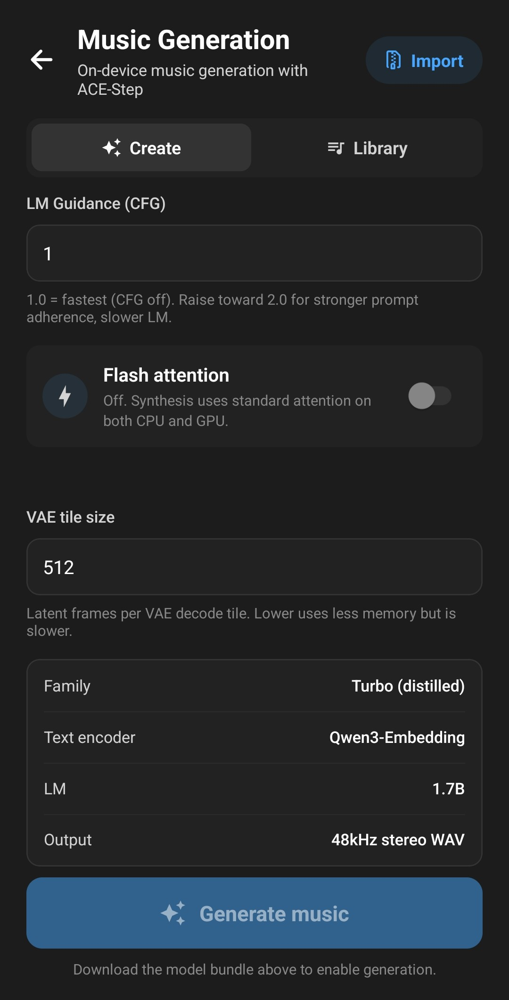

**Laylaは、ACE-Step 1.5音楽モデルを使って、スタイル・メロディ・アレンジ・歌唱パートまで含めた楽曲をスマートフォン上だけで生成できます。データは一切アップロードされず、アカウントも不要で、ネットワークを切った状態でも動作します。**


この記事では、Music Generationミニアプリのインストール、モデルバンドルのダウンロード、プロンプトの書き方、そして速度と品質を左右するパラメータについて説明します。

## ACE-Stepとは？

ACE-Stepは、ACE StudioとStepFunが開発した音楽生成モデルです。楽曲のテキスト説明（ジャンル、雰囲気、楽器、テンポ）と、任意で歌詞を受け取り、48kHzステレオの完成した音声を生成します。

これまで使ったことがあるかもしれないオンラインのAI音楽生成サービスとは異なり、LaylaのACE-Stepは端末のCPUまたはGPU上でローカルに動作します。順番待ちも、クレジット制度も、曲数の制限もありません。その代わり、データセンターのGPUなら数秒で終わる処理に、スマートフォンでは相応の時間がかかり、モデルファイルも大きくなります。

Laylaは[acestep.cpp](https://github.com/ServeurpersoCom/acestep.cpp)というGGMLベースの実装を通じてACE-Stepを実行します。これはLaylaのテキストモデルが[llama.cpp](https://github.com/ggerganov/llama.cpp)上で動くのと同じ考え方です。モデルをスマートフォンに収まるサイズまで量子化し、手元のハードウェアで動かします。

## 必要なもの

- **AndroidまたはiOS版のLayla。** 音楽生成はどちらのプラットフォームでも同じように動作します。
- **Laylaのプレミアム版。** すべてのミニアプリに必要です。Laylaは買い切りで、サブスクリプションではありません。
- **約5GBの空き容量。** モデルバンドルはおよそ4.2GBから5.3GBです。
- **6GBのメモリ**（小さい量子化の場合）、大きい量子化には**8GB**。
- **最初の実行には少し時間がかかります。** セッション内の最初の1曲を生成する前に、モデルをメモリに読み込む必要があります。

## ステップ1：Music Generationミニアプリを有効にする

音楽生成はオプション機能のため、既定では有効になっていません。_マイアプリ_を開き、右上のプラス記号をタップして利用可能な機能を一覧し、**Music Generation (Ace Step)** を有効にしてください。

ミニアプリの仕組みを使うのが初めての場合は、[Laylaでミニアプリを有効または無効にする方法](/ja/how-to-enable-disable-mini-apps-within-layla/)をご覧ください。

有効にすると、アプリ一覧に表示され、**Create** と **Library** の2つのタブが開きます。

## ステップ2：モデルバンドルをダウンロードする

Createタブ上部のモデルカードをタップすると、バンドル選択画面が開きます。各項目は単体で完結したバンドルで、歌詞とメロディを書く言語モデル、音声を生成する拡散トランスフォーマー、テキストエンコーダー、そして結果を音に変換するデコーダーが含まれています。選ぶのは常にバンドル1つだけで、個別のファイルを組み合わせる必要はありません。

バンドルは2つの軸で分かれています。

**バリアント** — モデルの音楽的な性格：

| バリアント              | 内容                                                                       |
| ----------------------- | -------------------------------------------------------------------------- |
| Turbo                   | 8ステップの高速生成。スマートフォンでの既定候補として最適です。            |
| SFT-Turbo50             | turboとファインチューン済みモデルの統合。turboの速度でやや豊かな仕上がり。 |
| Turbo Continuous        | 連続再生やシームレスなループ向けに調整されたturbo。                        |
| Turbo Shift-1 / Shift-3 | 別のサンプリングスケジュールを用いたturbo。音色の印象が変わります。        |

**量子化** — サイズと品質のトレードオフで、[テキストモデルのGGUF量子化](/ja/what-are-gguf-models-what-are-model-quants/)と同じ考え方です：

| 量子化 | 備考                              |
| ------ | --------------------------------- |
| Q4_K_M | 最小・最も低品質。メモリ6GB。     |
| Q5_K_M | 小さくバランスが良い。メモリ6GB。 |
| Q6_K   | やや大きく高品質。メモリ8GB。     |
| Q8_0   | 最大でほぼ無損失。メモリ8GB。     |

迷ったら **Turbo Q5_K_M** から始めてください。

_Download bundle_ をタップするとバックグラウンドでダウンロードが進みます。ミニアプリを離れても、Laylaを終了しても進捗は失われません。転送が完了すると、Laylaはアーカイブを展開し、4つのモデルファイルがすべて揃っているか検証します。準備ができるとカードに _Installed_ と表示されます。

不要になったバンドルは _Delete bundle_ で削除でき、後から再ダウンロードできます。

## ステップ3：音楽を説明する

**Style** 欄が主要な操作項目です。ミュージシャンに説明するつもりで、ジャンル、雰囲気、楽器編成、プロダクション、テンポを書いてください。

弱いプロンプト：

> ポップソング

より良いプロンプト：

> 夢見るようなシンセポップ、温かみのあるアナログパッド、ゲートリバーブのドラム、息づかいの感じられる女性ボーカル、120bpm、明るくノスタルジック

具体的であるほど効果があります。このテキストはモデルに2回読まれます。1回目は言語モデルが構成と歌詞を組み立てるとき、2回目は音声そのものを生成するときです。そのため、具体的な楽器名、プロダクションを表す形容詞、テンポのいずれも結果を明確な方向に導きます。


## ステップ4：歌詞ありか、なしか

スタイル欄の下に **Lyrics** 欄と **Instrumental** スイッチがあります。

- **歌詞欄を空のままにする**と、モデルがスタイルの説明から歌詞を自分で書きます。1行のプロンプトから完成した楽曲を得る最短の方法です。
- **自分で歌詞を書く**と、モデルはそのとおりに歌います。行を分けてセクションタグを書くと、構成を指定できます：

```
[verse]
Streetlights blink along the empty road
Radio static, half a song I know

[chorus]
Drive until the morning finds us
Nothing in the mirror behind us
```

`[intro]`、`[verse]`、`[pre-chorus]`、`[chorus]`、`[bridge]`、`[guitar solo]`、`[outro]` などのタグが認識され、`[bridge - saxophone and strings]` のようにタグ自体に説明を添えることもできます。

歌唱の言語は書かれた歌詞から判定されるため、日本語、フランス語、その他モデルが対応する言語で書けば、その言語で歌われます。

- **Instrumentalを有効にする**と、ボーカルのない楽曲になります。

## ステップ5：長さとシード

**Duration** では30秒から3分までのプリセットを選べます。長い曲ほど生成時間も比例して伸びるため、プロンプトを詰めている段階では30秒が現実的な長さです。

**Seed** はランダム性を制御します。空欄のままにすれば毎回異なる結果になり、数値を入力するか（サイコロをタップしても構いません）、同じ生成を再現できます。同じシード・同じプロンプト・同じ設定なら同じ曲が生成されるので、目標に近づいていてプロンプトを一語だけ変えたいときに役立ちます。



## 楽曲を生成する

**Generate music** をタップします。処理全体を通して1本の進捗バーが伸び、現在の段階がラベルで表示されます：

1. **Loading model** — 言語モデルをメモリに読み込みます。
2. **Writing structure / Writing lyrics** — テンポ、キー、拍子、そして自分で用意しなかった場合は歌詞。
3. **Composing melody** — 音楽的な内容を組み立てます。
4. **Generating music** — 音声そのものを1ステップずつ生成します。
5. **Decoding audio** — 結果を波形に変換します。

いつでも **Stop** を押せます。生成は現在のステップが終わった時点で停止するため、実際に止まるまで少し待ち時間があります。処理が中断されないよう、Laylaはその間画面を点灯させたままにします。

生成が完了すると、波形つきのプレイヤーカードが表示されます。波形をタップすると再生位置を移動でき、再生ボタンで試聴、ダウンロードアイコンで保存や共有、ゴミ箱アイコンで削除ができます。

各楽曲は48kHzステレオのWAVとしてミニアプリ専用フォルダーに書き出され、**Library** タブに、生成に使われたモデル・ステップ数・シードとともに一覧表示されます。自動削除はされないので、不要なものは整理してください。この品質のWAVファイルは容量がすぐにかさみます。

## 詳細パラメータ

より細かく制御するには、Parametersの下にある **Advanced** を開きます。ほとんどの場合は触る必要がなく、同梱モデルには既定値が適しています。

**Steps と Shift** は既定で空欄です。これは各モデルが学習時の値を使うことを意味し、turbo系は8ステップ、baseやファインチューン済みモデルは50ステップになります。数値を入力すると上書きできます。ステップ数を増やすと通常はディテールが増え、時間も増えます。

**Solver** はサンプリングアルゴリズムを選びます：Euler、SDE、DPM++ 3M、STORK-4。既定はEulerです。同じステップ数でもソルバーを変えると仕上がりの質感が変わるため、気に入ったプロンプトが見つかったら試す価値があります。

**Guidance (CFG)** は、音声がスタイルのプロンプトにどれだけ忠実に従うかを制御します。効果のあるモデルでのみ表示されます。turboモデルはガイダンスが重みに組み込まれているため、Laylaは1.0に固定し、結果が飽和しないようその旨を表示します。

**LM Guidance (CFG)** は歌詞とメロディの段階に対して同じ働きをし、すべてのモデルに適用されます。既定値の1.0が最も高速です。2.0に近づけるとプロンプトへの忠実度が上がりますが、その段階の所要時間がおよそ倍になります。

**Use GPU** は音声生成を端末のGPU（iOSではMetal、AndroidではOpenCL）に移し、失敗した場合はCPUにフォールバックします。歌詞とメロディの段階は常にCPUで実行されます。この処理は計算量よりメモリ帯域に律速されるため、モバイルGPUではかえって遅くなるからです。CPU経路が互換性の基準となるため、GPUは既定でオフです。速くなるかどうかは、ご自身の端末で試す価値があります。

**Flash attention** は品質を多少犠牲にして音声生成を高速化します。既定ではオフです。

**VAE tile size** は一度にデコードする音声の量を決めます。値を下げると最終段階のメモリのピークが下がる代わりに少し遅くなります。生成自体は完了するのに、メモリの少ない端末で最後の最後にアプリが終了されてしまう場合に有効です。



一番下のパネルには、実際に動作している構成が要約されています。モデルファミリー、Qwen3-Embeddingテキストエンコーダー、同梱された言語モデルのサイズ、そして出力形式です。

## 自分のモデルバンドルをインポートする

選択画面にはturbo系が並んでいます。スマートフォンで実用的なのがこの系統だからです。より低速なbaseやSFTのバリアント、その他の互換バンドルは手動で追加できます。

ミニアプリ右上の _Import_ をタップし、`lm.gguf`、`dit.gguf`、`text_encoder.gguf`、`vae.gguf` を含む `.zip` ファイルを選択します。Laylaはそれを展開し、入れ子になったフォルダーを平坦化し、4つのファイルが揃っていることを確認してから一覧に追加します。インポートしたバンドルは組み込みのものとまったく同じように動作し、同じ方法で削除できます。

## より良い結果を得るために

- **30秒で試行を重ねる。** 短いクリップで気に入ったプロンプトとシードを見つけ、同じシードのままフル尺で生成し直します。
- **ジャンルだけでなくプロダクションも書く。** 「温かみのあるレコードのノイズ」「洗練されたモダンなミックス」「ヴィンテージのアナログな温かみ」はいずれも実際に効きます。
- **テンポを指定する。** スタイルのプロンプトにbpmを入れるとリズムが安定します。
- **歌詞はセクションに分ける。** タグのない文章の塊では、モデルが構成を組み立てる手がかりがありません。
- **一度に1つだけ変える。** シードを固定すれば、プロンプトの変更が何をもたらしたかを正確に聞き分けられます。

## よくある質問

### LaylaのAI音楽生成はオフラインで動作しますか？

はい。モデルバンドルをダウンロードすれば、生成はすべて端末上で行われます。機内モードにしても動作します。プロンプトや歌詞が端末外に出ることはありません。

### スマートフォンで1曲生成するのにどれくらいかかりますか？

端末、曲の長さ、量子化、ステップ数によって大きく変わります。30秒のturbo生成を試すのが、ご自身の端末の目安を知る最短の方法です。長さやステップ数を増やすと、時間もおおよそ比例して増えます。

### 音楽生成にサブスクリプションは必要ですか？

いいえ。音楽生成はLaylaのプレミアム解除に含まれており、これは買い切りです。クレジットも、曲ごとの課金も、月額料金もありません。

### 生成した音楽を商用利用できますか？

それはLaylaではなく、ACE-Stepのモデル重みのライセンスによって決まります。商用利用の前に、モデルの作者が公開している条件をご確認ください。

### 最初の生成が2回目以降より遅いのはなぜですか？

最初の1曲の前にモデルをメモリへ読み込む必要があるためです。同じセッション内の以降の生成では、その一部を省けます。

### Laylaはどの音声形式で出力しますか？

48kHzステレオのWAVです。各楽曲のダウンロードアイコンから、端末への保存や他のアプリへの共有ができます。

---

音楽生成は、[画像生成](/ja/how-to-enable-image-generation-in-layla/)やオフラインのテキストチャットと並ぶ、Laylaが端末上だけで行える機能のひとつです。アカウントも、アップロードも、接続も必要ありません。
