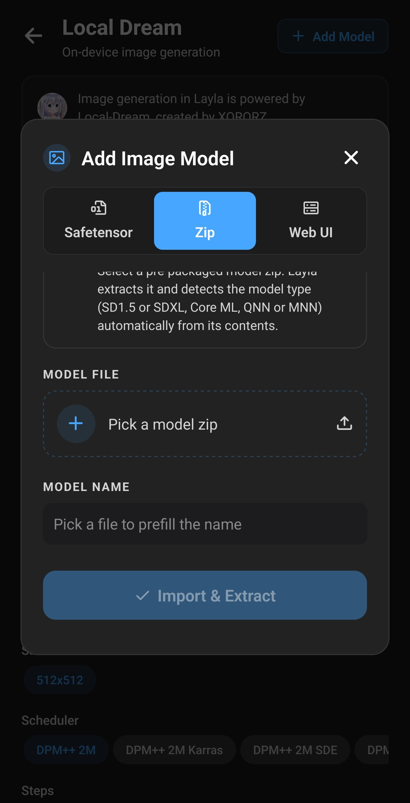
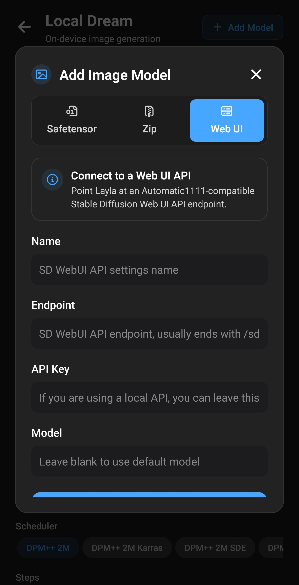

**Laylaには、CivitaiのStable Diffusionチェックポイントなどの独自画像モデルを追加する3つの方法があります。端末で変換するsafetensors・GGUFファイル、変換済みzip、PC上のStable Diffusion Web UIへの接続です。** ファイルから追加したモデルはAndroidやiPhoneでオフライン動作します。利用方法はモデル系統と端末のチップによって異なります。

この記事ではインポート画面、各方式、対応モデル、任意のNPU Forgeミニアプリについて説明します。インポート処理はすべて端末内で行われ、選択したファイルはアップロードされません。

内蔵モデルのみを使う場合は[画像生成を有効にする方法](/ja/how-to-enable-image-generation-in-layla/)をご覧ください。

## 独自モデルをインポートする理由

Laylaの内蔵モデル以外にも、[Civitai](https://civitai.com/)や[Hugging Face](https://huggingface.co/)には写実、アニメ、イラストなどのコミュニティ製チェックポイントや、人物・服装・外観を追加するLoRAがあります。インポートすれば、内蔵一覧だけに制限されず利用できます。

追加したモデルはLocal Dreamで実行し、処理はすべてローカルです。

- **オフライン。** インポート後はインターネット、アカウント、サブスクリプション不要。
- **プライバシー。** プロンプトと画像は端末に残り、オンラインの確認はありません。
- **柔軟性。** テキスト画像生成に加え、多くの種類は画像間生成にも対応。キャラクターもチャットで使えます。

## Laylaに独自モデルを追加する方法

同じ**Add Image Model**画面を2つの経路で開けます。

- **Settings** → **Inference Settings** → **Image Generation** → **Add Custom Model**。
- **Local Dream**上部の**Add Model**。

Local Dreamは端末内生成を担当し、Web UI以外の方式で必須です。[ミニアプリの有効化・無効化](/ja/how-to-enable-disable-mini-apps-within-layla/)を参考に先にインストールしてください。古い場合はインポート前に更新が必要と表示されます。

タブは最大3つで、**Safetensor**、**Zip**、**Web UI**があります。完了するとモデルが保存され、自動選択されます。大きなファイルでは数分かかるのでLaylaを開いたままにしてください。

## 3つのインポート方式

|             | Safetensor                                             | Zip                    | Web UI              |
| ----------- | ------------------------------------------------------ | ---------------------- | ------------------- |
| 入力        | `.safetensors`チェックポイント、Androidでは`.gguf`も可 | Layla用に準備済みのzip | Web UIのAPIアドレス |
| Laylaの処理 | 端末用モデルに変換                                     | 展開して種類を判別     | 接続情報を保存      |
| 生成場所    | 自分の端末                                             | 自分の端末             | Web UIを動かすPC    |
| OS          | Android、iOS（SD 1.5のみ）                             | Android、iOS           | Android、iOS        |
| 主な入手先  | [Civitai](https://civitai.com/)、Hugging Face          | 変換済みパッケージ     | 自分のPC            |

## 対応する画像モデル

AndroidのSafetensorタブでは**Base Model**で変換方法を指定します。チェックポイントの学習元の系統を選んでください。

| ベース         | 作成されるモデル                 | 実行先         | OS           |
| -------------- | -------------------------------- | -------------- | ------------ |
| SD 1.5         | LoRAを統合した単一の端末用モデル | CPU            | Android、iOS |
| SDXL           | Q4_0 GGUF、生成時にLoRA適用      | Snapdragon NPU | Android      |
| MOSS           | Q4_0 GGUF拡散モデル              | Snapdragon NPU | Android      |
| Qwen Image 2.1 | Q4_0 GGUF拡散モデル              | Snapdragon NPU | Android      |
| Flux 2 Klein   | Q4_0 GGUF拡散モデル              | Snapdragon NPU | Android      |

表についての補足：

- **SD 1.5**はCivitaiで広く使われ、iOSがインポートできる唯一の系統です。CPUを使い、最近のほぼすべての端末で動作します。
- **SDXL、MOSS、Qwen Image 2.1、Flux 2 Klein**は内蔵版と同じNPUエンジンを使い、Snapdragon 8 Elite（SM8750）以降が必要です。インポート時にチップの警告は出ないため、事前に確認してください。
- **MOSS、Qwen Image 2.1、Flux 2 Klein**は対応内蔵モデルのトークナイザー、テキストエンコーダー、VAEを再利用します。[必要なベースモデル](#models-that-need-a-base-model-first)を先に取得してください。
- **Z-Image Turbo、Krea 2 Turboなどの内蔵NPUモデル**はBase Modelにありません。Local Dreamから取得できますが、同系統の独自チェックポイントはインポートできません。

Civitaiのモデルページでベースを確認してから取得してください。Laylaはファイルから系統を確認しないので、選択を誤るとインポートや生成に失敗することがあります。

## safetensorsまたはGGUFを追加する

1. チェックポイントを端末に取得します。Civitaiで**Model Type: Checkpoint**、**File format: SafeTensor**、目的の**Base Model**を選びます。[SD 1.5の画像付き例](/ja/how-to-import-sd1-5-safetensor-models-from-civit-ai-into-layla/)もご覧ください。
2. **Add Image Model** → **Safetensor**を開きます。
3. Androidは**Base Model**を選びます。iOSはSD 1.5のみなので一覧がありません。
4. **MODEL CHECKPOINT**でファイルを選びます。拡張子は`.safetensors`、Androidなら`.gguf`も対応します。
5. ファイル名から入力された**MODEL NAME**を確認し、必要なら変更します。
6. 任意で後述のLoRAを追加します。
7. **Import & Convert**をタップします。

GGUFやLoRAのみの追加では変換不要なのでボタンは**Import**になります。コピー・変換の進行状況を表示し、完了後に一時コピーを消します。元のダウンロードファイルはそのままです。

### GGUFファイル

Androidではsafetensorsの代わりに`.gguf`拡散モデルを選べます。変換せず専用フォルダーにコピーするため高速です。適切な補助ファイルを使うよう、対応するベースモデルを選んでください。

### LoRA

LoRAはスタイルや人物・概念を追加する小さなファイルです。**LORA FILES (OPTIONAL)**の**Add LoRA**で`.safetensors`を選び、強さを指定します。初期値は1.0で、複数追加できます。

適用方法は系統で異なります。

- **SD 1.5**：変換済みモデルに統合され、後から変更・削除できません。
- **SDXL、MOSS、Qwen Image 2.1、Flux 2 Klein**：モデルフォルダーにコピーされ、生成時に適用されます。

### 先にベースモデルが必要な系統

MOSS、Qwen Image 2.1、Flux 2 Kleinは、Local Dreamに取得済みのモデルの補助ファイルを使います。不足時は警告が出てインポートできません。先に次を取得してください。

| Base Model     | Local Dreamで取得するモデル              |
| -------------- | ---------------------------------------- |
| MOSS           | MOSS-Image TurboまたはMOSS-Image Base    |
| Qwen Image 2.1 | Qwen Image 2.1またはQwen Image 2.1 Turbo |
| Flux 2 Klein   | FLUX.2 Klein 4B                          |

これら3系統では**LoRA only**も使えます。チェックポイントを省き、取得済みベースとLoRAだけでモデルを作ることで、変換の時間と容量を節約します。

## zipを追加する

**Zip**はLayla用に変換・梱包済みのモデル向けです。zipを選び名前を確認して、**Import & Extract**をタップします。

展開した内容から種類を判別します。

- Core MLバンドル：iOS用SD 1.5 Core ML。
- MNNファイル入りSDXL：SDXL CPU。
- QNNファイル入りSDXL：SDXL NPU。
- ANIMAパッケージ：ANIMA NPU。
- QNNファイル入りパッケージ：SD 1.5 NPU。
- その他：SD 1.5 CPU。

最後はフォールバックなので、非対応zipでも追加に成功し、生成時に失敗することがあります。Local Dream用と明記された信頼できる配布元を使ってください。QNNパッケージは特定のSnapdragonチップ向けなので、取得前に対応を確認します。

## Web UIに接続する

PCで[AUTOMATIC1111 Stable Diffusion Web UI](https://github.com/AUTOMATIC1111/stable-diffusion-webui)を動かしている場合、**Web UI**タブから接続できます。画像はPCで生成するため、ネットワーク接続が必要で、オフラインではありません。

次を入力します。

- **Name**：識別しやすい名前。
- **Endpoint**：APIアドレス。通常は末尾が`/sdapi/v1/text2img`。
- **API Key**：ローカルAPIでは空欄。
- **Model**：Web UIの既定モデルを使う場合は空欄。

**Save & Select**をタップします。Web UIの設定は[画像生成を有効にする方法](/ja/how-to-enable-image-generation-in-layla/)をご覧ください。

## NPU ForgeでSnapdragon NPUを使って高速化する

SD 1.5 safetensorsの通常インポートはCPU実行です。対応Qualcomm Snapdragonなら、**NPU Forge**で同じチェックポイントをQNNに変換し、より高速なAIアクセラレーターのNPUで生成できます。

NPU ForgeはAndroid専用の別ミニアプリです。SD 1.5とSDXLに対応し、LoRA統合もでき、完成モデルを直接Local Dreamに追加します。対応端末のSafetensorには案内が出ます。[NPU Forgeガイド](/ja/how-to-convert-safetensors-to-qnn-with-npu-forge-in-layla/)に手順と容量・メモリ要件があります。

## インポート後

Local Dreamでは新モデルが選択済みです。上の一覧で切り替えられます。初期値は20ステップ・CFG 5、Flux 2 Kleinは4ステップ・CFG 1です。変更可能で、少ないステップ用モデルには通常もっと低い値が必要です。

選択したモデルに対して次を操作できます。

- **Model setup**：新エンジンを使うSDXL、MOSS、Qwen Image 2.1、Flux 2 Kleinのファイル、サンプラー、LoRAを確認・変更。
- **Delete Model**：削除して容量を解放。

追加モデルはキャラクター用一覧にも表示されます。個別の割り当て方法は[画像生成を有効にする方法](/ja/how-to-enable-image-generation-in-layla/)をご覧ください。

## よくある質問

### AndroidでStable Diffusionをオフライン実行できますか？

はい。Local Dreamで、多くの端末はCPU、対応SnapdragonはNPUを使えます。モデル取得後の生成に接続は不要です。

### スマートフォンでSDXLを実行できますか？

AndroidのSnapdragon 8 Elite（SM8750）以降なら可能です。Safetensorで**SDXL**を選ぶとNPU用に変換します。変換済み**Zip**や、対応チップ向けのNPU Forgeも使えます。

### iPhoneでStable Diffusionを実行できますか？

SD 1.5に対応します。**Safetensor**からsafetensors、**Zip**からCore MLを追加します。他系統はAndroid専用です。

### Civitaiモデルをスマートフォンで使えますか？

対応系統のsafetensorsなら可能です。**Checkpoint**、**SafeTensor**、**SD 1.5**または**SDXL**で絞り込み、取得後に**Safetensor**から追加します。

### safetensorsとは何ですか？

機械学習モデルの重みを保存する形式で、Civitaiの多くのチェックポイントとLoRAが使います。旧`.ckpt`と異なり実行可能なコードを格納できず、広く普及する理由の一つです。

### チェックポイントとLoRAの違いは？

チェックポイントは完全なモデルです。LoRAはスタイルや題材を追加する小型の補助ファイルで、同じベースのモデルでのみ動作します。先にチェックポイントを選び、LoRAを追加します。

### LaylaでLoRAを使えますか？

はい。**Safetensor**で複数追加し、個別の強さを設定できます。SD 1.5は統合、SDXL、MOSS、Qwen Image 2.1、Flux 2 Kleinは生成時適用です。

### 独自モデルにはSnapdragonが必要ですか？

いいえ。SD 1.5は最近のAndroidとiPhoneのCPUで使えます。Snapdragonが必要なのはNPUモデルで、NPU Forge変換やAndroidのSDXL、MOSS、Qwen Image 2.1、Flux 2 Kleinが該当します。

### すべてのStable Diffusionモデルを追加できますか？

いいえ。SD 1.5とSDXL、AndroidではMOSS、Qwen Image 2.1、Flux 2 Kleinが対象です。SD 2.xなどはBase Modelにありません。

### インポートにインターネットは必要ですか？

ミニアプリのインストールと必要なベースモデル取得時だけです。変換は端末内で行います。Web UIは例外で、生成中にPCへの接続が必要です。

### iPhoneにBase Model一覧がないのはなぜですか？

iOSはSD 1.5 safetensorsだけなので選択不要です。ZipからCore MLも追加できます。

### 追加モデルはNPUで動きますか？

SD 1.5 safetensorsはCPUです。SD 1.5やSDXLをNPU用にするにはNPU Forgeを使います。AndroidのSDXL、MOSS、Qwen Image 2.1、Flux 2 Kleinの通常インポートはNPU向けで、Snapdragon 8 Elite以降が必要です。

### SD 1.5追加後にLoRAを変更できますか？

統合されるためできません。元チェックポイントを希望のLoRA・強さで別名に再インポートしてください。

### Local Dreamの更新を求められるのはなぜですか？

変換にはミニアプリ同梱のファイルが必要です。ミニアプリ画面で更新してから再試行してください。

### 追加モデルを削除するには？

Local Dreamでモデルを選び、**Delete Model**をタップします。

### モデルはどこで入手できますか？

主に[Civitai](https://civitai.com/)と[Hugging Face](https://huggingface.co/)です。インポート方法はベースによって変わるので、取得前に各ページで確認してください。

## クレジット

画像生成はXORORZが開発した[Local Dream](https://github.com/xororz/local-dream)を使用します。NPU Forgeの開発者はAbrahamPaulJです。
