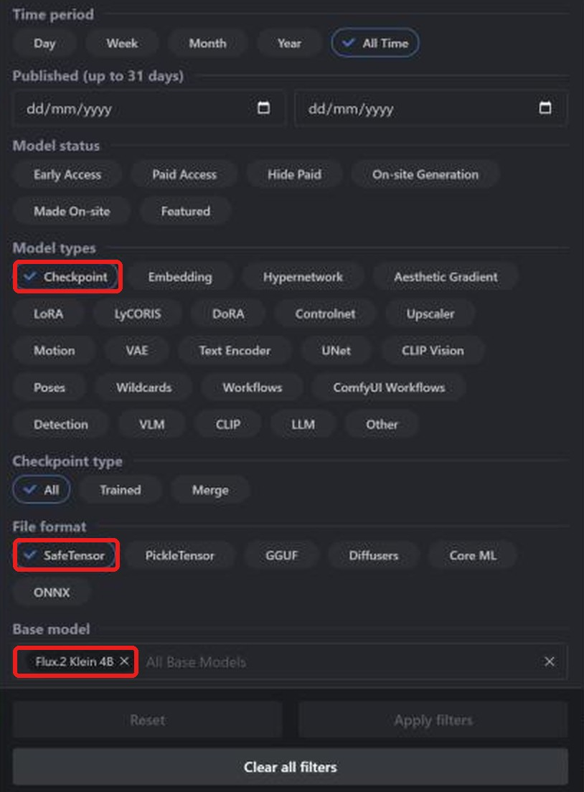
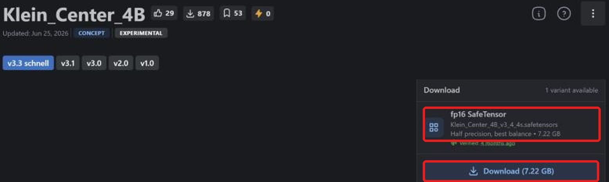
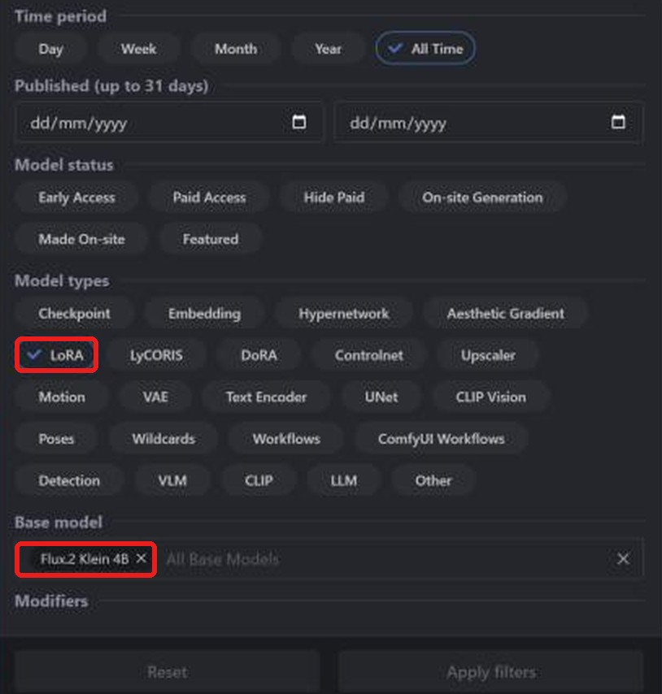
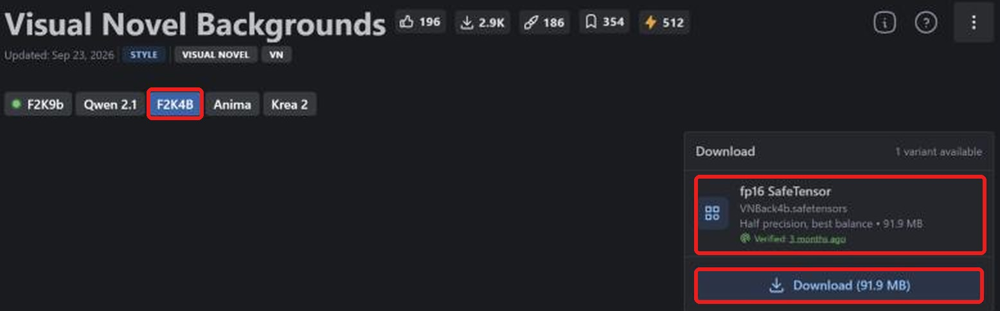

**LaylaはCivitaiのFLUX.2 Klein 4B safetensorsチェックポイントとLoRAをインポートし、Androidでオフライン画像生成できます。** 小型のテキスト画像モデルで、[Civitai](https://civitai.com/)には追加学習モデルとLoRAがあります。変換は端末内で行うので、取得後の生成に接続は不要です。

対応チェックポイントの検索、正しいファイルの取得、インポート、LoRA追加を説明します。他系統のガイド：[SD 1.5](/ja/how-to-import-sd1-5-safetensor-models-from-civit-ai-into-layla/), [SDXL](/ja/how-to-import-sdxl-safetensor-models-from-civitai-into-layla/), [MOSS Image](/ja/how-to-import-moss-image-safetensor-models-from-civitai-into-layla/), [Qwen Image 2.1](/ja/how-to-import-qwen-image-2-1-safetensor-models-from-civitai-into-layla/)。GGUF、zip、Web UIについては[Laylaにカスタム画像生成モデルをインポートする方法](/ja/how-to-import-custom-image-generation-models-into-layla/)をご覧ください。

## FLUX.2 Kleinとは？

FLUX.2 [klein]はFLUX開発元Black Forest Labsの画像モデル群です。4Bは約40億パラメーターで、約4ステップで生成するよう蒸留されています。より大きい9B版もあります。

Civitaiには**Flux.2 Klein 4B**や**Flux.2 Klein 9B**があります。Laylaの**Flux 2 Klein**は4Bベースなので、**Flux.2 Klein 4B**で絞り込んでください。4B用LoRAには4Bチェックポイントが必要です。

## 必要なもの

- Snapdragon 8 Elite（SM8750）以降のAndroid端末。FLUX.2 KleinのインポートはSnapdragon NPUを使い、iPhoneには対応しません。インポート時にチップを確認しないため、大きなファイルの変換前に自分で確認してください。

- **Local Dream**ミニアプリ。インストールは[Laylaのミニアプリを有効化・無効化する方法](/ja/how-to-enable-disable-mini-apps-within-layla/)をご覧ください。

- Local Dreamに取得済みの内蔵モデル：**FLUX.2 Klein 4B**。トークナイザー、テキストエンコーダー、VAEを再利用します。不足するとSafetensorに警告が表示され、インポートできません。

- チェックポイント用の空き容量。Klein 4Bのfp16は約7 GBです。

## 取得するsafetensorsファイル

**Laylaはf16（半精度）safetensorsに対応します。** Civitaiの表記は**fp16 SafeTensor**です。FLUX.2 Kleinはbf16もインポートできます。量子化された**fp8**、**int8**、**int4**、**nvfp4**には対応しません。

公式FLUX.2 Klein 4Bを含むbf16も対応します。Kleinには小型のfp8配布が多いものの非対応なので、ダウンロード欄を確認してください。

## CivitaiのFLUX.2 Kleinチェックポイントを追加する

### 手順1：CivitaiのModelsを開く

[civitai.com](https://civitai.com/)を開き、上部の**Models**を選びます。画像はPCブラウザーのため、スマートフォンでは配置が少し異なる場合があります。

### 手順2：Checkpoint、SafeTensor、Flux.2 Klein 4Bで絞り込む

右上の**Filters**を開きます。

1. **Model types**：**Checkpoint**。
2. **File format**：**SafeTensor**。
3. **Base model**：**Flux.2 Klein 4B**を検索して選択。

対応形式のFLUX.2 Kleinチェックポイントが表示されます。[絞り込み済み一覧を開く](https://civitai.com/models?types=Checkpoint&fileFormats=SafeTensor&baseModels=Flux.2%20Klein%204B&sort=Most%20Downloaded)。

### 手順3：fp16 safetensorsを取得する

モデルを開き、右の**Download**欄を確認します。**fp16 SafeTensor**（例：7.22 GB）を選び、**Download**で端末に保存します。複数あればfp16を選んでください。bf16対応の例外は上記の説明を参照してください。

必要なのはチェックポイントだけです。Civitaiの**Required Components**にあるテキストエンコーダーやVAEは他のツール向けです。LaylaはLocal Dreamの取得済みベースモデルの補助ファイルを使います。

### 手順4：Laylaにインポートする

**Settings** → **Inference Settings** → **Image Generation** → **Add Custom Model**、または**Local Dream** → **Add Model**を開きます。

**Safetensor**の**Base Model**で**Flux 2 Klein**を選びます。

**MODEL CHECKPOINT**でファイルを選び、**MODEL NAME**を確認して**Import & Convert**をタップします。Q4_0 GGUF拡散モデルに変換します。数分かかる場合があるので開いたままにしてください。完了すると保存・自動選択されます。

Laylaはファイルの系統を確認しません。別系統のチェックポイントに**Flux 2 Klein**を指定すると、インポートや生成が失敗することがあります。

### 手順5：画像を生成する

**Local Dream**でモデルを確認し、プロンプトを入力します。Kleinは少ないステップ向けなので、Laylaは4ステップ・CFG 1に設定します。どちらも変更できます。

## CivitaiのFLUX.2 Klein LoRAを追加する

LoRAはスタイルや人物、物体、概念を追加する小型ファイルです。チェックポイントと同様に検索し、モデルの種類だけを変えます。

### 手順1：LoRAとFlux.2 Klein 4Bで絞り込む

**Models** → **Filters**で**Model types**を**LoRA**、**Base model**を**Flux.2 Klein 4B**にします。[絞り込み済み一覧を開く](https://civitai.com/models?types=LORA&fileFormats=SafeTensor&baseModels=Flux.2%20Klein%204B&sort=Most%20Downloaded)。チェックポイントと同じフィルター画面です。

### 手順2：LoRA safetensorsを取得する

ページが9B用の**F2K9b**で開く場合があります。4B用の**F2K4B**に切り替え、**fp16 SafeTensor**（例：91.9 MB）を確認して**Download**します。

### 手順3：インポート時にLoRAを追加する

**Safetensor**で**Base Model**を**Flux 2 Klein**にしてチェックポイントを選びます。**LORA FILES (OPTIONAL)** → **Add LoRA**でファイルと強さを指定します。初期値は1.0で複数追加できます。準備ができたら**Import & Convert**を押します。

FLUX.2 KleinはLoRAをモデルフォルダーにコピーし、生成時に適用します。追加後はLocal Dreamでモデルを選び、**Model setup**からファイル、サンプラー、LoRAを確認・編集できます。

### チェックポイントなしでLoRAを使う

FLUX.2 Kleinの**Safetensor**では**LoRA only**を選べます。取得済みのベースモデルとLoRAだけで新モデルを作り、大きなチェックポイントの変換時間・容量を節約します。

## よくある質問

### スマートフォンでFLUX.2 Kleinを使えますか？

上記の要件を満たせば可能です。**Base Model**に**Flux 2 Klein**を選びCivitaiのチェックポイントを追加します。ベースを再利用する系統はLocal Dreamで先に取得してください。

### CivitaiでどのFLUX.2 Kleinファイルを取得しますか？

**fp16 SafeTensor**またはbf16です。fp8、int8、int4、nvfp4は非対応です。

### FLUX.2 Klein 9Bを追加できますか？

LaylaのFlux 2 Kleinは4B用です。チェックポイントもLoRAも**Flux.2 Klein 4B**で絞り込んでください。

### FLUX.1を追加できますか？

いいえ。FLUX.1は別系統でBase Modelにありません。

### iPhoneでFLUX.2 Kleinをインポートできますか？

いいえ。iOSがインポートできるsafetensorsはSD 1.5だけです。冒頭のSD 1.5ガイドをご覧ください。

### Civitaiからのインポートに接続は必要ですか？

ファイル取得時だけです。変換と生成は端末内で行います。

### 追加モデルを削除するには？

**Local Dream**でモデルを選び**Delete Model**を押すと容量を解放できます。

## スマートフォンでオフラインのFLUX.2 Klein

インポート後、FLUX.2 Kleinは接続・アカウント・サブスクリプション不要で端末上で動きます。プロンプト、モデル、画像は端末内に残ります。
