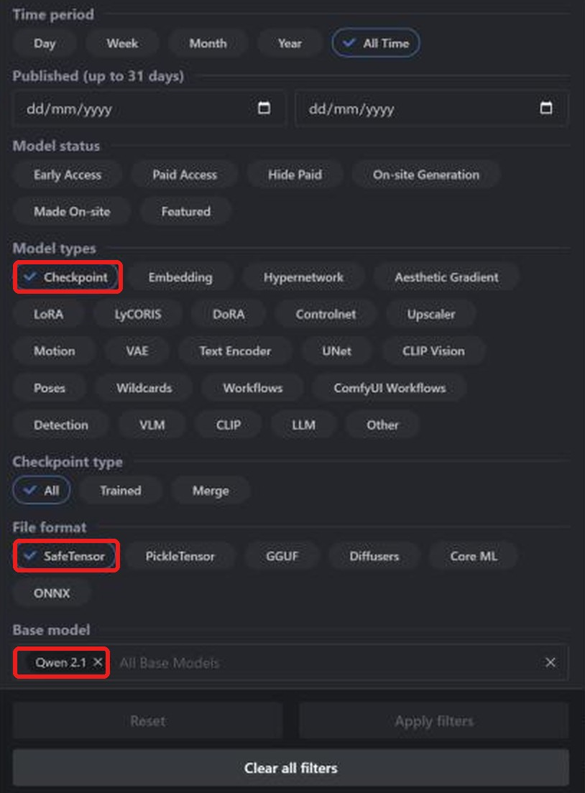
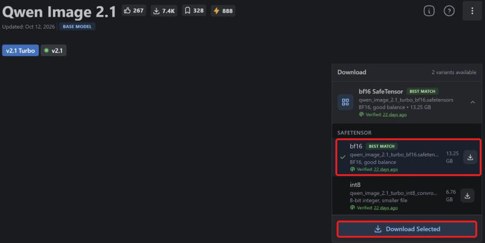
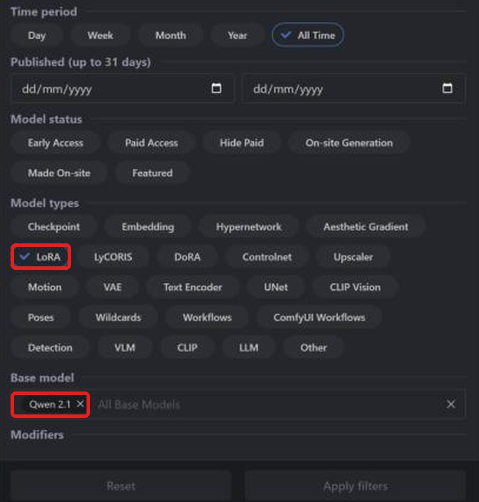
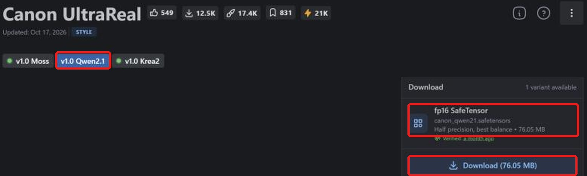

**LaylaはCivitaiのQwen Image 2.1 safetensorsチェックポイントとLoRAをインポートし、Androidでオフライン画像生成できます。** 新しいテキスト画像モデルで、[Civitai](https://civitai.com/)にはコミュニティの追加学習モデルとLoRAがあります。取得後、端末で変換すれば接続不要で生成できます。

対応チェックポイントの検索、正しいファイルの取得、インポート、LoRA追加を説明します。他系統のガイド：[SD 1.5](/ja/how-to-import-sd1-5-safetensor-models-from-civit-ai-into-layla/), [SDXL](/ja/how-to-import-sdxl-safetensor-models-from-civitai-into-layla/), [MOSS Image](/ja/how-to-import-moss-image-safetensor-models-from-civitai-into-layla/), [FLUX.2 Klein](/ja/how-to-import-flux-2-klein-safetensor-models-from-civitai-into-layla/)。GGUF、zip、Web UIについては[Laylaにカスタム画像生成モデルをインポートする方法](/ja/how-to-import-custom-image-generation-models-into-layla/)をご覧ください。

## Qwen Image 2.1とは？

Qwen-Image-2.1はAlibabaのQwenチームが2026年9月に公開した画像モデルです。重みが公開され、画像生成部は約70億パラメーターで、テキスト画像生成と画像編集に対応します。以前のQwen-Imageとライセンスが違うため、商用利用前にモデルページを確認してください。

Civitaiは**Qwen 2.1**、Laylaは**Qwen Image 2.1**を選びます。LoRAも同じベース用が必要です。Civitaiの**Qwen**、**Qwen 2**、**Qwen 3**は別系統です。

## 必要なもの

- Snapdragon 8 Elite（SM8750）以降のAndroid端末。Qwen Image 2.1のインポートはSnapdragon NPUを使い、iPhoneには対応しません。インポート時にチップを確認しないため、大きなファイルの変換前に自分で確認してください。

- **Local Dream**ミニアプリ。インストールは[Laylaのミニアプリを有効化・無効化する方法](/ja/how-to-enable-disable-mini-apps-within-layla/)をご覧ください。

- Local Dreamに取得済みの内蔵モデル：**Qwen Image 2.1** / **Qwen Image 2.1 Turbo**。トークナイザー、テキストエンコーダー、VAEを再利用します。不足するとSafetensorに警告が表示され、インポートできません。

- 十分な空き容量。Qwen Image 2.1のbf16チェックポイントは13 GBを超えます。

## 取得するsafetensorsファイル

**Laylaはf16（半精度）safetensorsに対応します。** Civitaiの表記は**fp16 SafeTensor**です。Qwen Image 2.1はbf16もインポートできます。量子化された**fp8**、**int8**、**int4**、**nvfp4**には対応しません。

執筆時点ではCivitaiにQwen 2.1のfp16チェックポイントは見つからず、bf16または量子化版でした。**bf16 SafeTensor**を選びます。公式ページの**Best match**はbf16ですが、他ページでは量子化版の場合があるので毎回確認してください。

## CivitaiのQwen Image 2.1チェックポイントを追加する

### 手順1：CivitaiのModelsを開く

[civitai.com](https://civitai.com/)を開き、上部の**Models**を選びます。画像はPCブラウザーのため、スマートフォンでは配置が少し異なる場合があります。

### 手順2：Checkpoint、SafeTensor、Qwen 2.1で絞り込む

右上の**Filters**を開きます。

1. **Model types**：**Checkpoint**。
2. **File format**：**SafeTensor**。
3. **Base model**：**Qwen 2.1**を検索して選択。

対応形式のQwen Image 2.1チェックポイントが表示されます。[絞り込み済み一覧を開く](https://civitai.com/models?types=Checkpoint&fileFormats=SafeTensor&baseModels=Qwen%202.1&sort=Most%20Downloaded)。

### 手順3：bf16 safetensorsを取得する

**Download**の種類一覧で**bf16 SafeTensor**（例：13.25 GB）を選び、**Download Selected**を押します。小さい**int8**は非対応です。**fp16 SafeTensor**があればそちらを優先します。この系統はf16とbf16に対応します。

必要なのはチェックポイントだけです。Civitaiの**Required Components**にあるテキストエンコーダーやVAEは他のツール向けです。LaylaはLocal Dreamの取得済みベースモデルの補助ファイルを使います。

### 手順4：Laylaにインポートする

**Settings** → **Inference Settings** → **Image Generation** → **Add Custom Model**、または**Local Dream** → **Add Model**を開きます。

**Safetensor**の**Base Model**で**Qwen Image 2.1**を選びます。

**MODEL CHECKPOINT**でファイルを選び、**MODEL NAME**を確認して**Import & Convert**をタップします。Q4_0 GGUF拡散モデルに変換します。数分かかる場合があるので開いたままにしてください。完了すると保存・自動選択されます。

Laylaはファイルの系統を確認しません。別系統のチェックポイントに**Qwen Image 2.1**を指定すると、インポートや生成が失敗することがあります。

### 手順5：画像を生成する

**Local Dream**でモデルを確認し、プロンプトを入力します。初期値は20ステップ・CFG 5で変更可能です。Turboは少ないステップ向けなので、通常もっと低い値にします。

## CivitaiのQwen Image 2.1 LoRAを追加する

LoRAはスタイルや人物、物体、概念を追加する小型ファイルです。チェックポイントと同様に検索し、モデルの種類だけを変えます。

### 手順1：LoRAとQwen 2.1で絞り込む

**Models** → **Filters**で**Model types**を**LoRA**、**Base model**を**Qwen 2.1**にします。[絞り込み済み一覧を開く](https://civitai.com/models?types=LORA&fileFormats=SafeTensor&baseModels=Qwen%202.1&sort=Most%20Downloaded)。チェックポイントと同じフィルター画面です。

### 手順2：LoRA safetensorsを取得する

Qwen Image 2.1用（例：**v1.0 Qwen2.1**）を選び、**fp16 SafeTensor**（例：76.05 MB）を確認して**Download**します。

### 手順3：インポート時にLoRAを追加する

**Safetensor**で**Base Model**を**Qwen Image 2.1**にしてチェックポイントを選びます。**LORA FILES (OPTIONAL)** → **Add LoRA**でファイルと強さを指定します。初期値は1.0で複数追加できます。準備ができたら**Import & Convert**を押します。

Qwen Image 2.1はLoRAをモデルフォルダーにコピーし、生成時に適用します。追加後はLocal Dreamでモデルを選び、**Model setup**からファイル、サンプラー、LoRAを確認・編集できます。

### チェックポイントなしでLoRAを使う

Qwen Image 2.1の**Safetensor**では**LoRA only**を選べます。取得済みのベースモデルとLoRAだけで新モデルを作り、大きなチェックポイントの変換時間・容量を節約します。

## よくある質問

### スマートフォンでQwen Image 2.1を使えますか？

上記の要件を満たせば可能です。**Base Model**に**Qwen Image 2.1**を選びCivitaiのチェックポイントを追加します。ベースを再利用する系統はLocal Dreamで先に取得してください。

### CivitaiでどのQwen Image 2.1ファイルを取得しますか？

**fp16 SafeTensor**があれば優先し、なければ**bf16 SafeTensor**です。fp8、int8、int4、nvfp4は非対応です。

### CivitaiにQwen Image 2.1のfp16版はありますか？

執筆時点ではQwen 2.1に見つからず、bf16または量子化版でした。この系統ではbf16をインポートできます。

### Turboとの違いは？

Turboは少ないステップで生成するモデルです。Local Dreamにどちらかを取得済みなら、両方ともインポート用のベースにできます。

### iPhoneでQwen Image 2.1をインポートできますか？

いいえ。iOSがインポートできるsafetensorsはSD 1.5だけです。冒頭のSD 1.5ガイドをご覧ください。

### Civitaiからのインポートに接続は必要ですか？

ファイル取得時だけです。変換と生成は端末内で行います。

### 追加モデルを削除するには？

**Local Dream**でモデルを選び**Delete Model**を押すと容量を解放できます。

## スマートフォンでオフラインのQwen Image 2.1

インポート後、Qwen Image 2.1は接続・アカウント・サブスクリプション不要で端末上で動きます。プロンプト、モデル、画像は端末内に残ります。
