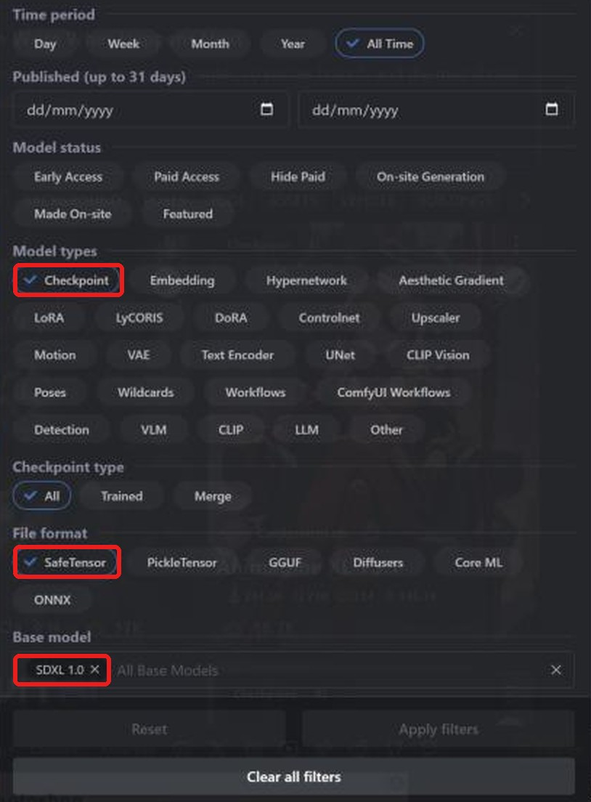
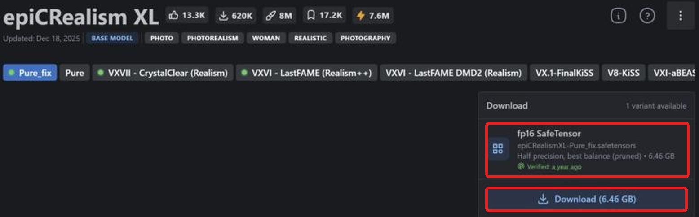
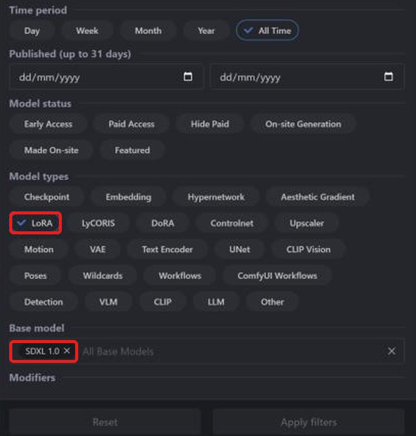
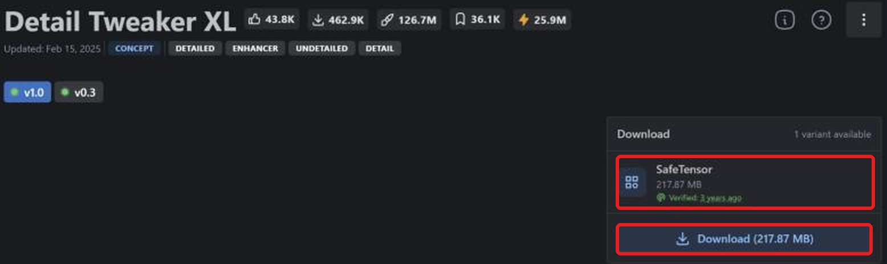

**LaylaはCivitaiのStable Diffusion XL（SDXL）safetensorsチェックポイントとLoRAをインポートし、Android端末のSnapdragon NPUで実行できます。** [Civitai](https://civitai.com/)の多くのSDXLモデルはsafetensorsです。端末で変換し、取得後はオフライン生成できます。

対応チェックポイントの検索、正しいファイルの取得、インポート、LoRA追加を説明します。他系統のガイド：[SD 1.5](/ja/how-to-import-sd1-5-safetensor-models-from-civit-ai-into-layla/), [MOSS Image](/ja/how-to-import-moss-image-safetensor-models-from-civitai-into-layla/), [Qwen Image 2.1](/ja/how-to-import-qwen-image-2-1-safetensor-models-from-civitai-into-layla/), [FLUX.2 Klein](/ja/how-to-import-flux-2-klein-safetensor-models-from-civitai-into-layla/)。GGUF、zip、Web UIについては[Laylaにカスタム画像生成モデルをインポートする方法](/ja/how-to-import-custom-image-generation-models-into-layla/)をご覧ください。

## SDXLとは？

SDXLはStable Diffusion XL 1.0です。Stability AIが2023年に公開したSD 1.5の大型後継で、512 x 512ではなく1024 x 1024を生成します。Civitaiでは**SDXL 1.0**と表示され、多くの写実・アニメモデルのベースです。

SDXLのLoRAにはSDXLチェックポイントが必要です。Laylaの**Base Model**では**SDXL**を選びます。

## 必要なもの

- Snapdragon 8 Elite（SM8750）以降のAndroid端末。SDXLのインポートはSnapdragon NPUを使い、iPhoneには対応しません。インポート時にチップを確認しないため、大きなファイルの変換前に自分で確認してください。

- **Local Dream**ミニアプリ。インストールは[Laylaのミニアプリを有効化・無効化する方法](/ja/how-to-enable-disable-mini-apps-within-layla/)をご覧ください。

- 数GBのチェックポイントと変換後モデルを保存する空き容量。

## 取得するsafetensorsファイル

**Laylaが対応するのはf16（半精度）safetensorsのみです。** Civitaiのダウンロード欄で**fp16 SafeTensor**と表示されるものを選んでください。

SDXLのfp16は約6.5 GBです。全精度など別の種類もあるのでラベルを確認してください。

## CivitaiのSDXLチェックポイントを追加する

### 手順1：CivitaiのModelsを開く

[civitai.com](https://civitai.com/)を開き、上部の**Models**を選びます。画像はPCブラウザーのため、スマートフォンでは配置が少し異なる場合があります。

### 手順2：Checkpoint、SafeTensor、SDXL 1.0で絞り込む

右上の**Filters**を開きます。

1. **Model types**：**Checkpoint**。
2. **File format**：**SafeTensor**。
3. **Base model**：**SDXL 1.0**を検索して選択。

対応形式のSDXLチェックポイントが表示されます。[絞り込み済み一覧を開く](https://civitai.com/models?types=Checkpoint&fileFormats=SafeTensor&baseModels=SDXL%201.0&sort=Most%20Downloaded)。

### 手順3：fp16 safetensorsを取得する

モデルを開き、右の**Download**欄を確認します。**fp16 SafeTensor**（例：6.46 GB）を選び、**Download**で端末に保存します。複数あればfp16を選んでください。bf16対応の例外は上記の説明を参照してください。

### 手順4：Laylaにインポートする

**Settings** → **Inference Settings** → **Image Generation** → **Add Custom Model**、または**Local Dream** → **Add Model**を開きます。

**Safetensor**の**Base Model**で**SDXL**を選びます。

**MODEL CHECKPOINT**でファイルを選び、**MODEL NAME**を確認して**Import & Convert**をタップします。Q4_0 GGUF拡散モデルに変換します。数分かかる場合があるので開いたままにしてください。完了すると保存・自動選択されます。

Laylaはファイルの系統を確認しません。別系統のチェックポイントに**SDXL**を指定すると、インポートや生成が失敗することがあります。

### 手順5：画像を生成する

**Local Dream**でモデルを確認し、プロンプトを入力します。初期値は20ステップ・CFG 5で変更可能です。SDXLは1024 x 1024向けです。

## CivitaiのSDXL LoRAを追加する

LoRAはスタイルや人物、物体、概念を追加する小型ファイルです。チェックポイントと同様に検索し、モデルの種類だけを変えます。

### 手順1：LoRAとSDXL 1.0で絞り込む

**Models** → **Filters**で**Model types**を**LoRA**、**Base model**を**SDXL 1.0**にします。[絞り込み済み一覧を開く](https://civitai.com/models?types=LORA&fileFormats=SafeTensor&baseModels=SDXL%201.0&sort=Most%20Downloaded)。チェックポイントと同じフィルター画面です。

### 手順2：LoRA safetensorsを取得する

SafeTensorの**Download**を選びます。この例は217.87 MBです。ラベルが**SafeTensor**だけの場合もあります。複数の精度があれば**fp16**を選んでください。

### 手順3：インポート時にLoRAを追加する

**Safetensor**で**Base Model**を**SDXL**にしてチェックポイントを選びます。**LORA FILES (OPTIONAL)** → **Add LoRA**でファイルと強さを指定します。初期値は1.0で複数追加できます。準備ができたら**Import & Convert**を押します。

SDXLはLoRAをモデルフォルダーにコピーし、生成時に適用します。追加後はLocal Dreamでモデルを選び、**Model setup**からファイル、サンプラー、LoRAを確認・編集できます。

## よくある質問

### スマートフォンでSDXLを使えますか？

上記の要件を満たせば可能です。**Base Model**に**SDXL**を選びCivitaiのチェックポイントを追加します。ベースを再利用する系統はLocal Dreamで先に取得してください。

### CivitaiでどのSDXLファイルを取得しますか？

**fp16 SafeTensor**です。SDXLはf16のみです。**Best match**が別種類を指す場合もあるので一覧を確認してください。

### Pony、Illustrious、NoobAIを追加できますか？

SDXL派生ですがCivitaiは**SDXL 1.0**とは別のベースに分類します。このガイドはSDXL 1.0が対象です。Laylaは系統を確認しないため、他系統の動作は保証されません。

### iPhoneでSDXLをインポートできますか？

いいえ。iOSがインポートできるsafetensorsはSD 1.5だけです。冒頭のSD 1.5ガイドをご覧ください。

### SDXLにはSnapdragonが必要ですか？

LaylaのSDXLインポートはNPU用なので必要です。Snapdragon 8 Gen 3以降なら[NPU Forge](/ja/how-to-convert-safetensors-to-qnn-with-npu-forge-in-layla/)でSDXLをQNNに変換することもできます。

### Civitaiからのインポートに接続は必要ですか？

ファイル取得時だけです。変換と生成は端末内で行います。

### Safetensorが無効と表示される理由は？

ファイルを読めませんでした。`.safetensors`、fp16、SDXL系統を確認して再試行してください。

### 追加モデルを削除するには？

**Local Dream**でモデルを選び**Delete Model**を押すと容量を解放できます。

## スマートフォンでオフラインのSDXL

インポート後、SDXLは接続・アカウント・サブスクリプション不要で端末上で動きます。プロンプト、モデル、画像は端末内に残ります。
