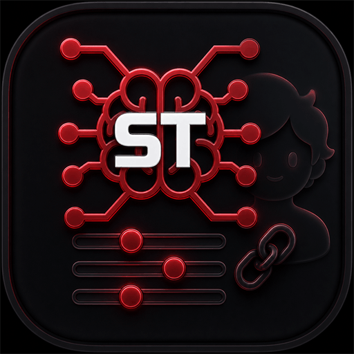

**SillyTavernプリセットとは、モデルに送信するプロンプト、その送信順序、どのプロンプトが有効かを定義するJSONファイルです。Laylaはこれらのファイルをインポートし、紐付けたキャラクターのプロンプトを組み立てるために利用できます。** すべての処理は端末上で行われ、プリセットをインポートしてもどこにも送信されません。

このガイドでは、SillyTavernプリセットのミニアプリのインストール、SillyTavernからのプリセットのエクスポート、Laylaへのインポート、プリセットカードの情報の読み方、キャラクターへの紐付け、そしてLaylaが意図的に実行しないプリセットの要素について説明します。

## SillyTavernプリセットの実際の中身

SillyTavernでは、チャット補完プリセットはプロンプトマネージャーで管理します。プリセットには名前付きプロンプトのリスト（メインプロンプト、キャラクターの説明、性格、シナリオ、ペルソナの説明、会話例、チャット履歴、履歴後の指示、そして作者が追加した独自プロンプト）と、どのプロンプトが有効でどの順序で並ぶかを示すプロンプト順序リストが含まれます。

プリセットの作者はこれを使って、複数部分から成る指示の積み重ね、書式ルール、会話の特定の深さに挿入されるプロンプト、特定の生成タイプでのみ発火するプロンプトなど、精巧なプロンプトシステムを構築します。ロールプレイ用の「プリセット」が共有されるとき、共有されているのはこのファイルです。

インポートする前に知っておきたい点が2つあります。

- Laylaが読み込むのは**チャット補完プリセット**、つまりプロンプトのリストとプロンプト順序リストを含むファイルです。サンプラーの値だけを持つテキスト補完プリセットは別の形式であり、インポート時に拒否されます。
- プリセットが扱うのは**プロンプトの構築**であり、モデルではありません。モデルをダウンロードすることも、使用中のモデルを変更することもありません。モデルも変更したい場合は、[LaylaにカスタムAIモデルを追加する方法](/how-to-add-custom-models-to-layla/)をご覧ください。

## SillyTavernプリセットのミニアプリをインストールする

プリセット管理はLaylaのオプションのミニアプリです。

1. Laylaで**マイアプリ**を開くか、最初の画面で**ミニアプリを追加**をタップします。
2. プラス記号をタップして、利用できるミニアプリを閲覧します。
3. **SillyTavernプリセット**を見つけて追加します。
4. **マイアプリ**から**SillyTavernプリセット**を開きます。

このミニアプリにはダウンロードするものがないため、すぐに使えるようになります。機能の追加と削除については、[Laylaで機能（ミニアプリ）を追加する方法](/how-to-add-features-mini-apps-in-layla/)をご覧ください。

## SillyTavernからプリセットをエクスポートする

作者が公開したものや友人から受け取ったものなど、すでに`.json`ファイルを持っている場合は、このセクションを飛ばしてかまいません。

自分のSillyTavern環境からエクスポートするには、**AI Response Configuration**パネル（上部バーのスライダーアイコン）を開き、上部の**Chat Completion Presets**ドロップダウンから目的のプリセットを選び、ドロップダウンの横にあるエクスポートボタンを使います。SillyTavernは`.json`ファイルとして保存します。

SillyTavernのデータフォルダーからファイルを直接コピーすることもできます。チャット補完プリセットは`data/<あなたのユーザーハンドル>/OpenAI Settings/`に保存されています。

ケーブル、クラウドストレージ、自分宛のメッセージなど、普段使っている方法でファイルをスマートフォンに転送してください。Laylaに必要なのは、Androidのファイル選択画面から到達できる場所にファイルがあることだけです。

## プリセットをLaylaにインポートする

1. **SillyTavernプリセット**ミニアプリを開きます。
2. **プリセットをインポート**をタップします。
3. 端末から`.json`ファイルを選びます。

Laylaは保存する前にファイルを検証します。ファイルは`.json`で終わり、有効なJSONであり、プロンプトのリストと空でないプロンプト順序リストの両方を含んでいる必要があります。いずれかが欠けている場合、Laylaは問題を示すエラー（プリセットが有効なJSONでない、プロンプト項目に識別子がない、など）を表示し、何もインポートされません。

すでに存在するファイル名のプリセットをインポートした場合、Laylaは既存のファイルを上書きせず、両方を保持して新しい方に番号を付けます。プリセットは最終更新の新しい順に一覧表示され、リストを下に引いて更新できます。

## プリセットカードを読む

インポートしたプリセットにはそれぞれカードが作られます。大きな名前はプリセット自身の内部名で、その下の小さな行はLaylaが保存した際のファイル名です。プリセットは内容の幅がとても広いため、何をインポートしたのかを一目で把握できるカードは読む価値があります。

3つの概要値は次のとおりです。

- **有効なプロンプト数** — プリセットのプロンプトのうち何個が有効か（全体数に対して）。40個のうち12個が有効というのは普通のことで、残りは作者が無効にしています。
- **システム／ユーザー／アシスタント** — 有効なプロンプトが3つのメッセージロールにどう分かれているか。
- **ファイルサイズ** — 主に異常に大きなプリセットを見つけるのに役立ちます。

その下にLaylaは、プリセットが指定している内容をチップとして表示します。コンテキストと出力のトークン上限、温度、有効なプロンプトのうちマーカーの数、深さ挿入の数、入力済みのユーティリティプロンプト設定の数、ファイルに含まれる正規表現スクリプトの数などです。一部のチップは単なる事実ではなく注意喚起として強調されます。

- **メインプロンプトの上書き** — プリセットがメインのシステムプロンプトを独自のテキストで置き換えます。
- **カスタムシステムプロンプト** — プリセットが独自のシステムロールのプロンプトを追加します。
- **システムプロンプト無効** — プリセットがシステムプロンプトを完全に無効にしています。
- **ジェイルブレイク有効** — プリセットの履歴後の指示プロンプトに内容があります。SillyTavernでは慣例的にこのプロンプトを「jailbreak」と呼びますが、実際には生成前の最後の指示ブロックにすぎません。

ファイルの読み込み中にLaylaが不審な点を見つけた場合、JSONプリセットのバッジの隣に**警告**バッジが表示されます。タップすると詳細が開きます。よくある警告は、プリセットが古いまたは非標準のプロンプト順序を使っている、あるいはLaylaが保存はするが実行しない拡張を含んでいる、というものです。警告は情報提供であり、プリセット自体は動作しますが、作者の意図のどの部分が反映されないかを教えてくれます。

## プリセットをキャラクターに紐付ける

プリセットは、キャラクターが使うまで何もしません。紐付ける方法は2つあります。

**プリセットカードから。** カード下部の**紐付けたキャラクター**をタップし、このプリセットを使うキャラクターを選択して、**X**または外側をタップして選択画面を閉じます。閉じたときに選択内容が保存されます。

**キャラクターエディターから。** キャラクターを編集用に開き、**詳細**タブに移動して、**プリセットとナレッジ**の下にある**SillyTavernプリセット**をタップします。リストからプリセットを選び、キャラクターを保存します。

この保存方法から2つのルールが導かれます。

- 1人のキャラクターが同時に使えるプリセットは**1つだけ**です。2つ目のプリセットに紐付けると、1つ目との紐付けは解除されます。
- 紐付けられるのは**自分で作成またはインポートした**キャラクターだけです。Layla内蔵のデフォルトキャラクターは選択画面に表示されません。内蔵の性格でプリセットを使いたい場合は、まずカスタムキャラクターにコピーしてください。[LaylaでカスタムAIキャラクターを作成する方法](/how-do-i-create-custom-characters/)と[LaylaでTavernPNGキャラクターをインポートする方法](/how-to-import-tavernpng-characters-in-layla/)をご覧ください。

キャラクターにプリセットが紐付けられると、そのキャラクターとチャットするたびにLaylaはプリセットからプロンプトを組み立てます。有効なプロンプトはプリセットの順序で組み立てられ、マーカープロンプトにはキャラクターの説明、性格、シナリオ、会話例、そしてあなたのペルソナの説明が埋め込まれ、チャット履歴はプリセットが指定する位置に配置され、深さ挿入のプロンプトは会話中の設定された深さに挿入されます。マクロはSillyTavernと同様に評価されます。`{{char}}`、`{{user}}`、`{{persona}}`、`{{description}}`、`{{personality}}`、`{{scenario}}`、`{{lastmessage}}`のほか、日付と時刻のマクロ、サイコロやランダム選択、ローカル変数とグローバル変数のマクロが含まれます。Laylaが認識できないマクロは、黙って削除されるのではなくそのまま残されます。

チャット中にヘッダーバーをタップすると**チャット情報**が開き、Laylaが組み立てた生のプロンプトを確認できます。プリセットが想定どおりに適用されているかを確認する最短の方法です。

## プリセットが変更しないもの

プリセットはプロンプトのファイルであり、Laylaはそのプロンプト部分を忠実に実行します。ファイル内の一部の要素は保存・表示はされますが、実際には適用されません。

- **サンプラーとコンテキストの設定。** カードに表示される温度、コンテキスト上限、出力トークン上限は、プリセットが要求している値を示すものです。生成を制御するのはLayla自身の推論設定です。変更する場合は推論エンジンの設定で行ってください。[Laylaで保存済み推論エンジンがどう機能するか](/how-saved-inference-engines-work-in-layla/)をご覧ください。
- **正規表現スクリプトと拡張データ。** Laylaは数を数えてファイル内に保持しますが、実行はしません。
- **ワールド情報の配置。** プリセットのワールド情報マーカーは認識されますが、現時点でLaylaはそこにロアブックのテキストを流し込みません。
- **モデルのプロンプトテンプレート。** プリセットが決めるのはメッセージの内容と順序であり、それらを包むチャットテンプレートはモデル側のものです。[モデルにカスタムプロンプトテンプレートを設定する方法](/how-to-set-up-custom-prompt-templates-for-models/)をご覧ください。

これらはいずれもプリセットの動作を妨げるものではありません。ただし、特定のクラウドモデルの癖に合わせて作られたプリセットは、ローカルモデルでは違った挙動になることがあります。他の人が高く評価しているプリセットが自分には奇妙に感じられるとき、この点を思い出すとよいでしょう。

## プリセットを管理・削除する

カードのゴミ箱アイコンをタップするとプリセットを削除できます。Laylaは削除前に確認を求めます。プリセットを削除すると、そのファイルは端末から取り除かれます。紐付けられていたキャラクターはプリセットの使用をやめ、Laylaの通常のプロンプト構築に戻ります。

プリセットは普通のファイルなので、自分で編集した場合や、再び見つけられないかもしれない入手元から得た場合は、元の`.json`をLaylaの外にも保管しておくとよいでしょう。

## よくある質問

### SillyTavernプリセットはオフラインでも使えますか？

はい。プリセットのインポート、保存、適用はすべて端末上で行われます。ローカルのGGUFモデルを使っていれば、プリセットを含めチャット全体がインターネット接続なしで動作します。

### インポート時にプリセットが拒否されたのはなぜですか？

最も多い原因は、そのファイルがチャット補完プリセットではなく、テキスト補完プリセットや設定のバックアップであることです。Laylaはプロンプトのリストとプロンプト順序リストの両方を必要とします。壊れたJSONや途中で切れたJSONも拒否され、エラーメッセージが具体的な問題を示します。

### プリセットをインポートするとキャラクターの性格が上書きされますか？

いいえ。キャラクターの説明、性格、シナリオはそのまま残ります。プリセットが決めるのは、それらをどのようにどの順序でモデルに提示するかです。メインプロンプトを上書きするプリセットが変えるのはキャラクターを包む指示であって、キャラクター自体ではありません。

### 2人のキャラクターで同じプリセットを共有できますか？

はい。1つのプリセットには好きなだけキャラクターを紐付けられます。逆は成り立ちません。各キャラクターが使えるプリセットは1つだけです。

### カードに表示される順序番号は何を意味しますか？

Laylaがファイルから選択したプロンプト順序ブロックの識別子です。`100001`は現在のSillyTavernの既定値です。プリセットに古い`100000`ブロックや非標準のブロックしかない場合、Laylaはそれを使用し、どの順序に従ったかが分かるように警告を出します。

### Laylaでプリセットを使うのにSillyTavernのインストールは必要ですか？

いいえ。必要なのは`.json`ファイルだけです。多くのプリセット作者はファイルを直接公開しており、Laylaはそれをインポートできます。SillyTavernはどの段階でも関与しません。

プリセットは、LaylaがローカルAIエコシステム全体のフォーマットを扱えることの一例です。GGUFモデル、TavernPNGキャラクターカード、SillyTavernプリセットはいずれも、サブスクリプションもアカウントも不要でオフラインで動作するAndroidアプリにインポートできます。
