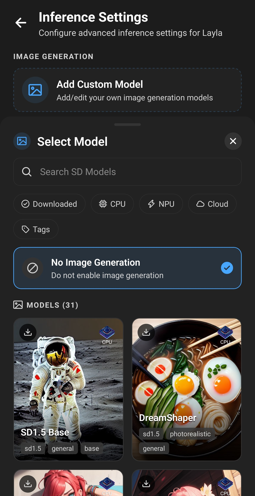

**OpenRouterの画像生成を使うと、1つのAPIキーで多くの企業の画像モデルを利用できます。Black Forest LabsのFLUX、ByteDanceのSeedream、GoogleのNano Banana、OpenAIのGPT Imageなどです。** このガイドでは、OpenRouterの画像生成APIをAndroid向けAIチャットアプリのLaylaに接続し、AIキャラクターがチャットで画像を送れるようにします。キャラクターが返信で画像を描写すると、Layla Agentがその描写をOpenRouterに送り、完成した画像を受け取って、会話に表示します。

Laylaはすでに、端末上またはLayla Cloud経由でStable Diffusionモデルによる画像生成に対応しています。Agentを使うと、サービス、モデル、設定を自分で選べるうえ、自分のAPIキーを使うことができます。[LaylaでNano Banana API](/ja/how-to-use-the-google-nano-banana-image-generation-agent/)では、Googleの1つのモデルでこれを行います。OpenRouter Agentも同じ方法を使いますが、別の企業のモデルに切り替えるには1行を変更するだけです。

この記事では、OpenRouter APIキーの取得方法とAgentのセットアップ方法を示し、OpenRouterの画像生成モデルと料金を比較し、Agentのコードを1ステップずつ解説します。

Laylaのローカルモデルと違い、このAgentにはインターネット接続が必要です。画像の描写はOpenRouterとモデルを運営する企業に送信され、画像1枚ごとにOpenRouterのクレジットから支払われます。ローカルモデルでチャットしている場合、会話のそれ以外の部分は端末内に残ります。

<div class="file-download">
  <div class="file-download-info">
    <span class="file-download-label">Agentファイル</span>
    <span class="file-download-name">openrouter-generate-image.json</span>
    <span class="file-download-hint">動作にはOpenRouter APIキーが必要です。取得方法はこの記事の後半で説明します。</span>
  </div>
  <a class="file-download-button" href="/assets/articles/how-to-use-the-openrouter-image-generation-agent/openrouter-generate-image.json" download="openrouter-generate-image.json"><svg viewBox="0 0 24 24" fill="none" stroke="currentColor" stroke-width="2" stroke-linecap="round" stroke-linejoin="round" aria-hidden="true"><path d="M12 4v11"/><path d="m7 10 5 5 5-5"/><path d="M5 20h14"/></svg>ダウンロード</a>
</div>

## LaylaでOpenRouterの画像生成を使う理由

端末上だけで画像を生成したい場合は、LaylaのStable Diffusionモデルが適しています。OpenRouterは、それとは別のニーズに応えます。

- **1つのキーで多くの画像モデル。** FLUX、Seedream、GPT Image、Nano Banana、Qwen Image、Grok Imagineなどは、すべて同じリクエストを使います。別のアカウントを作成したりAgentを書き直したりせずに、新しいモデルを試せます。
- **画像1枚あたりの低価格。** 執筆時点では、このAgentがデフォルトで使うモデルFLUX 3 Image Kleinは、1K画像1枚が$0.009です。OpenRouterはモデルを運営する企業の価格をそのまま適用し、上乗せはしません。
- **キーごとの支出上限。** OpenRouterではAPIキーごとにクレジットの上限を設定できるため、Agentに保存したキーは、許可した金額までしか使えません。
- **スマートフォンの性能に左右されない画質。** 画像はサーバー上で生成されるため、端末のCPUやNPUの速度が結果や待ち時間を制限することはありません。
- **チャットと画像に1つのOpenRouterアカウント。** Laylaは[OpenAI互換APIへの接続](/ja/how-to-connect-layla-to-any-openai-compatible-api/)を通じて、会話そのものにOpenRouterの言語モデルを使うこともできます。このAgentを使えば、同じアカウントでキャラクターの返信と画像の両方をまかなえるため、Laylaをどちらにも対応したOpenRouterのAndroidアプリとして使えます。
- **ローカルのチャットモデルとクラウドの画像生成の組み合わせも可能。** Agentはキャラクターの返信にだけ反応するため、どのモデルでチャットしていても動作します。会話にはプライベートなオフラインLLMを使い続け、スマートフォンの外に出るのは画像の描写だけにできます。

## Agentの仕組みの概要

このAgentは、チャットから動作するすべての画像生成Agentと同じ4つのステップで動きます。

```text
画像をリクエストする
  -> キャラクターがタグで囲んだ画像の描写を返信する
  -> Agentのトリガーがタグを検出する
  -> EvalツールがOpenRouterのAPIを呼び出して画像を保存する
  -> Display Imageツールがチャットに表示する
```

1. **システムプロンプトがモデルにタグを求めます。** Agentは、画像をリクエストしたときに、キャラクターの言語モデルが詳細な画像の描写を`<stable_diffusion_prompt></stable_diffusion_prompt>`タグの中に書くよう指示します。
2. **トリガーがタグを検出します。** 正規表現トリガーがモデルの返信を監視します。タグを見つけると、中のテキストを取り出してAgentを起動します。
3. **スクリプトがAPIを呼び出します。** Agentの最初のツールは短いJavaScriptプログラムを実行します。描写をOpenRouterに送り、画像を受け取って、ファイルとして保存します。
4. **画像がチャットに表示されます。** 2つ目のツール*Display Image*が、保存されたファイルを受け取って会話に表示します。

言語モデルがOpenRouterと直接やり取りすることはありません。モデルが書くのはテキストだけで、それ以降はすべてAgentが処理します。

タグの名前が`<stable_diffusion_prompt>`なのは、Layla自身の画像生成もこのタグを待ち受けているためです。後で説明するとおり、これはセットアップで重要になります。

## 必要なもの

- インストール済みの*Agent*ミニアプリ。Agentを使ったことがない場合は、先に[LaylaでAgent、Function、Tool Callingを有効にする方法](/ja/how-to-enable-agents-functions-and-tool-calling-in-layla/)をお読みください。
- クレジットのあるOpenRouterアカウントと、OpenRouter APIキー。次のセクションで取得方法を説明します。
- インターネット接続。
- この記事の最後にリンクがあるAgentファイル。

このAgentはLaylaに内蔵されている*Eval*ツールを使います。Pythonインタープリターミニアプリは不要です。

## OpenRouter APIキーを取得する方法

APIキーは、Agentがリクエストを送るときにOpenRouterアカウントを識別する長い文字列です。OpenRouterのキーは`sk-or-v1-`で始まります。取得は数分で終わります。

### ステップ1：OpenRouterアカウントを作成する

[openrouter.ai](https://openrouter.ai)にアクセスし、右上の**Sign up**を選びます。GitHubまたはGoogleのアカウント、あるいはメールアドレスとパスワードで登録できます。


### ステップ2：クレジットを追加する

OpenRouterは前払い制です。画像モデルは画像1枚ごとに課金するため、Agentが画像を生成するには、アカウントに残高が必要です。

[Creditsページ](https://openrouter.ai/settings/credits)を開き、クレジットを購入します。OpenRouterは主要なクレジットカード、AliPay、USDCに対応しています。カードでの購入ごとに5.5%の手数料（最低$0.80）がかかるため、少額のチャージは多めのチャージより割高になります。現在の手数料はOpenRouterの[FAQ](https://openrouter.ai/docs/faq)に記載されており、未使用のクレジットは購入から1年後に失効する場合があるとも書かれています。

以下に示す価格であれば、数ドル分のクレジットでデフォルトのモデルの画像を数百枚生成できます。

### ステップ3：API keysページを開く

[API keysページ](https://openrouter.ai/settings/keys)を開きます。OpenRouterの設定のサイドバーでは*Keys*として表示されています。このページには、すでに持っているキーが、最終使用日時、支出額、上限とともに一覧表示されます。右上の**New key**を選びます。


### ステップ4：キーに名前を付けて上限を設定する

*Create API key*ダイアログでは、次の3つを入力します。

- **Name**：分かりやすい名前（例：「Layla」）。
- **Expiration**：キーが使えなくなる日時。有効期限のあるキーのほうが安全ですが、その日以降は、新しいキーを作成して貼り付けるまでAgentが動作しなくなります。
- **Credit limit**：このキーが使える最大額。*Reset limit every*で、上限を毎日、毎週、毎月リセットするか、合計額のままにするかを選べます。


OpenRouterはすべてのキーにクレジット上限を設定することを推奨しており、ここでも設定しておくのが良い考えです。キーはAgentの内部に保存されるため、上限を設定しておけば、キーが漏えいしたりAgentが暴走したりしても、その金額までしか使われません。キーが上限に達すると、上限を引き上げるか、毎日・毎週・毎月の上限であればリセットされるまで、OpenRouterはそのキーのリクエストを拒否します。デフォルトのモデルで時々画像を生成する程度なら、月に数ドルの上限で十分です。

**Create**を選びます。

### ステップ5：キーをコピーする

OpenRouterは新しいキーを一度だけ表示します。隣のコピーボタンを選び、パスワードマネージャーなど安全な場所にキーを保管してください。ダイアログにあるとおり、キーを再表示することはできません。紛失した場合は、API keysページで削除して新しいキーを作成してください。


キーはパスワードのように扱ってください。キーを持っている人は誰でも、あなたのクレジットで支払われる画像を生成できます。OpenRouterの[認証ガイド](https://openrouter.ai/docs/api_reference/authentication)に、キーの形式と、キーが漏えいした場合の対処法が説明されています。

## OpenRouterの画像生成モデルと料金

OpenRouterは、すべての画像生成モデルを[モデルページ（画像出力で絞り込み）](https://openrouter.ai/models?output_modalities=image)に掲載しています。各項目には、モデルの価格と追加された日付が表示されます。


モデルを選ぶと、そのモデルのページが開きます。Agentに必要な名前であるモデルIDは、タイトルの下にコピーボタンとともに表示されています。ページには価格も表示され、Laylaで使う前にプロンプトを試せるプレイグラウンドもあります。


このAgentは、Black Forest Labsのオープンウェイトモデルで、高速かつ低価格なFLUX 3 Image Kleinを使います。次は、執筆時点でOpenRouterに掲載されている画像モデルの一部と、1K画像1枚の価格です。

| モデル               | モデルID                               | 1K画像あたりの価格 | 備考                                                             |
| -------------------- | -------------------------------------- | ------------------ | ---------------------------------------------------------------- |
| FLUX 3 Image Klein   | `black-forest-labs/flux-3-image-klein` | $0.009             | このAgentが使うモデル。768から4Kまで対応。                       |
| Seedream 5.0 Flash   | `bytedance-seed/seedream-5-0-flash`    | $0.018             | ByteDanceの高速モデル。1Kと2Kに対応。                            |
| Qwen Image 2.1 Turbo | `qwen/qwen-image-2.1-turbo`            | $0.0184            | Qwen Image 2.1の高速版。1Kと2Kに対応。                           |
| Seedream 5.5         | `bytedance-seed/seedream-5-5`          | $0.02              | ByteDanceの最新モデル。高解像度は$0.035。                        |
| Nano Banana 2.1      | `google/gemini-nano-banana-2.1`        | 約$0.034           | Googleのモデル。トークン単位で課金。1K、2K、4Kに対応。           |
| FLUX 3 Image         | `black-forest-labs/flux-3-image`       | $0.048             | FLUX 3の大型モデル。高解像度ほど高く、4Kでは最大$0.607。         |
| Nano Banana Pro      | `google/gemini-3-pro-image`            | 約$0.134           | Googleのプレミアムモデル。トークン単位で課金。                   |
| GPT Image 2          | `openai/gpt-image-2`                   | 変動               | OpenAIのモデル。トークン単位で課金。費用はサイズと品質で変わる。 |

1枚$0.009のFLUX 3 Image Kleinはこの表で最も安く、画像を頻繁に送るAIチャットのデフォルトとして妥当な選択です。Nano Banana ProとFLUX 3 Imageはより高価で、より細かい描写が欲しいときに試す価値があります。

ほとんどのモデルでは、大きな画像ほど高くなります。GPT ImageやRecraftのモデルなど一部のモデルは、Agentが送る`resolution`設定を受け付けません。Recraftのベクターモデルなど、画像ではなくSVG図形を返すモデルもあり、*Display Image*では表示されない場合があります。これらのモデルを選ぶ場合は、次の段落をお読みください。

モデルを切り替えるには、モデルのページからモデルIDをコピーしてスクリプトの`MODEL_ID`に貼り付け、**Test**ボタンを実行します。モデルがエラーを返す場合は、そのモデルが対応している設定を確認してください。設定の変更や削除の方法は、後のコード解説で説明します。価格とモデルはよく変わるため、選ぶ前にOpenRouterでモデルのページを確認してください。

## LaylaでOpenRouterの画像生成をセットアップする

### ステップ1：Laylaのデフォルトの画像生成をオフにする

*推論設定*を開き、*画像生成*セクションまでスクロールして、画像生成モデルを選びます。*Select Model*の一覧で**No Image Generation**（画像生成なし）を選びます。



Layla内蔵の画像生成も、キャラクターの返信から同じ`<stable_diffusion_prompt>`タグを読み取ります。モデルが選択されたままだと、Laylaがそのタグから独自の画像を生成し、画像が2枚届きます。*No Image Generation*を選んでおけば、タグはAgentに任されます。[LaylaでオフラインAI画像生成を有効にする方法](/ja/how-to-enable-image-generation-in-layla/)で、この設定の場所を確認できます。

### ステップ2：Agentをインポートする

この記事の最後にあるAgentファイルをダウンロードします。*Agent*ミニアプリを開き、右上の**Import**ボタンでインポートします。Agent名は*OpenRouter: generate image*で、カードには使用する2つのツール、*Eval*と*Display Image*が表示されます。

Agentのカードの右上にあるスイッチがオンになっていることを確認してください。

すでに[Nano Banana Agent](/ja/how-to-use-the-google-nano-banana-image-generation-agent/)や、`<stable_diffusion_prompt>`に反応する別のAgentを使っている場合は、それをオフにしてください。そうしないと、画像をリクエストするたびに両方のAgentが実行され、2枚分の料金がかかります。

### ステップ3：APIキーを追加する

**Edit**ボタンでAgentを開き、*Eval*ツールを探します。コードの冒頭付近に次の行があります。

```js
const API_KEY = "PUT YOUR API KEY HERE";
```

`PUT YOUR API KEY HERE`を自分のキーに置き換えます。引用符はそのまま残してください。Agentを保存します。

キーはAgentの内部に保存されました。Agentファイルを共有したりどこかにアップロードしたりする前に、キーを元のプレースホルダーに戻してください。

### ステップ4：画像をリクエストする

チャットを開始し、画像をリクエストします。たとえば「夕暮れの崖の上の灯台を見せて」と送ります。キャラクターが画像の描写を返信し、Agentが実行され、数秒後に画像がチャットに表示されます。

うまくいかない場合は、Agentミニアプリの**Test**ボタンを使ってください。[Layla Agentsの詳しい仕組み](/ja/deep-dive-into-layla-agents/)で説明しているとおり、各ステップの入力と出力が表示されます。OpenRouterの[Activityページ](https://openrouter.ai/activity)でも、すべてのリクエストと、そのモデルおよび費用を確認できます。

## Agentの仕組みをステップごとに解説

Agentは3つの部分でできています。システムプロンプト、トリガー、そして順番に実行されるツールのリストです。各ツールの出力が次のツールの入力になります。これらの構成要素の全般的な説明は[Layla Agentsの詳しい仕組み](/ja/deep-dive-into-layla-agents/)にあります。このセクションでは、OpenRouter Agentをそれぞれの部分に沿って見ていきます。

### 1. システムプロンプト

システムプロンプトは、Agentが有効な間、Laylaが会話に追加する指示です。このAgentのプロンプトは英語で書かれており、ファイルにもそのまま含まれています。

```text
When the user asks you to generate, draw or create an image, write a detailed
description of the image (subject, setting, style, lighting, composition) inside
<stable_diffusion_prompt></stable_diffusion_prompt> tags, e.g.
<stable_diffusion_prompt>a lighthouse on a cliff at dusk, oil painting, warm
light</stable_diffusion_prompt>. The image is generated from the text inside the
tags and shown in the chat. Use the tags only when an image is requested, and
never put backticks inside them.
```

この指示は画像サービスに依存しないため、Nano Banana Agentと同じものを使っています。

- **「When the user asks you to generate, draw or create an image」**（ユーザーが画像の生成、描画、作成を求めたとき）は、動作を画像リクエストに限定し、通常の会話に影響が出ないようにします。
- **「A detailed description (subject, setting, style, lighting, composition)」**（被写体、背景、スタイル、照明、構図を含む詳細な描写）は、モデルにチェックリストを与えます。FLUX 3やSeedreamなどの現在の画像モデルは完全な文章を理解するため、詳細な描写のほうが、キーワードを並べたリストよりも良い画像になることが多くなります。
- **例**は、タグの正確な形式を示します。言語モデルは、形式の説明よりも例のほうを確実に守ります。
- **「Use the tags only when an image is requested」**（画像が求められたときだけタグを使う）は、モデルがすべての返信にタグを付けるのを防ぎます。付けてしまうと、そのたびにAgentが起動し、クレジットが消費されます。
- **「Never put backticks inside them」**（タグの中にバッククォートを入れない）は、スクリプトを守ります。理由は後のコード解説で説明します。

### 2. トリガー

このAgentにはトリガーが1つあります。入力ではなく、モデルの**出力**に対して動作する*正規表現トリガー*です。パターンは次のとおりです。

```text
/<stable_diffusion_prompt>(.*?)<\/stable_diffusion_prompt>/s
```

- 開始タグと終了タグは、タグそのものに一致します。
- `(.*?)`はキャプチャグループです。タグの間にあるすべてを取り出し、`?`によって最初の終了タグで止まります。
- `s`フラグにより、描写が複数行にまたがっていても対応できます。

グループが取り出したテキストは、Agentから`{{match$1}}`として使えるようになります。モデルがタグの間に書いたものが、最初のツールに渡されます。

### 3. Evalツール：APIを呼び出す

最初のツールは*Eval*です。Layla内のサンドボックス化された実行環境でJavaScriptを実行します。この環境には、Webリクエスト用の`fetch`と、ファイルの保存などLaylaの機能にスクリプトからアクセスするためのグローバルオブジェクト`layla`があります。ブラウザのページやNode.jsのモジュールはありません。

Evalはスクリプトの最後の式の値を返し、それがPromiseの場合は完了を待ちます。スクリプトの最終行`generateImage(PROMPT);`が処理を開始します。

#### 先頭の設定

```js
const API_KEY = "PUT YOUR API KEY HERE";
const PROMPT = String.raw`{{match$1}}`.trim();

const MODEL_ID = "black-forest-labs/flux-3-image-klein";
const RESOLUTION = "1K";
const ASPECT_RATIO = "";
const API_URL = "https://openrouter.ai/api/v1/images";
const TIMEOUT_MS = 90000;
```

変更したくなる可能性のあるものは、すべて1か所にまとまっています。

- `API_KEY`はあなたのキーです。
- `PROMPT`はモデルが書いた描写です。スクリプトが実行される前に、Laylaが`{{match$1}}`を取り出したテキストに置き換えるため、描写がプログラムの一部になります。バックスラッシュを入力どおりに保つために`String.raw`付きのテンプレートリテラルで囲み、`.trim()`で余分な空白や改行を取り除きます。描写の中にバッククォートや`${`があると、リテラルが途中で終わってスクリプトが壊れてしまいます。システムプロンプトでバッククォートを禁止しているのはそのためです。
- `MODEL_ID`は使用するモデルで、OpenRouterのモデルのページからコピーしたものです。
- `RESOLUTION`は画像のサイズです。OpenRouterは`'512'`、`'768'`、`'1K'`、`'1.5K'`、`'2K'`、`'4K'`を受け付け、モデルごとにそのうちのいくつかに対応しています。GPT Imageなど、解像度を受け付けないモデルでは`''`に設定してください。
- `ASPECT_RATIO`は画像の縦横比です。たとえば、スマートフォンの画面いっぱいに表示される縦長の画像なら`'9:16'`、横長の画像なら`'16:9'`です。`''`の場合は、モデルのデフォルトが使われます。
- `API_URL`はOpenRouterの画像生成エンドポイントです。どのモデルでも同じです。
- `TIMEOUT_MS`は、あきらめるまでの待ち時間で、90秒です。モデルによっては、特に大きなサイズで、ほかのモデルより時間がかかることがあります。

スクリプトの残りは`generateImage`という関数の中にあります。この関数は描写を`prompt`というパラメーターで受け取り、スクリプトの最終行が`PROMPT`を渡して呼び出します。

#### 入力を確認する

```js
if (!prompt) throw new Error("The stable diffusion prompt was empty.");
if (!API_KEY || API_KEY === "PUT YOUR API KEY HERE")
  throw new Error("Set API_KEY in this agent first.");
```

送信するものがない場合やキーが設定されていない場合、スクリプトは分かりやすいメッセージとともに早い段階で失敗します。スクリプトがエラーを投げると、Agentは停止し、画像は表示されません。**Test**ボタンでそのメッセージを確認できます。

#### リクエストを組み立てる

```js
const payload = { model: MODEL_ID, prompt };
if (RESOLUTION) payload.resolution = RESOLUTION;
if (ASPECT_RATIO) payload.aspect_ratio = ASPECT_RATIO;
```

ペイロードは、OpenRouterに送るデータです。必須なのは`model`と`prompt`だけです。すべてのモデルがすべての設定を受け付けるわけではないため、スクリプトは`resolution`と`aspect_ratio`を、値がある場合にだけ追加します。

OpenRouterの[画像生成ガイド](https://openrouter.ai/docs/guides/overview/multimodal/image-generation)には、ペイロードに追加できるその他の設定が載っています。たとえば、結果を再現するための`seed`、GPT Imageモデル向けの`quality`、PNG、JPEG、WebPから形式を選ぶ`output_format`などです。各モデルのページに、そのモデルが対応する設定が表示されます。

#### 制限時間付きでリクエストを送信する

```js
const controller = new AbortController();
const timer = setTimeout(() => controller.abort(), TIMEOUT_MS);
let response;
let body;
try {
  response = await fetch(API_URL, {
    method: "POST",
    headers: {
      "Content-Type": "application/json",
      Authorization: `Bearer ${API_KEY}`,
    },
    body: JSON.stringify(payload),
    signal: controller.signal,
  });
  body = await response.text();
} catch (error) {
  if (controller.signal.aborted)
    throw new Error(`Image generation timed out after ${TIMEOUT_MS / 1000} s.`);
  throw new Error(`Image generation request failed: ${error.message}`);
} finally {
  clearTimeout(timer);
}
```

ここがOpenRouterとやり取りする部分です。

- `fetch`は、JSONテキストに変換したペイロードを付けて`POST`リクエストを送信します。
- APIキーは、OpenRouterが想定する形式であるBearerトークンとして、`Authorization`ヘッダーで送られます。Webアドレスには含まれません。
- `AbortController`とタイマーが、90秒後にリクエストを中止します。これらがないと、接続が止まったときにAgentが待ち続けてしまいます。
- `catch`ブロックは、タイムアウトとそれ以外のネットワークエラーを区別し、エラーメッセージで何が起きたか分かるようにします。`finally`ブロックは、どちらの場合もタイマーを解除します。

OpenRouterが課金するのは、完成した画像だけです。失敗したりタイムアウトしたりした生成には課金されません。

#### レスポンスのステータスを確認する

```js
if (!response.ok) {
  throw new Error(
    `HTTP error ${response.status} ${response.statusText}. Response body: ${body.slice(0, 500)}`,
  );
}
```

OpenRouterがリクエストを拒否すると、レスポンス本文にその理由が書かれています。スクリプトはその説明の先頭500文字をエラーに含めるため、キーの誤り、残高不足、クレジット上限への到達、モデルが対応していない設定などが、**Test**ボタンを使ったときに分かりやすいメッセージとして表示されます。

#### レスポンスから画像を見つける

```js
let data;
try {
  data = JSON.parse(body);
} catch (error) {
  throw new Error(`The response was not JSON: ${body.slice(0, 200)}`);
}

for (const image of data.data || []) {
  if (!image || !image.b64_json) continue;
  // ...save the image
}
```

OpenRouterは、どのモデルが画像を作ったかに関係なく、すべての画像リクエストに同じ形式で応答します。

```json
{
  "created": 1748372400,
  "data": [{ "b64_json": "<base64-encoded-image>", "media_type": "image/png" }],
  "usage": { "cost": 0.009 }
}
```

スクリプトはまずレスポンスのテキストをオブジェクトに変換し、テキストが有効なJSONでない場合はメッセージとともに停止します。そのオブジェクトの`data`は画像のリストです。各画像には、base64テキスト（バイナリデータを通常の文字で表す方法）としての画像そのものと、`image/png`や`image/jpeg`などの`media_type`が含まれます。スクリプトはリストの最初の画像を使います。`|| []`のガードにより、リストがない場合でもスクリプトがクラッシュしません。`usage`フィールドには、リクエストにかかった費用が記録されます。

この共通の形式が、AgentでOpenRouterを使う最大の利点です。スクリプトはFLUX、Seedream、Nano Banana、GPT Imageのどれでも同じフィールドを読み取るため、`MODEL_ID`を変更するだけでモデルを切り替えられます。

#### 画像を保存する

```js
const mediaType = String(image.media_type || "image/png");
const extension =
  mediaType
    .split("/")
    .pop()
    .split("+")[0]
    .replace(/[^a-z0-9]/gi, "") || "png";
const id = Math.random().toString(16).slice(2, 10).padEnd(8, "0");
const path = `generated-images/output_image_${id}.${extension}`;

await layla.utils.saveFile(path, image.b64_json);
return path;
```

- ファイルの拡張子はOpenRouterが報告する画像の種類から決まり、取得できない場合は`png`になります。
- ランダムな8文字のIDによって、画像ごとに固有のファイル名が付くため、新しい画像がチャット履歴にある以前の画像を上書きすることはありません。
- `layla.utils.saveFile`は、キャラクターのプライベートなワークスペースフォルダーにファイルを書き込みます。パスはそのフォルダーからの相対パスで、存在しないフォルダーは自動的に作成されます。この関数はbase64テキストを受け取ります。OpenRouterが送ってくる形式なので、変換せずにそのまま保存されます。
- 関数はパスを返します。このパスがツールの出力になります。

#### 失敗をわかりやすく報告する

```js
const detail =
  data.error && data.error.message
    ? data.error.message
    : `Response keys: ${Object.keys(data).join(", ")}`;
throw new Error(`No image was found in the response. ${detail}`);
```

ループが画像を見つけずに終わった場合（たとえば、モデルの安全フィルターがリクエストを拒否したときなど）、スクリプトはOpenRouterのエラーメッセージか、レスポンスに含まれていたフィールドを報告します。これにより、珍しい失敗の原因を調べやすくなります。

### 4. Display Imageツール

2つ目のツールは*Display Image*で、設定は次の1つだけです。

```text
{{input}}
```

`{{input}}`は、前のツールの出力、つまりスクリプトが返したファイルパスに置き換えられます。*Display Image*は、キャラクターのワークスペースからそのファイルを開いて返信に添付し、画像がチャットに表示されます。

## 画像生成付きAIロールプレイ：キャラクターの見た目を一貫させる

言語モデルは、画像の描写を毎回ゼロから書きます。そのため、何も指示がないと、キャラクターの見た目が画像ごとに変わることがあります。次の方法で、ロールプレイやコンパニオンとのチャットでAIキャラクターの画像を一貫させ、画像が表示される頻度も決められます。

- **キャラクターを一度だけ描写する。** キャラクターの*シナリオ*に、次のような指示を追加します。「`<stable_diffusion_prompt>`を書くときは、自分自身についての次の描写から始めること：20代後半の女性、短い赤い髪、緑の瞳、そばかす。そのあとでシーンを描写すること。」モデルがすべてのプロンプトで外見を繰り返すため、画像モデルが毎回同じキャラクターを描きやすくなります。
- **画風を固定する。** 同じ指示に画風を加えます。たとえば「35mmフィルム写真、自然光」や「水彩イラスト」などです。
- **メッセージごとに画像を生成する。** [画像生成Agentを作成する方法](/ja/creating-an-image-generation-agent/)のように、*シナリオ*に各返信の最後にタグを付ける指示を追加します。すると、すべての返信に画像が付きます。AIロールプレイやストーリーに向いています。画像1枚ごとに課金されるため、リクエストしたときだけ画像を出す場合より費用がかかります。FLUX 3 Image Kleinのような低価格のモデルを使えば、費用を抑えられます。
- **参照画像を使う。** OpenRouterのほとんどの画像モデルは、`input_references`設定で参照画像も受け付けます。これはキャラクターの顔を保つのに役立ちます。OpenRouterのFLUX 3 Image Kleinの説明には、画像間でキャラクターを一貫させる複数参照の編集機能が挙げられています。このAgentが送るのはテキストだけなので、リクエストに参照画像を追加するのは、次に取り組むのに良いプロジェクトです。

## 同じパターンで他のAgentを作る

システムプロンプト、正規表現トリガー、*Display Image*のステップは、どの画像サービスでも変わりません。変わるのはスクリプトだけです。このAgentと[Nano Banana Agent](/ja/how-to-use-the-google-nano-banana-image-generation-agent/)の違いが、リクエストとレスポンスの処理だけなのはそのためです。次のアイデアはそれを土台にしています。

- **2つのバージョンを用意する。** Agentを複製し、それぞれに別の`MODEL_ID`を設定して、使いたいほうをオンにします。どちらも同じタグに反応するため、一度に有効にするのは1つだけにしてください。
- **描写以外の情報もモデルに求める。** システムプロンプトで、自由なテキストではなく、`prompt`と`aspect_ratio`を持つ短いJSONオブジェクトなど、いくつかのフィールドを求めることができます。スクリプトは取り出したテキストからフィールドを読み取ります。Agentが`PROMPT`で行っているように、プレースホルダーは文字列リテラルの中に置き、テキストの解析は自分のコードで行ってください。
- **プロンプトの送信先を管理する。** OpenRouterでは、データを学習に使わないプロバイダーだけにリクエストを限定できます。スクリプトに`payload.provider = { data_collection: 'deny' };`を追加するか、OpenRouterの[プライバシー設定ページ](https://openrouter.ai/settings/privacy)でアカウント全体に同じ設定をします。そのモデルのプロバイダーに条件を満たすものがない場合、リクエストはエラーで失敗します。
- **画像以外のことをする。** 別のタグを選び、*Eval*に別のAPIを呼び出させ、最後に*Provide Context*ツールを使って、キャラクターが結果について話せるようにします。[Brave Search Agent](/ja/how-to-create-a-brave-search-agent/)が、この流れの例です。

## よくある質問

### OpenRouter APIキーはどうすれば取得できますか？

[openrouter.ai](https://openrouter.ai)でアカウントを作成し、Creditsページでクレジットを追加してから、API keysページを開いて**New key**を選びます。キーに名前、有効期限、クレジット上限を設定し、表示されたらコピーしてください。OpenRouterはキーを一度しか表示しません。

### OpenRouterの画像生成は無料ですか？

アカウントとキーの作成は無料ですが、画像モデルは画像1枚ごとに課金するため、クレジットが必要です。執筆時点では、FLUX 3 Image Kleinの1K画像は1枚$0.009です。OpenRouterは期間限定で無料の画像生成モデルを掲載することがあり、モデルページで「(free)」と表示されます。

### OpenRouterの画像生成の料金はいくらですか？

モデルごとに価格があり、各モデルのページに表示されています。執筆時点では、1K画像の価格は、FLUX 3 Image Kleinの1セント未満から、Nano Banana Proの約$0.134まであります。OpenRouterはモデルの価格に上乗せはしませんが、クレジットの購入時に手数料がかかります。

### OpenRouterの画像生成APIのエンドポイントは何ですか？

リクエストは`https://openrouter.ai/api/v1/images`に`POST`で送り、キーは`Authorization`ヘッダーに含めます。すべての画像モデルで同じエンドポイントを使い、リクエストの`model`フィールドで実行するモデルを選びます。すべての設定は、OpenRouterの[画像生成ガイド](https://openrouter.ai/docs/guides/overview/multimodal/image-generation)に記載されています。

### OpenRouter経由でNano Banana Proを使えますか？

はい。Nano Banana Proなら`MODEL_ID`を`google/gemini-3-pro-image`に、Nano Banana 2.1なら`google/gemini-nano-banana-2.1`に設定します。どちらも`RESOLUTION`設定で1K、2K、4Kを使えます。Googleに直接支払いたい場合は、代わりに[Nano Banana Agent](/ja/how-to-use-the-google-nano-banana-image-generation-agent/)を使ってください。

### Android向けのOpenRouterアプリはありますか？

OpenRouter自体はWebサイトとAPIです。Laylaは、OpenRouterと連携できるAndroidアプリです。[OpenAI互換APIへの接続](/ja/how-to-connect-layla-to-any-openai-compatible-api/)を通じてOpenRouterの言語モデルとチャットでき、このAgentを通じてOpenRouterの画像モデルで画像を生成できます。

### AndroidのAIチャットボットは画像を送れますか？

はい。このAgentを使うと、Laylaのキャラクターは、リクエストしたとき、またはそのように設定すればメッセージごとに、画像を送ります。[LaylaでオフラインAI画像生成を有効にする方法](/ja/how-to-enable-image-generation-in-layla/)で説明しているように、Laylaはスマートフォン上で動作するStable Diffusionモデルを使って、クラウドサービスなしで画像を送ることもできます。

### SillyTavernのキャラクターでOpenRouterの画像生成を使えますか？

はい。Laylaは、SillyTavernが使う形式である[TavernPNGキャラクターカード](/ja/how-to-import-tavernpng-characters-in-layla/)と、[SillyTavernプリセット](/ja/how-to-use-sillytavern-presets-in-layla/)をインポートでき、このAgentはどのキャラクターでも動作します。パソコンのSillyTavernでOpenRouterの画像生成を使っていた場合、同じ構成をスマートフォンのチャットアプリで使えます。

### 画像が2枚届いたのはなぜですか？

Layla内蔵の画像生成がまだ有効になっているか、`<stable_diffusion_prompt>`に反応する別のAgentがオンになっています。推論設定で*No Image Generation*を選び、他の画像Agentをオフにしてください。

### Agentに「Set API_KEY in this agent first.」と表示されます

キーのプレースホルダーがスクリプトに残っています。Agentを開いて*Eval*ツールを編集し、`PUT YOUR API KEY HERE`を自分のキーに置き換えてください。

### OpenRouter APIキーが使えないのはなぜですか？

リクエストが失敗すると、AgentはOpenRouter自身の説明を含むHTTPエラーを表示します。401エラーは、キーが間違っている、削除された、または期限切れであることを意味します。402エラーは、残高またはキーのクレジット上限を使い切ったことを意味します。400エラーは通常、解像度など、モデルが受け付けない設定が含まれていることを意味します。モデルのページを確認し、`RESOLUTION`や`ASPECT_RATIO`を変更してください。

### OpenRouterは画像をフィルタリングしますか？

はい。各企業は自社のモデルに独自のコンテンツポリシーを適用しており、モデルが拒否したリクエストは画像を返しません。その場合、Agentは受け取ったエラーを報告します。ポリシーはモデルごとに異なるため、あるモデルが拒否したプロンプトが、別のモデルでは使えることもあります。プロンプトをどのプロバイダーにも送らず、画像生成を完全に端末上で行いたい場合は、[LaylaでオフラインAI画像生成を有効にする方法](/ja/how-to-enable-image-generation-in-layla/)で説明しているローカルのStable Diffusionモデルを使ってください。

### プロンプトはプライベートですか？

画像の描写は、OpenRouterと、選んだモデルを運営する企業に送信されます。OpenRouterはデフォルトではプロンプトを記録しないと述べており、プロバイダーが受け取った内容には、そのプロバイダー自身のデータポリシーが適用されます。ローカルモデルでチャットしている場合、会話のそれ以外の部分は端末内に残ります。

### インターネット接続なしでこのAgentを使えますか？

いいえ。AgentはOpenRouterのサーバーを呼び出します。オフラインで画像を生成するには、[LaylaでオフラインAI画像生成を有効にする方法](/ja/how-to-enable-image-generation-in-layla/)で説明しているローカルモデルのいずれかを使ってください。

## まとめ

OpenRouter Agentは、Laylaのどの画像生成Agentとも同じ4つの要素でできています。タグ付きの描写を求めるシステムプロンプト、それを捉える正規表現トリガー、描写を画像に変える短いスクリプト、そして結果をチャットに表示する*Display Image*です。OpenRouterはどのモデルでも同じ形式で応答するため、1つのスクリプトでAIキャラクターが数十の画像生成モデルを使えるようになり、モデルの切り替えは1行の変更で済みます。

LaylaはAndroid向けのオフラインAIアシスタントとして作られており、完全にプライベートでオフラインのチャットと画像生成には、引き続きローカルモデルが適しています。OpenRouterの画像生成は、特定のオンラインモデルをチャットで使いたく、接続と画像ごとの費用を受け入れられる場合の選択肢です。

## Agentをダウンロードする

<div class="file-download">
  <div class="file-download-info">
    <span class="file-download-label">Agentファイル</span>
    <span class="file-download-name">openrouter-generate-image.json</span>
    <span class="file-download-hint">Agentミニアプリの<em>Import</em>ボタンでインポートし、APIキーを追加してください。</span>
  </div>
  <a class="file-download-button" href="/assets/articles/how-to-use-the-openrouter-image-generation-agent/openrouter-generate-image.json" download="openrouter-generate-image.json"><svg viewBox="0 0 24 24" fill="none" stroke="currentColor" stroke-width="2" stroke-linecap="round" stroke-linejoin="round" aria-hidden="true"><path d="M12 4v11"/><path d="m7 10 5 5 5-5"/><path d="M5 20h14"/></svg>ダウンロード</a>
</div>
